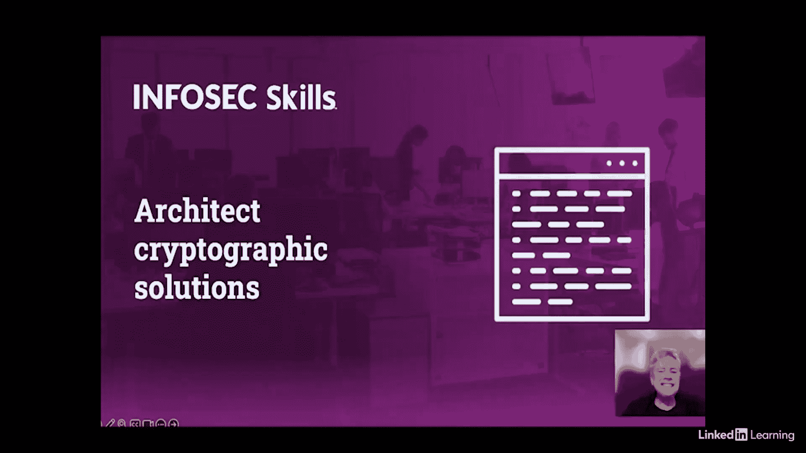
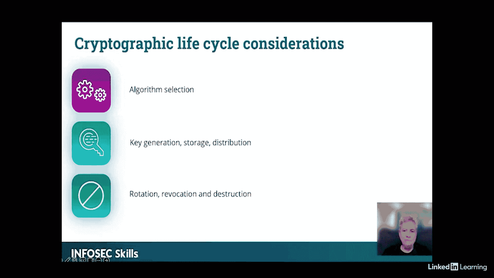

# ISSAP：01：架构加密解决方案 🔐

在本节课中，我们将要学习如何架构加密解决方案。现在，我们下一个话题要转向讨论加密解决方案了。我们会先聊聊当我们引入密码学时，必须考虑想要提供哪些服务，以及把精力集中在哪里，接着看看数据在静止、传输和使用三种状态下该如何保护，然后讨论标准化与算法选型，再分析安全强度与性能之间的权衡，最后讲解密钥的全生命周期管理。

## 一、密码学能提供的安全服务

上一节我们介绍了课程的大致方向，本节中我们来看看密码学到底能帮我们实现哪些目标。所以当我们谈论引入密码学时，必须考虑想要提供哪些服务，以及把精力集中在哪里。我们当然可以使用密码学来实现保密性，这一点大家都知道。这通常也是人们对密码学的典型联想。但我们也可以通过哈希来获得数据的完整性。我们可以获得真实性和不可否认性。所以我们想要搞清楚优先级在哪里，并确保实施基础设施来支持这些服务，确保在基础设施各层中一致地应用密码学。

以下是密码学可以提供的核心安全服务：

- **保密性**：只让授权的人能看到数据内容。公式：**C = E(K, P)**
- **完整性**：通过哈希确保数据没有被篡改。公式：**H(M) = 摘要值**
- **真实性**：确认消息发送者的身份。公式：**Sign(K_private, M)**
- **不可否认性**：发送者事后不能否认发送过这条消息。

## 二、数据三态与保护方式

刚才我们聊完了密码学能提供的服务，现在我们来看看数据在不同状态下该如何保护。第二点实际上只是强调，如果我们要提供数据保护，我们希望做到一致性。所以当我们思考这个问题时，必须考虑数据静止状态，数据传输中，以及数据在使用中。就像我们说的，在所有数据状态下提供保护将需要不同的技术。我们保护静止数据的方式，与保护传输中数据和使用中数据的方式不同。

以下是三种数据状态及其常见保护方式：

- **数据静止（Data at Rest）**：通常指存储在磁盘上的文件。所以如果我们想到数据静止状态，就想到典型的加密。我们可以使用操作系统提供的文件系统级加密来加密我们的文件。
- **数据传输中（Data in Motion）**：在传输过程中，我们必须添加安全性，因为IP协议本身没有安全功能。所以我们考虑TLS或双向TLS，还有IPsec。
- **数据使用中（Data in Use）**：然后当我们考虑保护使用中的数据时，这有点困难，因为当数据加载到内存时，我们通常会让它解密，然后操作数据，接着保存它，它会在驱动器上重新加密。所以找到保护使用中数据的方法变得更具挑战性。这时同态加密等新兴技术就派上用场了。另外，CPU也可以为这些敏感程序提供隔离，把它们放在受保护的区域里，所以我们在那里有一些选择。

## 三、标准化与算法选型

了解了数据三态的保护思路后，我们还需要确保整个环境里的密码学使用是标准化的。我们还需要确保有标准化。我们希望整个环境保持一致性，所以当我们思考算法时，我们将使用哪些算法，密钥将如何生成和存储，以及域之间和证书颁发机构之间的任何信任模型都需要建立。

以下是标准化需要关注的几个方面：

- 选择使用的加密算法
- 密钥的生成方式和存储方式
- 不同域和证书颁发机构之间的信任模型

## 四、安全强度与性能的权衡

算法选好之后，我们还得权衡安全强度和系统性能之间的关系。现在，我们可以实施最强的加密。但安全总是有代价的，就像我们知道的那样。所以我们必须考虑延迟，我们必须考虑计算开销和性能。所有这些都会受到算法强度和密钥长度的影响。通常情况下，如果我们需要遵守像GDPR或PCIDSS这样的法律法规，它们可能会指定特定的算法和特定的强度。然后当然，我们必须考虑硬件能力，坦率地说，你知道，今天的硬件非常便宜，我们通常都会拥有执行所需加密所需的硬件。所以我们只需要思考这些流程，我们会稍微深入一点地探讨如何选择算法，如何生成密钥。

以下是需要权衡的关键因素：

- 延迟
- 计算开销
- 性能
- 算法强度和密钥长度
- 法规合规要求（如GDPR、PCIDSS）
- 硬件能力

## 五、密钥全生命周期管理

除了选算法和权衡性能，密钥在整个生命周期中的保护也非常重要。还要提到的一点是贯穿整个生命周期的保护，包括处置。所以我们必须考虑密钥是否会过期，当然会过期。我们应该等多久才让它们过期，如果发生泄露，我们将如何吊销密钥，然后在密钥寿命结束后销毁密钥。

以下是密钥生命周期管理需要考虑的问题：

- 密钥过期时间设定
- 密钥吊销机制
- 密钥销毁流程

## 总结

本节课中我们一起学习了架构加密解决方案的核心内容。包括密码学能提供的四大安全服务，数据静止、传输中、使用中三种状态的保护方法，标准化与算法选型的考量因素，安全强度与性能之间的权衡，以及密钥全生命周期的管理方法。
