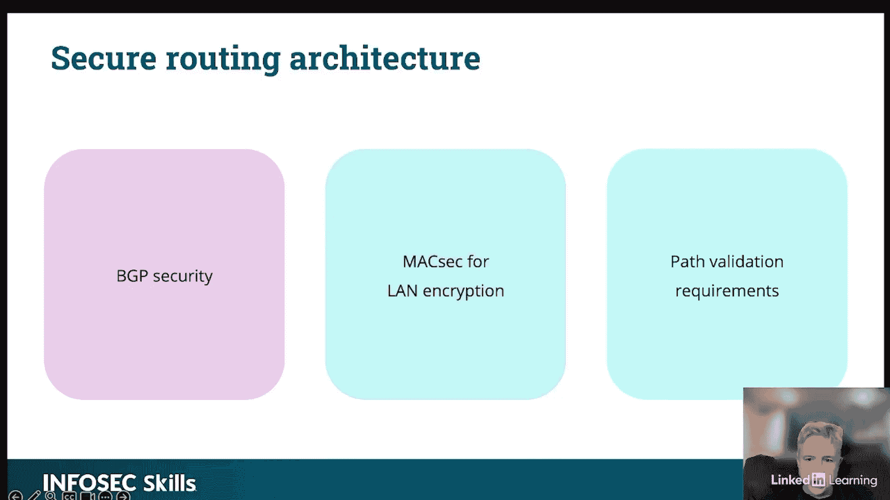

🔒 信息系统安全架构专业师（ISSAP）：第02章：数据传输中的加密解决方案


 在本节课中我们将要学习如何保护数据在网络中传输时的安全性。当数据从一台设备移动到另一台设备时，它会经过许多不同的网络节点，这就可能被攻击者截获或篡改。所以我们需要了解哪些技术和方法可以确保这些数据在传输过程中不被泄露。本节内容将围绕 TLS 协议、加密套件选择、证书管理、VPN 架构以及安全路由等几个核心话题展开，帮助你建立完整的数据传输防护体系。


 为什么要保护传输中的数据

 上一节我们介绍了信息安全架构的基础知识，本节中我们先来看看为什么需要保护传输中的数据。数据在网络中移动时，我们必须考虑保护措施。首先要考虑的是 TLS，特别是双向 TLS，这样可以实现强双重身份认证。比如，当用户的浏览器访问网站，或者应用程序之间进行通信，又或者应用程序连接数据库，以及 API 之间交换数据时，我们都需要确保所有网络通信都受到保护。只有这样，数据在传输过程中才不会被未授权的第三方读取或修改。


 选择安全的加密套件和证书生命周期

 上一节我们介绍了 TLS 和双向认证的基本概念，本节中我们来看看如何选择安全的加密算法以及如何管理证书。对于强大且安全的加密套件，我们需要确保使用的算法不过时，也没有固有的安全漏洞。比如可以考虑在加密计数器模式下使用 `AES-GCM`，也可以考虑其他一些现代算法。同时我们要避开流密码，也要避开三重 DES 等已经被弃用的老旧算法。

 以下是加密算法选择的基本原则：
 - 使用现代且未被弃用的算法，例如在 GCM 模式下使用 `AES-GCM`
 - 避免使用流密码
 - 避免使用三重 DES 等旧有算法
 - 避免使用随时间被废弃的算法

 我们还需要保护证书的整个生命周期。这包括证书的安全颁发方式，甚至更早的用户安全注册方式，以便为他们颁发证书。证书到期后需要续期，当然还必须有吊销证书的方式，并让相关信息为人所知。

 以下是证书生命周期的主要阶段：
 - 证书注册
 - 证书颁发
 - 证书到期与续期
 - 证书吊销


 TLS 的核心安全要求

 上一节我们介绍了加密套件和证书生命周期，本节中我们来看看 TLS 协议本身还需要满足哪些核心安全要求。除了使用已批准的加密套件并确保采用强大算法之外，还有一个称为完全前向保密的概念。

 以下是完全前向保密的说明：
 完全前向保密，英文叫做 `Perfect Forward Secrecy`，简称为 `PFS`。它的基本意思是，我们希望每个会话使用的会话密钥都是唯一的。也就是说，如果攻击者发现了会话 1 的密钥，这不能帮助他推断出会话 2 的密钥是什么。同样，如果攻击者拿到了会话 2 的密钥，他也不知道会话 3 或者会话 1 的密钥是什么。

 我们可以用下面这种方式来表示这个概念：
 ```text
 会话 1 密钥泄露 => 不会推导出会话 2 密钥
 会话 2 密钥泄露 => 不会推导出会话 1 或会话 3 密钥
 ```

 此外，还需要确保有良好的安全密钥交换机制，使用安全的算法来交换对称密钥。展望未来，我们必须考虑抗量子密码算法，因为目前用于密钥交换的大多数非对称算法，比如 `RSA`，在量子密码学到来后可能会过时。所以我们要尽早开始思考安全交换密钥的方法。

 还有一个概念叫证书固定。证书固定是指预先将浏览器中经常使用的证书的公钥加载进去。比如说，假设我们有一个银行应用程序，要连接到银行服务器。这个银行应用程序确切地知道应该与哪台服务器通信，不需要像浏览器那样信任大量不同的网站。银行应用程序只需要信任那台银行服务器。在这种情况下，我们可以将信任这台服务器的设置硬编码进去。这样做可以降低中间人攻击的可能性，也能防止恶意证书绕过保护，比如用户可能会忽略警告消息而覆盖保护。证书固定在移动应用程序中非常常见。

 以下是证书固定的典型应用场景：
 - 银行类移动应用
 - 仅需访问特定服务器的专用应用
 - 需要防止用户忽略证书警告的场景


 VPN 架构

 上一节我们介绍了 TLS 的核心要求和证书固定，本节中我们来看看另一种保护传输中数据的重要方案，即 VPN 架构。保护传输中数据的一个好方法是使用 VPN。当我们谈论 VPN 时，可以考虑 `IPsec`，也可以考虑 `TLS` 或 `SSL VPN`。

 以下是 IPsec 和 TLS/SSL VPN 的对比及适用场景：
 - IPsec：试图保护从笔记本电脑一直到企业环境的所有网络流量，是不安全远程位置访问内部网络的不错选择
 - TLS/SSL VPN：适用于保护到特定应用程序的流量，例如客户端系统连接到特定的 Web 门户，进行基于浏览器的访问，适合允许承包商连接到特定应用程序

 另外，在使用隧道时，我们需要进行身份认证，无论是基于证书的认证还是其他方式，都要确保是强身份认证。
 还需要考虑分割隧道问题。分割隧道是指，是否允许用户在不经过内部网络的情况下直接连接互联网。如果强制所有远程用户的连接都经过内部办公网络，虽然可以更好地限制和保护通信，但会带来更多开销。允许分割隧道可以让用户直接连接互联网，性能更好，但可能会引入安全漏洞。所以我们需要权衡是否允许分割隧道。


 安全路由架构

 上一节我们介绍了 VPN 架构和分割隧道考量，本节中我们来看看当流量在网络和互联网中移动时，如何构建安全的路由架构。当流量在整个网络和互联网中移动时，我们必须考虑保护问题。首先是边界网关协议安全。我们的路由器是如何在网络中学习路由的？它们是从安全可信的邻居那里学习路由的吗？

 然后我们要考虑 `MACsec`。这并不是我们经常讨论的东西，但它可以保护交换机之间的流量，并在第二层保护流量，而 `IPsec` 是在第三层保护流量。因此，当我们查看差异时，交换机之间的 ARP 广播和其他通信等内容，就会通过 MACsec 进行保护。

 以下是 IPsec 与 MACsec 的工作层对比：
 - IPsec：工作在第三层（网络层），保护端到端的 IP 流量
 - MACsec：工作在第二层（数据链路层），保护交换机之间的帧级流量

 最后是路径验证要求。我们试图确保流量正在移动，并且正在通过授权路由器移动，确保路径没有被某种配置错误或路由劫持所修改或重定向。我们只是想确保流量在通过网络时是安全的。

 以下是路径验证需要关注的问题：
 - 流量是否经过授权路由器
 - 路径是否被修改或重定向
 - 是否存在配置错误
 - 是否存在路由劫持


 总结

 本节课中我们一起学习了数据传输中的加密解决方案。我们了解了使用 TLS 和双向 TLS 来保护网络通信，如何选择安全的加密套件并避免使用过时算法，如何管理完整的证书生命周期。我们还学习了完全前向保密、安全密钥交换、抗量子算法以及证书固定等 TLS 核心要求。接着我们探讨了 IPsec 和 TLS/SSL VPN 的区别、隧道认证与分割隧道的权衡，最后还介绍了 BGP 安全、MACsec 与 IPsec 的层级差异，以及路径验证在安全路由架构中的作用。希望这些内容能帮助你构建起保护传输中数据的完整知识体系。




