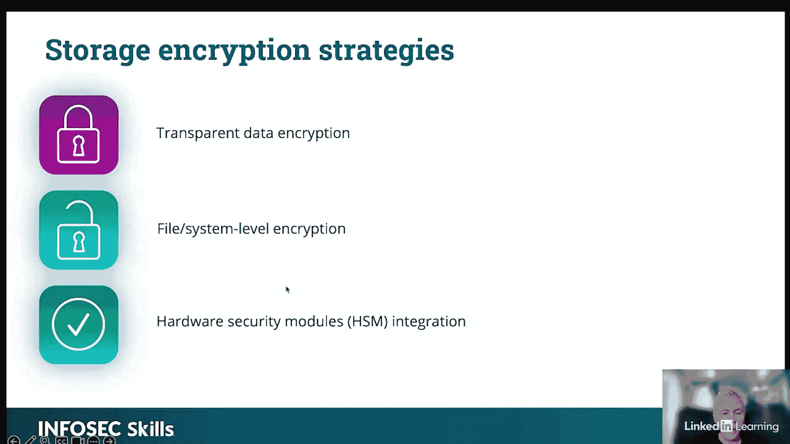
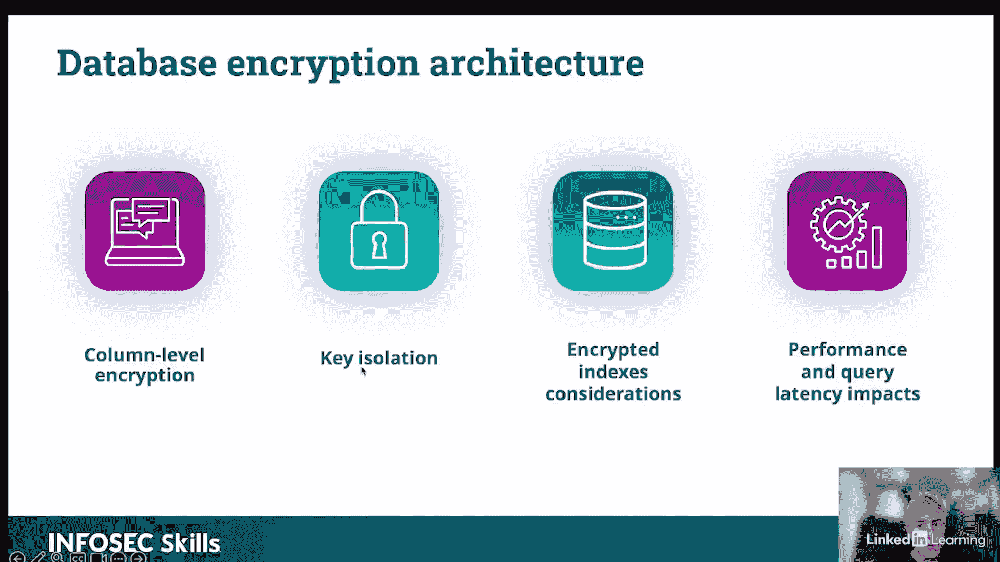
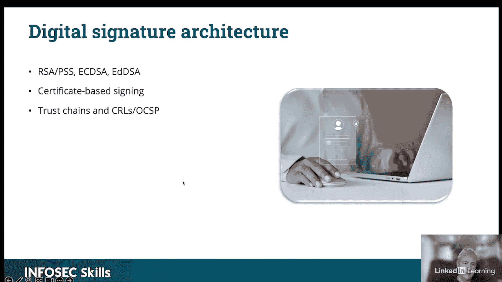

linkedin ISC2 ISSAP：01：数据静态加密概述与存储加密 📦


在本节课中我们将要学习数据静态加密的基本概念，重点理解当数据停留在存储设备中而不在网络上传输时，应该采取什么样的安全措施来保护它。

在之前的学习中，我们讨论过数据在传输过程中的加密，也就是所谓的“数据在途”保护。那种情况下，数据正在网络中移动，重点在于防止传输过程中被窃听或篡改。而在本节中，我们来看看数据静态，也就是 Data at Rest 的保护方式。

简单来说，数据静态就是数据已经写入硬盘、固态硬盘、磁带或云存储中，暂时没有被程序读取，也没有在网络上发送。这时候的数据面临设备被盗、硬盘丢失、备份介质被拿走等风险。如果数据是明文存储，坏人拿到硬盘就能直接读取里面的信息，所以我们需要对静态数据进行加密。

以下是针对数据静态的几种常见加密方式，我们逐一进行说明。

- **存储加密**（Storage Encryption）是指由存储系统本身，或者磁盘硬件自身完成的加密过程。典型代表是自加密硬盘，也就是 Self Encrypting Drives。其工作原理可以用下面这个简单的流程来表示：

```
数据写入磁盘 → 硬盘内部加密模块 → 加密后写入物理介质
```

这种方式能够有效防止设备或存储介质被盗后，数据被未授权人员读取。但是它不能防止已经获得合法使用权限的人滥用数据。换句话说，一旦用户通过了身份验证并获得访问权限，几乎没有技术手段能完全阻止他查看或复制数据。因此在使用存储加密时，我们必须配合强大的身份验证机制。

在实际环境中，我们可以考虑使用自加密硬盘，也可以考虑云存储服务中的存储层加密，例如 Amazon S3 存储桶的服务端加密功能。

- **卷加密**（Volume Based Encryption）会对整个存储卷进行加密，最常见的例子是 Windows 系统中的 BitLocker。这通常是由操作系统完成的工作，加密的粒度是整个卷，而不是单个文件。

卷加密的核心特点可以概括如下：

```
系统关机时数据仍处于加密状态 → 存储卷可以在不同计算机之间移动 → 访问卷需要操作系统管理的密钥
```

即使计算机断电，数据依然是加密的，不会被轻易读取。你可以把加密后的卷从一台系统移到另一台系统，但是因为密钥是基于操作系统管理的，所以你必须能够访问那个密钥才能解密数据。

- **应用层加密**（Application Layer Encryption）是指数据由应用程序，或者应用服务器在写入数据库之前就完成加密。

```
应用程序 → 对数据进行加密 → 将密文写入数据库
```

这种方式能够很好地防范数据库泄露事件，因为攻击者即使拿到了数据库文件，看到的也是加密后的密文，无法直接读取明文信息。但是这种方式也有一个副作用，就是数据库里的数据已经是密文，直接通过数据库工具进行搜索会变得比较困难。通常情况下，你可以通过应用程序来访问数据，但不能直接在数据库层面进行明文查询。

- **分片密钥架构**（Split Key Architecture）的核心思想是，在保护数据的同时，也要对用于解密的密钥本身提供保护。

```
完整密钥 = 密钥片段1 ⊕ 密钥片段2 ⊕ ... ⊕ 密钥片段N
```

具体来说，避免让任何一个人单独持有完整的密钥。你可以将密钥拆分成几个片段，分别存放在不同的位置，或者采用分片知识的方式来恢复密钥。无论如何，我们要确保没有单一实体可以单独访问完整密钥，从而提升整体安全性。

用大白话来比喻一下，存储加密保护的是磁盘，卷加密保护的是设备，应用层加密保护的是数据，而分片密钥架构保护的是密钥本身。这样分层来看，可能更容易理解。

本节中我们介绍了数据静态的四种主要加密方式，以及保护密钥的分片架构。下一节中我们来看看数据库和文件系统层面的具体加密策略。


linkedin ISC2 ISSAP：02：数据库与系统级加密策略 🗄️


上一节我们介绍了数据静态的四种主要加密方式，以及保护密钥的分片架构。本节中我们来看看数据库和文件系统层面的具体加密策略，了解在不同的部署场景下应该如何选择合适的加密粒度。

当数据存储在数据库或文件系统中时，我们并不一定要对整个磁盘或整个卷进行加密，有时候只需要针对特定的文件、数据库文件，甚至数据库中的某几列进行加密，这样可以在安全性和性能之间找到更好的平衡点。

以下是数据库与系统级加密中常用的几种策略，我们逐一来看。

- **透明数据加密**（Transparent Data Encryption, TDE）是指由数据库系统自动完成加密和解密工作，应用程序本身不需要做任何特殊的开发修改。

```
应用程序 → 数据库 → 数据库自动加密 → 存储文件
```

使用 TDE 时，应用程序不需要自行处理密钥管理，这些工作都在数据库内部完成。如果数据库文件被盗，没有相应密钥的人无法读取数据。但是，任何拥有合法数据库访问权限的用户，包括数据库管理员，当然都可以看到明文数据。所以如果你希望连数据库管理员都无法看到敏感数据，就需要考虑在更高的层面，比如应用层进行加密。

- **文件或系统级加密**（File or System Level Encryption）是指对整个数据库文件进行加密，而不是只加密数据库内部的某些数据。在 Windows 环境中，我们可以使用操作系统提供的加密文件系统，也就是 EFS。

```
操作系统 → 对指定数据库文件加密 → 存储于磁盘
```

这种方式提供了非常细粒度的保护，你不需要加密整个卷，只需要加密具体的数据库文件即可。这比卷加密更加灵活，适合只需要保护部分敏感文件的场景。

- **硬件安全模块集成**（HSM Integration）是指在企业环境中，使用专门的硬件设备来存储和管理加密密钥。

```
密钥 → 存入硬件安全模块 → 由硬件模块执行加解密操作
```

硬件安全模块，简称 HSM，是一种专门的密码模块硬件设备。你可以把它理解为类似于主板上的 TPM 芯片，也就是可信平台模块，但 HSM 是面向整个网络环境的，而 TPM 通常只处理单台系统的加密。HSM 为密钥存储提供了安全的硬件位置，能够强力防范密钥被盗窃，非常常见于使用公钥基础设施的企业，也适用于需要在本地存储云加密密钥的场景。

在数据库内部，我们还可以进行更细粒度的加密，比如对单个列进行加密。

```
数据库表 → 社会安全号列 → 加密后存储
```

比如如果你存储的是社会安全号码或者信用卡号码，可以只对存储该信息的列进行加密。不过这里有个问题，数据被加密后，就比较难通过数据库进行搜索和索引了。这就是加密索引需要考虑的地方，如果你需要对加密列进行搜索，实现起来会变得更加复杂。

除了选择加密的粒度，我们还需要注意密钥的存放位置。

**密钥隔离**（Key Isolation）原则是，不要把加密密钥和加密后的数据放在同一个地方。



```
加密数据 → 存储在系统A → 密钥 → 存储在系统B或HSM
```

也就是说，密钥应该存放在别处，比如刚才提到的硬件安全模块，或者其他专门的密钥管理解决方案。这样即使攻击者拿到了加密数据，没有密钥也无法解密。

在实际部署中，我们还需要在安全性和性能之间找到平衡。加密和解密都需要计算资源，不可避免地会引入一定的延迟。因此我们需要评估系统能接受的延迟范围，找到安全与性能之间的合适平衡点。

本节中我们介绍了透明数据加密、文件系统级加密、HSM 集成、列级加密以及密钥隔离等策略。下一节中我们来看看令牌化和数据掩码技术，它们在合规性场景中非常常用。


linkedin ISC2 ISSAP：03：令牌化与数据掩码技术 🎭


上一节中我们介绍了透明数据加密、文件系统级加密、HSM 集成、列级加密以及密钥隔离等策略。本节中我们来看看令牌化和数据掩码技术，这两种方法在满足 PCI DSS 或 GDPR 等合规性要求时非常有用。

在很多行业中，法律法规要求我们保护敏感信息，比如支付卡信息、个人身份信息等。但是业务系统往往又需要使用这些数据，这就产生了一个矛盾：既要使用数据，又不能直接存储敏感数据。令牌化和数据掩码就是为了解决这个问题而诞生的技术。

以下是令牌化和数据掩码的主要概念和做法，我们逐一说明。

- **令牌化**（Tokenization）是一种用非敏感的替代值，也就是令牌，来代表敏感数据的技术。



```
敏感数据 → 令牌化系统 → 令牌 → 存储在应用中 → 映射回敏感数据
```

简单理解，就是用一个看起来像数据的“假值”来代替真实的敏感数据。应用程序拿到的是这个令牌，真正的敏感数据被安全地存储在后台，令牌只包含一个指向实际受保护数据的指针。这样应用程序可以正常使用令牌，而不需要直接接触敏感信息，从而降低合规压力。

令牌的格式通常需要和原始敏感数据保持一致，这样应用程序可以直接使用，不需要做大的修改。比如信用卡号是 16 位数字，那么生成的令牌最好也是 16 位数字格式，这样原来的应用程序不需要太多改动就能继续运行。

除了令牌化，合规性还要求我们尽量减少数据的收集和存储量。

**数据收集最小化**的意思是，我们收集和存储的数据越少，就需要保护的数据越少。

```
收集的数据量 ↓ → 需要保护的数据量 ↓ → 合规压力 ↓
```

如果合规性是一个主要问题，我们可以考虑存储令牌而不是敏感数据本身，同时尽量减少数据的收集范围，这样可以从源头上降低风险。

在需要让测试环境或开发环境使用包含敏感信息的数据时，直接使用真实数据是不安全的。这时候就需要用到数据掩码。

**静态掩码**（Static Masking）会创建数据库的单独副本，并在副本中将敏感数据替换为假数据。

```
原始数据库 → 静态掩码处理 → 掩码数据库副本 → 用于测试
```

比如社会安全号码或信用卡号会被替换成星号，或者随机生成的假数据。测试人员拿到的是这个副本，无法接触到真实的敏感信息。

**动态掩码**（Dynamic Masking）则不创建数据库副本，而是在数据被查询时实时进行掩码显示。

```
用户查询 → 数据库 → 动态掩码规则 → 脱敏后显示
```

比如客服人员查询客户账户时，信用卡号只显示后四位，前面的数字被遮挡。这只是显示层面的处理，底层数据库中的数据依然是完整的，只是展示给特定用户时被掩码了。

除了技术手段，我们还可以根据策略来控制脱敏行为。

**策略驱动的去标识化**（Policy Driven De-identification）是指根据预先定义的策略，来决定对哪些数据进行掩码，以及如何掩码。

```
策略 → 基于用户角色或数据分类 → 决定掩码规则
```

这些规则可以基于用户角色，也可以基于数据的分类等级。比如管理员可以看到完整数据，而普通客服只能看到掩码后的数据。这种方式和零信任架构的理念比较契合，不再只依赖网络边界，而是更多依赖身份和策略来控制访问。

最后，被掩码后的数据仍然需要能用于报表和分析。

**安全分析**（Secure Analytics）要求掩码后的数据依然可以用于必要的报告和分析场景，比如测试环境。

```
掩码数据 → 可用于报表 → 可用于分析 → 不泄露敏感信息
```

也就是说，我们不希望敏感信息暴露，但希望受保护的数据依然能发挥作用，这就是数据掩码能够为我们提供的价值。

本节中我们介绍了令牌化、数据收集最小化、静态掩码、动态掩码、策略驱动去标识化以及安全分析等概念。下一节中我们来看看应用层加密与 API 安全架构，了解端到端保护是如何实现的。


linkedin ISC2 ISSAP：04：应用层加密与 API 安全架构 🔐


上一节中我们介绍了令牌化、数据收集最小化、静态掩码、动态掩码、策略驱动去标识化以及安全分析等概念。本节中我们来看看应用层加密与 API 安全架构，了解如何在数据从一个应用传到另一个应用的过程中保持端到端的保护。

在分布式系统中，数据经常需要在不同的应用程序之间传递，或者通过 API 接口暴露给外部系统。如果数据在中间节点以明文存在，那么任何攻破中间系统的攻击者都能读取敏感信息。应用层加密和 API 安全架构的目标，就是确保数据在整个传输和处理链路上都受到保护。

以下是应用层加密与 API 安全相关的关键技术，我们逐一说明。

- **应用层加密**（Application Layer Encryption）是指由发送端的应用程序对数据进行加密，数据在传输和存储过程中始终保持加密状态，直到接收端的应用程序进行解密。

```
发送端应用 → 加密 → 网络/存储 → 密文 → 接收端应用 → 解密
```

这种方式的核心优势在于，中间任何中间件、代理或存储系统都无法访问明文数据。只有最终的接收应用程序拥有解密能力，才能看到真实内容。这提供了真正的端到端保护，即使底层基础设施被攻破，攻击者也无法从中获取有用信息。

在 Web 应用和 API 中，数据往往需要以特定的格式进行传输，并且要保证消息的完整性和不可否认性。

**安全消息格式**（Secure Message Formats）是指采用标准的密码消息格式来封装数据。

```
JWS（JSON Web 签名 / JSON Web 令牌） → 用于签名和保护负载
CMS（加密消息语法） → 主要用于数字签名
```

JWS，也就是 JSON Web 签名，通常和 JWT 令牌一起使用，可以确保载荷被签名，从而提供不可否认性。CMS 则是加密消息语法，主要用于数字签名场景。使用这些安全格式，可以确保对象和载荷都被签名，防止抵赖，是构建安全 API 的重要基础。

当我们专门讨论 API 加密架构时，还需要考虑令牌交换和双向身份验证。

**API 加密架构**（API Cryptography Architecture）通常涉及令牌机制和证书相互认证。

```
API 客户端 → 携带 OAuth / SAML / OIDC 令牌 → API 网关 → 验证令牌签名 → 允许访问
```

常见的令牌包括 OAuth 令牌、SAML 令牌或 OIDC 令牌。我们需要确保 API 之间有一个安全的通道来交换这些令牌，并且这些令牌都要经过数字签名，这样接收方可以验证令牌的真实性。常见的做法是使用 JWT 签名。

除了令牌，还可以在 API 网关上部署 MTLS，也就是相互 TLS。

```
客户端证书 ↔ 网关证书 → 双方相互认证 → 建立安全通道
```

MTLS 要求客户端和网关都使用证书进行身份验证，双方都能确认对方的身份，从而建立更加可信的通信连接。

本节中我们介绍了应用层加密、安全消息格式以及 API 加密架构中的令牌和 MTLS 机制。下一节中我们来看看哈希算法与数字签名，了解如何保护密码和验证数据完整性。


linkedin ISC2 ISSAP：05：哈希算法与数字签名 🛡️


上一节中我们介绍了应用层加密、安全消息格式以及 API 加密架构中的令牌和 MTLS 机制。本节中我们来看看哈希算法与数字签名，了解如何保护用户密码、确保数据没有被篡改，以及如何实现不可否认的签名。

在信息安全中，哈希函数是一种将任意长度的数据转换为固定长度摘要的算法。它在密码存储、完整性校验和数字签名中都有广泛应用。选择合适的哈希算法，并配合盐、胡椒等机制，可以显著提高安全性。

以下是哈希与数字签名相关的核心内容，我们逐一说明。

- **密码哈希**（Password Hashing）是专门用于保护用户密码的哈希方式。

```
存储值 = Hash(密码 + 盐 + 胡椒)
```

目前较新的标准是 Argon2，它比传统的 SHA1、MD5 更安全，后两者已经淘汰。PBKDF2 和 Bcrypt 也曾经广泛使用，但 Argon2 在抵抗暴力破解攻击方面表现更好。

为了进一步防止彩虹表攻击，我们需要对密码进行加盐和加胡椒处理。

```
盐 = 每个密码独有的随机值 → 加在密码后再哈希
胡椒 = 存储在数据库之外的秘密值 → 作用于所有密码
```

盐的作用是给每个密码增加唯一性，即使两个用户使用相同的密码，哈希结果也会不同。胡椒则是一个存储在数据库之外的秘密值，类似于一个全局的主密钥，所有密码在哈希时都会加上这个值，从而提供额外的安全层。

除了强度，哈希算法还需要具备碰撞抵抗性，并且要考虑未来的发展。

**碰撞抵抗与未来性**（Collision Resistance and Future Proofing）是指哈希算法应该避免两个不同的内容产生相同的哈希值。

```
碰撞 = 内容A ≠ 内容B，但 Hash(A) = Hash(B)
```

一旦发生碰撞，该哈希算法就基本失效了。因此我们希望算法具有抗碰撞能力。同时，随着计算能力的发展，比如量子计算的出现，目前的哈希算法可能不再提供足够的复杂性。所以我们需要关注抗量子计算或抗量子哈希算法，始终面向未来选择更强的算法，以应对攻击者能力的不断提升。

哈希不仅可以用于密码保护，还可以用于完整性保护。

**完整性保护**（Integrity Protection）中常见的技术是 HMAC，也就是哈希消息认证码。

```
HMAC = Hash(数据内容 ⊕ 对称密钥)
```

HMAC 通过将数据内容与对称密钥拼接后再哈希，生成一个认证标签。接收方使用相同的密钥重新计算，如果结果一致，就说明数据没有被修改，并且来自可信发送方。但是 HMAC 使用的是对称密钥，所以只能提供身份认证，不能提供不可否认性。如果需要不可否认性，就必须使用数字签名。

我们也可以对日志和关键文件进行哈希保护。

```
关键文件 → 计算哈希 → 存储于一次写入介质 → 定期核对哈希值
```

比如将日志发送到只写介质，并通过哈希值检查关键文件是否被修改，从而确保审计记录的可信度。

最后，数字签名架构是实现不可否认性的核心技术。

**数字签名架构**（Digital Signature Architecture）常用的算法是 RSA PSS。

```
RSA PSS = 概率性签名方案 → 比传统 RSA 签名更安全
```

RSA 已经使用了很长时间，而 PSS 是概率性签名方案，是对 RSA 的一种增强，提供了更安全的签名版本。我们需要确保使用的算法是最新、最安全的。

在基于证书的签名中，真实性由 X.509 证书提供。

```
证书 → 由可信机构签名 → 验证信任链 → 使用 OCSP 或 CRL 检查吊销状态
```

证书由受信任的权威机构签发，我们可以验证信任链，并且不仅能验证信任根或信任链，还可以通过 OCSP 或证书吊销列表，也就是 CRL，来确认证书没有被吊销。验证数字签名需要完成这些步骤，才能确保签名的有效性。

本节中我们介绍了密码哈希、Argon2 算法、盐和胡椒机制、碰撞抵抗与未来性、HMAC 完整性保护，以及基于 RSA PSS 和 X.509 证书的数字签名架构。至此，我们完成了关于数据静态加密与相关安全技术的全部内容。




在本节课中我们一起学习了数据静态加密的多种实现方式，包括存储加密、卷加密、应用层加密和分片密钥架构；了解了透明数据加密、文件系统加密、HSM 集成、列级加密与密钥隔离等数据库和系统级策略；掌握了令牌化、静态和动态数据掩码、策略驱动去标识化等合规技术；探讨了应用层端到端加密、安全消息格式、API 加密架构与 MTLS；最后学习了 Argon2 哈希、盐和胡椒、HMAC 完整性保护，以及 RSA PSS 和 X.509 证书的数字签名。希望这些内容能帮助你建立起完整的数据静态安全防护体系。

