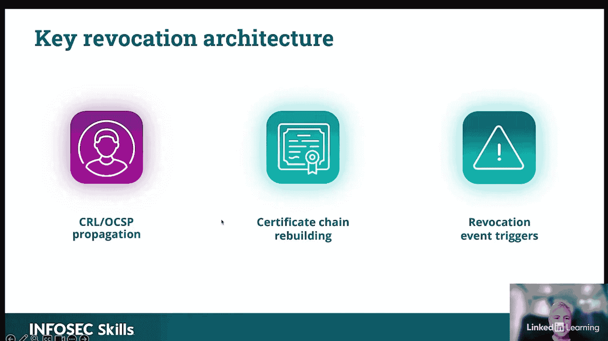

# 信息系统安全架构专业师（ISSAP）：04：密钥管理 🔑

在本节课中，我们将要学习密钥管理的核心知识。当我们讨论静态数据和传输中数据的加密时，就必须考虑密钥管理，因为系统的安全程度取决于密钥本身的安全程度。如果密钥被攻击者获取，那么无论加密算法多么先进，数据都无法得到真正保护。本节将带你了解如何设计密钥管理解决方案，包括集中式密钥机构、数据与密钥的物理分离、第三方密钥托管，以及密钥的自动更换和轮换机制。

## 密钥管理架构与数据密钥分离 🏗️

构建密钥管理方案时，最常见的方式之一是设立集中式密钥机构。你可以部署一套密钥管理系统，也就是KMS，或者使用硬件安全模块，也就是HSM，在一个中心位置完成密钥的生成、存储和轮换工作。这里有一个非常重要的原则，就是要让存储数据的地方与管理密钥的地方保持隔离。举例来说，如果你的业务数据存放在云端，那么通常不建议把密钥也放在云端，而是可以将密钥保留在本地机房。这样做的目的是为了降低单点被攻破后的整体影响，即使数据存储环境出现安全问题，攻击者也难以立刻拿到保管密钥的位置。除了自建中心化方案，另一种思路是密钥托管，即付费让第三方帮你保存密钥。但这种方式引入了新的信任问题，你必须仔细评估第三方的可信度，判断是否真的适合自己的业务场景。

无论选择哪种架构，都需要确保加密密钥能够按照固定周期自动更换，并且在某些特定事件发生时，例如密钥吊销或疑似泄露，能够立即触发相应的处置流程。只有让密钥更新的过程实现自动化，才能显著提升运维效率并降低人为疏忽带来的风险。

以下是集中式密钥管理的关键考量点：
- 使用KMS或HSM在中心位置生成、存储和轮换密钥
- 将数据存储位置与密钥管理位置分开
- 当数据在云端时，可将密钥保留在本地
- 使用第三方密钥托管前，必须评估其可信度

## 密钥轮换与定期更换 🔄

上一节我们介绍了密钥管理的基本架构，本节中我们来看看密钥如何随时间安全地更新。密钥不应该永远使用同一把，必须设定生命周期并定期自动替换。除了按照固定计划进行轮换之外，系统还需要能够根据具体事件自动触发密钥吊销，比如发生私钥泄露或证书过期等情况。只有建立起自动化的签发和更换机制，才能避免因密钥过期而导致的服务中断或认证失败。

密钥更换的常见操作包括：
- 按照预设计划自动替换旧密钥
- 在安全事件发生时立即吊销受影响的密钥
- 确保新密钥及时签发并投入使用

## 随机数生成与熵源 🎲

有了更换计划之后，我们还需要解决密钥最初是如何产生的问题。一个安全的密钥必须具备足够的随机性，否则攻击者可能通过预测来破解加密。随机数生成主要分为两类思路。第一类是真随机数生成，它完全依赖于物理世界的不可预测事件，比如计算机硬件产生的热噪声，甚至有些机构会利用太阳耀斑等外部物理现象作为随机性来源。第二类是加密安全伪随机数生成，它使用一个安全的算法和一个安全的种子值，通过计算得出一个不可预测的输出值。无论采用哪种方式，核心都需要一个可靠的熵源，也就是提供随机性的源头。

真随机数生成可以表示为：
TRNG = PhysicalEvent（例如热噪声、太阳耀斑）

加密安全伪随机数生成可以表示为：
CSPRNG = SecureAlgorithm（SecureSeed）

常见的熵来源包括：
- 硬件热噪声
- 用户鼠标移动轨迹
- 专用随机数生成器硬件

为了让我们对密钥生成过程有足够的信心，通常会参考FIPS 140-3标准。这是业界公认的密码模块安全标准，如果保护的数据价值很高，使用经过FIPS验证的模块可以提供更强的安全保证。

## 密钥存储位置与方式 💾

前面我们讨论了如何产生随机密钥，那么生成之后应该把密钥存放在哪里呢？一种选择是将密钥存储在本地的硬件安全模块中。HSM是一种专门设计的防篡改硬件，用于集中式存储密钥，其中的密钥在正常情况下不会离开该设备，因此能提供非常强的保护。另一种选择是使用云端的密钥管理服务，也就是KMS。这样组织可以创建、存储、轮换和控制密钥，而不需要自己购买和维护专门的硬件设备，因为硬件由云服务提供商负责运维。此外还有一种技术叫做安全隔区，它位于CPU内部或设备内部，是一个隔离的区域，用于安全地生成和处理密钥。这种隔离可以将密钥操作与操作系统和应用程序分开，从而在数据处理过程中提供额外的保护。

不同存储方案的对比如下：
- 本地硬件安全模块（HSM）：专用硬件，密钥不离开设备，保护等级最高
- 云端密钥管理服务（KMS）：由云服务商管理硬件，降低自建运维成本
- 安全隔区（Secure Enclave）：CPU内部隔离区域，保护处理中的密钥和数据

## 密钥分发与保护 📡

密钥生成并安全存储之后，还需要把密钥送到需要使用它的系统或应用手中。分发过程绝对不能以明文形式在网络中传输，否则密钥就会被窃听。通常应该使用TLS或mTLS等安全通道来保护密钥分发过程。除了直接通过安全通道传输，还可以使用密钥包装和信封加密等技术来进一步保护密钥。

信封加密的处理流程可以简化为：
DEK = GenerateDataEncryptingKey()
Ciphertext = Encrypt(Data, DEK)
WrappedDEK = Encrypt(DEK, KeyEncryptingKey)
Store(Ciphertext, WrappedDEK)

在这个流程中，数据首先使用数据加密密钥进行加密，然后再用另一把密钥加密密钥来保护这个数据加密密钥。加密后的数据加密密钥可以存储在云端KMS或硬件安全模块中，或者通过TLS发送给应用程序。应用程序收到之后，先解密出数据加密密钥，再用它来解密实际数据。这种做法在Azure和AWS等主流云平台中被广泛采用，是保护密钥和数据的有效手段。

密钥分发需要遵循以下原则：
- 始终通过TLS或mTLS等安全通道传输
- 禁止在网络中以明文形式传递密钥
- 可使用密钥包装技术对密钥进行二层保护

## 密钥生命周期与吊销机制 ⏳

完成密钥分发之后，就进入了密钥的长期管理阶段。密钥是有生命周期的，不能无限期地一直使用。我们需要根据所保护数据的价值，制定定期轮换计划，并且要监控证书和密钥的过期时间，在到期之前及时续期，以避免系统停机和认证失败。为了实现零停机的密钥替换，可以在新旧密钥同时可用的一段时间内完成过渡，这样业务不会中断，认证也不会失败。

除了轮换，还需要处理密钥吊销。证书吊销列表，也就是CRL，以及在线证书状态协议，也就是OCSP，是客户端实时验证证书是否已被吊销的标准方式。如果证书被吊销或替换，系统需要能够重新构建并验证证书链，确保其最终仍然指向一个受信任的根证书机构。对于某些紧急情况，比如私钥被攻击者获取，必须立即吊销相关密钥，防止被滥用。

密钥生命周期管理包括：
- 基于数据价值设定定期密钥轮换计划
- 在密钥和证书过期前及时续期
- 实施零停机替换，新旧密钥短期共存
- 使用CRL和OCSP实时检查证书吊销状态
- 私钥泄露时立即执行密钥吊销

本节课中我们一起学习了密钥管理的完整流程。从设计集中式密钥架构，到产生真正随机的密钥，再到选择安全的存储位置、通过受信通道分发密钥，最后管理密钥的整个生命周期并处理吊销，每一个环节都直接决定着加密数据的最终安全性。请记住，密码学是保护数据的重要手段，但它的强弱始终取决于密钥管理的好坏。
