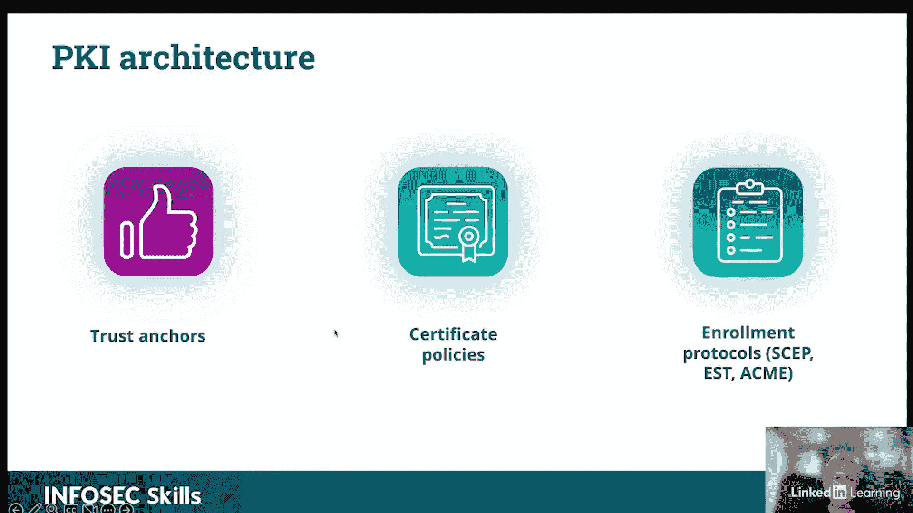
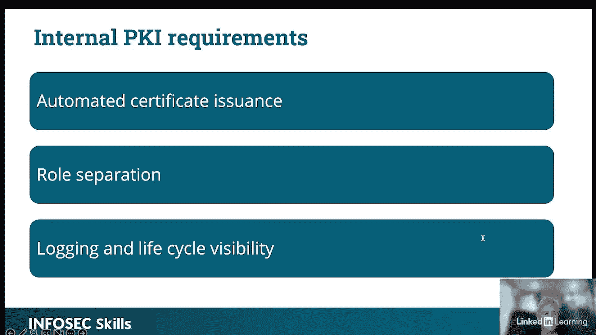
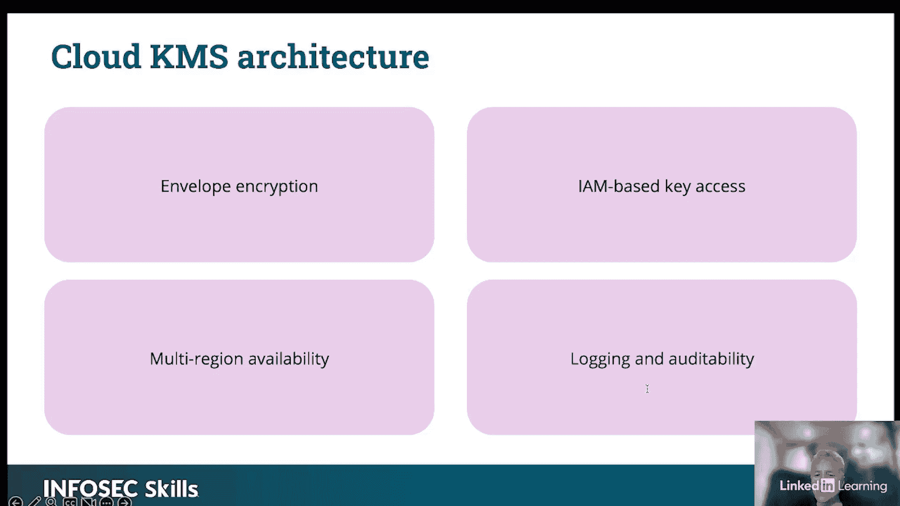
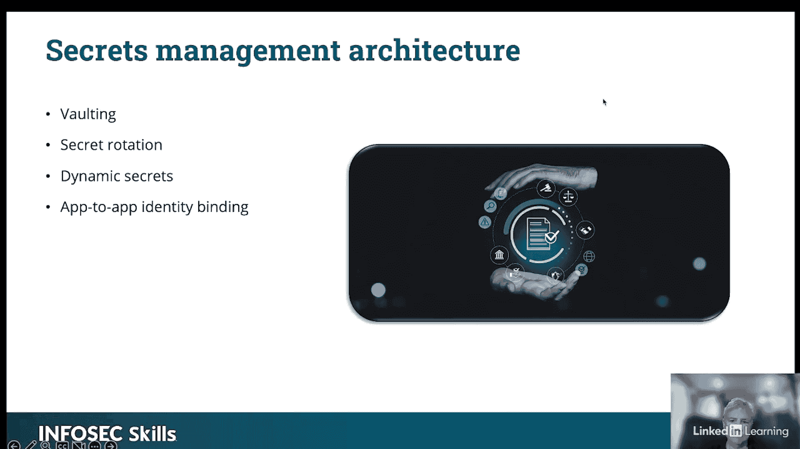

# ISC2 ISSAP 认证教程：05：公钥基础设施 🔐

在本节课中，我们将要学习公钥基础设施的核心内容，包括证书颁发机构的作用、根证书与中继证书的区别、证书策略与注册协议、内部和外部 PKI 的部署要求，以及硬件安全模块和云端密钥管理等知识点。


## 公钥基础设施的核心：证书颁发机构

公钥基础设施的核心就是证书颁发机构，也就是 CA。证书颁发机构是一个被信任的实体，它负责颁发证书，这些证书用来保证通信双方的身份真实可靠。也就是说，如果没有可信的证书颁发机构，公钥基础设施就无法建立起有效的信任关系，也就无法保障通信安全。


## 根证书颁发机构与中继证书颁发机构

根证书颁发机构非常珍贵，攻击者也非常想要攻破它，因此我们需要把根证书颁发机构保护得尽可能安全。具体做法是，在根证书颁发机构签署中继证书颁发机构的证书之后，就将根证书颁发机构物理上隔离，断开网络连接，并尽可能采用最高等级的防护措施。中继证书颁发机构则负责向用户和员工颁发证书，可以根据需求增加数量以扩展规模。

以下是根证书颁发机构和中继证书颁发机构的主要职责区别：

- 根证书颁发机构主要用于签署中继证书颁发机构的证书，平时不参与日常证书颁发工作。
- 中继证书颁发机构负责向用户和员工颁发证书，可以根据需求增加数量以扩展规模。

离线证书颁发机构和在线证书颁发机构的区别也很重要。根证书颁发机构处于离线状态，安全性很高，很少使用，主要只是用来签署在线颁发证书机构的证书。而在线证书颁发机构则随时可用，负责签发和管理证书。离线根证书颁发机构签署中继证书颁发机构，中继证书颁发机构再向员工颁发证书，这几乎是唯一采用的方式。根证书颁发机构是信任的锚点，也就是可信的起点。只要一个实体信任根证书颁发机构，它就会信任通过证书链颁发的所有证书。

信任关系可以用简单的公式表示：

信任(根证书颁发机构) → 信任(证书链中的所有证书)




## 证书策略与注册协议

为了保护证书，我们需要制定策略来管理证书的整个生命周期。这些策略应该涵盖证书如何颁发、如何管理、如何使用，以及如何撤销等方面。具体来说，我们需要管理策略来约束证书的使用行为。

以下是证书策略需要管理的关键环节：

- 证书的颁发流程和标准
- 证书的日常管理方式
- 证书的使用场景和限制
- 证书的撤销策略

除了策略之外，注册协议可以帮助我们自动化这些流程。常见的注册协议包括 SCEP，即安全证书注册协议，这是一个已经使用较久的较老协议。更近期的协议是 EST，即通过安全传输进行注册，它使用 TLS 协议，提供更强的注册保护。还有 ACME，即自动化证书管理环境，常被 Web 服务器使用，使服务器能够自动申请和获取证书。所有这些协议的目的，都是为了实现证书流程的自动化，让管理工作更加高效。


## 内部 PKI 部署要求



如果我们要在内部实施公钥基础设施，就需要确保有一种方式能够自动完成证书的申请、注册、颁发和续期。自动化的目的是让用户感知不到流程，使用体验无缝衔接。为此，我们可以在 Active Directory 中配置策略，并配合刚才提到的注册协议来实现。

职责分离也是内部 PKI 的重要要求。安全管理员、审计员和证书颁发机构管理员应该是不同的角色，彼此之间职责分明。此外，我们需要在证书整个生命周期内记录日志。例如，当组织雇佣新员工，新员工的笔记本电脑加入域之后，策略会让它自动注册并获取证书。PKI 管理员负责管理证书颁发机构，而另一个安全团队负责审计。每一个被颁发、续期或撤销的证书都要记录日志。这样我们就能同时获得自动化、职责分离和对证书生命周期的可见性。


## 外部 PKI 与公共信任模型

面向外部的公钥基础设施，我们需要考虑不同的公共信任模型，通常会使用公共可信的证书颁发机构。选择公共证书颁发机构时，最好选择那些证书已经预装在浏览器中的机构，不要选择冷门或不为人知的证书颁发机构，以确保浏览器默认信任我们使用的证书颁发机构。

公共证书颁发机构可以颁发两种主要类型的证书：

- 组织验证证书，简称 OV 证书，主要验证组织是否拥有域名，以及是否是合法的商业机构。
- 扩展验证证书，简称 EV 证书，常用于银行等受信服务器，身份验证流程更严格，能够提供更高水平的保证。

为了发现未经授权或欺诈性的证书，我们还会使用证书透明度日志。这些日志是公开的、只追加、只读的日志，记录所有已颁发的证书。

举个例子，假设一家公司推出了 www.infect.com 网站，并从公共可信的证书颁发机构购买了 OV 或 EV 证书。公司需要向证书颁发机构证明自身身份，证书随后会被发布到证书透明度日志中。浏览器会信任该网站，因为证书链可以追溯到公共可信的证书颁发机构。这样一来，用户就可以通过 HTTPS 安全访问该网站，而无需手动安装任何证书。


## 密码学合规与模块边界

根据我们的密码学需求，可能需要遵循法律法规的要求，例如 GDPR、PCI DSS 或 HIPAA。为了获得更高的保证，我们可以遵循 FIPS 140-3 标准，这些标准符合政府安全要求，并提供经过授权的加密模块。

模块边界需要明确界定，也就是要搞清楚模块内部包含什么，外部包含什么。只有经过验证的模块内部组件才会被 FIPS 认证所覆盖。

以下是模块边界的一个具体示例：

- 如果是政府机构，并且将加密密钥存储在硬件安全模块中，那么硬件安全模块内部的所有内容都在边界之内。
- 硬件安全模块外部的应用程序，以及与硬件安全模块交互的请求，都在边界之外。

我们必须非常清楚哪些部分受到保护，哪些部分不受保护。


## 硬件安全模块架构

硬件安全模块的核心目标是安全密钥存储。我们需要硬件安全模块来安全地生成、存储和保护加密密钥。硬件本身应该具有防篡改能力，密钥绝对不能以明文形式离开硬件安全模块，这是最基本的安全原则。

使用硬件安全模块还有一个好处，就是可以将一些计算量很大的密码学操作卸载到硬件安全模块上执行，从而减轻主机的计算压力。硬件安全模块可以执行加密和解密机制、密钥生成，以及证书签名或代码数字签名等操作，这些操作在传统服务器上可能会非常消耗资源。

因为硬件安全模块在企业环境中非常重要，我们通常会将这些模块集群化，以实现高可用性，从而获得更高的可用性、负载均衡和服务质量，确保密钥服务不会中断。


## 云端密钥管理与信封加密

当我们转向云端思考时，会回到之前提到的信封加密概念。信封加密的工作方式是，密钥管理系统创建并保护密钥加密密钥，而数据加密密钥用于保护实际数据。数据加密密钥本身又会被密钥加密密钥加密，也就是说，有一个密钥用来加密另一个密钥，再由那个密钥加密数据。

以下是信封加密的核心关系：

```
密钥加密密钥 → 数据加密密钥 → 实际数据
```

以 AWS 为例，密钥管理系统可以生成数据加密密钥，数据加密密钥用来加密 S3 对象，随后 AWS 密钥管理系统使用主密钥来加密数据加密密钥。这就是信封加密的简要回顾。


## 身份基础密钥访问与密钥管理

身份和访问管理是当今云计算的核心。这意味着只有经过授权的用户、角色或特定应用程序才能使用密钥。



以下是身份基础密钥访问的关键原则：

- 只有授权用户、角色或特定应用程序可以使用密钥。
- 例如，财务应用程序可以加密工资数据，开发人员可以读取应用程序并加密工资数据，这也体现了职责分离。
- 为了实现高可用性，密钥会在多个云区域中复制。
- 所有密钥操作都要进行审计和日志记录，以确保可追溯性，日志会显示谁在何时、为了什么目的使用了密钥。

除了密钥管理之外，秘密管理也非常重要。代码可能需要密码或密钥等秘密信息，我们不希望将这些秘密信息硬编码到应用程序中。因此，我们可以使用保险库来存储密码、API 密钥、证书或令牌。我们还需要定期更换秘密信息，以防万一凭证被泄露，或者有迹象表明可能存在安全妥协。

动态序列也是一种有效的做法，即使用临时凭证，这些凭证仅在需要时使用。这样一来，即使密码被泄露，其有效期也很短，风险也就较小。

应用到应用身份绑定意味着，应用程序使用自身身份进行身份验证。应用程序拥有身份和访问管理角色，或者持有证书。在保险库释放证书之前，应用程序需要使用自身凭证进行身份验证，这样就不需要将凭证硬编码了。

总的来说，秘密管理的核心思想是通过安全存储来保护凭证，确保定期轮换，在可能的情况下使用临时密钥，并且只允许经过身份验证的应用程序检索这些凭证。


## 本节课总结



在本节课中，我们一起学习了公钥基础设施的核心概念，包括证书颁发机构的中心地位、根证书和中继证书的作用、证书策略与注册协议、内部和外部 PKI 的部署要求、密码学合规与模块边界、硬件安全模块架构、云端密钥管理与信封加密，以及身份基础密钥访问和秘密管理等内容。

