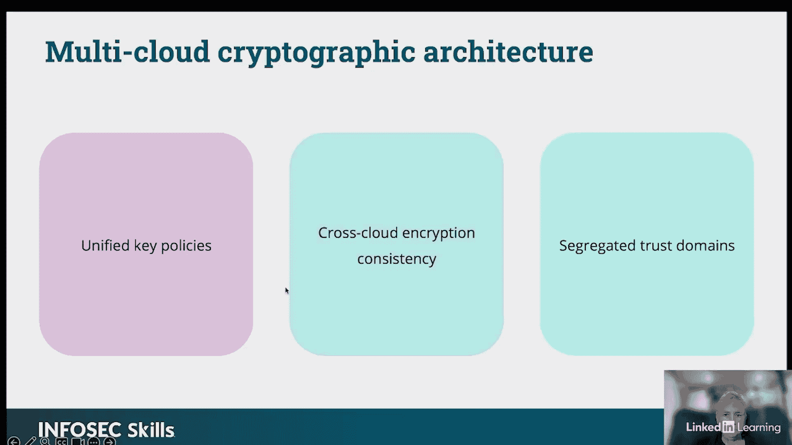

ISC2 ISSAP 信息系统安全架构专业认证：06：运行时完整性 🔒

在本节课中我们将要学习运行时系统完整性保护的核心内容。首先会聊聊为什么安全启动是一切运行时防护的基础，接着看看 UEFI 安全启动和测量启动是如何具体工作的，再了解 TPM 芯片在其中扮演的角色，以及 TPM 证明怎样让其他系统信任你的设备。随后我们会进入运行时完整性架构，重点学习如何监控内核完整性，防止 rootkit 和恶意驱动程序植入。最后还会讨论零信任架构、身份绑定加密、加密分段控制，以及在多云环境中如何保持密钥管理和加密策略的一致性。

## 1. 安全启动是运行时保护的起点

要保护系统在运行期间的安全，第一步必须是安全启动。如果系统启动本身就不安全，那么后面所有的安全措施都会失去意义。因为一旦启动阶段被攻破，攻击者就可以在系统完全起来之前就植入恶意代码，这时候后面的防护再强也很难发现问题。

以下是运行时保护必须满足的基础条件：

- 系统必须完成安全启动
- 启动过程不能被未授权代码篡改
- 启动后的每个组件都需要可信

## 2. UEFI 安全启动与数字证书验证

上一节我们介绍了安全启动的重要性，本节中我们来看看 UEFI 安全启动具体怎么实现。在实际操作中，我们通常使用 UEFI 安全启动。它的目标很简单：在引导加载程序、操作系统和设备驱动程序加载之前，先用数字证书验证它们的数字签名。只要证书不匹配或者签名无效，这些组件就不会被加载。这样一来，未经授权或者恶意的代码就无法在启动时运行。

具体验证逻辑可以这样理解：

if 证书 == 受信任证书 then
    加载组件
else
    阻止加载
end if

以下是 UEFI 安全启动需要验证的对象：

- 引导加载程序
- 操作系统
- 设备驱动程序

## 3. 测量启动与 TPM 芯片

除了验证证书，我们还需要记录启动过程中每个组件的状态，这就是测量启动的作用。测量启动会在每个启动组件加载之前，计算它的哈希值，并把这些哈希值存放到主板上的 TPM 芯片里。TPM 是一个专门的安全芯片，它可以安全地保存这些测量值。之后如果有任何启动组件被修改，哈希值就会发生变化，系统就能立刻检测出来。

这个过程可以用简单的公式表示：

哈希值 = Hash(启动组件) → 存入 TPM 芯片

以下是测量启动的核心步骤：

- 计算每个启动组件的哈希值
- 将哈希值存储到 TPM 芯片
- 比对哈希值以检测是否被篡改

## 4. TPM 证明与远程可信验证

有了 TPM 存储的启动哈希值，我们还需要一种方式把这些信息告诉其他系统，这就是 TPM 证明。TPM based attestation 听起来很专业，但意思很简单：TPM 芯片会向另一个系统提供一种担保，这个系统可能是云服务提供商、云服务平台，或者是企业内部网络。这种担保会说明你的设备确实是以安全、可信、未被篡改的状态启动的，只有在获得这种担保之后，才允许设备访问资源。

以下是 TPM 证明可以提供担保的目标系统：

- 云服务提供商
- 云服务平台
- 企业网络

## 5. 运行时完整性架构与内核监控

安全启动解决了开机阶段的问题，但系统运行起来之后，如何保持持续可信呢？这就是运行时完整性架构要解决的问题。运行时完整性架构再次回到了 TPM 芯片。TPM 不仅检查系统启动是否安全，还会在系统运行期间持续核对。它会拿出之前记录的最后已知良好值，跟当前操作系统环境进行比对。如果发现差异，就说明系统在运行过程中可能被篡改了。特别要重点监控内核完整性，不能让 rootkit 或者恶意驱动程序嵌入到内核里面，否则整个系统就会失去可信度。

以下是运行时完整性需要重点检查的内容：

- 内核完整性
- 是否存在 rootkit
- 是否存在恶意驱动程序

## 6. 防篡改控件与代码签名

除了 TPM 的自动检查，我们还需要一些额外的防护手段来阻止未授权的修改。防篡改控件、完整性检查和代码签名是常用的运行时保护手段。代码签名可以确保只有经过签名的代码才能运行，完整性检查可以发现文件或内存是否被修改，而防篡改控件则直接禁止未授权的修改行为。这些手段加在一起，就能有效防止系统在运行期间被恶意篡改。

以下是常见的运行时保护手段：

- 防篡改控件
- 完整性检查
- 代码签名

## 7. 零信任架构与身份绑定加密

在讨论完系统本身的完整性后，我们需要把视角扩大到整个安全架构，这时候零信任架构又会出现。零信任架构是我们反复会提到的一个核心思想，它不只关注网络边界，更关注身份。身份绑定加密就是一种典型做法：加密密钥与特定用户或者特定设备绑定。在允许访问之前，这个身份必须先经过认证和授权。而且零信任不是只在登录时验证一次，而是在整个会话期间持续重新验证密钥和身份。如果设备的可信状态发生变化，访问权限会立刻变更，凭据也可以立即吊销。

以下是零信任架构中的关键原则：

- 使用身份绑定加密，密钥与用户或设备绑定
- 访问前必须先完成身份认证和授权
- 整个会话期间持续重新验证密钥和身份
- 设备可信状态变化时立即变更访问权限并吊销凭据

## 8. 加密分段控制与攻击半径

零信任不仅体现在身份验证上，也体现在加密密钥的使用方式上，这就引出了加密分段控制。加密分段控制的主旨是：不同的工作负载使用不同的密钥，这样可以实现隔离，把攻击半径控制在最小范围。如果一个密钥不幸被泄露，攻击者只能拿到这把钥匙对应的那一部分资源，而无法访问其他所有内容。这就像给不同的房间配不同的钥匙，一把钥匙丢了，不会导致整栋大楼都不安全。

以下是加密分段控制的核心逻辑：

- 不同工作负载使用不同密钥
- 实现工作负载之间的隔离
- 限制攻击半径或者破坏半径
- 单个密钥泄露不会导致全部资源暴露

## 9. 多云环境中的一致性与隔离

在单个云平台上做好密钥管理已经不容易，如果企业使用多个云服务商，情况会变得更复杂。多云环境指的是同时使用多个云服务商提供不同的服务。在这种情况下，策略的一致性变得非常关键。我们需要确保所有云服务商上的密钥管理策略保持一致，包括密钥的生成方式、轮换方式和存储方式。加密标准也要保持一致，比如如果符合 FIPS 140-3 合规要求，那么所有基于云的系统都要满足这个要求。另外还要做隔离，每个云环境的密钥要分开保存，一个云环境被攻破不应该导致其他云环境也跟着被攻破。

以下是多云环境下需要保持一致的内容：

- 密钥管理策略
- 密钥生成方式
- 密钥轮换方式
- 密钥存储方式
- 加密合规标准，例如 FIPS 140-3

以下是多云环境下需要执行的隔离措施：

- 每个云环境使用独立的密钥
- 禁止跨云环境共享密钥

本节课中我们一起学习了运行时完整性的完整保护体系。我们了解了安全启动的基础地位、UEFI 安全启动如何通过数字证书验证启动组件、测量启动如何把哈希值存入 TPM 芯片、TPM 证明如何向远程系统提供可信担保。接着我们探讨了运行时完整性架构如何持续监控内核并防止 rootkit 入侵，以及防篡改控件和代码签名的作用。最后我们还学习了零信任架构中的身份绑定加密与持续验证、加密分段控制如何缩小攻击半径，以及在多云环境中如何保持密钥管理和加密策略的一致性与隔离。

