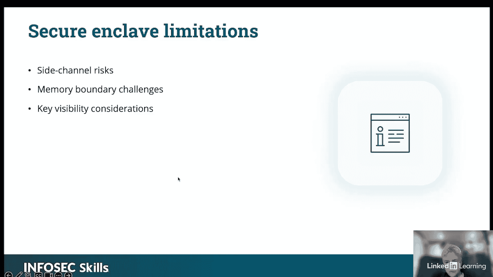

# ISC2 ISSAP信息系统安全架构专业认证：07：安全实施 🔒


在本节课中我们将要学习安全实施的核心思想。我们会聊聊在虚拟化和云环境里怎么把不同租户分开，怎么给每个应用单独准备密钥，为什么不能让一个人管所有密钥，以及保密计算和安全飞地到底是在保护什么。最后我们也会看看这些方案不能解决哪些问题，避免觉得装了安全飞地就万事大吉。


上一节我们介绍了安全架构的基础概念，本节中我们来看看怎么在实际部署中把这些概念落地。首先我们要考虑的是虚拟化环境和基于云的环境。在云平台上，很多不同的客户共享同一套物理硬件，这时候最基本的要求就是把每个租户隔离开来。换成大白话来说，就是甲公司的数据和乙公司的数据不能混在一起，乙公司绝对不应该能碰到甲公司的资源。

以下是具体需要做到的租户隔离措施：
- 每个租户拥有独立的虚拟私有云，网络上不和其他租户互通。
- 每个租户自己管理加密密钥，不共享密钥材料。
- 在租户之间设置明确的信任边界，防止跨越边界的非法访问。

目标非常明确，就是确保没有任何一个租户有可能去读取或者修改另一个租户的资源。用公式表达就是两个租户的资源集合没有交集：
```
租户A资源 ∩ 租户B资源 = 空集合
```


把租户隔离做好之后，我们还需要在单个租户内部，把不同的应用再分开来处理。同样的思路也适用于应用程序。每个应用都应该拥有自己唯一的密钥，并且这些密钥要彼此隔离。为什么要这么做？简单来说，就是万一某个应用的密钥被攻破了，攻击者不能利用这个密钥去攻击其他应用。把风险限制在一个应用内部，避免一个出问题，全盘都跟着出问题。

以下是应用密钥管理的基本要求：
- 每个应用使用独立的密钥，密钥之间不重复。
- 不同应用的密钥存储环境要分开，不能混放。
- 即使一个应用发生安全事故，其他应用的数据依然安全。

这样做就像给每个房间装独立的门锁，一把钥匙只能开一扇门。用公式表示就是不同应用的密钥不相等：
```
应用1密钥 ≠ 应用2密钥 ≠ 应用3密钥
```


除了把租户和应用分开，人和人之间的权限也需要划分清楚，不能让一个人说了算。接下来是一个经典的安全原则，叫作职责分离。意思就是，管理不同系统密钥的人或者系统，应该是不同的。绝对不允许出现一个“全能密钥管理员”，由他一个人掌握所有应用、所有环境的密钥。

以下是职责分离的具体做法：
- 不同系统的密钥由不同的人员或不同的管理系统负责。
- 各应用或各实施环境配备独立的密钥管理员。
- 避免单点失效，一个管理员出问题不会导致所有密钥泄露。

道理很简单，权力分散了，出问题的范围就小，内部人员滥用权限的风险也会降低。用公式简单表达就是不同系统对应的管理员不同：
```
系统A管理员 ≠ 系统B管理员
```


把人、应用、租户都分开了之后，我们还要思考数据在计算过程中的保护，这引出了保密计算架构。保密计算架构的目标是为实际的计算过程创建一个安全环境。传统的加密通常只保护“存储中的数据”和“传输中的数据”，但数据在内存里被CPU处理的时候，往往是明文状态。保密计算要改变这一点，让数据在内存中执行计算时依然保持加密。

以下是保密计算的关键技术：
- 加密内存执行：数据在内存中处理时保持加密状态，即使是拥有系统特权的攻击者也很难窃取。
- 安全飞地：无论是Intel、AMD还是云平台的Nitro，都是硬件保护的执行环境。
- 隔离敏感代码和数据：安全飞地把关键代码和数据与操作系统、虚拟化管理程序、其他工作负载隔离开来。

用公式来表达这个思路，大概就是：
```
数据在处理中的状态 = 加密状态
安全飞地 = 硬件保护执行环境 ≠ 操作系统
```

同态加密也是相关方向，它的意思是让数据在完全不解密的情况下就能进行计算，虽然实现起来比较复杂，但核心思想一致，就是数据主动被处理的时候也要受到保护。把加密从“静止数据”和“传输数据”扩展到“使用中的数据”，才是保密计算想要达到的效果。


安全飞地听起来很强大，但它并不是银弹，还是存在一些风险需要注意。安全飞地提供了额外的保护，但风险依然存在，而且不会消失。首先是旁通道风险。攻击者可能通过分析功耗、执行时间或者其他物理特征，推断出正在使用的加密算法或者处理的数据特征。这种攻击不需要直接破解飞地，而是从外部侧面窥探。

其次是边界挑战。安全飞地只保护飞地边界内部的内容。如果数据要从飞地内部传出来，或者从外部传进去，在边界上依然需要考虑保护措施，否则数据在传输过程中可能暴露。

最后是密钥可见性问题。加密密钥在安全飞地内部是受到保护的，但如果密钥被使用，或者被转移到飞地外面的环境，那么它们就不再处于那个受保护的状态。也就是说，安全飞地降低了风险，但不能把风险完全消除。

用一个简单的公式表达剩余风险：
```
安全飞地启用后，剩余风险 ≠ 0
```




我们已经把安全实施的主要内容都梳理了一遍，接下来做一个总结。在本节课中我们一起学习了安全实施的几个核心方面。首先是在虚拟化和云环境中实现租户隔离，确保不同租户的资源、密钥和信任边界互不干扰。其次是给每个应用分配独立的密钥，防止一个应用被攻破后影响其他应用。再次是职责分离，避免由单一管理员掌握所有密钥。然后是保密计算架构和安全飞地，让数据在内存中处理时保持加密，并与操作系统和虚拟化层隔离。最后我们也讨论了安全飞地的局限性，包括旁通道攻击、边界保护和密钥可见性问题，明确安全飞地能降低风险但不能消除所有风险。
