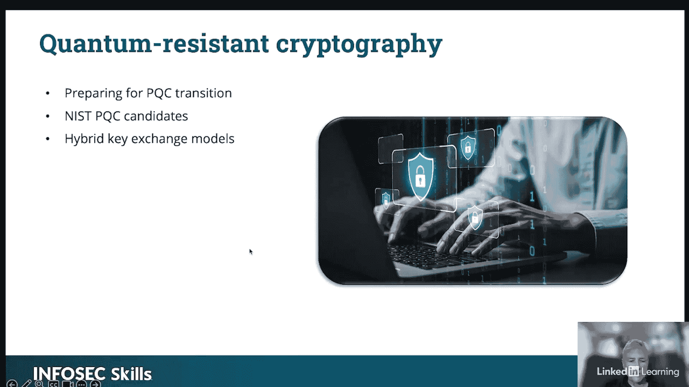
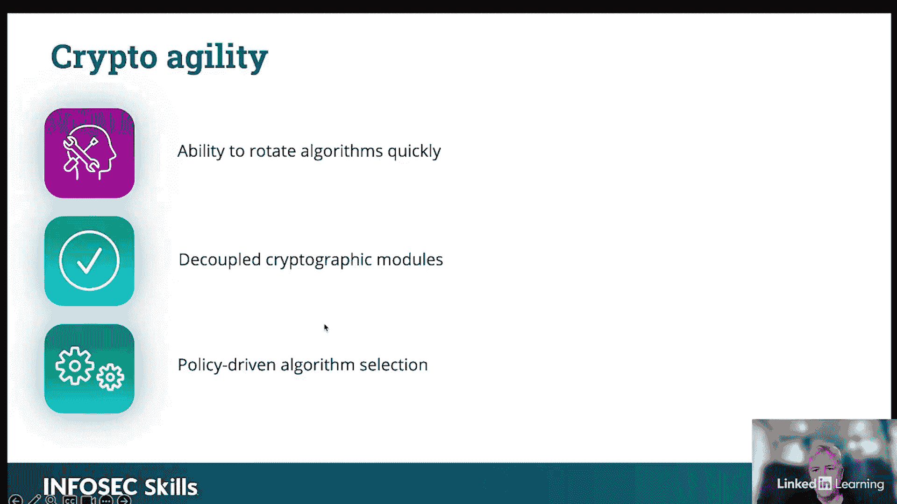

# ISSAP信息系统安全架构专家：08：附加考量事项 🛡️


在本节课中我们将要学习量子计算对现有密码系统的影响，以及如何为未来的后量子密码世界提前做准备。我们还会讨论密码敏捷性的概念，看看怎样让系统在不拆除重建的情况下，快速更换或升级密码算法。本节内容比较短，重点都放在面向未来的额外考量事项上，对安全架构师的日常工作非常有帮助。


## 为什么要为量子计算提前做准备 🔮


量子计算虽然听起来像是未来科技，但它的发展速度比很多人想象的要快，迟早会对目前的加密体系造成真正的冲击。作为安全架构师，我们不能等到量子计算机真正出现才开始应对，而需要提前了解哪些算法会受到影响，并开始储备后量子密码学的相关知识。只有这样，在未来进行切换时才不会手忙脚乱，也能避免整个系统被迫推倒重建。


以下是需要重点关注的几个方面：

- 先清点当前环境中部署了哪些密码系统和算法，摸清楚家底。
- 找出在后量子计算环境下最容易受到攻击的算法，优先评估风险。
- 重点关注非对称算法，例如 RSA 和 ECC，它们将受到严重冲击，其他非对称算法也是如此。
- 非对称算法的安全性建立在解决复杂数学问题的基础上，可以用公式表示为：**安全性 = 解决复杂数学问题的难度**。
- 量子计算的出现会让求解这些复杂数学问题的能力呈指数级提升，可以用公式表示为：**破解能力 ∝ 量子计算能力的指数级增长**。
- 因此必须提前意识到哪些算法会受到冲击，并开始评估后量子密码学算法。
- 可以参考 NIS 批准的后量子密码学算法列表，了解哪些算法已经通过标准化。
- 在过渡期间，建议同时使用传统算法和后量子算法，这样既能保证系统兼容性，也能保证安全性。
- 这样在未来正式切换时，算法的升级和迁移会变得更加容易。


通过上面这些步骤，我们就能清楚掌握现有环境中使用了哪些密码技术，也知道哪些算法需要优先替换，从而在量子计算真正成为威胁之前，提前完成后量子密码体系的布局。




## 什么是密码敏捷性 🔄


刚才我们介绍了量子计算对现有算法的影响，本节中我们来看看怎样在系统架构中实现灵活的密码管理。密码敏捷性的核心思想是，不要把密码算法直接写死在应用程序代码里，否则以后想换一个算法就得重新开发、重新测试、重新部署，工作量非常大，也不符合快速响应安全威胁的要求。


以下是实现密码敏捷性的具体做法：

- 在应用程序中不要对密码算法进行硬编码。
- 将密码功能与应用程序代码解耦，可以用代码描述为：
  ```python
  # 不推荐：将算法硬编码在代码中
  encrypted_data = RSA.encrypt(data)

  # 推荐：通过配置或服务动态选择算法
  encrypted_data = crypto_service.encrypt(data, algorithm=config.get("encryption_algorithm"))
  ```
- 这样可以方便地移入或移出算法，快速替换存在漏洞的密码算法，或者升级到更安全的版本。
- 保持密码函数与应用代码分离，确保在必要时能灵活更换算法，而不需要修改业务逻辑。
- 建立完善的策略，明确哪些算法是被允许使用的，哪些已经被废弃。
- 通过策略可以快速、一致地推送算法更新，无需拆分系统并重新构建。
- 当新的密码技术出现时，可以直接替换损坏或脆弱的算法，平滑迁移到后量子密码学，同时也能满足新出现的合规要求。


做好密码敏捷性之后，系统就拥有了适应变化的能力，未来无论出现什么新的密码标准或合规要求，都不需要推倒重来，只需更换对应的算法模块即可完成适配。


## 本节小结 📚




本节课中我们一起学习了量子计算对 RSA、ECC 等非对称密码算法的潜在威胁，了解了如何清点现有密码系统、评估后量子密码学算法，以及在过渡期采用传统算法与后量子算法并用的策略。同时，我们还探讨了密码敏捷性的概念，学习了如何通过解耦密码功能、避免硬编码、制定算法策略等方式，让系统具备快速更换和升级密码算法的能力。希望这些内容能帮助你在未来的安全架构设计中，提前应对量子计算带来的挑战。

