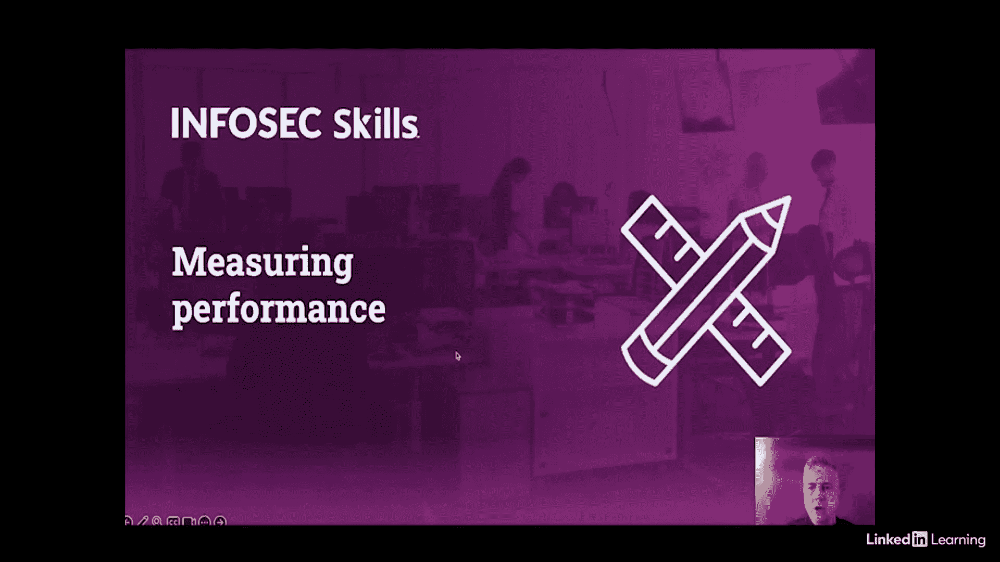
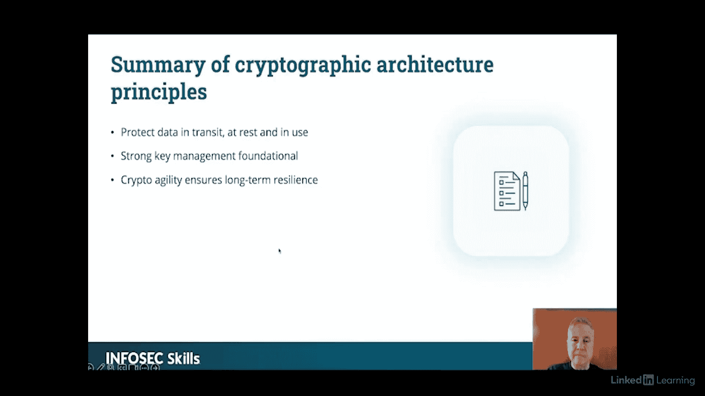

# ISSAP 信息系统安全架构专家：09：衡量性能 📊

在本节课中，我们将学习如何衡量信息系统安全架构的性能。安全架构师在设计系统时，经常需要在运行速度和安全强度之间找到一个合适的平衡点，而这两者往往是相互制约的。我们会先介绍性能与安全的基本权衡关系，然后讨论硬件加速技术、密钥管理的常见问题、法规合规要求、端到端加密架构，以及合法拦截可能带来的技术困难。此外，还会讲解文档记录、密钥生命周期、证书层级、治理机制和密码学敏捷性，帮助你建立一套完整的安全绩效评估体系。这些内容对初学者来说非常基础，但也是后续进行高级安全架构设计的重要前提。

---



## 1. 性能与安全的基本权衡 ⚖️

首先，我们来看看安全性能评估中最核心的矛盾所在。在设计安全系统时，性能与安全程度之间总是存在权衡关系。如果安全措施过于繁重，系统响应会变慢，用户体验会下降；如果安全措施太少，系统虽然运行速度快，但面临的风险也会增加。安全架构师的工作就是在这两个极端之间找到一个合理的中间地带，确保系统既足够安全，又能保持可接受的运行速度。下面是一些可以在保证安全的前提下提升性能的常见方法：

- 使用硬件加速工具，例如 Intel Quick Assist Technology（QAT）。QAT 是一种硬件加速技术，专门用于加速加密等计算密集型任务。
- 利用 CPU 指令集加速 AES 加密。现代 Intel 处理器内置了专门的指令，可以大幅提高 AES 加解密的执行速度。
- 将 TLS 卸载到硬件安全模块（HSM）中处理，并对这些模块进行负载均衡。TLS 握手和加解密工作交给专用硬件后，服务器的压力会明显减轻。
- 增加负载分发的节点数量。负载分布得越均匀，整体系统性能通常越好。

从安全角度看，可以用下面的公式来大致理解性能开销：

```
总响应时间 = 安全处理时间 + 网络传输时间 + 应用处理时间
```

掌握了提升性能的手段之后，我们还需要关注从安全角度可能导致性能不达标的原因，以及密钥管理的基础知识。

---

## 2. 密钥管理与常见配置错误 🔑

密码学系统的强弱，最终取决于密钥管理的好坏。无论加密算法多么先进，如果密钥生成方式不当、密钥强度不足，或者未经授权的人员可以访问密钥，整个安全体系都会失效。我们需要明确密钥是如何生成的，使用什么强度的密钥，选用什么强度的算法，以及谁有权访问加密密钥。除了密钥本身，配置错误也是经常困扰安全团队的问题。下面列举几种典型的配置失误：

- 使用已过时的 TLS 版本，甚至仍在使用 SSL。旧版协议提供的保护力度不如最新版本，容易被攻击者利用。
- 重复使用初始化向量（IV）或随机数（Nonce）。这种情况通常出现在使用短初始化向量的算法中，会导致密码学重复，削弱加密效果。
- 依然依赖无法提供足够安全保护的遗留系统。旧系统往往不支持现代加密标准，整体安全程度较低。

密钥的完整生命周期通常包括以下阶段：

```
生成 → 分发 → 存储 → 轮换 → 备份 → 吊销
```

除了技术层面的设置，安全架构还必须符合相关法律法规的要求，否则即使技术再先进，也可能面临合规风险。

---

## 3. 法规合规与尽职调查 ⚖️

合规性始终是安全架构工作的重点之一。不同行业有不同的法规标准，例如支付卡行业遵循 PCI DSS，医疗行业遵循 HIPAA 和 HITECH，联邦系统涉及 FedRAMP 和 FSMA，而处理欧盟公民数据的企业则需要满足 GDPR 要求。尽职调查要求我们了解适用于本组织的法律法规，而责任义务则要求我们实施适当的安全控制措施，以满足合规要求。下面列举几类常见的合规框架及其适用行业：

- PCI DSS：支付卡行业数据安全标准，适用于处理支付卡信息的组织。
- HIPAA / HITECH：美国医疗保险可移植性与责任法案及相关技术法案，适用于医疗健康行业。
- FedRAMP：联邦风险和授权管理计划，适用于美国联邦信息系统。
- FSMA：食品安全现代化法案，也可涉及联邦系统的安全要求。
- GDPR：欧盟通用数据保护条例，适用于在欧盟开展业务并处理欧盟公民数据的组织。

在讨论了性能、密钥管理和合规之后，我们进一步探讨一种具体的保护数据的架构模式，即端到端加密，以及它可能面临的合法拦截挑战。

---

## 4. 端到端加密架构与合法拦截 🔒

端到端加密的意思是，数据从发送端开始就被加密，一直到达接收端才被解密，中间任何环节都无法查看明文。Signal 或 WhatsApp 等通讯工具就采用了端到端加密，能够提供很强的安全保障。不过，要使这种架构正常工作，必须妥善处理密钥管理，并且要将终端与用户身份绑定，而不仅仅是绑定到某台特定设备。也就是说，系统需要确认用户的身份，并通过证书、密钥或其他方式完成可靠的身份验证。

在实际部署端到端加密时，经常会出现一个问题：是否存在合法拦截的要求？端到端加密最大的好处是中间没有任何一方能够捕获、记录或评估通信内容。但是，如果某些通信必须具备被拦截的能力，这就可能带来技术困难。为了满足拦截需求，组织可能会在通信路径中部署解密设备，例如代理服务器，用于拦截流量并在需要时解密，但这同时也引入了密钥分发的新问题。合法拦截的处理逻辑可以用简单的伪代码说明：

```
如果 需要合法拦截 == 是:
    部署 TLS 解密代理
    处理中间密钥分发
否则:
    维持端到端加密
```

归根结底，我们既需要安全，也需要合规，同时还要保证良好的性能，三者之间的平衡需要针对每个具体情况单独做出决策，没有统一的简单答案。

为了说明这一点，我们可以看一个具体的例子。假设公司部署了能够检查旧版 SSL 流量的授权设备，比如代理服务器和网关。这些设备之所以被授权，是因为需要检测恶意软件，或者使用数据防泄漏（DLP）系统，防止不当信息被窃取或导出。比如，如果一名员工尝试将包含社会安全号码的电子表格上传到 Dropbox，而防火墙没有 TLS 检查功能，它只知道该员工连接到了 Dropbox，却无法看到文件内容。但如果防火墙或代理服务器具备 TLS 检查能力并解密了会话，DLP 引擎就会分析流量，发现正在传输社会安全号码，并阻止该上传操作。由此可见，部署 TLS 解密设备能够带来明显的安全收益。

在技术控制措施之外，文档记录和治理机制同样不可忽视，它们是安全策略落地的基础。

---

## 5. 文档、策略与密钥生命周期 📄

文档记录必须始终保持完整，并且要有可追溯性。所有与密码学相关的决策都应当回溯到安全策略。我们需要确认是否已制定适当的策略，是否定义了批准的加密算法、密钥长度以及使用的加密标准。可接受使用策略中也应当明确哪些数据需要加密，哪些数据不需要加密。

接下来是密钥生命周期管理。密钥是如何生成的，如何分发，如何存储，如何定期轮换，如何备份，以及如何吊销，这些都是必须明确的环节。特别是密钥吊销，它是一个非常重要的问题。除了单个密钥，还需要管理证书层级，确定谁是根证书颁发机构，整个环境中的信任锚是什么，证书颁发机构之间的层级结构如何，由谁来签发证书。

治理方面，密钥所有权和角色划分至关重要。密钥的生成审批、托管和恢复都需要明确责任人。如果私钥损坏，我们必须能够恢复该密钥。负责恢复密钥的个人或实体，必须遵循分权原则。也就是说，不应该允许单一个人拥有恢复私钥的全部权力，因为这会带来过大的操作风险。我们可以实施双人控制机制，要求多方在场才能执行恢复操作，或者采用 M of N 控制机制。这里的 M 和 N 是变量，意思是总共有 N 个管理员，其中至少需要 M 人在场才能完成关键操作。无论采用哪种方式，核心目标都是确保密钥在整个生命周期内受到保护，没有任何个人拥有对密钥的完全控制权。

密钥轮换同样需要基于策略执行。密钥会过期，过期后必须重新签发新密钥，并销毁旧密钥。此外，我们还需要跟踪证书的成功和失败情况，例如证书到期率、吊销率、是否存在无效证书或配置错误的证书，以及公钥基础设施实施中哪些环节削弱了安全性。除了证书，还需要追踪使用的算法，确认所选算法是否正确，以及它们提供的安全程度是否仍然适合当前环境，而不仅仅是当初部署时合适。

最后，我们来看看如何量化这些安全工作的效果。

---

## 6. 绩效指标与密码学敏捷性 📈

我们可以使用关键绩效指标（KPI）来评估密码学风险管理是否到位。密码学的核心目标是保护数据在传输中、静止时和使用中的安全，而密钥管理是所有密码学解决方案的核心。为了应对不断发展的密码学技术，组织需要具备密码学敏捷性，也就是说，当加密算法或标准发生变化时，能够快速、高效地进行调整和更改，而不需要对整个系统进行大规模重构。

可以参考下面的关键绩效指标示例：

- 证书过期率
- 密钥吊销率
- 无效或配置错误证书数量
- 使用的加密算法是否仍符合当前安全要求



在本节课中，我们一起学习了如何衡量安全架构的性能，探讨了安全与性能之间的权衡关系，介绍了硬件加速和 TLS 卸载等性能优化方法。我们还学习了密钥管理的重要性、常见的配置错误，以及 PCI DSS、HIPAA、FedRAMP、FSMA 和 GDPR 等合规标准的基本要求。同时，我们讨论了端到端加密架构、合法拦截带来的技术挑战、TLS 检查在数据防泄漏中的作用，以及文档、密钥生命周期、证书层级、分权治理和密码学敏捷性等内容。希望这些知识能够帮助你在实际工作中更好地评估和优化信息系统的安全性能。

