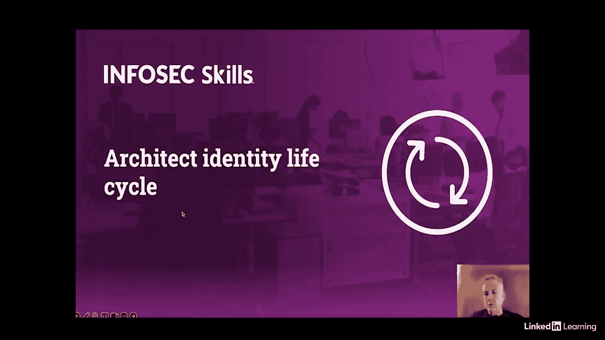
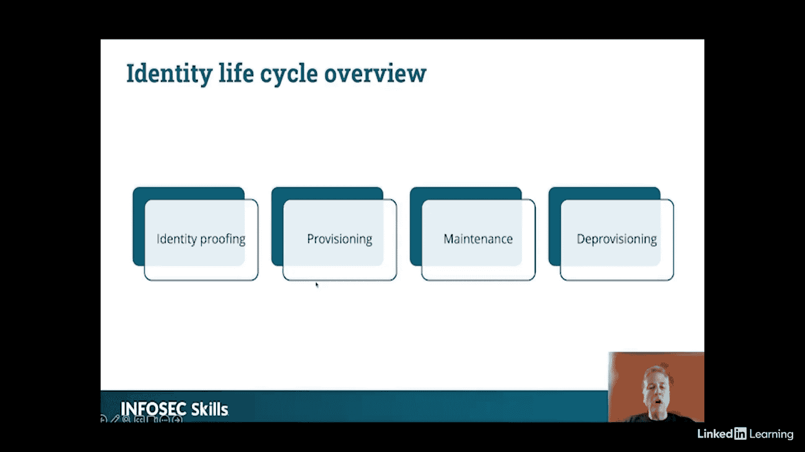

# LinkedIn ISC2 ISSAP：01：身份生命周期架构 🔐


在本节课中我们将要学习身份和访问管理架构的基础知识，重点围绕身份生命周期展开。我们会先了解什么是身份管理，什么是访问管理，然后依次探讨身份验证、授权和审计这些核心概念。在正式进入具体话题之前，我们必须先搞清楚如何管理整个身份生命周期，因为只有把身份管理好，后面的访问控制才能建立在可靠的基础之上。这篇教程适合初学者阅读，我们会用大白话把每个环节讲清楚，让你在学习完之后能够清晰地知道一个用户从入职到离职，其账户和权限是如何被创建、维护和撤销的。


## 身份管理与访问管理的关系

上一节我们介绍了安全架构的整体框架，本节中我们来看看身份和访问管理是如何协同工作的。在构建安全系统时，我们需要把身份管理和访问管理分开来思考，但又不能把它们完全割裂，因为两者是紧密相连的。

以下是身份管理和访问管理的核心区别与联系：

- 身份管理关注的是用户是谁，即如何验证用户的身份声明，以及如何为用户创建和维护账户。
- 访问管理关注的是用户能做什么，即在身份确定之后，如何决定用户可以访问哪些资源、执行哪些操作。
- 两者的结合体现在访问控制流程中，先确认身份，再决定权限，最后记录行为。

身份和访问管理的核心流程可以用一个简单的公式来表示：

```
访问控制 = 身份验证 + 授权 + 审计
```



这个公式告诉我们，完整的访问管理不仅包含确认用户是谁，还包含确定用户能做什么，以及记录用户做了什么。缺少任何一环，安全体系都会出现漏洞。


## 身份生命周期的核心阶段

我们要重点讨论的是身份生命周期，也就是一个用户账户从诞生到消亡的完整过程。在身份管理中，我们通常会把用户在组织中的整个旅程拆解为几个关键阶段，每个阶段都有明确的操作要求和安全目标。

以下是身份生命周期的主要阶段：

- 身份证明：当新用户加入组织时，需要证明自己就是他所说的那个人。这通常由人力资源部门完成，比如要求出示驾驶执照、社保号码、护照等身份文件。身份证明只发生一次，并且发生在账户创建之前。
- 账户配置：身份证明通过之后，系统会为用户生成账户，并分配相应的权限。这一步包括创建账户、设置初始密码、分配角色和权限等操作。
- 账户维护：用户在组织任职期间，其账户需要持续维护。这包括权限变更、密码更新、账户状态调整等日常管理工作。
- 账户撤销：当用户因任何原因离开组织时，其账户需要被移除或停用。这是生命周期的最后一个阶段，目的是防止离职人员保留系统访问权限。

身份生命周期的关键操作可以用伪代码来描述：

```
IF 用户通过身份证明 THEN
    创建账户
    分配权限
WHILE 用户在职 DO
    维护账户
    更新权限
IF 用户离职 THEN
    撤销账户
    停用访问权限
END IF
```

这个伪代码展示了账户管理的基本逻辑，帮助你理解从入职到离职的完整流程。


## 身份生命周期管理原则

在设计和治理身份生命周期时，我们需要遵循一些关键的架构原则，这些原则能够帮助组织建立安全、合规且易于维护的身份管理体系。

以下是身份和访问管理的核心管理原则：

- 从创建到撤销设计生命周期：必须为身份生命周期的每个阶段制定明确的流程，包括入职验证、账户创建、权限分配、离职撤销等。
- 账户验证方式：在用户加入组织时，需要确定验证步骤，可以是人工审核、自动化系统校验，或者两者结合。
- 账户全生命周期管理：不仅要关注账户创建，还要覆盖账户使用期间的维护和离职后的撤销，确保账户状态始终与用户实际身份保持一致。

这些原则的核心目标是实现问责制和可追溯性。我们需要能够将系统中的任何活动追溯到具体的个人，这就是可追溯性的含义。除了可追溯性，我们还需要关注合规性要求，在组织环境中限制访问范围，执行职责分离原则，确保没有一个人拥有过大的权限。通过适当的治理机制，我们可以强制执行经过批准的身份管理流程，避免随意创建或修改账户。

为了减少人为错误和管理开销，我们应该尽可能地自动化这些任务。自动化不仅能降低出错概率，还能让身份管理变得更加高效和一致。


## 总结



本节课中我们一起学习了身份和访问管理架构的基础知识，重点探讨了身份生命周期的设计与治理。我们了解了身份管理和访问管理的关系，明确了身份验证、授权和审计在访问控制中的作用。我们详细梳理了身份生命周期的四个核心阶段：身份证明、账户配置、账户维护和账户撤销，并讨论了在设计身份管理体系时应当遵循的架构原则，包括可追溯性、合规性、职责分离和自动化。希望这篇教程能帮助你建立对身份生命周期管理的直观认识，为后续学习访问控制架构打下坚实基础。

