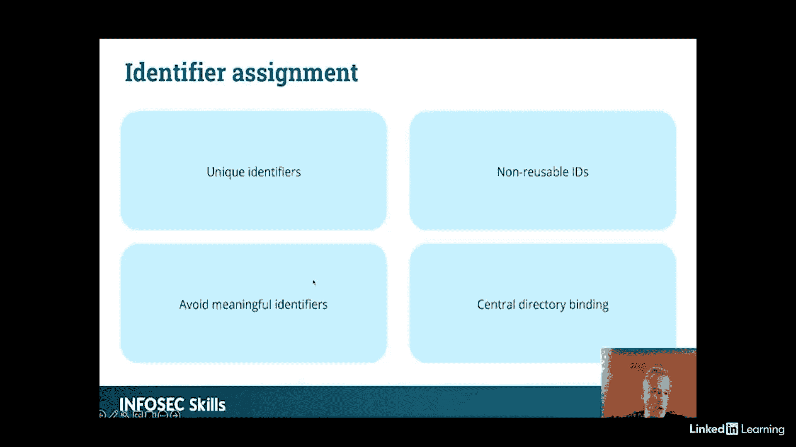

# ISSAP 信息系统安全架构专家：02：身份管理基础 🔐

在本节课中我们将要学习身份管理的核心流程。我们将从身份证明的起点开始，逐步进入用户入账、属性记录、凭证绑定，最后探讨如何集中管理标识符。每一步都围绕一个核心目标展开，即确保系统中出现的每个用户都是真实存在的、经过验证的个体，并且与其对应的账号和权限能够被准确追踪。本节内容虽然部分知识与之前章节有所重合，但我们会更深入地剖析每一个环节，帮助你建立完整的身份管理体系认知。

## 身份证明：确认用户真实身份

上一节我们介绍了身份管理的整体轮廓，本节中我们来看看身份证明是如何开展的。

身份证明是整个身份管理流程的第一步。在实际工作中，这个环节通常由人力资源部门或相关岗位人员负责，当组织迎来新员工时，入职流程中必须包含身份证明环节。它的最终目的只有一个，就是验证用户确实是他所声称的那个人。为了达成这个目的，我们需要要求新员工提供一定的证明材料，并对这些材料及其附带的属性进行验证，确认其中包含我们所需的信息。在日常实践中，很常见的证明材料包括驾驶执照、社会保障卡或社会保险号，护照也是非常普遍的选择，此外还有其他一些受信任的文件可用于这一身份证明阶段。

以下是身份证明阶段通常会用到的证明材料类型：

- 驾驶执照
- 社会保障卡或社会保险号
- 护照
- 其他受信任的官方文件

我们需要收集多少材料，要求新员工带来哪些具体文件，这取决于风险。用户需要通过多少种方式来证明身份，以及需要证明到什么程度，都由组织内部的风险情况决定。与此同时，我们始终要回顾法律与法规要求，确保清楚相关的法律与法规合规性是什么，明白这些要求在维持必要框架方面具体意味着什么。

身份证明的核心逻辑可以表示为：

`身份证明结果 = f(提供材料, 风险等级, 法律合规要求)`

## 用户入账与属性记录

完成身份证明之后，我们已经确认了用户身份，本节中我们来看看如何将这些信息正式记录下来。

当我们完成用户入账，身份证明阶段也随之结束。此时我们可以向用户表明，相信他是他声称的那个人，接下来会记录他的身份以及与身份相关的具体属性。这个工作依然通常由人力资源部门完成，记录的内容当然包括姓名，还有社会保障号以及其他相关个人信息，也许还会记录分配给该用户的薪资信息、部门编号，或者任何其他必要的属性。我们会把需要捕获的信息全部记录下来，不过稍后我们会讨论如何最小化所存储的数据量。

以下是入账阶段通常会记录的用户属性：

- 姓名
- 社会保障号
- 薪资信息
- 部门编号
- 其他必要属性

我需要回头验证我们的身份信息，必须确保我们存储的信息是准确无误的。然后我们将凭证绑定到该用户身上，也就是为他创建或配置一个用户账号，确保我们收集的那些属性都与该用户身份关联在一起。

## 身份信息验证与凭证绑定

在确认用户身份、掌握其重要属性之后，我们需要思考如何将凭证与身份建立关联。

我们会为用户创建或配置一个用户账号，确保我们收集的那些属性都与该用户身份关联在一起。在确认用户身份、掌握其重要属性之后，我们要把安全性作为焦点，考虑所存储数据的最小化问题。我已经验证过你的社会保障号，但人力资源部门是否需要把它存起来，也许需要，如果必须存储，我希望确保它被归类为敏感信息。

系统会为你生成一个 ID 号码或用户账号，我需要确保这个账号与你的身份绑定。但是，我们将收集的各种属性将具有不同程度的敏感性。

## 数据最小化与属性敏感度分类

身份验证完成后，我们需要决定到底该存储什么信息，以及如何对这些信息进行分类。

例如，你的电子邮件地址可能被授权仅供内部使用，公司内任何人都可以访问；而你的薪资信息将受到高度保护，属于高度敏感的分类信息。因此，能够对员工属性和用户属性进行标记或分类是非常重要的环节，之后我们还需要为这些属性配置安全控制措施，以保证机密性和完整性。

属性敏感度的评估可以用下式表示：

`属性敏感度 = 分类等级 × 访问范围`

## 标识符唯一性与中央目录管理

完成属性记录和分类之后，我们需要为用户分配账号，并思考这些标识符应该如何设计以及存储在哪里。

如前所述，我们会为你分配一个用户账号，并且这个账号必须是唯一的。我们不会让多个用户共享同一个账号。我们需要确保标识符不被重复使用，不会拿某个离职员工的标识符再分配给新员工。我们要保证真正的完整性，具备可审计性和可追溯性，避免出现混淆、未授权访问或无法追踪的情况。

在敏感环境或安全环境中，我们可能需要避免使用有意义的标识符。我们可能不希望你的用户账号直接关联到姓名，比如 Kelly H，这可能会在高度敏感环境下泄露比预期更多的信息。因此我们可能会使用用户 ID 号码，当然绝不会使用社会保障号、出生日期或其他敏感信息，但我们可能需要使用不透明标识符，即不会泄露超出预期信息的标识符。

然后我们需要将这些信息绑定到中央目录。我们不希望身份验证和识别是分散的，我们希望拥有一个单一的存储点，或者至少是一个带有单一真实来源的中央存储点。在 Windows 环境中，这通常可能是 Active Directory。即使这些信息根据我们的环境被共享，我们仍然拥有那个单一真实来源，即信息的读写副本，也是身份管理的单一身份来源。

身份真实来源可以表示为：

`身份真实来源 = 中央目录中的读写副本`

## 账户生命周期与下节预告

我们已经梳理了从身份证明到属性绑定的完整流程，本节中我们来看看整体内容的收尾。

这些就是我们在身份管理方面需要考虑的一些步骤，涵盖了从身份证明一直到将属性绑定到个人的全过程。我们还没有详细讨论的一个阶段是账户注销，我们会在下一节中讨论，这也是生命周期中重要的一部分。

## 本节总结

本节课中我们一起学习了身份管理的完整流程，包括身份证明、用户入账与属性记录、身份信息验证与凭证绑定、数据最小化与属性分类、标识符唯一性与追溯性，以及不透明标识符和中央目录的使用。通过这些内容，你可以了解如何从源头验证用户身份，如何合规地记录和保护敏感属性，以及如何构建一个集中、唯一且可追溯的身份管理体系。
