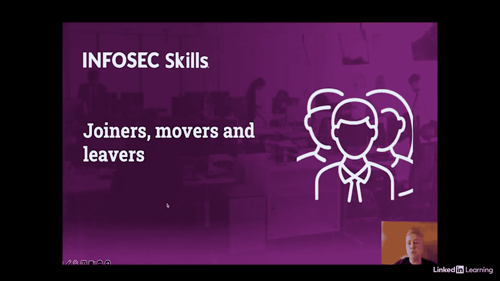
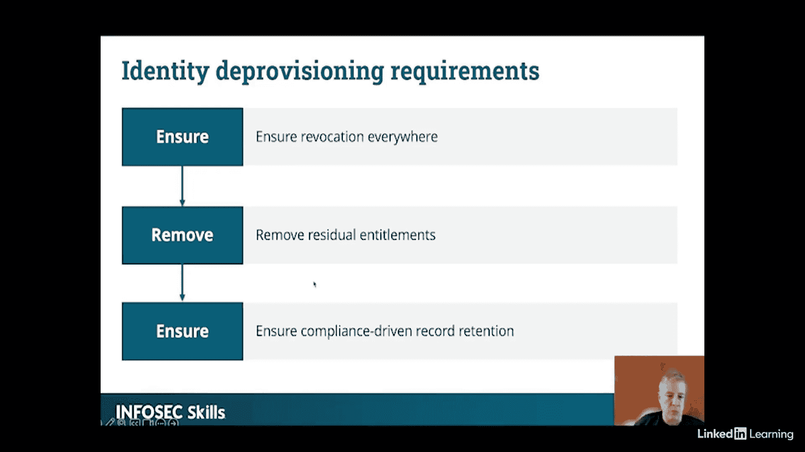

ISSAP教程：03：入职者、调岗者与离职者管理 🔐


在本节课中我们将要学习身份生命周期管理中的三个核心场景，分别是入职者、调岗者和离职者。简单来说，就是公司里的人员状态发生变化时，他们的系统账号和权限应该怎么处理。无论是新员工刚刚来报道，老员工换了部门或职位，还是员工决定离开公司，我们都需要一套标准化、自动化的办法来保证系统安全，避免权限混乱和遗留风险。下面我们就一起看看这三种情况具体该怎么处理。


首先，我们先来看看新员工入职时应该怎么处理。

当一个人刚刚加入组织，也就是我们所说的“入职者”，第一件事就是为他创建系统账号，并分配相应的权限。在有些公司过去是由管理员手动创建账号，可能在人力资源系统里建一个，又在活动目录里建一个，甚至在好几个不同的地方重复操作，这样既浪费时间，又很容易出错。更好的做法是使用自动化预配工作流，让账号创建和权限分配都按固定流程自动完成，不再依赖人工逐个操作。

以下是自动化预配工作流的核心步骤：



- 人力资源系统录入新员工信息
- 身份和访问管理系统自动接收信息
- 根据策略自动创建账号
- 根据角色自动分配权限

自动化预配工作流可以用这个公式来理解：
`账号创建 = 自动化工作流(人力资源入职事件)`

除了自动创建账号，我们还需要把权限也自动分配好，不能靠管理员随口决定。这里用到的是策略驱动的访问分配，意思是根据员工的工作地点、职位、部门等条件，由策略来决定给什么凭证和权限，而不是管理员临时拍脑袋决定。

策略驱动访问分配可以表示为：
`访问权限 = 策略(员工位置 + 员工角色 + 员工部门 + 其他属性)`

为了让权限分配更统一，我们通常会准备一些模板。比如针对不同职位，提前配好该职位通常需要的权限模板，或者根据员工的所在地、所属部门等属性来套用模板。这样可以保证每个人拿到的权限是一致的，不会出现这个部门给多，那个部门给少的情况。

以下是使用权限模板的好处：

- 权限分配保持一致
- 减少人工配置错误
- 加快新员工入职速度

不过，无论用什么模板，我们都要始终遵循最小权限原则。这句话的意思就是，任何人得到的权限都不能多于他完成工作所必须的权限，多一分都不行。

最小权限原则可以简写为：
`用户权限 = 完成工作所需的最小权限集`

在考试和实际架构设计中，我们还要把重点放在零信任架构上。零信任的核心思想就是“不信任任何人，验证一切”，不要默认内部网络里的人就安全，每一次访问都要经过验证。

零信任架构的核心公式是：
`信任 = 0，验证 = 一切`

通过基于角色和属性的映射，我们想要尽量减少特权蔓延和未授权访问。特权蔓延就是指员工权限越积越多，最后变成“超级用户”，这很危险。我们要追求可扩展性，也就是公司人多了也能轻松管理；也要追求可追溯性，也就是每一个权限变更都有记录可查。

身份生命周期治理从账号预配开始，包括身份证明、账号预配，然后是修改、禁用、删除等步骤。在这整个过程中，我们必须有详细文档，标准化流程，清楚知道怎么预配账号，怎么修改，怎么禁用，怎么删除，并且要保证全程可追溯。

定期还要回头审查这些流程，看看现有的权限和流程是否还能妥善监控和管理风险。此外，管理层需要批准访问变更，同时要强制执行职责分离，避免一个人拥有冲突的权限，比如既能创建供应商又能批准付款。


接下来，我们看看员工在公司内部变动时该怎么处理。

员工入职之后，通常不会一直待在同一个岗位，可能会换部门、换职位、换工作地点。这时候就是我们所说的“调岗者”。当员工角色发生变化，他的系统权限也必须随之调整，否则他可能保留着不该有的旧权限，又拿不到新工作需要的新权限，这既影响工作效率，也带来安全隐患。

要解决这个问题，最好的办法就是尽可能自动化。自动化越多，出错越少，管理也越轻松。

以下是调岗时权限调整的关键操作：

- 自动移除不再需要的旧权限
- 自动授予新岗位需要的权限
- 根据新属性更新账户标签
- 记录所有修改操作

动态访问调整可以用这个伪代码表示：

```
当检测到员工角色变更事件时：
    移除旧角色对应的权限集
    授予新角色对应的权限集
    更新员工属性标签
    同步至所有关联系统
    记录变更日志
```

具体怎么实现呢？就是通过基于触发器的更新。当某个特定事件发生时，就会自动启动权限变更流程。举个例子，假设销售代表Alice升职成了销售经理。人力资源系统会把这个变动发送给身份和访问管理平台，平台检测到角色变更后，自动移除Alice的销售代表权限，授予她销售经理的权限。

如果涉及的是高度敏感的权限，可能还需要经理额外批准。批准通过后，这些变更会推送到活动目录、Salesforce或者其他需要知道的系统里，确保所有系统的信息保持一致，这就是多系统对齐。

多系统对齐的核心目标是：
`所有系统中的员工身份和权限状态 = 一致且最新`

现在很多公司用的是云系统，不同供应商，不同的SaaS服务商，系统和服务非常多。我们希望能用身份和访问管理平台来做中心化的对齐，让入职、调岗、离职在所有系统里都能同步生效。


最后，我们再来看看员工离开公司时该怎么处理。

当员工从组织中分离，也就是离职时，处理速度必须非常快。离职员工的账号需要立即停用，所有的凭证都要撤销。这里的凭证包括密码、数字证书、密钥，以及任何可能让用户进入系统的东西。

停用账号并不只是让对方再也登不进去，通常撤销凭证只是意味着他不能再次登录，但如果他已经登录到了系统里，当前这个会话可能还在。所以我们还需要终止所有活跃会话，把他踢出系统。

离职处理的核心动作包括：

- 立即停用账号
- 撤销所有凭证（密码、证书、密钥等）
- 使活跃令牌失效，终止现有会话
- 执行去预配流程，清理残留权限
- 记录所有操作用于合规审计

去预配流程可以描述为：
`去预配 = 从单一真源发起停用 -> 推送至所有关联系统 -> 移除残留权限`

这里的“单一真源”指的是中心化的身份数据库，可能是活动目录、LDAP目录或者X.500目录。我们在这个中心位置做一次修改，然后确保这个变更传播出去，同步到所有其他系统和服务，保证撤销操作在各处都生效且保持一致。

还有可能残留一些权限，比如之前的群组成员身份或者某些没被覆盖到的访问权限，我们需要回头检查，把这些残余权限全部清理干净，并且要有文档记录，从头到尾都留下痕迹。这一点对于合规非常重要，不管是法律法规要求，还是公司内部政策要求，都要做到有据可查。即使账号已经停用，合规检查依然不能停。




本节课中我们一起学习了入职者、调岗者和离职者三种人员状态下的身份和访问管理方法。我们了解到，入职时要用自动化预配和策略驱动的权限分配，坚持最小权限原则和零信任架构；调岗时要依靠自动化和基于触发器的动态访问调整，实现多系统对齐；离职时要立即停用账号、撤销凭证、终止会话，并完成去预配和清理，确保合规和可追溯。希望这些内容能帮你更好地理解身份生命周期管理，在实际工作和考试中都能用得上。
