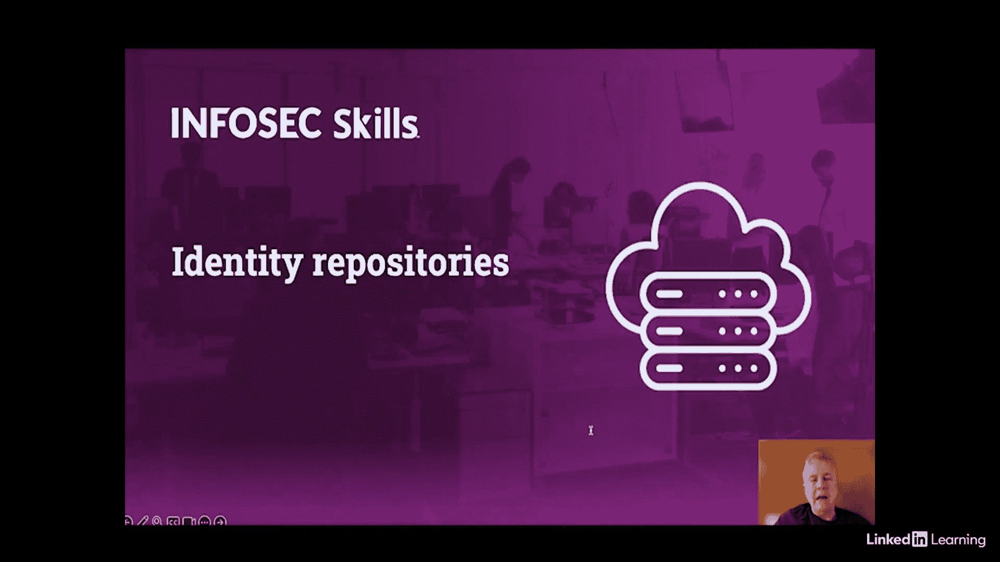
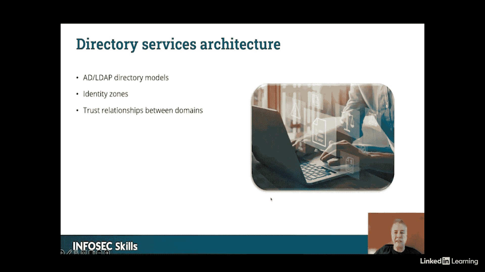

# LinkedIn ISC2 ISSAP：04：身份存储库 🗄️


在本节课中我们将要学习身份存储库的基本概念。我们会先看看什么是身份存储库，以及为什么企业需要一个中心位置来保存身份信息。接着我们会介绍唯一真理源的思想，解释它是如何帮助各个系统保持信息一致的。随后我们会聊聊模式一致性，看看如果不同目录里的同一个字段写法不一样，会带来什么麻烦。然后通过一个新员工入职的例子，说明自动化预配是怎么工作的，为什么要避免管理员手动创建账号。之后我们会简单介绍目录服务架构，说说Active Directory、LDAP和X.500这些常见模型。再之后我们会讨论身份区域，了解如何给员工、承包商和管理员分别制定安全策略。最后我们会说明域与域之间的信任关系，看看认证凭据是如何在不同域之间传递的。通过这些内容，你会对身份和访问管理中的核心基础设施有一个清晰的认识。


## 一、什么是身份存储库 🔍



在开始具体细节之前，我们先来看看身份存储库到底是指什么。

以下是身份存储库的核心作用。

身份存储库就是一个中心位置，专门用来存放身份信息和相关属性。你可以把它想象成一本通讯录，里面记录了公司里每个人是谁，拥有什么特征。在这个位置里，系统会保存用户的密码，或者更常见的是保存密码的哈希值，也就是经过加密处理后的密码摘要，而不是明文。除此之外，这里还会记录各种认证信息，用来证明用户确实是他声称的那个人。所有的身份数据都集中在这里，这样其他系统就不需要各自单独维护一份用户名单了。


```text
身份存储库 = {用户身份, 用户属性, 密码或密码哈希, 认证信息}
```


## 二、唯一真理源（Single Source of Truth） 📘

了解了身份存储库之后，我们再看看它为什么要被设计成唯一的权威来源。

以下是唯一真理源的主要目标。

唯一真理源的意思是，企业里应该只有一个权威的身份和访问管理系统。这个系统是整个环境中身份信息的最终出处。从这一点出发，我们可以向外推送一致的身份，并在整个环境中统一处理访问管理。也就是说，我们需要一个中心的、可信的来源，避免出现一种情况：一个仓库里记录的是一个信息，另一个仓库里记录的却是另一套信息，久而久之就会导致数据混乱甚至损坏。这个单一真理源可以来自人力资源系统，也可以来自Active Directory，或者其他企业目录。不管来源是什么，目标都是确保所有系统都使用同一套信息，避免冲突。


```text
单一真理源 = 权威身份和访问管理系统 = 全环境身份信息的唯一出处
```


## 三、模式一致性（Schema Consistency） 📐

有了唯一真理源之后，接下来需要解决的问题是，不同目录里的数据格式要不要统一。

以下是模式一致性的具体说明。

模式一致性是指，在不同的身份存储库之间，同样的字段应该使用同样的写法和含义。举个例子，在一个目录环境里，我们可能会看到department等于finance，完整拼写出来；而在另一个仓库里，可能会用DEPT等于FIN，DEPT是department的缩写，FIN是finance的缩写。你看，这两个条目表达的是同一个意思，但写法完全不同。如果不统一，当我们要根据部门来分配属性和权限时，系统可能就无法正确识别，导致权限分配出错。所以我们需要在所有身份存储库里保持模式一致，确保每个字段的定义都一样。


```text
目录A：department = finance
目录B：DEPT = FIN
```
这两行虽然都指代表财务部，但因为写法不一致，可能导致系统无法正确匹配。


## 四、自动化账号预配示例 🔄

当身份信息准确且一致之后，我们就可以把它自动分发到各个系统里了。

以下是一个新员工入职时的自动化预配流程。

假设公司招聘了一名新员工，人力资源部门在Workday或者其他类似系统里创建了一条新记录。这条记录会被推送到我们的身份管理服务器，然后服务器会自动在Active Directory、Intuit、AWS、Salesforce或者其他任何系统里创建对应的账号。这样做的好处是，管理员不需要手动去每个系统里创建或预配账号，也就避免了出现重复记录或者信息冲突的可能性。我们要的就是简化预配流程，提高自动化水平，让新员工能够快速获得所需的访问权限，而不需要人工干预。


```text
HR系统创建新员工记录
    -> 推送到身份管理服务器
    -> 自动预配到Active Directory
    -> 自动预配到AWS
    -> 自动预配到Salesforce
    -> 完成，无需手动操作
```


## 五、目录服务架构 🏗️

除了预配流程，我们还需要了解身份存储库背后的目录服务架构是什么样的。

以下是常见的目录服务模型。

目录服务架构通常涉及Active Directory或者LDAP模型。如果你在本地运行Windows环境，那么Active Directory就是很常见的选择。除此之外，轻量级目录访问协议，也就是LDAP，以及X.500数据库，也都提供了不错的模型和基础设施。这些架构决定了身份信息是如何被组织、存储和查询的。选择哪一种模型，要根据企业自己的环境和需求来决定。下一节我们会再详细聊聊跨域和跨环境的联邦信任，这里先知道有这些不同的目录服务模型可供选择即可。


```text
目录服务架构 = Active Directory | LDAP | X.500数据库
```


## 六、身份区域（Identity Zones） 🏷️

当所有系统都连接到同一个身份源之后，我们还需要给不同类型的用户制定不同的安全规则。

以下是身份区域的分类和策略示例。

身份区域用来把用户划分成不同的分组或类别，然后针对每个区域应用一致的安全策略。比如，我们可以设置普通员工区域、承包商区域和管理员区域。在普通员工区域，我们可能会要求启用多因素认证，只允许访问员工应用程序，并且要求使用经过授权的设备，也就是说要遵守一套特定的规则。而对于管理员区域，要求会更严格，可能需要更强的多因素认证，要求使用专门用于特权访问的特定工作站，还要进行持续的会话监控。总体来说，身份区域的想法就是给账户分类，这样就可以针对不同类别的用户，应用统一且合适的安全策略。


```text
身份区域 = {用户分组, 对应的安全策略集}
示例：
员工区域 -> {多因素认证, 员工应用访问, 授权设备}
管理员区域 -> {更强多因素认证, 特权工作站, 持续会话监控}
```


## 七、域与域之间的信任关系 🤝

在了解了身份区域之后，最后我们来看看不同域之间是如何建立信任的。

以下是域间信任关系的基本原理。

如果我们回到本地环境，考虑Active Directory，在典型的企业环境里通常会有多个Active Directory域。默认情况下，同一个森林里的Active Directory域会互相信任。简单来说，如果我在一个域里完成了身份认证，那么我的认证凭据可以被传递到受信任的域，或者被信任的域，这样我就不需要在每个自己有资源访问权限的域里都重新登录一遍。联邦信任也是类似的道理。想象一下，如果每次访问一个SaaS应用都要重新输入用户名和密码，对用户来说非常麻烦，而且用户名和密码会在网络上被反复传输，风险也很大。当我们说起这些信任关系时，并不意味着一个域里的所有人都默认信任另一个域里的所有人。它的意思只是，一个域里的认证服务器被信任，可以为那些已经提供过认证信息的用户做担保。我们会在下一节关于联邦的内容里更详细地探讨这一点。


```text
域A信任域B <=> 域A的认证服务器可为域B中已认证用户担保
```




本节课中我们一起学习了身份存储库的概念，了解了唯一真理源如何保证信息一致，学习了模式一致性为什么对权限分配很重要，通过新员工入职的例子看到了自动化预配的好处，还介绍了目录服务架构、身份区域以及域间信任关系。这些知识构成了身份和访问管理的基础，希望能帮助你更好地理解企业如何集中管理用户身份和访问权限。
