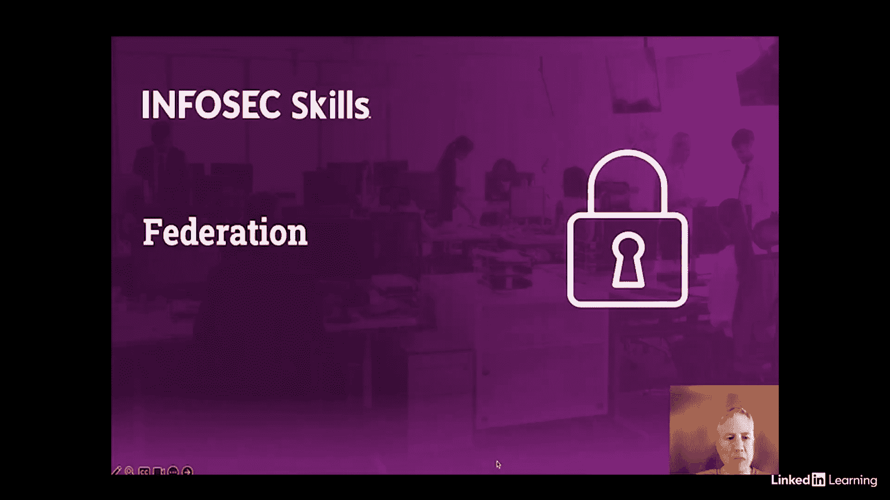
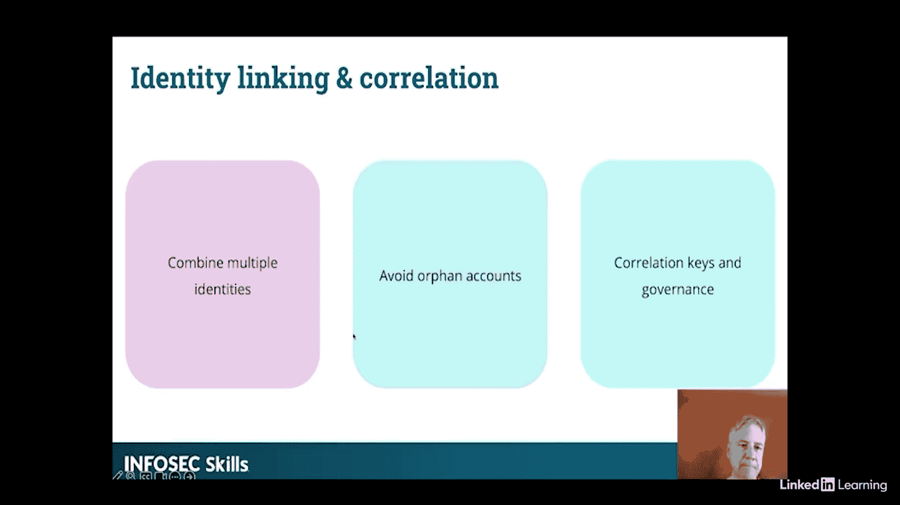

# ISC2 ISSAP：第05章：联邦身份管理 🔗


## 概述

在本节课中，我们将学习联邦身份管理的基本概念。首先会了解什么是联邦，以及它如何帮助不同系统之间建立信任关系。接着会介绍跨域身份交换的工作原理，并说明SPML和SCIM这两种常用的账户配置接口。随后会重点讲解SAML和OpenID Connect如何实现跨域单点登录，并说明OAuth授权框架的作用与区别。最后会讨论身份关联与治理，包括如何避免孤儿账号，以及如何建立统一的数字身份。希望通过本节内容，你能清楚地理解企业在多个域和云服务之间管理身份和访问权限的完整流程。

## 1. 联邦身份管理与跨域信任

之前我们一直在讨论身份和访问管理，重点主要放在单个域内部。也就是说，大部分场景都集中在一个组织或一个技术域内完成用户认证和权限控制。现在我们要把视野扩大，来看看如果用户需要访问多个不同域中的资源，应该如何处理。



这时候就涉及到跨域单点登录的问题。所谓跨域，就是指不同的系统、不同的组织，甚至不同的云服务提供商之间，原本并不共享同一套账号体系。如果要让用户在这些系统之间自由移动，而不需要反复输入用户名和密码，就必须在各个域之间建立信任关系。

为此，我们需要讨论联邦，并简单了解联邦信任是什么。联邦身份管理，简单说就是让多个独立系统同意信任对方的身份证明，从而让用户只需在一个地方完成登录，就能访问其他受信系统中的资源。

要让跨域单点登录正常工作，必须先搭建好一些基础架构。没有这些基础设施作为支撑，各个系统之间就无法交换身份信息，也就无法实现真正的单点登录。

首先需要的东西之一，就是跨域身份交换。以下是跨域身份交换的核心作用：

- 从一个服务中创建账号，并将该账号配置到另一个数据库中。
- 在HR系统中录入新员工信息，自动同步到Active Directory等中央目录。
- 使用API在不同数据库之间传输身份数据，避免人工重复录入。

## 2. 跨域身份交换与账户配置接口

跨域身份交换的意思是，我可以在某个服务中创建账号，并将该账号配置到另一个数据库。为了更好地理解，我们可以举一个实际的例子。假设一家公司招聘了一名新员工，HR部门会在人力资源系统中录入该员工的全部个人信息，包括姓名、部门、职位、联系方式等等。接下来，公司可以使用API，从HR数据库拉取这些信息，或者直接将信息推送到Active Directory以及其他中央目录数据库中。

你知道的，很多企业现在也会使用身份即服务，也就是IDaaS，比如Okta这类提供商。通过这些云端身份服务，企业可以把本地的用户信息与云服务进行打通，实现统一管理。不过，我们可以使用某些API，把这些信息拿去在别处配置账号，而不需要管理员逐个系统去创建。

这当然非常理想，因为我不需要重复操作，也不容易因为手动输入而出错，整个账号配置过程实现了自动化。这一点虽然不在幻灯片中重点展示，但它是理解跨域身份管理的重要前提。

针对跨域身份交换，有两类API你需要熟悉。以下是这两类接口及其特点：

- SPML：全称是服务配置标记语言。它可以帮我们将账号从一个数据库配置到另一个数据库，甚至多个数据库。
- SCIM：全称是跨域身份管理系统。它的功能和SPML基本相同，也用于在不同系统之间同步账号信息。

但SPML有一个明显的问题，它是基于XML构建的，XML包含大量标记，解析速度较慢。所以SCIM是更新、更现代的配置版本，我们今天主要使用SCIM，因为它更精简、更高效。

以下是账号配置的示例流程：

```
HR数据库 --API--> 中央目录(Active Directory) --API--> SaaS系统
```

因此，无论是在同一域内还是跨域配置账号，我们大概率会使用SCIM。不过也要知道，考试中SPML也可能出现，因为两者本质上做的事情是一样的，都是为了实现跨系统的账号自动配置。

好了，这样一来，身份信息就能从一个数据库同步到另一个了。但光有账号同步还不够，我们还要解决如何让用户不用重复登录的问题。

## 3. 单点登录与身份验证协议

那还不能让我实现单点登录，这时就需要SAML和OpenID Connect登场了。SAML已经存在很多年了，它的作用基本上就是允许跨边界进行身份验证。这里的边界，就是指不同域、不同组织、不同云服务之间的信任分界线。

当然，我们需要在各自的域之间建立信任关系。比如，我可能同时使用多个SaaS供应商，包括Salesforce、Office 365以及其他云服务。如果没有联邦信任，我就不得不每次都向每个供应商发送用户名和密码进行登录，这显然是我们不希望看到的，因为频繁在网络上传输密码会增加安全风险。

取而代之的是，我只需登录一次内部身份和访问管理服务器，或者像Okta这样的外部身份服务器。接下来，当我去访问我的资源，也就是我的SaaS供应商时，系统会有两种处理方式。以下是具体的登录流程：

- 如果我还没有登录，SaaS供应商会把我重定向回我的身份提供商，让我先完成身份验证。
- 如果我已经登录，我可以直接使用身份提供商给我的令牌来访问资源。

该令牌是因为我提供了正确凭据而获得的。因此，我的身份提供商会颁发SAML令牌或OIDC令牌，通常是JSON Web Token之类的东西，并且带有数字签名，用来证明这个令牌确实是由可信身份服务器签发的。

以下是SAML单点登录的简化流程：

```
用户 -> 访问SaaS -> 重定向到身份提供商 -> 登录成功 -> 返回SAML令牌 -> SaaS验证签名 -> 允许访问
```

因为SaaS供应商与身份和访问管理服务器建立了信任关系，所以它们会信任这个令牌。这样一来，我就可以在我的身份服务器上登录一次，然后访问管理员配置好的、我们之间有信任关系的所有资源。希望这能说清楚，因为这确实是当今云端单点登录的主流方式。

## 4. OAuth授权框架与权限委派

我还提到过，幻灯片上也出现了OAuth。OAuth是一个框架，是授权框架，而不是身份验证，而是授权。这里的关键区别在于，身份验证回答的是“你是谁”，而授权回答的是“你被允许做什么”。OAuth允许我授权某些应用程序代表我行事，而不需要把我的账号密码交给这些应用。

比如，假设我正在使用QuickBooks，需要访问我的信用卡和银行对账单，还需要从大量不同设备访问财务资源。我可以授权QuickBooks从我的银行和信用卡那里拉取信息，而不需要把我的银行登录密码告诉QuickBooks。这是因为它构建在OAuth框架之上。

OAuth框架的核心就是将权利和权限委派给应用程序，让它们代表用户行事。以下是OAuth授权的典型场景：

- 用户在第三方应用中授权访问银行账户信息。
- 应用程序代表用户从信用卡系统读取账单数据。
- 用户不需要向第三方应用提供自己的主账号密码。

以下是OAuth授权的简化流程：

```
用户 -> 授权第三方应用 -> 登录身份服务器 -> 颁发访问令牌 -> 应用使用令牌访问资源
```

好了，讲完了身份验证和授权，接下来我们要讨论的是如何在多个系统中把同一个人的身份整合在一起。

## 5. 身份关联与治理

身份关联与关联，这里我们要确保，同一个人名下的所有账号都被视为同一个数字身份。即使这些账号分布在Salesforce、QuickBooks、WebEx以及其他系统中，也应该被识别为同一个用户。所以我们希望能够通过Active Directory或身份和访问管理服务器提供的工具，把这些身份关联起来。

我们要避免出现孤儿账号，也就是不再使用的账号，也就是不再与活跃用户关联的账号，我们要清除掉。孤儿账号如果长期存在，就会成为安全隐患，因为攻击者可能利用这些被遗忘的账号进入系统。

当然，作为监管的一部分，我们需要良好且严格的治理。我们需要确保每个用户都有唯一标识符，比如员工ID或其他唯一身份标识，以便在所有系统中匹配账号。治理还需要提供政策和流程，确保不会出现任何错误关联。以下是身份治理的关键要素：

- 为每个用户分配唯一标识符，例如员工ID。
- 在所有系统中使用相同的唯一标识来匹配账号。
- 制定政策和流程，防止错误地将不同用户的账号关联在一起。
- 定期审查并清理孤儿账号。

## 总结



本节课中我们一起学习了联邦身份管理的核心内容。我们了解了跨域单点登录需要建立域间信任关系，掌握了SPML和SCIM两种跨域身份交换接口的区别，学习了SAML和OpenID Connect如何通过令牌实现跨域身份验证，还区分了OAuth作为授权框架的作用。最后，我们讨论了身份关联与治理，包括如何避免孤儿账号、如何使用唯一标识符匹配跨系统账号，以及治理政策的重要性。希望这些内容能帮助你建立起对联邦身份管理的完整认识。

