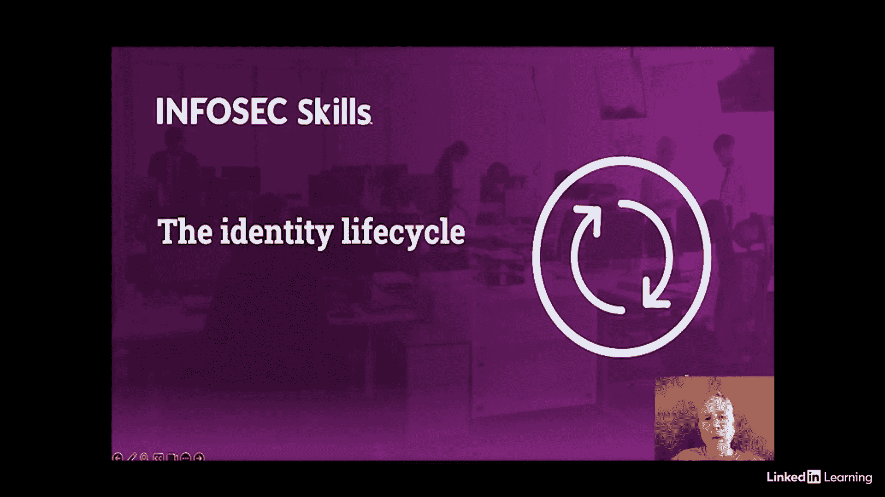
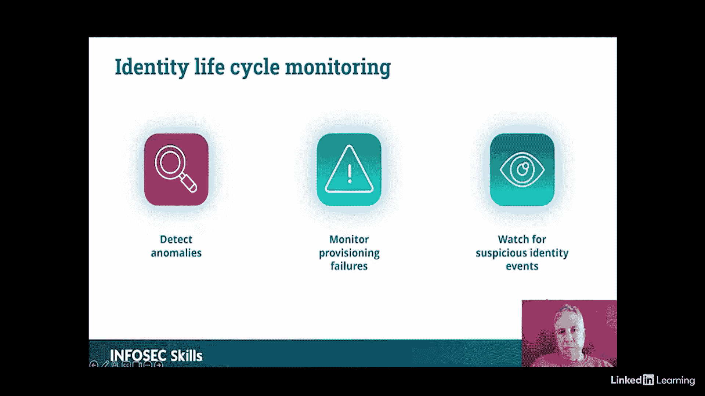

# 信息系统安全架构专家：06：身份生命周期 🔐


## 本节概述

在本节课中，我们将一起学习身份生命周期中的监控与日志记录工作。身份生命周期是指一个用户身份从创建到停用的完整过程，而在这整个过程中，我们需要持续地做监控和记录日志。这样做的目的是保证可追溯性和审计能力，也就是在出现问题时，能够查清楚是谁做了什么、什么时候做的。我们还会讨论如何保护审计日志不被篡改，如何发现账户创建中的异常情况，以及如何建立环境基线来判断什么是正常行为、什么是可疑行为。希望通过本节的学习，你能掌握身份管理中日志监控的核心要点。

## 身份生命周期与日志记录的基本要求

接下来我们来看看身份生命周期本身。身份生命周期可以用一个简单的公式来描述：

身份生命周期 = 创建 → 使用 → 变更 → 停用 → 删除

在身份生命周期的每一个步骤里，所有的变更都必须被跟踪并记录下来，这是治理工作中非常重要的一部分。简单来说，只要有账户被创建、修改或删除，就必须留下痕迹，不能有任何操作是在暗中进行的。

以下是身份生命周期中的主要阶段：

- 身份创建：为新用户建立账户
- 身份使用：用户正常登录和访问资源
- 身份变更：修改权限、角色或个人信息
- 身份停用：暂时禁用不再使用的账户
- 身份删除：彻底移除不再需要的账户



每个阶段产生的日志都要绑定到唯一身份上，也就是说，日志里必须清楚地写明是哪个具体用户做了什么操作。我们之前已经强调过身份唯一性的重要性，这里再次提醒，日志必须关联到具体的用户，而不能是模糊的共享账户或匿名操作。

## 可追溯性与审计能力

上一节我们介绍了身份生命周期的阶段和日志记录的基本要求，本节中我们来看看可追溯性和审计能力。可追溯性意味着我们能够沿着日志线索倒回去，找到每一个操作的源头。审计能力则是指我们能够定期组织审计，让审计人员来核查这些记录是否真实、完整。

为了做好这两点，必须制定相应的政策和流程，并确保这些政策被严格执行。具体来说，我们需要：

- 建立日志记录的标准操作程序
- 定期安排内部或外部审计
- 要求审计人员定期核验日志记录
- 确保每一次身份变更都有文档支持

审计不仅仅是形式上的检查，而是要真正验证日志是否被正确保存，是否可以用于事后追责。如果没有可靠的审计机制，那么即使记录了大量日志，在发生安全事故时也很难发挥作用。

## 审计日志的防篡改保护

我们刚才讲过审计的重要性，本节中我们来看看如何保护审计日志本身。审计日志必须具有防篡改能力，也就是说，没有人应该能够悄悄修改或删除已经写入的日志。

这里有一个核心原则：管理员和其他人员绝对不应该拥有对审计日志的写入权限。审计人员可以拥有读取权限，但也不是所有人都能看，只有真正需要查看的人才能获得读取权限。用代码来表达这个访问控制逻辑，大致如下：

```text
if 用户是管理员:
    拒绝写入审计日志
if 用户是审计员:
    允许读取审计日志
其他用户:
    拒绝访问审计日志
```

为了检测日志是否被修改，我们可以使用哈希算法。简单来说，哈希可以为每一份日志生成一个唯一的指纹，如果日志内容被改动，指纹就会变化，从而立刻被发现。除此之外，还可以把审计日志发送到场外保存，或者使用一次性写入介质，也就是只能写不能擦除的存储介质，这样即使攻击者获得了系统权限，也很难改走已有的日志记录。

我们需要能够证明审计日志具有防篡改能力，这不仅是技术要求，也是合规要求。

## 异常监控与基线建立

保护好审计日志之后，本节中我们来看看监控时具体要找什么。监控的核心目标是发现异常，也就是那些不符合常规的行为。但在判断什么是异常之前，我们必须先知道什么是正常，这就需要建立环境基线。

环境基线就是对系统通常运行状态的了解，包括每天大约创建多少个账户、用户通常会被分配什么权限、哪些操作属于日常工作。有了这个基线，我们才能发现偏离常态的情况。以下是需要重点监控的异常行为：

- 大量账户被手动创建，而平时应该是自动创建
- 单个用户被分配了超出常规的权限
- 身份创建或变更发生在非工作时间
- 同一个身份在短时间内从不同地点登录

如果发现大量手动创建的账户，可能意味着自动化流程出了问题，也可能意味着有人在暗中建立账户，这两种情况都需要进一步调查。

## 账户创建与配置失败检查

上一节我们讨论了如何建立基线并发现异常行为，本节中我们来看看账户创建过程中的失败和可疑事件。当在一个系统中创建了新账户，我们需要确认相关信息是否通过 API 或者配置语言被正确同步到了其他数据库。如果在传播过程中出现了失败，必须查明原因，不能放过任何一个错误。

新账户的创建本身就是一个潜在的安全漏洞。账户越多，被攻击者利用的可能性就越大，恶意行为发生的风险也就越高。因此我们需要确保新创建的身份都符合既定的基线要求。如果系统本来应该实现自动创建，却出现了大量手动创建，这就说明自动化流程可能没有正常工作，或者有人在绕过流程私自建立账户。

无论是日志监控还是身份生命周期管理，我们始终要关注可疑活动、系统失败以及超出常规范围的事件。这些关注点不仅适用于身份生命周期，也适用于其他任何类型的监控工作，但在身份管理领域尤其重要。

## 本节总结



本节课中，我们一起学习了身份生命周期中的监控与日志记录。我们了解了身份生命周期的各个阶段，强调了每一步都要被跟踪和记录，并指出日志必须关联到唯一身份。我们还学习了如何建立可追溯性和审计能力，如何通过访问控制、哈希算法和异地存储来保护审计日志不被篡改。最后，我们探讨了如何建立环境基线，发现手动创建账户、权限异常和配置失败等可疑事件。希望这些内容能帮助你更好地开展身份管理中的安全监控工作。

