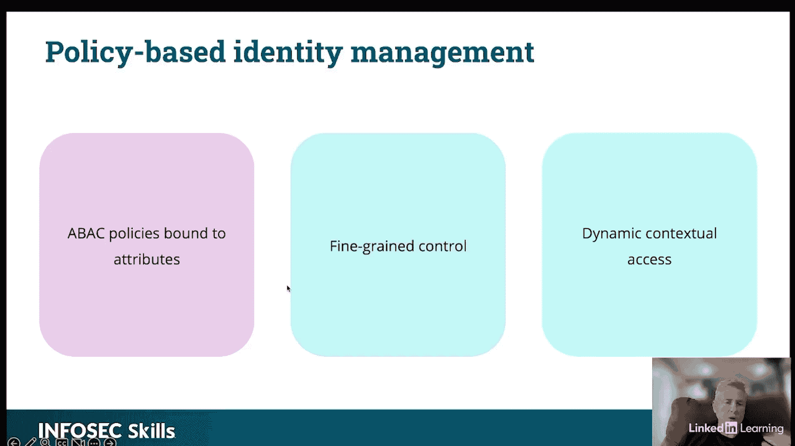
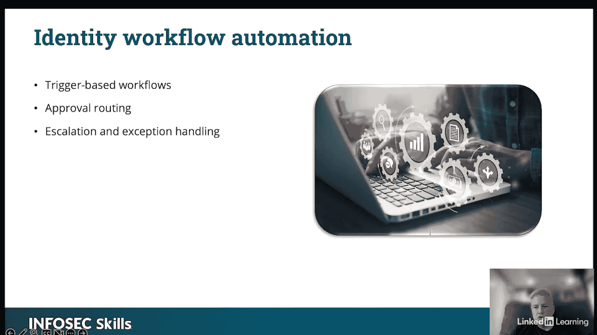
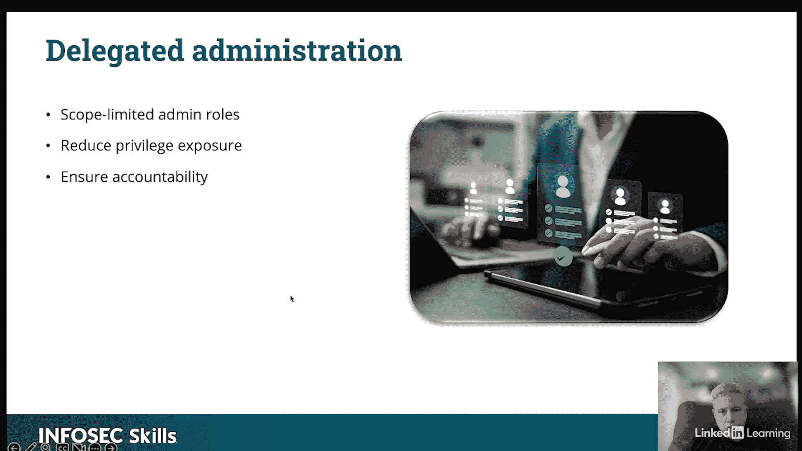

# ISSAP信息系统安全架构专家：07：身份与访问管理中的角色 🔐

在本节课中，我们将学习身份与访问管理中的角色设计。具体内容包括治理结构、证书生命周期、访问评审、角色工程、职责分离、工作流自动化以及基于属性的访问控制。通过本节学习，你将理解安全架构师如何构建规范的角色体系，降低权限滥用风险，并实现动态的访问决策。


## 1. 治理与身份治理管理 📋

上一节我们介绍了身份与访问管理的基本概念，本节我们先来看看治理在这一领域中的作用。

所有的安全工作都离不开治理。在任何环境中，都需要来自高层的支持和监督。身份与访问管理尤其如此。治理提供组织结构，通过政策表达领导层对流程如何推进的期望。

在身份治理与管理（IGA）范畴内，我们需要关注证书的生命周期。证书会被颁发，也会过期。我们需要定期审查，确保正确的所有者拥有正确的证书，并且整个证书生命周期得到妥善管理和维护。证书生命周期可以简化表示为：

```
颁发 → 使用 → 审查 → 过期 → 吊销或更新
```

另外，还要考虑访问评审。我们要确保不会出现权限蔓延问题。权限蔓延是指一个人在组织中待得越久，累积的权限和特权就越多。

以下是治理需要关注的关键点：
- 证书的签发与过期管理
- 定期的访问权限评审
- 权限蔓延的识别与清理


## 2. 角色工程与基于角色的访问控制 ⚙️

在了解了治理基础之后，我们继续看看作为架构师将深度参与的角色工程。

角色工程的核心思想是建立标准化的基于角色的访问控制机制。我们不再给个人分配权限，而是给组织中的角色分配权限。需要搞清楚组织里有哪些角色，每个角色对应的职责是什么，然后遵循最小权限原则和需要知道原则。最小权限原则可以表示为：

```
用户权限 = 完成工作所需的最小权限集合
```

基于角色的访问控制（RBAC）的访问决策可以表示为：

```
访问决策 = 用户所拥有的角色 ∩ 资源所要求的角色
```

在这之上，还有职责分离。这是一个非常重要的行政控制，应该在整个环境中实施。职责分离的目标是确保没有单个用户拥有过多权力或权威，并且要有清晰的报告路径。


## 3. 职责分离与角色挖掘 🚫

接下来我们深入探讨职责分离和角色挖掘的具体应用。

职责分离是保护组织免受内部欺诈和内部滥用的重要政策和工具。关于职责分离，有一个说法：它强制要求串通。乍一听这似乎很奇怪，为什么要让人们串通？串通通常是负面的，是指多方合作实施欺诈。

但我们的思路是，如果有人想要实施欺诈，我们希望他必须与他人串通才能成功，因为这样成功的可能性会大大降低。比如，签发支票的人不应该是打印支票的人。这就是我们所说的危险组合。另一个例子是，既能创建管理员账户，又能批准管理员权限的人，拥有了过大的权力。

角色挖掘是角色工程的重要环节。我们需要查看系统中已存在的用户，找出他们的权限，寻找模式、重叠部分，或者某人拥有过多权限的情况。例如，我们进行评估后发现：

- Alice拥有23项权限
- Bob拥有22项权限
- Carol拥有24项权限
- Dave拥有3项权限

这些人都说是薪资专家。为什么他们在同一个角色上的权限不一致呢？通过角色挖掘，我们会发现这些薪资专家中有20项权限是共用的。也许Dave和Carol有一些额外的权限作为例外。我们可以创建一个薪资专家角色，赋予这20项共用权限，然后将额外的权限作为例外处理。这样可以在各个角色之间保持更大的一致性。这是角色工程的一大好处，也是有效治理的重要需求。

角色生命周期管理意味着我们要持续审查和更新角色，确保有角色退役流程。当组织结构变化、业务需求变化、员工在组织中流动时，角色也需要随之调整。


## 4. 工作流程与策略强化 🔄

聊完职责分离和角色挖掘，我们看看如何通过工作流程来落实这些策略。

当用户请求访问权限时，我们希望启动一个工作流程。身份与访问管理解决方案会将请求的权限与职责分离策略进行比较。如果不存在冲突，可以批准访问；如果存在冲突，请求就会被拒绝。这个逻辑可以表示为：

```
如果 请求权限与职责分离策略冲突，则 拒绝访问；否则 允许访问
```

我们尽可能自动化工作流程，创建角色和策略，让管理员承担的工作更少，去除人为因素，提高效率。

随着课程继续，我们还会讨论零信任架构，以及身份管理与策略的结合。还有基于属性的访问控制（ABAC）。与静态角色分配不同，当用户访问资源时，系统不再只问“这个用户是谁，有什么权限”，而是查看属性。

用户从哪里登录？现在是什么时间？这是否是可信系统？系统使用这类信息来做决策。这样我们可以对访问进行非常细粒度的控制。访问决策不再是“Kelly H可以访问这个资源”，而是“Kelly H从该系统在今日特定时间可以拥有对此资源的读取权限”。这显然提供了更强的保护和更大的控制力。

访问决策公式如下：



```
访问决策 = f(用户属性, 环境属性, 动作属性, 资源属性)
```

属性包括：登录系统、职位、经理、权限等级、时间、地点、设备、读写删除修改等操作。


## 5. 自动化、审批路由与委派管理 🤖

最后，我们来看看如何实现自动化和委派管理。

自动化工作流程可以简化治理，在整个生命周期中自动响应事件。我们期望的是基于触发的工作流程。例如，当HR标记某人已离职时，就会触发工作流程；账户过期或晋升也是触发点。我们希望这些事件自动触发对应的流程。

以下是常见的触发事件：
- HR将员工标记为已离职
- 账户到期
- 员工晋升或岗位变动



在审批路由方面，访问请求会通过正确的审批链路进行传递。可能涉及特定经理、应用所有者或安全团队。目的是确保敏感访问在授予前得到审查和批准。如果需要升级，实例会自动升级到相应负责人。

关于委派管理，我们不会只有一个全能的网络管理员。相反，会有特定角色承担管理职责，但不存在全能的操作系统或全能的管理员。这样可以降低特权暴露。如果你攻破了我的账户，我只有管理权限，也许只能创建账户，但不能给这些账户分配特权，那么对你来说用处有限。

当然，我们还要确保问责、可追溯和可审计，以便将活动映射到单个用户。


## 本节总结 ✅



在本节课中，我们一起学习了身份与访问管理中的角色设计。我们讨论了治理与身份治理管理、证书生命周期、访问评审与权限蔓延、角色工程与基于角色的访问控制、职责分离与危险组合、角色挖掘与角色生命周期、工作流程与策略强化、零信任与基于属性的访问控制，以及自动化、审批路由和委派管理。这些内容构成了安全架构师在设计身份与访问管理体系时需要掌握的核心角色概念。

