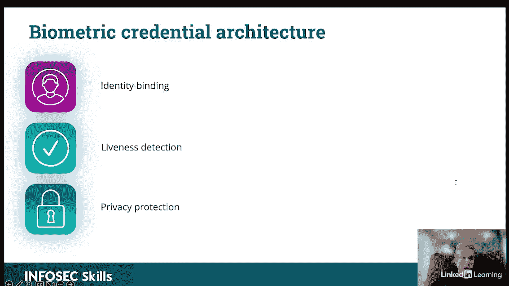
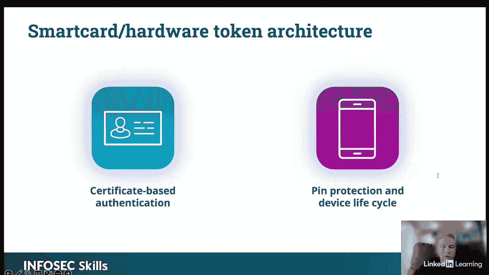

信息系统安全架构专家：08：凭据管理 🔐

在本节课中我们将要学习凭据管理的核心内容。凭据管理是指用户如何获取、使用、更新和最终失去对系统资源的访问权限。我们会从凭据的整个生命周期开始讲解，然后讨论如何颁发凭据，接着看看凭据如何进行轮换和续期，之后介绍自动化撤销机制，最后探讨密码以外的认证方式，包括生物识别和智能卡。通过本节课的学习，你将掌握如何在企业环境中安全地管理用户凭据，避免常见的安全风险。

接下来，我们先来看看凭据是如何随时间变化的。

凭据管理的生命周期 🔄

用户要访问他们需要的资源，必须先拥有相应的凭据。凭据可以是密码、智能卡、密钥或数字证书等。不管是什么类型的凭据，它都会经历一个完整的生命周期。简单来说，凭据管理的核心就是确保每个凭据在正确的时间被创建、被使用、被更新，并在不再需要时被撤销。

以下是凭据生命周期的主要阶段：

- 用户入职：组织为新员工创建账户并预配访问权限。
- 凭据颁发：系统为用户生成或发放密码、证书、密钥等凭据。
- 凭据维护：在用户使用期间，对凭据进行日常管理和监控。
- 定期续期：根据策略，对密码、证书和密钥进行到期更新。
- 凭据撤销：当用户离职或变更岗位时，废止旧凭据并收回访问权限。

整个生命周期必须有治理和监督机制，否则就会出现权限残留或僵尸账户，给安全埋下隐患。

了解了生命周期之后，我们再看凭据具体是怎么颁发出来的。

凭据的颁发与身份证明 🪪

在颁发任何凭据之前，必须先确认用户是谁。这个过程叫身份证明，意思是验证用户的身份是真实的，而不是冒充的。只有身份验证通过，系统才会创建并发放相应的凭据。无论是普通密码、智能卡、安全密钥还是数字证书，颁发前都需要完成这一步。

如果没有身份证明，攻击者可能冒充合法用户拿到凭据，从而绕过所有后续的安全控制。因此，身份证明是整个凭据管理体系的第一道防线，也是最基础的一步。

凭据颁发后，并不是一劳永逸的，还需要定期更新。

凭据的轮换与续期 🔁

凭据不能永远使用，必须定期更换或更新。组织的安全策略可能规定密码每隔一段时间就要过期，虽然这与某些早期的 NIST 建议不完全一致，但证书和密钥确实需要定期轮换。当证书到期、密钥需要更换，或者用户换岗需要新的访问权限时，就要启动轮换和续期流程。

以下是常见的轮换与续期场景：

- 密码到期：用户按策略在指定时间后更换旧密码。
- 证书到期：数字证书有有效期，到期前必须重新申请新证书。
- 密钥轮换：加密密钥定期生成新对，废弃旧密钥。
- 岗位变更：用户调岗后，收回旧凭据并颁发与新岗位匹配的凭据。

通过轮换和续期，可以降低凭据被长期泄露后被滥用的风险，保持环境的动态安全。

除了正常更新，还需要在用户离职时快速撤销。

自动化撤销与离职流程 🛑

当员工离开组织或职位发生变化时，旧的凭据必须立即失效，否则就可能被恶意利用。人工逐一撤销效率低下，容易遗漏，因此最好实现自动化。

以下是自动化撤销的典型流程：

- 人力资源系统标记员工已离职。
- 身份和访问管理平台接收离职信号。
- 用户在 Active Directory 或类似目录中的身份被自动禁用。
- 与该账户关联的令牌、证书、组成员身份、角色、VPN 访问权限、智能卡权限等全部被吊销。
- 每一步操作都会被记录在审计日志中，形成审计痕迹。

自动化不仅节省管理员时间，还能确保没有任何环节被遗漏，避免离职员工保留对企业资源的访问能力。

传统密码正在被淘汰，我们来看看无密码认证是怎么工作的。

从密码到无密码认证 🔓

传统的密码认证正在逐渐退出历史舞台。在安全要求较高的环境中，密码已经不再是可接受的方案，因为密码容易被猜测、破解或泄露。行业正在转向无密码认证模式，意思是用户不再需要输入密码来证明身份。

无密码认证的常见方式包括多因素认证和通行密钥。通行密钥类似于 Windows Hello，用户输入一个 PIN 码，解锁存储在系统可信平台模块中的密钥，从而完成基于个人和设备的双重认证。系统会向认证服务器发送数字证书，而密码及其哈希值绝不会通过网络传输，认证服务器也永远不会持有用户密码或 PIN 码的副本。

相比于在客户端和服务器上存储密码哈希的传统做法，这种方式安全性更高，因为它避开了太多已知的漏洞。

如果组织仍然允许使用密码，就必须制定严格的密码策略，明确密码的复杂度要求和最小长度，并强制用户遵守。

除了通行密钥，生物识别也是重要的无密码方式。

生物识别认证 👁️

生物识别技术正变得越来越普及，成本降低，准确率提高。常见的生物识别包括指纹、人脸识别和虹膜扫描等。在使用生物识别之前，必须确保用户的身份已与生物特征数据绑定。

以下是生物识别注册和使用的关键步骤：

- 身份证明：在注册期间，先验证用户的真实身份。
- 模板创建：对用户提供的生物样本进行数学运算，生成一个模板。
- 模板存储：模板经过加密，安全存储，例如存放在可信平台模块或安全隔区中，而不是集中式数据库。
- 比对认证：用户再次提供生物样本，系统重新计算并与存储的模板比对。

生物识别模板不是原始图像，也不是简单的哈希值，而是通过数学函数处理后的结果。可以把它理解为：模板 = 数学函数(生物样本)。这样即使模板被窃取，攻击者也无法直接还原出用户的指纹或人脸。

除了保护模板，还需要活体检测。早期的人脸识别系统可能被一张照片骗过，指纹识别可能被从玻璃上提取的伪造指纹骗过。活体检测的作用是确保用户提供的是真实的活体样本，而不是照片、视频或人造伪造品。

隐私保护也非常重要。系统不能存储原始生物图像，只能存储加密后的模板，并且最好分散存储而非集中在一个数据库中，以降低隐私泄露风险。

另一种常见的替代方案是智能卡和硬件令牌。

智能卡与硬件令牌 💳

除了密码和生物识别，智能卡和硬件令牌也是常见的替代方案。智能卡通常与公钥基础设施结合，实现基于证书的认证。为了提高安全性，还会加上第二个认证因素，比如 PIN 码、生物识别或通行密钥，从而实现多因素认证。

多因素认证的核心思想可以概括为：认证 = 你知道的 + 你拥有的 + 你是谁。没有任何单一认证因素是绝对安全的，都有可能被绕过。因此，分层防御和多因素认证非常重要，能够显著提升账户和系统的安全性。

本节总结 📚

在本节课中我们一起学习了凭据管理的完整流程。首先介绍了凭据的生命周期，包括入职、颁发、维护、续期和撤销；接着讨论了颁发凭据前必须完成的身份证明；然后解释了凭据轮换与续期的必要性；之后介绍了如何通过自动化流程在用户离职时及时撤销凭据并保留审计痕迹；最后探讨了密码以外的认证方式，包括无密码认证、生物识别以及智能卡和硬件令牌。希望这些内容能帮助你建立起对凭据管理的整体认识，并在实际工作中应用这些安全最佳实践。
