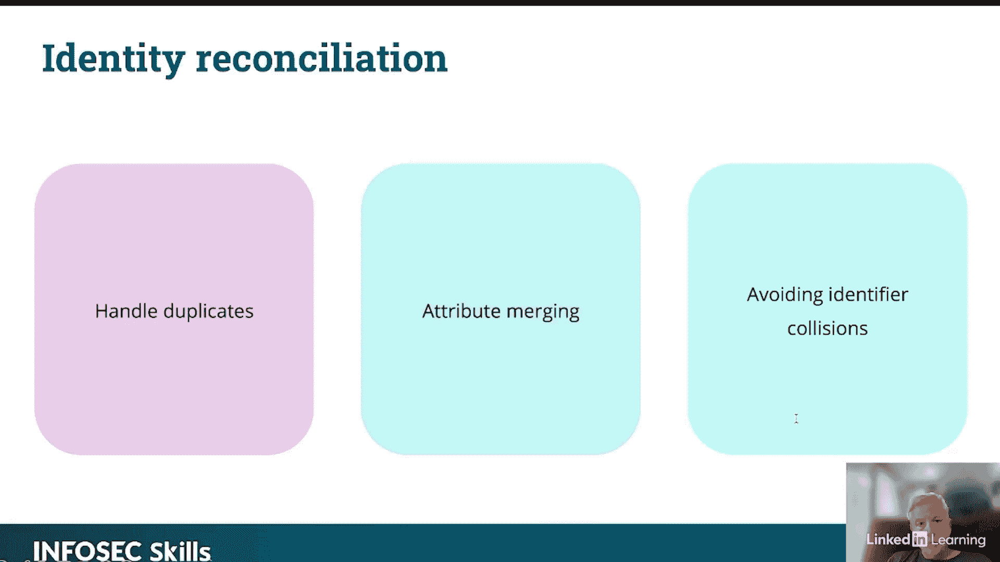

ISC2信息系统安全架构专家：09：API与机器身份 🔐


在本节课中，我们将一起学习应用程序编程接口（API）和机器身份的相关内容。很多刚接触安全架构的朋友可能认为身份管理只是给员工创建账号，但实际上，应用程序、服务、脚本和容器等非人类实体也都需要有自己的身份。我们会把这些机器身份的生命周期管理讲清楚，还会讨论证书认证、SSH密钥管理以及跨平台身份同步等实际问题。学完之后，你应该能理解为什么机器身份需要和用户身份一样严格地管理。

## 1. 什么是API与机器身份 🤖

首先，我们先来看看API和机器身份到底指的是什么。

当我们说到应用程序编程接口，也就是API，以及机器身份时，其实是在说非人类身份。这类身份可能来自应用程序、后台服务、工作负载、自动化脚本，或者其他任何不需要人工操作的程序。这些实体和普通员工一样，也需要拥有身份标识和访问权限，否则它们根本无法和其他系统进行通信。

你可以把API身份想象成一张电子通行证，里面记录了这个程序是谁，它被允许做什么。没有这个通行证，程序之间就没法互相信任。

以下是常见的非人类身份类型：

- 应用程序：比如后台运行的业务系统
- 服务：比如一直运行的网络服务进程
- 工作负载：比如部署在服务器上的计算任务
- 脚本：比如自动运行的自动化脚本

每一类身份都需要单独管理，不能混在一起处理。

## 2. 身份生命周期管理 🔄

了解了什么是机器身份之后，下一步就是学习如何管理它的整个生命周期。

在身份管理框架（ICF）中，生命周期管理是一个非常核心的概念。简单来说，就是从身份被创建开始，一直到它被停用或删除，整个过程都要有规则可循。对于员工身份，我们通常需要创建账户、设置认证方式、授予权限、监控使用情况、定期更换凭证，最后在员工离职时吊销账号。

对于API和机器身份，道理完全一样。我们也要在服务创建时就建立身份，并在整个使用期间对凭证进行轮换，防止密钥或证书长期不变导致安全风险。同时，不能让API拥有无限权限，必须通过授权治理来明确它能做什么、不能做什么。

以下是身份生命周期的主要阶段：

- 创建：为新的应用或服务建立身份记录
- 认证：确定该身份是谁的证明方式
- 授权：规定该身份可以访问哪些资源
- 监控：观察身份在使用过程中的行为
- 轮换：定期更换密钥、证书等凭证
- 审查：定期检查权限是否仍然合理
- 吊销与退役：当身份不再需要时，立即撤销访问权限

每个阶段都不能跳过，否则容易留下安全隐患。

## 3. 机器间通信与证书认证 🔒

有了身份和生命周期之后，我们还得知道机器之间怎么互相认识，这时候就要用到证书认证了。

现在的系统经常需要系统与系统之间通信。比如，一个网页应用程序可能需要连接数据库，这时候数据库就得确认：连过来的到底是不是真的那个网页应用？它经过认证了吗？它有没有权限执行接下来的操作？

为了解决这个问题，机器身份通常使用数字证书来进行认证。具体流程是这样的：应用程序A向应用程序B出示一张证书，应用程序B对这张证书进行验证，验证通过之后，两者之间的连接才会被允许。

证书的作用可以用这个简单的公式来表示：

```
证书 = 公钥 + 工作负载身份 + 可信机构签名
```

这个公式意味着，证书不仅包含公开密钥，还把这个密钥和具体的工作负载身份绑定在一起，并由可信机构背书。这正是TLS和双向TLS（mTLS）的工作原理：证书用来对连接两端的服务器进行身份认证，确保通信双方都是可信的。

## 4. 自动化证书管理与加密绑定 ⚙️

证书认证固然好用，但如果成千上万个容器都要人工发证，那工作量太大，所以我们需要自动化和加密绑定。

在实际环境中，容器的数量可能多达几千个，而且容器的生命周期往往非常短，启动一会儿就销毁了。如果每次都要人工给容器签发证书，那显然不切实际。因此，我们需要让系统自动完成证书的注册、签发、续期和吊销。

当一个新的工作负载被创建时，系统会自动验证它的身份，然后自动签发证书；证书快要过期时，自动续期；工作负载消失时，自动吊销证书。自动化不仅能提高效率，还能减少人为操作失误。

除了自动化，还有加密绑定这个概念。它的意思是，我们要把机器、API或者用户的身份，在密码学层面上和一个密钥绑定在一起。通常这个绑定是通过证书来完成的，这样就能确保身份和密钥是一一对应的，不能被随意替换。

以下是自动化证书管理的核心步骤：

- 身份验证：确认新建工作负载的合法身份
- 证书签发：自动生成并分发数字证书
- 证书续期：在到期前自动更新证书
- 证书吊销：工作负载销毁时立即撤销证书

有了这些机制，机器身份的整个生命周期就能高效、安全地管理了。

## 5. SSH密钥生命周期管理 🗝️

除了证书，SSH密钥也是机器身份管理中非常重要的一部分，我们不能忽视它。

安全外壳协议密钥，也就是SSH密钥，常被用来替代密码直接登录服务器。因为SSH密钥能直接获得对服务器的特权访问权限，所以它必须被当作特权凭证来对待。和其他身份一样，SSH密钥也需要完整的生命周期管理，包括生成、分发、监控、轮换和吊销。

在处理SSH密钥时，我们要遵循最小权限原则，只给该有的权限，不多给；要明确每个密钥的所有者；要采用集中式管理，避免密钥散落在各个服务器上；要定期审计使用情况；一旦发现问题，要能快速吊销。

以下是SSH密钥管理的关键原则：

- 最小权限：每个密钥只拥有完成任务所需的最低权限
- 所有权明确：每个密钥都有明确的负责人
- 集中管理：所有密钥统一存储和控制
- 定期审计：检查密钥的使用记录
- 快速吊销：发现风险时立即撤销密钥

这些措施能确保SSH密钥不会成为攻击者的入口。

## 6. 跨平台身份同步与调和 🔄🌐

当一个组织里有好几套身份系统时，就要考虑怎么让它们之间的数据保持一致，这涉及到身份同步架构。

现代企业通常不止一套身份系统。可能有人力资源应用、Active Directory、身份和访问管理平台，还有各种SaaS应用程序。如果这些系统里的身份信息不一致，就会造成很大的管理混乱。比如，一个人在HR系统里是财务部，在Active Directory里却成了会计部，这时候就得判断谁才是权威来源。

跨平台映射就是要把不同系统里的字段对应起来。比如，一个系统叫员工ID，另一个系统叫用户ID，虽然名字不同，但代表的可能是同一个信息，我们得把它们正确映射。

当多个系统的数据出现冲突时，必须确定哪个系统是权威来源，也就是source of truth，以此来决定冲突如何解决。

以下是跨平台身份同步需要注意的几个方面：

- 字段映射：将不同平台的同类字段正确对应
- 权威来源：确定在发生冲突时以哪个系统为准
- 数据调和：处理重复记录和不一致信息
- 属性标准化：把不同格式的数据统一成一样的形式

只有做好了这些，身份同步才不会变成一团乱麻。

## 7. 属性标准化与标识符冲突 🧩

在同步身份数据时，除了字段映射，我们还要处理数据格式和重复身份的问题。

属性标准化听起来很高级，其实就是把不同系统里存储的同类信息，统一成一个统一的格式。比如电话号码，有的数据库带括号，有的用连字符，有的什么符号都没有，虽然写法不同，但它们本质上都是电话号码。我们需要把这些格式统一起来，才能在多个数据库之间准确对比。

调和，也就是reconciliation，是指处理重复身份。比如系统里既有Robert Smith，又有Bob Smith，员工编号分别是12345和某个编号，这到底是不是同一个人？我们得制定规则来判断是否重复，如果是重复的，就要把来自多个来源的属性合并到同一个身份档案里。

最后还要注意标识符冲突，确保两个不同的人不会被错误地创建成同一个身份。人名并不是好用的唯一标识符，因为可能有重名。员工编号、用户ID这类标识符会更可靠。

以下是处理身份数据时常用的方法：

- 电话号码标准化：去掉括号、连字符等特殊字符，统一数字格式
- 重复身份判定：通过姓名、员工ID、部门等字段综合判断是否为同一人
- 属性合并：将HR系统、Active Directory等来源的信息整合到一个完整档案
- 优选标识符：优先使用员工编号或用户ID，而不是仅依赖姓名

做好标准化和调和，才能保证身份数据的准确性和可靠性。



本节课中，我们一起学习了API和机器身份的核心知识。我们了解到，应用程序、服务和脚本等非人类身份也需要像用户一样进行身份管理，并且要贯穿从创建到退役的完整生命周期。我们还讨论了数字证书在机器间通信中的作用，以及如何通过自动化来管理大量短暂存在的容器证书。此外，SSH密钥、跨平台身份同步、属性标准化和标识符冲突，都是实际工作中必须重视的环节。希望这些内容能帮助你建立起对机器身份管理的整体认识。
