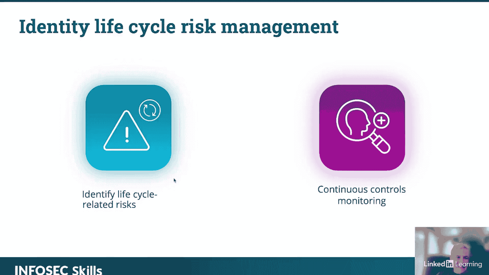
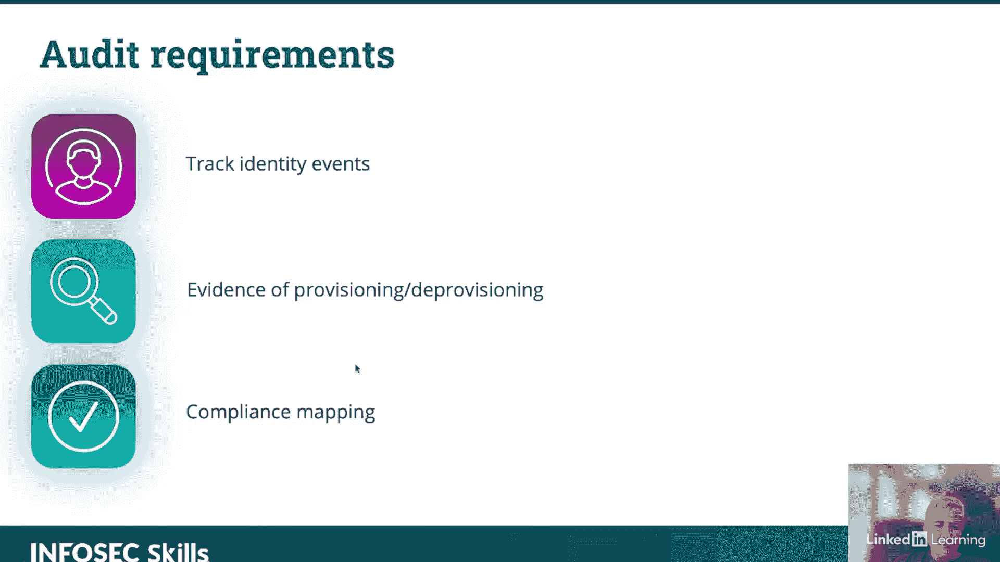

🔐 LinkedIn ISC2 ISSAP课程：10：风险与合规

在本节课中，我们将一起学习身份和访问管理生命周期中常见的安全风险，以及组织如何通过合规管理来降低这些风险。内容包括从账户创建到账户销毁的各个阶段可能出现的问题，还有企业需要遵守的法律法规和审计要求。即使你是刚接触安全架构的初学者，也不用担心，我会用最直白的语言把每个概念拆开来讲，确保你听得懂、记得住。


身份生命周期中的常见风险

上一节我们介绍了身份管理平台的同步机制和非人账户的基本概念，本节中我们先来看看账户生命周期里会遇到哪些具体的安全风险。这些风险贯穿员工从入职到离职的全过程，了解它们是做好访问控制的基础。


首先是账户配置阶段的风险。当新员工加入组织时，管理员需要为其创建账户，分配合适的凭证和访问权限。这时候必须遵循最小特权原则，也就是只给用户完成工作所必需的权限，多给一分都是安全隐患。可以用下面这个简单的公式来理解：

```
用户权限 = 完成当前工作所需的最小权限集合
```

如果配置时给多了权限，就属于过度授权，攻击者一旦入侵这个账户，就能拿到比预期更多的系统控制能力。以下是配置阶段需要注意的关键点：

- 确认新员工的身份和岗位职责
- 分配与岗位匹配的凭证
- 只开放需要访问的系统和数据
- 应用需要知道原则，避免无关人员看到敏感信息


接着我们看看员工在组织内部工作一段时间后，容易出现的特权蔓延问题。特权蔓延指的是一个人待在公司越久，积累的权限就越多，而旧权限却没有被及时回收。在基于身份的访问模型中，这种情况尤其常见。比如一位数据库管理员最初负责 DB1，后来调岗到 DB2，获得了 DB2 的权限，但原来的 DB1 权限没有被撤销，于是他手里就同时握着两个数据库的钥匙。可以用这个公式表示：

```
当前总权限 = 历史所有权限的并集 - 已被正式撤销的权限
```

当“已被正式撤销的权限”为空集时，权限就会不断累积，这就是典型的特权蔓延。以下是导致特权蔓延的典型场景：

- 员工内部调岗或换部门
- 项目结束后没有回收临时权限
- 管理员忘记禁用旧系统的账户权限


另一个需要警惕的是孤儿账户和休眠账户。孤儿账户是指员工已经离开组织，但对应的系统账户还没有被删除、禁用或移除，账户依然存在并且可能仍然可用。休眠账户则是账户本身还在，但长期没有登录或使用，比如某个只在每月月末运行一次的工资发放账户。这两类账户如果长期保留，就会成为攻击者的潜在入口。以下是这两种账户的区别和处理建议：

- 孤儿账户：员工离职，账户未及时注销，应立即禁用或删除
- 休眠账户：账户长期未使用，不在使用时段应保持禁用状态，仅在需要时临时启用




除了人为账户，我们还要关注字段同步和非人类账户带来的风险。字段同步是指组织内部使用多个身份管理平台时，需要确保同一个用户的身份信息在这些平台之间保持一致。如果同步出错，可能导致用户在某个系统里权限过高，在另一个系统里又无法正常工作。非人类账户包括服务账户和系统账户，它们不是由真人操作，而是由应用程序或脚本使用，通常拥有较高的系统权限，一旦被滥用，危害很大。以下是非人类账户的常见类型：

- 服务账户：用于运行后台服务或应用程序
- 系统账户：用于操作系统维护或自动化任务


最后，针对上述所有风险，组织需要通过治理机制和持续监控来加以应对。治理是指制定明确的访问管理政策和流程，而持续监控则是定期检查环境，确保没有人拥有超出职责范围的权限或权限。只有两者结合，才能在账户生命周期的每一个环节都把风险控制在可接受范围内。


合规风险与法规要求

在介绍完身份生命周期的各种风险之后，本节中我们再来看看另一种重要的风险类型，也就是合规风险。合规风险关注的不是技术漏洞，而是组织是否遵守了适用的法律、法规和行业标准。


合规风险可以简单理解为：我们是否做到了该做的合规事情。不同的行业和地区有不同的法律要求，比如美国的萨班斯法案、健康保险可携性和责任法案、支付卡行业数据安全标准，以及欧盟的通用数据保护条例。以下是常见的合规法规示例：

```
SOX（萨班斯法案）：财务报告和内部控制
HIPAA：医疗健康信息保护
PCI DSS：支付卡数据安全
GDPR：欧盟个人数据保护
```

需要注意的是，在美国并没有一部覆盖所有私人信息的全国统一隐私法，但这并不意味着组织可以忽略合规。很多企业仍然需要根据自身业务属性，遵守上述一个或多个法规。合规工作的核心是尽职调查，也就是要清楚自己属于哪些法规的管辖范围，并持续保持合规状态。以下是合规管理中需要考虑的关键方面：

- 确定组织需要遵守的法律和法规清单
- 评估现有控制措施是否满足法规要求
- 记录合规证据，以备审计检查


在保留记录方面，组织需要明确各类记录应该保存多长时间，包括审计日志、人事记录、客户记录以及财务数据等。保留期限通常由法规或内部政策指定，保留期结束后，还需要有明确的销毁流程，确保信息不会无限期地留在系统中。同时，组织必须保证可审计性，即保存的记录能够清晰展示谁访问了什么资源、谁批准了访问、访问是什么时候授予的、什么时候被变更的、什么时候被撤销的。为了保证这一点，还需要定期审查用户权限，确认用户当前拥有的访问权限是否仍然必要。以下是访问记录中应当包含的核心字段：

```
访问记录字段：
- 访问者身份
- 访问的资源
- 批准人
- 授予时间
- 变更时间
- 撤销时间
```

这些内容合起来，就是合规控制中关于保留和审计的重要部分。


审计与合规方法

说完了合规风险和记录保留，本节中我们最后来聊聊审计和合规方法。审计是验证合规是否落到实处的重要手段，而合规方法则是把技术控制措施与法规要求对应起来的过程。


首先，组织需要确保身份和访问管理的所有关键活动都可以被审计和追踪。这包括账户创建、身份验证、特权变更、访问批准、角色变更等全部操作。所有这些活动都需要有详细文档，并且必须能够提供配置或取消配置的证据，证明访问是被正确授予的、在必要时被修改过，以及在不再需要时被及时移除了。审计人员通常会核查谁批准了某项访问，以及该访问是否在应该撤销的时候被及时撤销。以下是需要纳入审计范围的活动清单：

- 账户创建和删除
- 身份认证日志
- 权限和特权的变更记录
- 访问请求的审批记录
- 用户角色的变更历史


在合规方法层面，关键词是可追溯性。组织需要把身份和访问管理的控制措施，映射到具体的法规、法律、标准或内部组织要求上，从而形成一条完整的证据链，追踪身份和访问管理生命周期的每一个阶段。只有做到可追溯，才能在面对外部审计或监管检查时，出示充分的证据证明组织的合规努力。




本节课中我们一起学习了身份生命周期中的常见风险，包括配置不当、特权蔓延、孤儿账户和休眠账户，还讨论了字段同步和非人类账户带来的安全挑战。接着我们探讨了合规风险，了解了常见的法律法规，以及记录保留、销毁和可审计性的要求。最后我们学习了审计的关键活动和基于可追溯性的合规方法。希望这些内容能帮助你建立起对风险和合规管理的直观认识，为后续的学习打下基础。

