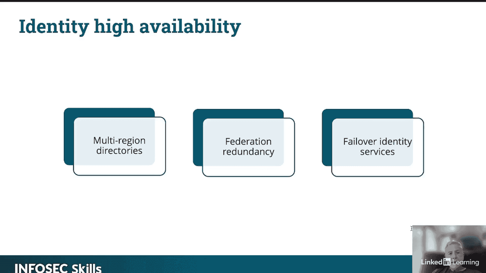

# ISSAP认证教程：11：可用性 🔒

在本节课中我们将要学习可用性在信息安全中的核心地位，重点探讨身份和访问管理系统如何保持持续可用，以及备份、恢复和高可用性设计的具体做法。这部分内容对准备ISSAP认证的学员非常重要，因为可用性直接关系到业务能否正常运转，即便是最强大的安全控制如果系统不可用也毫无意义。

CIA三元组是信息安全最基础的模型之一，它由机密性、完整性和可用性三个部分组成。很多安全课程在讲解时容易过度强调机密性，但实际上完整性和可用性对业务运行同样关键。如果数据无法在需要的时候被访问，业务就会停滞，因此可用性绝不能被忽视。

CIA = {机密性, 完整性, 可用性}

上一节我们简要介绍了安全基础概念，本节中我们来看看可用性如何具体应用到身份和访问管理系统中。身份和访问管理系统是整个企业安全体系的核心依赖，一旦这个系统出问题，用户和设备可能无法完成身份验证，也就无法维持对数据的访问权限和权限分配。初学者可能会觉得身份系统只是登录入口，但实际上它是支撑所有访问控制的基础设施。

身份存储的备份与保护

身份存储包含用户身份的属性、角色、访问策略和组成员关系等管理员配置的所有内容。如果身份存储发生故障，业务可能会受到严重影响，因此必须确保这些目录数据被备份，并且备份本身受到访问控制保护。无论目录是本地的Active Directory，还是通过Okta或其他身份提供商访问的云身份存储，保护和备份机制都不可或缺。备份还需要防止未授权访问，也要防范勒索软件这类威胁，因为勒索软件往往会让服务、备份和信息变得不可用，我们绝不能让系统处于容易受到攻击或系统故障导致的风险之中。

以下是备份保护的关键措施：
- 对身份存储定期执行备份
- 对备份数据启用访问控制
- 防御勒索软件对备份的破坏
- 防止系统故障导致身份不可用

备份完整性验证

仅仅拥有备份还不够，我们还必须确保备份没有被损坏，没有被篡改或修改。为了保证完整性，可以使用哈希算法检测数据是否被修改，使用数字签名提供不可否认性和真实性，同时对数据加密防止意外或无意泄露。简单来说，哈希告诉我们文件是不是原来的那个文件，数字签名告诉我们文件是谁签发的，加密则防止无关人员看到备份内容。

哈希完整性检查：Hash(备份前) == Hash(备份后)

数字签名：Sign(私钥, 数据) -> 签名，Verify(公钥, 签名, 数据) -> 真/假

恢复目标与恢复测试

拥有完备的备份流程固然重要，但更关键的是验证恢复是否可行。我们需要测试能否恢复身份及其权限和策略，并且要确认恢复能在既定目标时间内完成。这里涉及两个重要指标：恢复时间目标和恢复点目标。

恢复时间目标 RTO：系统允许的最大停机时间
恢复点目标 RPO：数据丢失的最大容忍时间窗口

RPO决定数据必须有多新，例如是一小时前、一分钟前还是一周前的数据，这完全由业务需求决定。大多数组织不可能接受一周前的数据，每个企业的具体需求略有不同。我们需要确保能够恢复到最后已知良好状态，并且该状态必须符合RTO和RPO的要求。

高可用性与弹性设计

备份和恢复是被动应对故障的手段，而高可用性则希望系统在遭遇法律问题、损坏、攻击或其他冲击时仍能持续提供服务。由于身份和访问管理是如此关键的依赖项，我们需要构建多区域目录，将身份服务和数据复制到不同地理区域。这样即使某个数据中心或某个区域发生故障，也不会导致整个数据存储不可用。在联邦身份场景中，不能只依赖单一联邦提供商，否则它就会成为单点故障。我们必须构建冗余基础设施，配置身份服务故障转移，并测试故障转移是否正常工作。如果身份基础设施失败，系统应当能自动切换到另一个位置或另一个服务。

以下是高可用性系统设计原则：
- 消除单点故障
- 部署多区域目录复制
- 实现身份服务自动故障转移
- 定期验证故障转移流程

本节课中我们一起学习了可用性在CIA三元组中的作用，探讨了身份存储的备份与保护，掌握了备份完整性验证的方法，理解了RTO和RPO恢复目标，并了解了高可用性与弹性设计的核心原则。希望通过这节课，你能对如何保障身份和访问管理系统持续可用有一个直观的认识。

