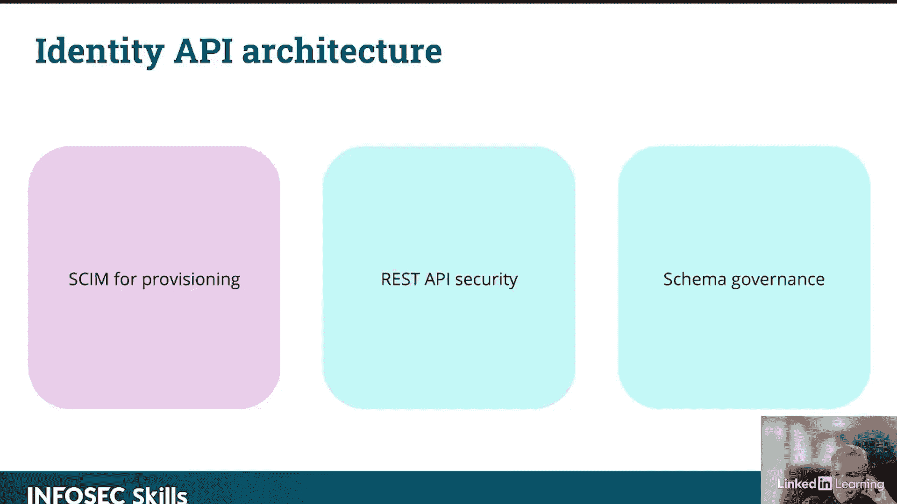

LinkedIn ISC2 ISSAP：12：API 架构 🌐

在本节课中，我们将学习 API 架构在身份和访问管理中的作用。我们会了解身份提供者和服务提供者如何通过 API 进行通信，重点介绍身份预配、单点登录和授权服务这几个核心目标。随后会对比 SCIM 与 SPML 两种预配协议，解释 SOAP 和 REST 的区别，讨论如何用 TLS 和 OAuth 保护 API，最后通过模式治理和一个实际案例，说明如何保持身份属性的一致性与安全性。


为什么我们需要讨论 API 架构

在身份和访问管理的语境下，我们的身份提供者和服务提供者需要相互通信，而它们通常是通过 API 来完成通信的。在搭建这套通信机制时，我们希望实现几个目标。首先是身份预配，即在不同系统之间自动创建和同步账户。其次是单点登录，让用户只需验证一次身份即可访问多个系统。最后是授权服务，确定用户可以对资源执行什么操作。


我们要关注的核心目标包括以下内容：

- 身份预配
- 单点登录
- 授权服务


SCIM 与 SPML：身份预配的两种标准

在 API 架构中，我们首先要关注的是 SCIM，它的全称是系统用于跨域身份管理。SCIM 是一种比 SPML 更现代的格式，虽然我们之前也使用过 SPML。SPML 的全称是服务预配置标记语言。这两者的核心目的都是身份预配，也就是说，当我在人力资源数据库中创建一个用户账户时，我需要将这个账户自动同步到活动目录、SaaS 提供商以及其他身份数据库中。SCIM 正是为此设计的，它支持自动创建、更新、禁用和删除账户，实现账户生命周期的自动化管理。

SCIM 的公式描述如下：

```text
SCIM = System for Cross-domain Identity Management
```

SPML 的公式描述如下：

```text
SPML = Service Provisioning Markup Language
```

身份预配的核心操作包括创建、更新、禁用和删除账户，这使得身份管理变得自动化，无需人工逐个系统进行操作。


SOAP 与 REST：API 通信协议的演进

接下来我们需要了解 API 通信中常见的两种协议类型，即 SOAP 和 REST。SOAP 的全称是简单对象访问协议，而 REST 的全称是表述性状态转移。这两种协议在早期都基于 XML 格式。XML 非常繁琐，包含大量标记，就像写一封纸质信件，需要写地址、装信封、贴邮票，流程较慢。相比之下，REST API 可以使用 JSON 等更简洁高效的格式，就像发短信一样快速直接，传输开销更小。

SOAP 的公式描述如下：

```text
SOAP = Simple Object Access Protocol
```

REST 的公式描述如下：

```text
REST = Representational State Transfer
```

目前在实际场景中，我们更倾向于使用 RESTful API，而不是基于 SOAP 的 API，因为 REST 更加轻量且灵活。


保护 API 的安全措施

API 拥有创建、预配账户、修改属性、删除或变更权限等敏感能力，因此必须做好保护。首先，我们始终应该使用 TLS 来加密传输通道。其次，API 需要强身份验证，确保只有合法的应用或用户才能调用。另外，我们还要提及 OAuth，即开放授权。OAuth 其实并不是一个 API，而是一个应用构建所依赖的框架。这个框架还包含 OpenID Connect，允许我们将责任委托给应用，让它们代表用户行动。OAuth 使用令牌来实现授权，必须遵循最小权限原则，并且对所有通过 OAuth 进行的访问应当开启日志记录与监控。

TLS 的作用可表述为：

```text
TLS = 传输层安全协议，用于加密 API 通信
```

OAuth 的公式描述如下：

```text
OAuth = Open Authorization
```

最小权限原则的公式描述如下：

```text
权限 = 最小必要权限
```


模式治理：保持身份属性的一致性

在讨论模式时，我们指的是数据库的结构。为了保证身份管理的可控性，我们需要确保身份属性在各平台之间有统一的定义。常见的身份属性包括用户名、员工 ID、部门、经理和账户状态等。由于身份需要在不同平台之间复制和维护，如果属性定义不一致，就会导致同步错误或权限混乱。模式治理的目标就是标准化这些定义，使得架构中的 API 能够提供一致性、标准化和安全的通信，从而实现受控的身份管理。

身份属性集示例如下：

```text
属性集 = {用户名, 员工 ID, 部门, 经理, 账户状态}
```


一个实际的账户生命周期示例

为了更直观地理解，我们可以看一个具体的例子。假设人力资源系统雇佣了一名新员工 Kelly，身份和访问管理系统会为 Kelly 创建一个身份。如果我们使用类似 Workday 的系统，SCIM 会将 Kelly 的账户预配到活动目录和 SaaS 提供商，同时同步所需的特定属性。后来，如果 Kelly 离职，人力资源系统会在其系统中终止她的账户，这条信息会被同步到其他基于身份的系统，使她的账户在所有关联平台上被撤销。

这个过程可以简化为以下步骤：

1. 人力资源系统录入新员工 Kelly
2. 身份和访问管理系统创建 Kelly 的身份
3. SCIM 将账户预配到活动目录和 SaaS 提供商
4. 同步必要的身份属性
5. 员工离职后，在人力资源系统中终止账户
6. 账户在所有关联的身份系统中被撤销


总结



本节课中，我们一起学习了 API 架构在身份和访问管理中的作用，了解了身份预配、单点登录和授权服务的目标，对比了 SCIM 与 SPML 以及 SOAP 与 REST 的区别，掌握了使用 TLS 和 OAuth 保护 API 的基本方法，还探讨了模式治理如何保持身份属性的一致性，并通过一个实际案例演示了账户的预配与撤销流程。希望这些内容能帮助你初步掌握安全 API 架构的核心思路。

