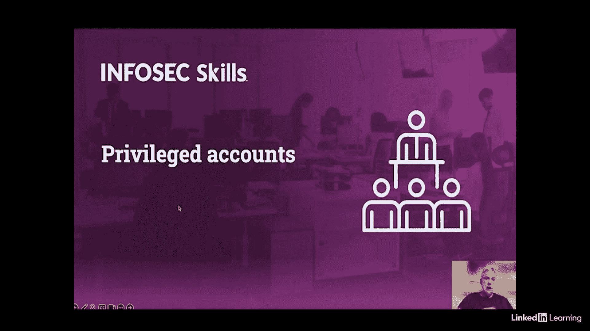
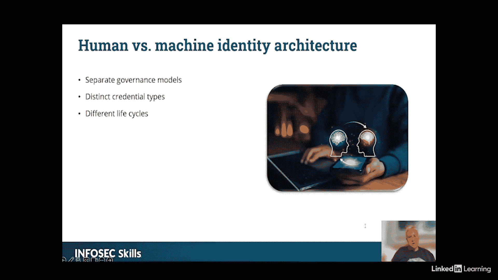

# 🔐 ISSAP 教程：第 13 章：特权账户与身份管理



在本节课中我们将要学习特权账户的保护方法，影子身份的识别方式，以及身份治理在企业网络中的核心作用。我们还会探讨如何通过角色访问控制防止权限蔓延，如何使用特权访问管理工具轮换密码，以及何时适用紧急访问流程。课程最后会讨论人类身份与机器身份在治理模型上的区别，并说明如何在软件开发生命周期中集成身份管理。这些内容将帮助你从架构师的角度理解身份与访问管理的完整体系。

## 🛡️ 什么是特权账户

首先我们来看看什么是特权账户，以及为什么这些账户需要额外保护。特权账户是指拥有超过普通用户权限的账户。在企业环境中，典型的特权账户包括管理员账户、root 凭证、域管理员账户以及云管理员账户。这些账户拥有的权限和权力远高于普通员工，因此一旦被攻击者控制，对网络安全的威胁将非常严重。作为架构师，我们需要明确这些账户的边界，确保它们不会拥有不必要的权力，避免在网络中造成过大的安全风险。

以下是特权账户的常见类型：

- 系统管理员账户
- root 超级用户账户
- 域管理员账户
- 本地管理员账户
- 云管理员账户

**特权账户权限** = 普通用户权限 + 额外管理权限

## 👥 影子身份与身份蔓延

上一节我们介绍了特权账户的基本定义，本节中我们来看看影子身份以及它如何导致身份蔓延。影子身份是指超出组织官方预批准身份和访问管理范围的任何身份。简单来说，就是员工私自使用未经批准的账户进行工作活动。例如，用户可能使用个人 Dropbox 账户或个人 GitHub 账户上传下载业务文件，或者使用未经授权的服务账户、本地管理员账户、SSH 密钥等。这些未经批准的凭证往往在 IT 部门的视线之外，不受监控，也不受定期审查。当组织拥有大量未管理的人类或机器账户时，我们称之为身份蔓延。身份蔓延会增加安全风险，因为治理机制通常无法有效覆盖这些未知的账户。

以下是影子身份的典型来源：

- 员工使用个人云存储账户处理业务文件
- 未登记的服务账户
- 本地管理员账户
- SSH 密钥和 API 密钥
- 其他未经批准的凭证

**身份蔓延** = 未管理的人类或机器账户数量

## ⚖️ 身份治理与管理 IGA

了解了影子身份的风险后，我们需要建立完善的身份治理与管理机制，简称 IGA。身份治理与管理的目标是确保每个身份和每个凭证都能被发现、被归属、被监控，并在整个生命周期内被妥善管理和注销。我们需要梳理人力资源部门新增的账户，确保用户入职时能够直接对应到现有账户，建立从入职到账户分配的直接路径。云身份发现也是重要环节，AWS、Google、Azure 等主流云服务提供商都能够监控并发现基于云的身份。架构师的职责包括建立账户清单，明确所有人类账户和机器账户，确保每个身份都有明确的所有者和文档化的业务目的。我们通过账户配置来进行治理，并对不再需要或不属于组织的账户进行审查和注销。当员工离职且账户不再必要时，必须及时删除这些孤儿账户。影子身份绝对会给组织带来真实风险，因为它们不受治理，甚至不被 IT 部门识别或知晓。因此我们的目标是确保每个身份和每个凭证都能被发现、被归属、被监控，并在整个生命周期内被妥善管理和注销。

以下是身份治理与管理的核心职责：

- 维护所有人类账户清单
- 维护所有机器账户清单
- 为每个身份指定所有者
- 记录每个身份的业务目的
- 执行账户配置与注销
- 处理孤儿账户

## 🔑 权限分配与基于角色的访问控制

接下来我们讨论权限，也就是与账户关联的权利和许可，以及如何将其与业务需求直接挂钩。权限是指账户在环境中拥有的具体权利和操作许可。为了防止用户获得超出其工作需要的权限，我们需要确保权限直接与业务挂钩。实现这一目标的最佳方式之一是采用基于角色的访问控制，即 RBAC。与按身份分配权限不同，RBAC 将权限直接映射到组织内的角色上。这样可以有效防止权限蔓延，即用户随着时间的推移获得了超出其所需权限的情况。当用户在组织内部转换角色时，我们还需要确保有适当的审批流程来调整其权限。基于角色的访问控制是一个非常重要的理念，而权限蔓延正是我们要解决的问题，这是一个非常真实的问题。我们将强制执行最小权限原则，确保不存在未经授权访问的路径，并确保任何孤儿账户都被注销。审计和合规性验证也是需要考虑的方面，职责分离同样重要。在管理权限时我们可以一直讨论其重要性，而针对特权账户，这一工作变得更加关键。

以下是基于角色访问控制的主要优势：

- 权限与业务角色直接绑定
- 减少基于身份的随意授权
- 降低权限蔓延风险
- 简化角色变更时的权限调整

```
用户 -> 角色 -> 权限
普通员工 -> 员工角色 -> 读取文件权限
系统管理员 -> 管理员角色 -> 修改系统配置权限
```

**权限蔓延** = 累积的权限 - 实际需要的权限

## 🛠️ 特权账户全生命周期管理与 PAM 工具

除了日常权限控制，我们还需要针对特权账户的整个生命周期采取专门的管理措施。特权账户的生命周期管理涵盖管理员、root、域管理员、本地管理员、云管理员以及服务账户等。为了有效管理这些账户，行业中常见的工具包括 CyArc 等特权访问管理解决方案。这类工具可以自动配置特权账户、授予临时访问权限、轮换密码、实现密码保管库，并支持借出和归还密码，确保策略得到执行。如果没有这样的软件工具，人为错误和策略不一致的问题将难以避免。特权访问轮换也是关键措施，其目标是限制特权账户被攻破后可能造成的危害。如果某个特权账户被攻破且长期未被发现，攻击者可以长期拥有域管理员权限，留下严重的安全隐患。因此，我们应当定期轮换管理员密码，甚至在使用后立即轮换，具体取决于我们要保护的数据价值和资源。我们还要考虑服务账户、API 及其关联的密钥，包括 SSH 密钥和云管理员凭证。大多数现代 PAM 系统正是通过自动化实现密码自动轮换，确保这些账户拥有强大且可靠的凭证。

以下是特权访问管理工具应具备的功能：

- 自动配置特权账户
- 授予临时访问权限
- 定期轮换密码
- 密码借出与归还
- 策略自动执行

```
PAM 功能 = 自动配置 + 临时访问 + 密码轮换 + 密码保管库 + 会话审计
```

**特权访问轮换** = 定期更改密码 + 使用后立即更改（视资源价值而定）

## 📋 特权访问审批流程与即时访问

在授予特权账户之前，通常需要经过比普通用户更严格的审批流程。特权访问的工作流程包含额外的监督步骤。用户首先提交请求，并记录业务合理性。随后可能需要经理、系统所有者或应用所有者批准，视请求的访问内容而定，信息安全部门也可能需要介入。批准通常具有时效性，我们稍后将讨论即时访问的概念。在监控和日志记录之后，凭证应立即被吊销。请注意，这只是一个典型流程的示例，实际流程应由组织自行定义，这是特权账户管理以及更广泛的身份和账户管理治理的一部分。

以下是特权账户审批流程的常见步骤：

- 用户提交访问请求
- 记录业务合理性
- 经理或所有者审批
- 信息安全部门介入（视情况而定）
- 设置时效性批准
- 监控与日志记录
- 立即吊销凭证

## ⏱️ 即时访问 JIT

刚才提到的时效性访问，也就是即时访问，是特权账户管理的重要理念。即时访问的核心思想是临时访问，绝不将特权账户作为用户的唯一账户长期分配。例如，用户 Kelly 拥有一个普通用户账户，当需要执行管理功能时，可以临时提升权限，使用管理员账户和密码完成必要操作，然后注销并返回普通用户账户。这种方式称为即时访问，适用于非常有限的时间段。在授予特权访问之前，还需要有文档化的业务理由。治理机制将规定具体需要哪些步骤。即时访问架构能够将潜在的利用风险控制在非常小的范围内，而不是变成大规模的安全事件，因为授权时间可能只有 10 分钟或 5 分钟，危害天然受到限制。自动过期也很容易理解，经过特定时间后凭证会过期，从而再次限制可能造成的损害。

以下是即时访问的主要特点：

- 临时提升权限
- 访问时长极短
- 使用后自动过期
- 需文档化业务理由

**即时访问** = 特权提升 + 固定时限 + 自动过期

## 🚨 紧急访问：玻璃访问

除了常规审批流程，组织还需要为紧急情况预留特殊的访问通道。玻璃访问，也就是 Break Glass Access，是指在紧急和紧迫的需求下绕过正常审批流程的应急访问方式。当你听到“玻璃访问”时，应当联想到“紧急情况下敲碎玻璃”这一场景。这通常由事件响应或防止业务中断等紧急需求驱动。玻璃访问必须是规则的例外，不是日常业务方式，使用频率极低，受到严格控制，并且必须接受审计。其目标是在正常审批流程因时间紧迫或其他原因无法遵循时，提供紧急访问。在紧急流程中，由于时间限制，无法走完正常的用户请求、合理性记录等步骤。此时可能有一名拥有激活玻璃访问账户能力的授权管理员，能够立即获取所需凭证。事件发生后，管理员必须说明使用玻璃访问的原因，评估紧急情况、访问的系统、持续时间，并总结经验教训，以便未来避免类似情况。从架构师角度设计时，我们需要确保为这些例外情况准备紧急账户，并且只有极少数用户能够访问该账户。

以下是玻璃访问的关键控制措施：

- 极少用户拥有该账户权限
- 凭证受到良好保护，通常存放在特权访问管理保管库中
- 强制使用多因素身份验证
- 记录会话日志
- 使用后轮换密码
- 事后进行严格监控与评估

## 🔄 权限漂移与持续验证

我们还需要关注用户权限随时间发生变化的问题，即权限漂移。权限漂移是指当我们不够依赖基于角色的访问控制，而更多采用基于身份的访问时，员工在组织中任职时间越长，其拥有的权限越可能超出实际需求。这类问题被称为权限漂移或身份不匹配，即用户的权限不再符合其职位名称所应具备的权限。为了应对这一问题，我们必须坚持持续验证，建立定期审查流程，持续监控任何权限变化，并验证合规性。架构师始终从架构师视角设计这些机制，确保在设计阶段就考虑到紧急账户等例外情况，并且只有极少数用户能够访问这些账户。

以下是持续验证的主要措施：

- 定期审查用户权限
- 监控权限变更
- 验证合规性
- 根据职位变化调整权限

**权限漂移** = 当前拥有权限 - 岗位所需权限

## 🔗 在软件开发生命周期中集成身份管理

身份管理不能只在系统上线后才考虑，而应贯穿整个软件开发生命周期。身份管理必须集成到整个软件开发生命周期中，而不能作为事后才想到的安全措施。应用程序需要关注集中式身份管理，无论使用的是 Azure、Okta 还是其他系统。我们需要与企业身份系统集成，提供单点登录支持，部署多因素身份验证，并持续应用基于角色的访问控制，因为这是重要的安全问题。同时应当使用 SAML、OIDC、OAuth 等标准，除非绝对必要，否则避免使用专有或厂商特定的实现方式，因为我们更倾向于使用开放标准。API 如同用户和服务一样，也具有入职要求。API 应与身份和访问管理解决方案注册，确保使用安全凭证，并通过 API 网关实现集中式策略执行。我们需要持续记录日志，建立问责机制并保留审计痕迹，这一点在考试中非常重要。

以下是身份在软件开发生命周期中的集成要求：

- 集中式身份管理
- 单点登录支持
- 多因素身份验证
- 基于角色的访问控制
- 使用开放标准协议
- API 与身份解决方案注册
- API 网关策略执行
- 持续日志记录

```
支持的标准协议 = {SAML, OIDC, OAuth}
不推荐的方式 = 专有协议 / 厂商特定实现
```

## 🤖 人类身份与机器身份

最后，我们来区分人类身份和机器身份，因为它们的治理模型截然不同。人类身份和机器身份采用不同的治理模型。对于我们的人员，其人类身份架构由人力资源部门进行治理；而机器凭证则由应用所有者、系统所有者和 DevOps 人员等进行治理。这意味着它们拥有不同的凭证类型和生命周期。如果你是普通用户，凭证可能包括密码、证书、多因素身份验证、生物识别、智能卡等。机器则会使用证书、密钥，无论是 API 密钥、OIDC 令牌还是 SAML 令牌，凭证类型完全不同。人类身份的生命周期包括入职、变更、离职，而机器身份通常随应用程序或工作负载创建，通常是自动化流程。重点在于，人类身份和机器身份需要不同的治理、不同的凭证管理以及不同的生命周期流程。作为架构师，我们必须考虑到这些差异，这是我们的首要职责。

以下是人类身份与机器身份的主要区别：

- 治理部门不同：人力资源部门 vs 应用和系统所有者
- 凭证类型不同：密码/生物识别 vs 证书/密钥/令牌
- 生命周期来源不同：人工入职流程 vs 自动化应用或工作负载创建

**人类身份治理** = 人力资源部门 + 入职变更离职生命周期  
**机器身份治理** = 应用所有者 / 系统所有者 / DevOps + 应用或工作负载创建生命周期



本节课中我们一起学习了特权账户的定义与保护方法，影子身份与身份蔓延的风险，身份治理与管理的核心职责，基于角色的访问控制及其在防止权限蔓延中的作用，特权访问管理工具与密码轮换，即时访问和玻璃访问的应用场景，权限漂移与持续验证，身份在软件开发生命周期中的集成，以及人类身份与机器身份的治理差异。希望这些内容能帮助你理解如何作为架构师设计安全的身份与访问管理体系。

