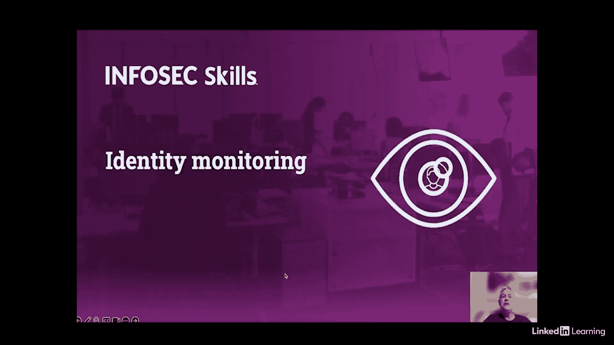
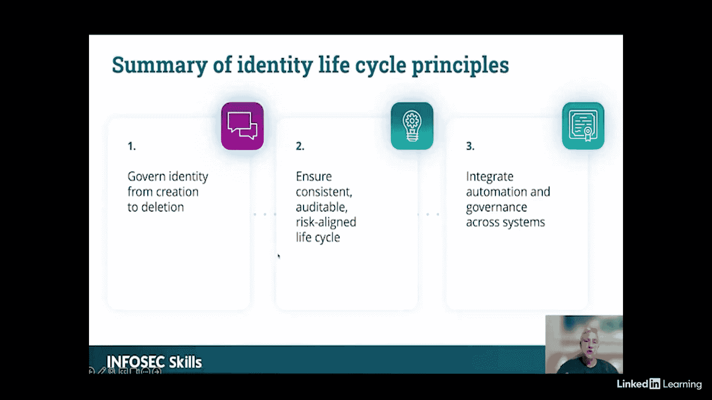

ISSAP 信息系统安全架构专家教程：14：身份监控 🔍




在本节课中我们将要学习身份监控的核心内容。身份监控是身份和访问管理体系中非常重要的一环，它决定了我们在创建身份之后，如何持续确保这些身份的数据准确、完整、有效，并配合治理机制完成访问控制。我们会从数据质量的基础说起，再看看文档和追溯性的作用，最后聊聊治理机制和关键绩效指标。无论你是刚接触安全架构的新手，还是正在准备 ISSAP 考试的学员，这节课都会用大白话把复杂概念讲清楚，避免使用晦涩难懂的专业术语。


从身份构建到身份监控 🛠️

上一节我们介绍了如何构建用户身份，本节中我们来看看身份创建完成后，应该如何进行持续监控。我们在前面的章节已经构建好了身份，接下来要做的就是对这些身份进行监控。监控的目的不是为了监视用户，而是为了确保每一个身份在整个使用周期内都保持合法、准确，不会因为数据错误而导致安全风险。这是身份和访问管理体系从建立阶段进入运维阶段的关键转折点。


数据质量是身份管理的基础 📊

既然要做身份监控，首先就要确保数据本身没有问题，否则后续的认证和授权都会出偏差。首先我们要确保数据质量，因为这是我们后续所有工作的基础。我们会先创建用户账户或用户身份，然后进行身份认证，最后授权用户访问资源。因此从一开始就要保证数据的准确性。完整性和有效性同样重要。当我们谈论准确性时，实际上这三者——准确性、完整性和有效性——都要从身份证明阶段开始抓起。

以下是数据质量需要关注的三个核心指标：

- **准确性**：录入的信息必须正确，不能有错别字或错误数值。
- **完整性**：所有必填字段都要填满，不能遗漏关键信息。
- **有效性**：数据格式要符合标准，数值要在允许范围内。

核心公式如下：

```
数据质量 = 准确性 + 完整性 + 有效性
```

如果数据本身就有问题，就会出现“垃圾进，垃圾出”的情况，也就是说：

```
错误输入 = 错误访问权限
```

记住，单纯的身份证明和整个生命周期的治理有很大区别。但我们必须从源头开始，确保获取的数据准确、正确，所有必要字段或请求字段都完整，所有信息都录入到身份管理系统中，并且有手段验证这些信息，确保格式正确、符合标准和业务规则。所有这些都要在身份证明之后，但在真正创建身份之前的早期阶段完成。

说到验证和清理，就是要确保录入的内容就像刚才说的那样：格式正确、必填字段齐全、录入的数值在可接受范围内。其中一些可以通过系统自动完成，但最终责任还是在于确保进入系统的数据准确且完整。当数据准确完整时，用户才不会获得错误或不当的访问权限，一切都要从数据质量开始。这样才能为身份认证和授权打下坚实基础。


文档、架构图与属性映射 📄

数据质量解决了输入的问题，接下来我们需要把这些数据的流转和结构记录下来，方便后续追溯和管理。现在说文档。我们负责确保有清晰、准确的架构文档，用于可追溯性，而且在可追溯性之前，还要确保这些文档能协助实施、运行和治理身份。

以下是文档工作需要包含的主要内容：

- 生命周期流程图：展示加入者、调动者、离职者在各个阶段的处理流程。
- 身份证明流程：说明身份是如何被证明的。
- 分配与修改流程：说明身份如何被分配、修改、审查和撤销。
- 架构图与属性映射：列出需要收集和验证的身份属性，例如部门、经理等，并说明这些属性在不同系统之间如何跟踪和管理。

所以，需要生命周期流程图。什么是生命周期流程？什么是加入者、调动者、离职者这几个流程，在每个阶段文档需要包含什么内容。我们要能展示身份是如何被证明、如何分配、如何修改、如何审查、如何撤销的。文档，文档，文档。你听过我说无数次可追溯性，这对考试非常重要。提供正确的文档用于可追溯性。

身份生命周期可以用简单代码表示：

```
身份生命周期 = 创建 → 分配 → 修改 → 审查 → 撤销
```

所以我们有了流程图，还有架构图和属性映射。我们需要收集和验证哪些身份属性？从正确的起点开始，哪些属性需要跟踪，如何跟踪，如何在系统之间管理？比如人力资源部门和谁是经理。我们要确保各个应用系统之间的格式和数据保持一致，因为身份和访问管理会根据最早录入的信息来分配账户，如果源头数据不对，后续分配就会出错。我们要跟踪正确的记录，确保信息可靠，而不是仅仅靠口头承诺或过时的文书工作。


治理机制与关键绩效指标 ⚖️

有了数据质量和文档基础，最后要谈的是治理机制，也就是谁来负责、怎么考核、如何持续改进。说到底是什么？治理。治理必须介入。那么执行哪些安全控制？我们如何认证？如何审查数据？治理的职责是什么？

治理会确定谁拥有身份和角色，哪些权利分配给这些角色，审批流程是什么。这样做是为了支持基于角色的访问控制，确保组织内权利一致。我们可以用简单代码描述 RBAC 模型：

```
基于角色的访问控制 = 用户 → 角色 → 权利
```

我们要记录文档，让分配规则的人有清晰的定义和可遵循的文档。说到治理时，我们还要为治理机构提供信息，供其决定需要做哪些改变。

以下是常见的关键绩效指标：

- 配置准确率：用户是否收到了正确的账户、身份、角色和权限。
- 撤销时间线：撤销账户的速度有多快，是否有遗漏。
- 认证完成率：完成了多少次访问复核，是否在要求的时间内完成。

说到关键绩效指标，配置准确率，就是要确保用户收到正确的账户、正确的身份，角色和权限是否准确分配，撤销时间线——我们撤销账户的速度有多快，是否有遗漏。说到认证完成率，也就是访问复核的完成率，关联到访问复核，确保我们跟踪完成了多少次访问复核，是否在要求时间内完成。

记住，在关键绩效指标层面，如果保持信息在较高层级，这非常适合高层领导。高层领导关心什么？我们是否在正确的时间做正确的事情？能否通过可审计性来证明？总结一下。治理总是从治理开始，所以我们需要对身份实施治理。我们谈过身份和访问管理的治理，从头到尾，从创建到删除身份，都需要一致且有效的数据，并集成到可能不同的系统中，在多个异构平台上保持一致。因为我们可能有 Azure、Okta、Active Directory 和 SaaS 提供商，一致性很重要。文档是治理中不可或缺的部分，也是治理职责的核心所在。




本节课中我们一起学习了身份监控的完整流程。我们了解了数据质量如何成为认证和授权的基础，学会了编写清晰准确的架构文档和属性映射，还掌握了治理机制的职责以及配置准确率、撤销时间线和认证完成率等关键绩效指标。希望这些内容能帮助你更好地理解身份和访问管理的治理体系，也为 ISSAP 考试打下坚实基础。

