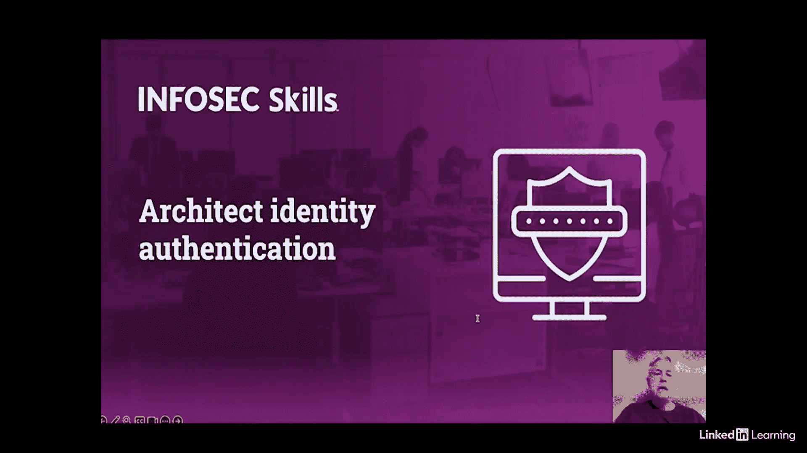
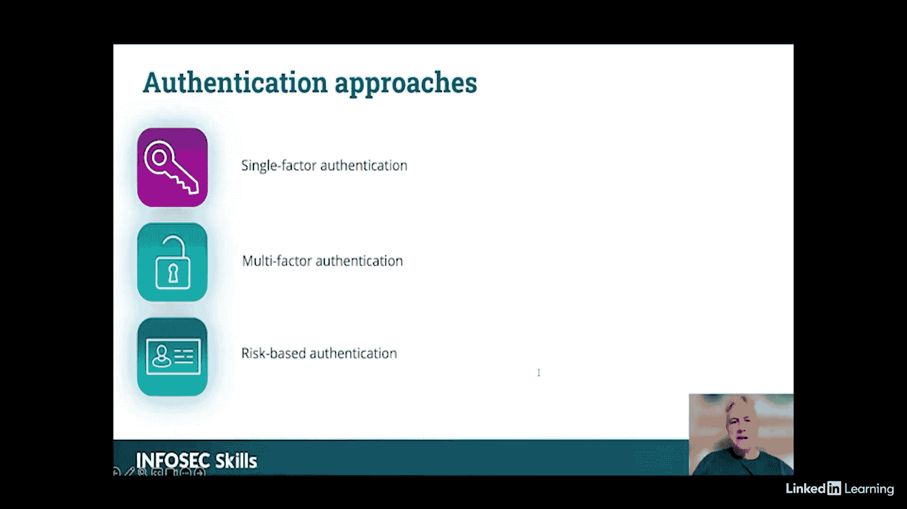

ISSAP身份认证架构：01：架构身份认证 🔐


在本节课中，我们将学习身份认证的基本架构思路。在完成身份管理之后，接下来要解决的问题是如何让用户证明自己的身份是真实的。我们会用大白话讲解认证机制怎么选，考试中如何平衡安全和业务，认证到底验证什么，以及零信任和访问控制模型在其中扮演什么角色。希望这些内容能帮助初学者快速建立起完整的认知框架。

上一节我们介绍了身份管理，重点是确保系统里的身份信息准确且完整，并且在不同平台之间保持一致。本节中我们来看看身份认证，也就是在有了正确身份记录之后，如何强制用户去证明这些身份确实属于他本人。

认证的核心目标非常直接，就是确认用户声称的身份是否属实。我们可以用下面这个公式来描述：



```
认证 = 验证(身份声明) + 验证(用户凭证)
```

在这个公式里，身份声明是说“我是谁”，而用户凭证则是用来支撑这个说法的证据。只有把这两部分都验证通过，系统才能相信用户就是他声称的那个人，而不是冒充者。

在决定使用哪种认证方式之前，我们需要先界定哪些认证机制是可以接受的。常见的选择包括多因素认证和单因素认证，稍后我们会详细对比两者的适用场景。具体来说，组织可以选择使用智能卡，也可以选择生物识别技术，比如指纹或人脸识别。不管最终选哪一种，关键是要提前决定哪些机制符合当前的安全要求和业务场景。

以下是需要评估的常见认证手段：
- 多因素认证，要求用户提供两种或以上的身份证明。
- 单因素认证，只需要一种身份证明，比如只有密码。
- 智能卡，一种携带身份信息的物理卡片。
- 生物识别，利用指纹、虹膜或人脸等生物特征进行验证。

考试里有一条非常重要的原则，大家务必牢记：答案永远不是“尽可能安全”。也就是说，在考试场景中，安全性绝不能盖过业务需求。虽然现实工作中我们希望安全措施与业务目标保持一致，但如果安全做得过头，就会影响用户体验，让日常操作变得更复杂，甚至让审计追踪和系统扩展变得更加困难。因此，我们必须在安全性和业务需求之间找到平衡点，而不是一味追求最高等级的安全。

可以用下面这段简单的代码逻辑来辅助理解：

```
if 安全措施影响业务可用性:
    重新评估安全措施的必要性
else:
    保持当前安全配置
```

认证到底起什么作用呢？简单来说，它负责验证身份，也负责验证用户的声明。也就是说，用户说自己是谁，认证系统要帮他确认这句话是不是真的。此外，认证机制必须具备抵御冒充和凭证窃取的能力，才能保证整个认证过程的可信度。

以下是认证机制需要抵御的主要风险：
- 冒充攻击，攻击者假装成合法用户进入系统。
- 凭证窃取，攻击者窃取密码、令牌或智能卡等凭证。

举个具体的例子，智能卡和令牌设备比较容易被物理偷走，而密码可能比较容易被猜中，攻击者甚至可以利用弱密码伪造用户身份。因此，在选择认证机制时，我们需要非常谨慎地评估处理流程，明确哪些方式是允许使用的，哪些方式应该被排除。

在讨论具体认证方式之前，还需要了解访问控制和信任模型。在考试中，零信任环境是一个经常出现的概念。零信任的核心思想是不默认信任任何人或任何设备，每次访问都要重新验证。同时，我们还需要考虑基于角色的访问控制、基于属性的访问控制，以及联合身份机制。这些因素都是决定如何进行身份认证时需要综合考虑的内容。

可以用下面这段伪代码来表达零信任的认证思路：

```
对于每一次访问请求:
    强制验证身份
    检查设备合规性
    根据最小权限原则授予访问权限
```

接下来我们来聊聊单因素认证和多因素认证怎么选。看到单因素认证，很多人第一反应可能是不想用，觉得不够安全。但实际上，在低风险环境下，单因素认证完全可以是合适的选择。记住，考试里的正确答案不一定是安全级别最高的那个。多因素认证显然更受青睐，因为它更难被伪造，即使发生了凭证窃取，攻击者还需要通过生物识别等第二道防线，才能拿到访问权限。

所有的选择最终都归结为基于风险的认证。我们可以用下面这个公式来描述决策逻辑：

```
认证方式 = 风险等级低 ? 单因素认证 : 多因素认证
```

在低风险环境中，单因素认证可能非常合适；在安全要求较高的环境中，多因素认证则更合适。具体采用哪种方式，取决于业务需求和安全要求，这些因素会共同决定我们认证流程的安全强度。最后，我们要把之前辛苦确保的正确有效身份拿出来，强制用户去证明那个身份确实属于他本人。



本节课中我们一起学习了身份认证的基本架构。我们了解了如何界定可接受的认证机制，掌握了考试中安全与业务平衡的原则，明确了认证要验证身份和声明并抵御冒充与凭证窃取，还学习了零信任、RBAC、ABAC和联合身份等访问控制模型，最后根据风险决定使用单因素还是多因素认证。希望这些内容能帮你打下坚实的身份认证架构基础。
