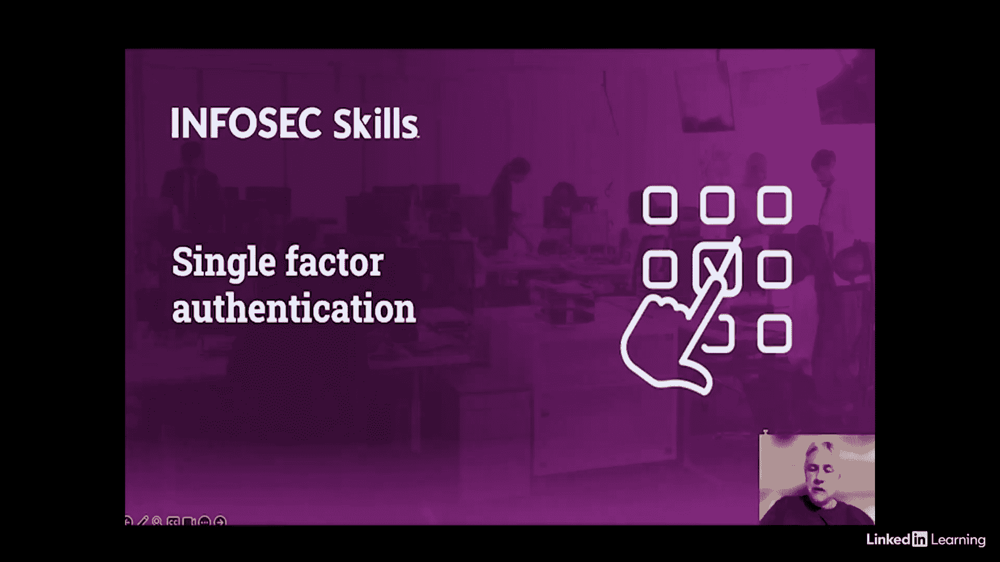
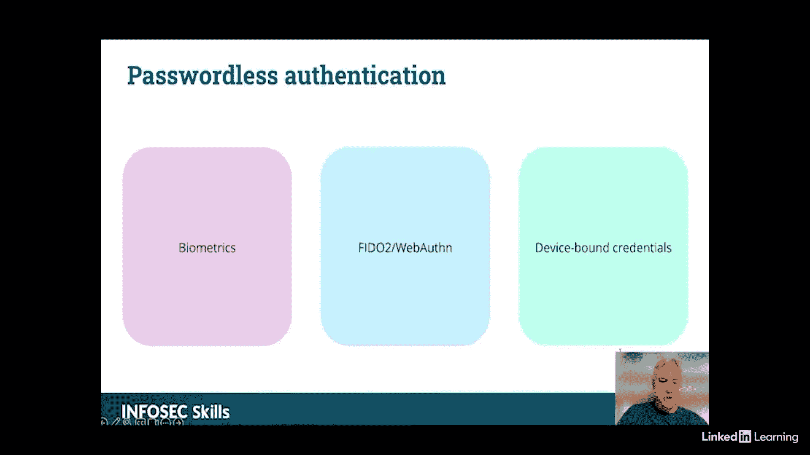

🔐 LinkedIn ISC2 ISSAP教程：02：单因素认证


在本节课中我们将要学习单因素认证的核心内容。上一节我们讨论了身份验证架构，也就是我们的用户将如何进行身份认证。在这一节里，我们将继续沿用这个话题，把重点放在单因素认证上，了解它的基本定义、面临的安全风险，以及密码策略在实际中的合理设置方法。

单因素认证是我们日常工作中最常见的身份验证方式。简单来说，只要用户只提供一种凭据来证明身份，就属于单因素认证。我们可以用下面这个公式来描述：

```text
单因素认证 = 仅一种验证因素（例如：仅密码，或仅PIN码，或仅生物特征）
```

大多数人都使用过单因素认证环境，因为这种方式在低风险场景下非常实用。它的首要考虑点是易用性和用户体验，也就是让用户能够快速、方便地完成登录。由于只需要一种凭据，系统能够获得的用户身份保证程度是最低的。常见的单因素凭据包括用户知道的密码、PIN码，以及越来越流行的生物识别技术。

不过，即使是生物识别技术，也存在被伪造的可能性。如果单因素认证使用的是用户已知信息，也就是基于知识的认证方式，那么它就会非常容易受到钓鱼攻击和暴力破解攻击的影响。密码尤其容易受到彩虹表攻击，而且如果用户设置的密码太弱，攻击者就能很轻易地获得访问权限。



下面是单因素认证中常见的凭据类型：
- 用户知道的信息：例如密码、PIN码
- 用户持有的信息：例如安全令牌
- 用户本身的特征：例如指纹、面部识别

在单因素认证场景中，如果我们选择使用基于知识的认证，就需要特别警惕网络钓鱼和暴力破解这两种攻击手段。弱密码和可预测的密码模式，会让攻击者通过彩虹表等手段快速破解账户，从而绕过系统的安全防护。

接下来，我们来看看密码策略的具体要求。长期以来，很多组织都采用八位字符密码，并且强制要求包含复杂字符。NIST机构已经发布了新的标准和建议，供我们参考。在制定密码策略时，我们需要明确密码的长度要求和复杂度要求。具体来说，需要决定密码最少要有多长，是否要求特殊字符、字母数字组合，以及大小写字母的使用规则。

这里有一个容易被误解的概念，我们可以用公式来辅助理解：

```text
密码安全性 ≠ 密码复杂度
密码安全性 ∝ 密码长度
```

也就是说，复杂度并不等同于安全性，密码的长度才是更关键的因素。很多时候，我们为了提高安全性而强制要求复杂的字符组合，结果反而让用户更难记住密码，而攻击者却能更轻易地猜到。因此，在设计策略时，必须充分考虑可用性，避免给用户带来过多负担。

NIST对安全环境的建议是使用16位字符的密码。与此同时，NIST已经不再建议用户定期更换密码，比如每隔一段时间就强制修改。现在的建议是，只有在密码可能已被泄露的情况下，才需要更换密码。我们需要跟进最新的密码解决方案，并且思考除了传统复杂密码之外的替代方案。

下面是NIST关于密码策略的主要建议：
- 对于安全环境，建议使用16位字符密码
- 不再要求用户定期轮换密码
- 仅在存在密码泄露风险时才更换密码

以前我们可能见过像XJ9@$4,4K这样难以记忆的密码要求，但这并不是最好的选择。一个更好的办法是让用户根据自己熟悉的四个单词来创建密码。这样生成的密码会非常长，攻击者很难破解，但对用户来说却更容易记住。

标准账户和特权账户的管理策略是有区别的。对于标准账户，NIST已经不再要求每30天强制更换一次密码。但对于特权账户，由于其关联的风险更高，我们需要单独评估是否仍然需要定期更换密码，以及什么样的频率才合适。

除了普通密码，我们还可以考虑一次性密码或密码签出机制。这是一种相对较新的理念，可以把管理凭证的过程想象成图书馆管理员借书。当用户需要凭证时，可以签出一份凭证，用于特定目的，使用完毕后归还。整个过程会留下完整的纸质痕迹和文档记录，方便审计和追溯。

密码签出流程可以表示为：

```text
用户申请凭证 -> 系统签出凭证 -> 用户在特定用途中使用 -> 用户归还凭证 -> 记录完整审计日志
```

另一个需要重点考虑的概念是剪切级别。剪切级别本质上是系统对错误操作的容忍度，具体来说，就是用户在被锁定账户之前，最多允许输入多少次错误密码。

```text
剪切级别 = 允许的最大错误尝试次数
```

这里有一个比较棘手的点。剪切级别的主要目的，其实是降低管理员的工作量，而不是直接防止密码被猜测。如果每次输入错误一次就立即锁定账户，那确实是最安全的做法，但管理员就会天天忙着给用户解锁密码，变成所谓的“密码解锁员”，这显然不符合实际工作需求。因此，我们通常会允许用户有三次或五次错误尝试的机会。当用户超过剪切级别时，系统采取的应对措施，才是真正用来防止密码被猜测的手段。

密码的存储方式也在不断演进。目前，密码通常以哈希值的形式存储，而不是明文保存。我们正在探索并实施一些新技术，这些内容将在后续章节中详细介绍。传统的哈希算法，比如SHA1和SHA2，已经不再足够安全，我们需要转向更强大的哈希方法，例如BCrypt、PBKDF2和Argon2。

```text
存储值 = Hash(密码，盐值)
```

这些新技术本质上都是用来保护密码的不同手段，因为我们之前看到的旧方法确实已经不够安全了。

最后，我们也可以考虑无密码认证方案。如果只允许使用单因素认证，生物识别可能是一个更好的选择。除了传统的生物识别，还有FIDO2技术。我们将在稍后详细讨论FIDO2，但可以先说，它能提供更强的身份验证，支持设备绑定凭据，并且兼容零信任架构。

在零信任模型下，我们需要确保身份验证不仅仅依赖于容易被伪造的用户身份，而应当将认证与用户的设备绑定在一起。这样一来，认证就不仅与用户挂钩，还与具体的设备关联，从而为系统增加了一定的安全保障。

下面是无密码认证与传统密码认证的简单对比：
- 传统认证：仅依赖用户密码，容易被钓鱼或暴力破解
- 无密码认证：依赖生物识别或设备绑定凭据，安全性更高
- 零信任认证：将用户身份与设备同时绑定，提供额外安全度



本节课中我们一起学习了单因素认证的基本概念，以及它在低风险环境中的应用场景。我们还探讨了单因素认证面临的钓鱼、暴力破解和彩虹表攻击等风险，并详细了解了密码长度、复杂度、可用性以及NIST的最新建议。除此之外，我们讨论了标准账户与特权账户的管理差异、一次性密码和密码签出机制、剪切级别的设置逻辑、密码哈希存储的最新算法，以及无密码认证和零信任架构在单因素认证中的作用。希望这些内容能帮助你更好地理解如何设计和实施单因素认证策略。
