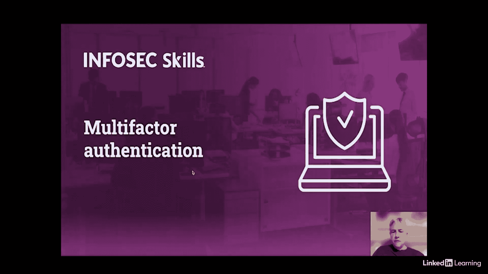
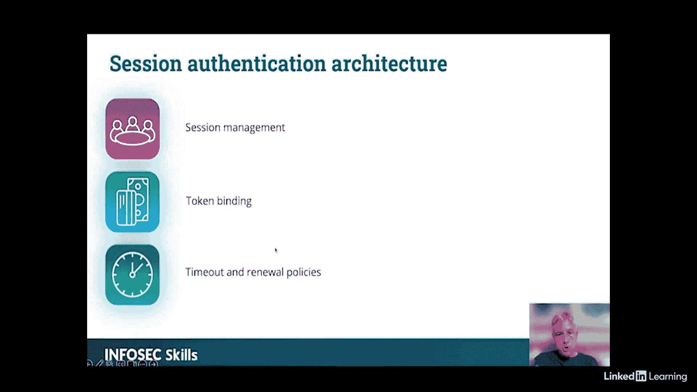

# 信息系统安全架构专家：03：多因素认证 🔐




在本节课中我们将要学习多因素认证的核心知识。我们会从单因素认证的不足说起，逐步引出多因素认证作为更优解的概念，并详细说明它所依赖的三大认证因素。接着，我们会介绍一次性密码设备、推送式多因素认证、硬件令牌以及 FIDO2 标准等具体实现方式，再讨论生物特征认证的优劣。随后，我们会把视角扩展到基于风险的自适应认证，探讨它如何与零信任架构结合，最后还会讲解会话管理、会话劫持防护以及超时策略等实际运维要点。下面我们就正式开始。


## 多因素认证的基本原理


在上一节中我们讨论了单因素认证的弱点，本节中我们来看看为什么多因素认证是更好的选择。简单来说，单因素认证只依赖一种证件，一旦被窃取，账户就面临直接风险；而多因素认证要求攻击者同时突破多道防线，从而大幅提高入侵难度。使用多因素认证进行身份验证的方式有很多种，不同的场景可以选择不同的组合方案，以达到最佳的安全效果。


以下是我们在认证设计中通常会考察的三类因素：


- 你知道的东西，例如密码、PIN 码或安全问题答案
- 你拥有的东西，例如手机、安全令牌或智能卡
- 你自身的特征，例如指纹、人脸或虹膜


或者你可能会听到基于知识、基于拥有和基于特征的认证。需要注意的是，多因素认证并不是指多个认证事项，它的意思是选择多个认证因素，两个或三个，最好是三个。在安全环境中，当我们需要使用设备、生物特征或基于知识的认证时，我们的要求是什么呢？我们需要确定最佳方案，比如一次性密码设备，你可能见过带有一次性密码的 RSA 安全 ID，或者 inrus 也有一类设备。我们要找的是那种一次性凭证，这样即使有人窃取了我们的凭据，这些凭据也就不再有效。或者我们可以选择基于哈希的一次性密码，通过完整性检查增加一点额外的安全性。


## 一次性密码与推送式多因素认证


刚才我们介绍了多因素认证的三大基本因素，本节中我们来看看具体的实现技术。一次性密码设备是一种常见的落地方式，它的核心思想是让每个凭证只能使用一次，从而避免凭据被重复利用。推送式多因素认证则是另一种广泛采用的机制，它将验证码直接推送到用户的指定设备上。


以下是一次性密码设备的典型特征：


- 每个密码仅在短时间内有效
- 即使被截获，过期后也无法再次使用
- 常见形式包括 RSA 安全 ID 等硬件令牌


基于哈希的一次性密码则通过完整性检查，在基础一次性密码之上增加了一点额外的安全性。


接下来看看推送式多因素认证。大多数人都见过，当你登录网站时，系统会向你的手机发送一条验证码，或者发送到其他设备，这就是推送式多因素认证。这种方式的优势在于用户体验较好，无需手动输入复杂的动态口令，只需在手机上点击确认即可完成登录。


## 硬件令牌与 FIDO2 标准


讲完推送式多因素认证，本节中我们来看看硬件令牌与 FIDO2 标准。硬件令牌属于“你拥有的东西”这一类因素，典型代表就是 UB key。FIDO2 是认证领域的重要标准，通过 UB key 等设备得以实现，所以 UB key 实际上就是强制执行 FIDO2 协议的设备。


核心原理可以用以下伪代码描述：


```
注册阶段：
  网站请求 UB key 生成凭证
  UB key 生成公私钥对 (public_key, private_key)
  发送 public_key 到网站
  private_key 永久存储在 UB key 内部，不可提取

认证阶段：
  网站发送挑战请求
  UB key 使用 private_key 进行数字签名
  网站使用 public_key 验证签名
  验证通过则授予访问权限
```


具体流程如下。例如，我会在网站或应用程序上注册一个 UB key。网站会要求 UB key 创建某种形式的凭证。UB key 随后会生成一对公私钥。当然，公钥会发送给网站，而私钥绝不会共享。私钥将存储在 UB key 中，并且永远不应该被提取。因此网站知道我的公钥，但不知道我的私钥。我们可以对请求进行数字签名，为网站或应用程序提供强有力的身份保证。


## 生物特征认证的优势与局限


在了解了硬件令牌之后，本节中我们来看看生物特征认证。生物特征认证分为基于行为的方式和基于生理特征的方式。基于行为的生物特征认证可以分析你怎么走路、怎么说话、怎么签名，虽然它们能提供一定程度的安全性，但天然存在被伪造的可能性。任何东西都可以被伪造，比如说行为模式，你可以冒充基于行为的生物特征，就像你可以冒充任何东西一样。但是，尝试次数越多，或者需要进行的尝试越长，伪造就越困难。我的意思是，你可以伪造我的签名，但如果你需要以我的名义签署 100 次，你最终会回到对你来说自然而舒适的方式。所以，基于行为的生物特征认证确实往往有效。当然，如果你必须在基于行为和生理特征之间做出选择，生理特征显然与身份的绑定要强得多。因此，我们的选择取决于基于风险。


## 基于风险的认证与零信任架构


讨论完生物特征后，本节中我们来看看基于风险的认证及其与零信任架构的结合。我们可以扩展基于风险的认证来支持零信任认证，支持零信任架构，并使我们的控制措施自适应。基于风险的自适应认证会综合多种上下文信息，判断当前登录请求的风险等级。


以下是系统在评估登录风险时会参考的关键上下文：


- 登录地理位置
- 登录时间段
- 访问资源类型
- 设备健康状况
- IP 地址


所以你在哪里登录、什么时候登录、从什么位置登录、试图访问什么，具有这种灵活性，使得认证方式可以变化。你可以使用密码进行低级别访问，然后如果你试图提升权限，就需要提供多因素认证。这是基于对哪些上下文比其他上下文更危险进行评分。地理位置和行为分析也非常关键。你是否在 10:01 从马里兰州 Silver Spring 的一台设备登录，然后在 10:05 从加利福尼亚州的一台设备登录？你知道，这是不可能的。所以要了解地理位置。我通常表现出什么样的行为？我从早上 8 点到下午 5 点登录，我访问某些资源。然后突然间，我在凌晨 2 点试图访问某些奇怪的东西。所以要不仅仅查看身份。我们在零信任架构中谈到过这一点，以及基于属性的访问控制的重要性。因此，我们需要基于属性的认证，以及实时风险评分。


## 会话管理与超时策略


最后，本节中我们来看看会话管理与超时策略。我们还需要考虑会话认证架构。在管理我们的系统时，我们要确保拥有一个唯一的、不可预测的会话 ID，或者登录后的身份验证令牌。这使得会话劫持变得更加困难。我们将令牌绑定到特定会话和特定用户，可能是他们的设备或 TLS 连接，但我们试图做的是防止会话劫持。


会话令牌的安全绑定关系可以简化为：


```
会话令牌 = f(用户身份, 会话标识, 设备或 TLS 连接信息)
```


然后我们有超时和更新策略。所以是在闲置一定次数后被锁定，还是有明确的登出时长？两小时后，你会自动登出，即使你在活跃。这可能只是要求你重新认证并获取新的会话令牌。更高权限的活动使用更短的超时时间，以降低长时间会话被劫持的风险。


# 总结




在本节课中我们一起学习了多因素认证的完整体系。我们回顾了单因素认证的弱点，阐述了多因素认证的三大因素，介绍了一次性密码设备、推送式多因素认证、硬件令牌与 FIDO2 标准，探讨了生物特征认证的优劣，并重点讲解了基于风险的自适应认证、零信任架构结合方式、会话管理与超时策略。希望这些内容能帮助你构建更安全的身份认证体系。

