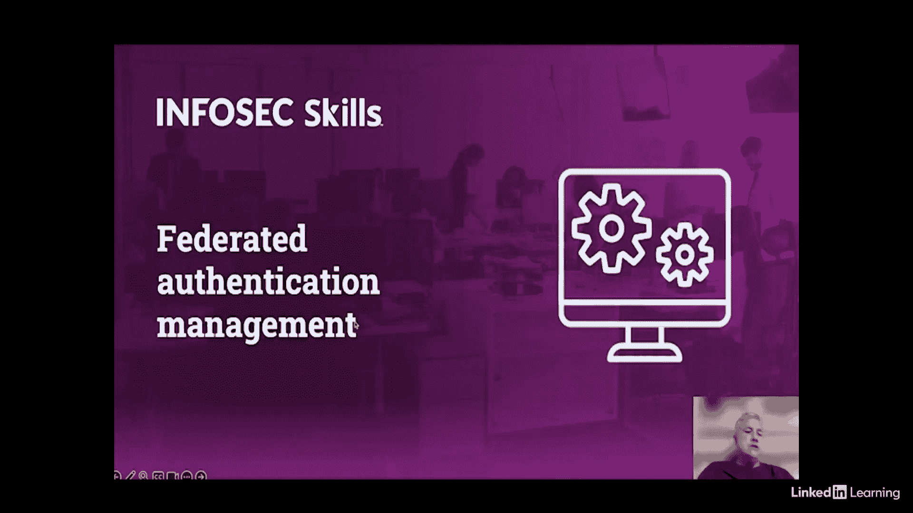
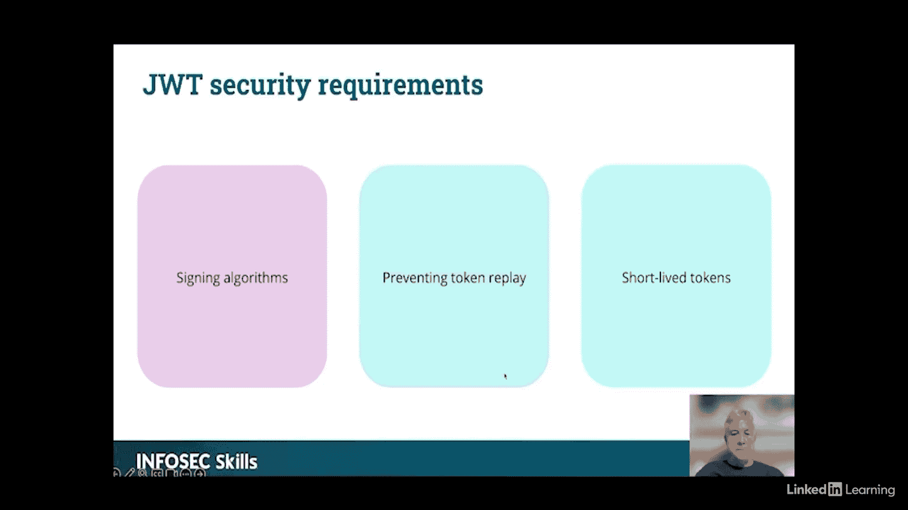

# ISC2 ISSAP：第04章：联邦身份验证管理 🔐


在本节课中我们将要学习联邦身份验证管理的核心知识。今天我们已经不再局限于企业内部的域，而是在全球范围内访问各种 SaaS 应用程序。过去我们依赖 Kerberos 来完成域内的身份验证，但现在我们需要走出企业，跨越多个域去访问应用程序。本节课将解释联邦身份是如何让我们只需验证一次身份，就能访问多个受信任的应用程序的。

## 什么是联邦身份验证



联邦身份验证是指不同系统之间建立信任关系，让用户可以在多个域和多个应用程序之间进行身份验证。过去我们只能在自己的域内进行身份验证，而现在我们需要访问各种 SaaS 应用程序，这些应用程序可能位于不同的域之中。

以下是联邦身份验证的主要特点：
- 用户只需要进行一次身份验证。
- 身份验证由受信任的身份提供者完成。
- 应用程序信任身份提供者，而不是直接对用户进行身份验证。
- 所有的过程都建立在联邦信任的基础之上。

## 联邦信任与身份提供者

上一节我们介绍了什么是联邦身份验证，本节中我们来看看联邦信任和身份提供者是如何工作的。联邦身份验证的核心在于信任。应用程序不再自己验证用户的密码，而是信任身份提供者来完成这项工作。

当你尝试访问像 Salesforce 这样的应用程序时，流程是这样的：
1. 应用程序将请求重定向到身份提供者。
2. 身份提供者对你进行身份验证，可能使用密码，也可能使用多因素身份验证或安全密钥。
3. 身份提供者发送一个经过数字签名的身份验证令牌回到应用程序。
4. 应用程序信任身份提供者，验证令牌后允许你进入。

这个过程只有在应用程序信任身份提供者时才有效。应用程序本身不直接对你进行身份验证，它信任的是身份提供者。因此我们需要确保建立这些信任关系，并且遵循联邦标准。

接下来的内容中我们将要介绍几个常见的联邦标准，包括 SAML、OAuth 和 OpenID Connect。

## SAML 认证架构

我们刚才介绍了联邦标准的概览，本节中我们来看看 SAML 认证架构。SAML 已经存在很长时间了，今天通常用于企业单点登录。

SAML 的工作流程可以这样理解：
- 身份提供者对用户进行身份验证。
- 身份提供者发送一个经过数字签名的 SAML 令牌到服务提供者。
- 服务提供者基于数字签名验证用户身份。

在 SAML 联邦能够工作之前，身份提供者和服务提供者必须建立信任关系。他们通过交换元数据来实现这一点。你可以把元数据想象成一张名片，上面记录了各方的身份和配置信息，信任关系就建立在这些信息的基础之上。

SAML 最大的问题是它基于 XML。XML 包含大量标记，架构显得比较笨拙。你可以这样对比：SAML 像是写一封信，把它放进信封，并在信封上写上地址；而新的标准更像是发送一条短信，信息更加简洁。

核心概念可以用下面的公式来表示：
```text
SAML 令牌 = XML 格式 + 数字签名
```

SAML 更适合企业内部架构。当我们走出企业，访问外部 SaaS 应用程序时，我们会转向 OpenID Connect，它基于 OAuth 架构，流程更加简化。

## OAuth 授权机制

上一节我们介绍了 SAML 架构，本节中我们来看看 OAuth。需要注意，OAuth 实际上关注的是授权，而不是身份验证。授权允许一个应用程序代表你访问另一个应用程序的资源，而且不需要共享你的密码。

OAuth 的基本流程如下：
1. 用户与身份提供者进行身份验证。
2. 用户授予权限或同意。
3. 应用程序获得一个授权码。
4. 授权码被交换为令牌。

令牌有不同的类型，其中最常见的是访问令牌。访问令牌通常被称为持有者令牌，可以这样理解：
```text
持有者令牌 = 拿着令牌就能进入，就像音乐会门票
```

持有者令牌寿命很短，用于保护对资源的访问，并且会随每个 API 请求一起发送。

## 访问令牌与刷新令牌

介绍完访问令牌之后，本节中我们来看看刷新令牌。访问令牌的有效期很短，可能只有 10 分钟或 15 分钟。为了避免用户频繁登录，OAuth 引入了刷新令牌。

刷新令牌的作用如下：
- 在短寿命的访问令牌过期后，系统使用刷新令牌请求一个新的访问令牌。
- 刷新令牌不会包含 API 密钥，但会受到更严格的保护。
- 刷新令牌是获取新访问令牌的秘密凭据。

如果没有刷新令牌，我们将不得不每 10 分钟或 15 分钟就登录一次并提供凭据，因为我们必须限制访问令牌的有效期长度。

令牌类型的关系可以用下面的代码块来表示：
```text
访问令牌：短期有效 + 每次 API 请求携带
刷新令牌：长期有效 + 用于换取新访问令牌
```

## 持有证明令牌

在讨论完访问令牌和刷新令牌之后，本节中我们来看看持有证明令牌，也就是 PoP 令牌。标准访问令牌是持有者令牌，任何人拿到这个令牌都可以使用它。而持有证明令牌则不同，它绑定到特定的客户端或加密密钥。

持有证明令牌的工作原理是：
- 客户端必须证明它拥有该私钥，而不是仅仅出示私钥。
- 这就像标准令牌是音乐会门票，出示门票就能进入；而持有证明令牌则绑定你的身份。
- 当令牌被使用时，可能会结合指纹或智能卡等方式进行额外的身份验证。

这样我们不仅证明持有某个令牌，还证明持有该令牌的人就是你本人。它真的是令牌和身份的结合。

核心概念可以表示为：
```text
PoP 令牌 = 绑定客户端私钥 + 证明私钥所有权
```

## OpenID Connect 与 JWT

我们之前介绍了 OAuth 和持有证明令牌，本节中我们来看看 OpenID Connect，也就是 OIDC。如果 OAuth 说的是你可以访问什么，那么 OIDC 说的是这里是证明我是我是谁的证据。

使用 OIDC 时，身份提供者会在你成功登录或提供身份验证后，向你颁发一个身份令牌。这个身份令牌的作用就是验证你的身份。

OIDC 中常使用的令牌是 JWT，也就是 JSON Web 令牌。JWT 的格式比 XML 更加精简轻量，并且同样由身份提供者数字签名。它的作用是证明令牌是真实的，没有被修改，也没有过期。

身份令牌可以包含基于声明的额外信息，比如你的用户 ID、姓名、电子邮件地址、群组，以及任何我们想要包含的其他属性。这样应用程序就能根据这些信息来定制你的用户体验。

OIDC 和 OAuth 的关系可以用下面的公式来表示：
```text
OIDC = OAuth + 身份令牌 (ID Token)
```

## 数字签名与安全注意事项

上一节我们介绍了 OIDC 和 JWT，本节中我们来看看数字签名以及相关的安全注意事项。JSON Web 令牌必须经过数字签名，并且需要使用强算法进行签名。

数字签名的基本原理如下：
```text
数字签名 = 加密(哈希(令牌), 发送者私钥)
```

通过这种方式，我们可以获得令牌的不可否认性。但是我们必须使用强算法，比如 RSA 或椭圆曲线算法。椭圆曲线算法速度更快，使用更小的密钥就能提供类似的加密强度。

我们的目标是确保令牌具备完整性和真实性，这为我们提供了不可否认性。同时我们也需要防范重放攻击。使用 HTTPS 在数据包中包含唯一性信息是当今的标准，我们要确保这一点被采用，因为我们的很多安全性都来自 HTTPS 连接。

访问令牌寿命很短，我们可能会引入持有证明来获得额外的身份验证。最后请记住，我们既有短寿命的持有者令牌，也有刷新令牌。

## 本节总结

本节课中我们一起学习了联邦身份验证管理的相关内容。我们了解了联邦身份如何让用户只需验证一次身份，就能访问多个受信任的应用程序。我们还学习了几个重要的联邦标准，包括 SAML、OAuth 和 OpenID Connect。



SAML 基于 XML，更适合企业内部单点登录；OAuth 关注授权，允许应用程序代表用户访问资源而不共享密码；OIDC 构建在 OAuth 之上，通过身份令牌和 JWT 来证明用户身份。在令牌管理方面，我们了解了短寿命的访问令牌、长期有效的刷新令牌，以及绑定客户端私钥的持有证明令牌。最后，我们强调了数字签名、强算法和 HTTPS 连接对于保障令牌安全的重要性。
