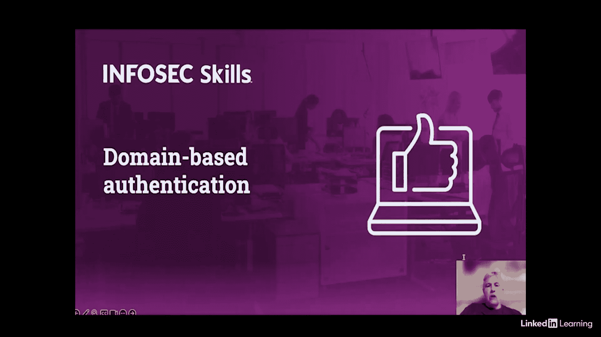
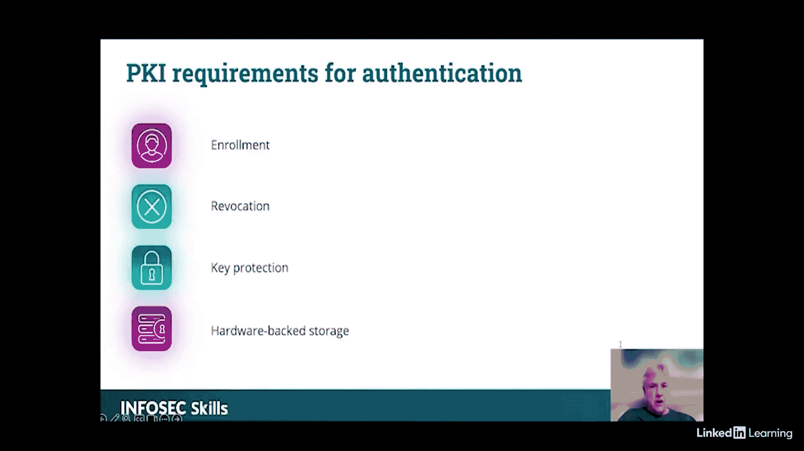

# ISC2 ISSAP：05：基于域的身份验证 🔐

## 概述 📖

在本节课中，我们将学习如何在企业域内完成身份验证。我们会先回顾联合身份验证的基础，然后重点介绍在自己的域中登录系统的具体过程，接着讨论 Kerberos 票据认证的工作原理，再了解远程访问设备如何通过 RADIUS 进行身份验证，最后介绍 Active Directory 如何生成访问令牌来控制资源访问。

## 1. 在企业域中登录 🖥️



刚才我们了解了联合身份验证，它可以让我们在多个域之间完成身份验证。接下来，我们要把目光聚焦到本域环境，看看当你在企业内部登录自己的 Windows 系统时，身份验证是怎么进行的。

当你坐下来登录加入企业域的 Windows 系统时，你通常会使用 Kerberos 进行身份验证。Kerberos 是一种基于票据的身份验证方式，它的核心思路是用票据来证明你的身份，而不是每次都直接发送密码。为了让你更清楚整个流程，下面给出一个简化的伪代码描述。

```
用户登录 -> 将凭据发送到身份验证服务
身份验证服务 -> 发放票据授予票据 (TGT)
用户持 TGT -> 访问票据授予服务
票据授予服务 -> 针对特定服务发放票据（例如打印服务器）
用户持服务票据 -> 访问目标服务，证明身份
```

具体发生了什么，可以用大白话总结如下。

以下是 Kerberos 票据认证的主要步骤：

- 首先，用户登录并将凭据发送到身份验证服务。
- 其次，身份验证服务会发放一个叫做票据授予票据（TGT）的东西。
- 然后，用户拿着这个 TGT 去找票据授予服务，请求某个特定服务的票据，比如打印服务器。
- 最后，这些票据被用来证明用户确实是他声称的那个人。

除了单方面证明身份，Kerberos 还提供相互身份验证。这意味着打印服务在接收并使用票据之前，也必须完成自身身份验证。这样就实现了主体和客体之间的双向认证。这里提到的身份验证服务和票据授予服务是两个不同的服务，但它们运行在同一台系统上，这台系统称为密钥分发中心。

```
KDC = 密钥分发中心
KDC 包含：身份验证服务 + 票据授予服务
```

从攻击者的角度来看，密钥分发中心非常具有吸引力。如果密钥分发中心被攻破，攻击者可能会利用 Kerberoasting 或黄金票据攻击，通过受损的密钥分发中心签发票据，从而获得未授权的访问权限。当然，Kerberos 并非万能，也不是我们在 Active Directory 中想要使用的唯一手段，但它自 Windows 2000 以来就在使用，直到今天仍然在企业域内身份验证中发挥作用。

## 2. 远程访问设备与 RADIUS 🌐

我们刚才详细介绍了域内登录和 Kerberos 的工作原理。接下来，我们要把视野扩展到远程访问设备，看看那些没有直接插网线的设备是怎么连接到域并完成身份验证的。

当我们谈论远程访问时，指的是任何没有物理连接到网络的设备。这包括 Wi-Fi 设备、使用 VPN 连接网络的设备，以及虽然不常见但仍然存在的拨号连接。

关于拨号，虽然我们已经进入新千年二十多年了，但拨号并没有完全消失。它仍然被用作冗余手段，也因为地球上不是每个地方都能上高速互联网。所以拨号依然存在，在我们的安全规划中仍然需要被考虑。

下面是远程访问身份验证的主要角色。

以下是 RADIUS 架构中的关键组件：

- 请求发起者（Supplicant）：发起连接的系统，比如你的 Wi-Fi 笔记本电脑、VPN 客户端或远程访问客户端。
- 网络访问服务器（RADIUS 客户端）：比如无线接入点、VPN 服务器或远程访问服务器，它接收设备的连接请求。
- 中央身份验证服务器（RADIUS 服务器）：策略服务器，接收来自网络访问服务器的请求，并向 Active Directory 查询用户是否合法以及可以访问什么资源。

具体流程是这样的。远程设备，也就是请求发起者，先连接到网络访问服务器，也就是 RADIUS 客户端。网络访问服务器把登录请求转发到 RADIUS 服务器。RADIUS 服务器作为策略服务器，会连接 Active Directory 询问这个用户是否经过身份验证，以及他可以访问哪些资源。Active Directory 会回答 RADIUS 服务器，确认用户是合法用户，并说明其可访问内容。RADIUS 服务器再将结果回传给网络访问服务器，也就是 RADIUS 客户端，通知它允许请求发起者访问网络。

RADIUS 的全称是远程拨入用户身份验证服务，它的主要用途是为远程访问提供中央身份验证。

## 3. Active Directory 与访问令牌 🗂️

刚才我们学习了 RADIUS 如何处理远程访问身份验证。接下来，我们要深入了解 Active Directory 本身，看看它在 Windows 环境中如何与 Kerberos 配合，并为用户构建访问令牌。

Active Directory 是 Windows 环境中的身份验证服务器，它使用 LDAP 目录结构来存储用户和对象信息。

当用户登录 Windows 时，身份验证通常由 Kerberos 完成。随后，Kerberos 会查询 Active Directory，获取该用户的属性信息，包括他所属的组、安全标识符（SID）以及其他相关数据。Windows 会根据这些信息构建访问令牌。

```
访问令牌 = 用户属性 + 组成员身份 + SID + 其他相关信息
```

有了访问令牌后，用户就可以访问文件服务器、SharePoint 或打印服务器等资源了。

## 总结 ✅



本节课中，我们一起学习了基于域的身份验证。我们介绍了在企业域中如何使用 Kerberos 票据进行身份验证，解释了票据授予票据、票据授予服务以及密钥分发中心（KDC）的作用，讨论了密钥分发中心被攻破后的安全风险，还讲解了远程访问设备如何通过 RADIUS 完成身份验证，最后说明了 Active Directory 如何利用 LDAP 结构和访问令牌来控制用户对资源的访问。

