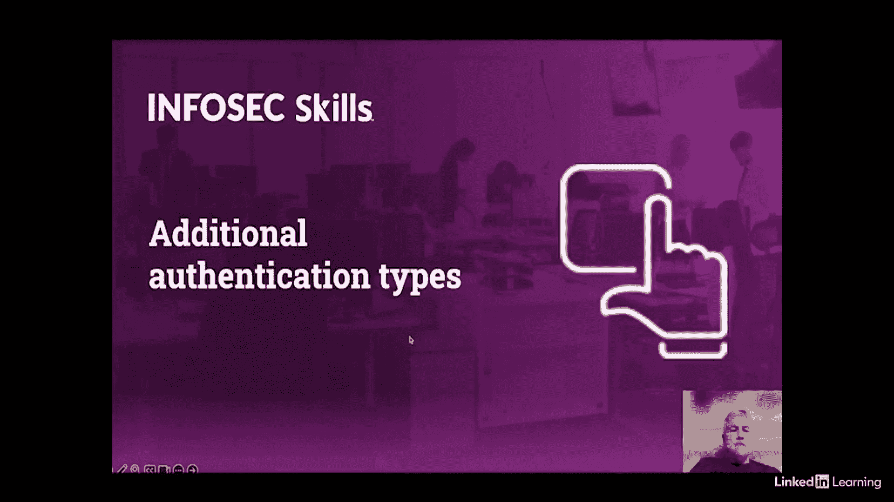
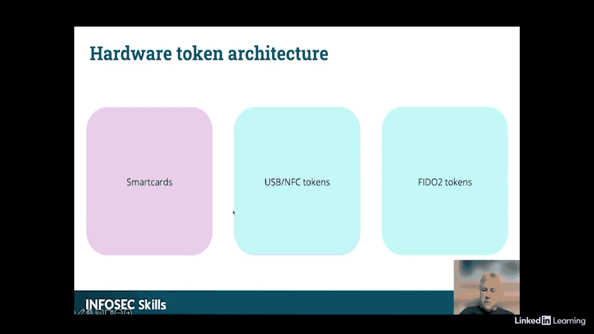

ISSAP认证教程：06：附加身份验证类型 🔐

在本节课中我们将要学习附加身份验证类型。身份验证不仅仅是输入密码这么简单，现在还有生物识别、移动端绑定、多因素验证等多种方式。我们会用大白话把这些概念拆开讲清楚，让初学者也能看得懂。

首先我们来看看生物识别身份验证。生物识别是指利用人的身体特征来确认身份，常见的有指纹、掌纹、手形、耳廓形状等等。这些方式的核心思想，就是把身份验证和用户的真实身份绑定在一起。

以下是生物识别常见的身份特征：
- 指纹
- 掌纹
- 手形
- 耳廓形状

在使用生物识别时，有几个重要的考虑事项。首先是活体检测，也就是要确认验证的人是活人，而不是一段录像或一块假皮肤。我们可以这样简单理解活体检测：

`is_alive = 检测体温() + 检测脉搏() + 检测活动设备()`

如果无法确认对方是活人，攻击者可能会用不连在身体上的手指来骗过系统，所以除了指纹图像，还需要体温检测等手段来辅助判断。

除了活体检测，隐私也是生物识别必须重视的问题。某些生物识别信息可能会透露用户的健康状况，比如视网膜扫描可能显示用户是否患有糖尿病、是否怀孕或者是否患有高血压。这意味着，架构师不仅要考虑如何验证身份，还要思考这些敏感信息是否得到保护，以及如何保护用户的整体隐私。所有这些都是架构师需要认真思考的点。

接下来我们来看看身份验证模板。当用户注册生物识别时，系统会根据用户的拇印等特征创建一个模板。这个模板和哈希值有点像，但又不完全相同。我们可以用下面这个简单对比来理解：

`模板：允许一定程度的变化，适合生物识别`
`哈希：要求精确匹配，适合密码验证`

例如，密码必须完全一致才能通过验证，但指纹每次采集的图像都不会一模一样。因此模板需要以受保护的方式存储指纹，同时还要允许设备精度范围内的变化程度。

为了防止攻击者用照片或假模型骗过系统，还需要防伪造措施。早期的人脸识别软件就曾被人的照片骗过，因此必须引入防伪造机制，确保匹配过程安全，模板存储安全，并且匹配程度符合当前环境的安全要求。

在生物识别中，会出现两种错误：假阳性和假阴性，也就是假接受和假拒。这两种情况都不是理想的结果。我们可以把它们分类如下：

- 类型1错误：假拒（False Rejection），本应允许进入系统的用户被拒绝，会造成较大的管理开销。
- 类型2错误：假接受（False Acceptance），本应被拒绝的用户却被允许进入，这带来的安全隐患远比类型1错误严重。

类型1错误和类型2错误成反比关系，一个下降，另一个就会上升。这两者会在某个点相遇，我们希望这个点尽可能低，这个点就叫做交叉误差率：

`交叉误差率 (CER) = 类型1错误与类型2错误相等时的错误率`

交叉误差率通常用百分比表示，它的可接受水平取决于风险、易用性以及业务需求。

了解了生物识别之后，我们继续看看移动端身份验证架构。很多移动应用都会使用生物识别，所以我们需要确保无论凭证是基于密码还是生物识别，都要绑定到特定的移动设备上。这就是我们一直在说的设备绑定，不只是证明“我是我”，还要确保登录的是一个受信任且预期的设备。

接着我们来聊聊多因素身份验证。多因素身份验证会向设备推送密钥或临时密码，大家应该都见过这种方式。不过这里有个问题叫 MFA 疲劳，用户会因为不断等待安全码而感到厌烦，比如在平板电脑上操作时手机不在身边。因此实施多因素身份验证时要尽可能周全，考虑用户需求，可以向手机发送推送验证码，也可以发送到邮箱，有多种解决方案。

另一个需要考虑的点是安全分区的使用。我们会使用加密密钥，但这些密钥应存储在移动设备的安全区域里。例如苹果设备有安全分区，安卓设备有可信执行环境，目的是确保加密密钥存放在受保护的地方。

除了安全分区，身份验证器应用也非常流行。这些应用可以生成基于时间的一次性令牌，或者基于 HMAC 的一次性密码。基于时间的令牌取决于当前时间，比如验证器应用知道在 10:01 和 30 秒时应该期待什么代码。而基于 HMAC 的令牌是基于计数器的，不受时间影响，每次身份验证请求都会生成一个全新的密码。我们可以用简单的公式表示这两者：

`基于时间的一次性密码：OTP = 时间相关的一次性函数`
`基于 HMAC 的一次性密码：OTP = 计数器相关的一次性函数`

很多这类一次性密码是基于我们所说的种子值生成的。种子值是一种伪随机生成的值，用于保护或生成密钥和代码。我们必须确保种子值以及创建种子值的机制都受到保护。几年前 RSA 曾发生过安全 ID 泄露事件，攻击者通过钓鱼邮件攻破了 RSA 的安全系统，窃取了与种子值相关的数据。如果攻击者知道了种子值，就可能准确推断出后续的验证码，所以保护种子值至关重要。

当我们谈论备份与恢复时，需要确保在手机丢失的情况下仍能恢复多因素身份验证。常见的做法包括加密云备份以及各种恢复控制措施。很多服务会提供恢复代码，用户在创建账号时保存这些代码，万一被锁定可以输入其中一个代码来找回访问权限，这就是管理身份验证器应用的不同方式。

最后我们看看基于硬件的令牌。常见的有智能卡、近场通信设备，比如 UBKey、FIDO 令牌等。智能卡可以实现基于证书的身份验证，类似芯片卡的方式。USB 设备如 UBKey、FIDO 令牌则使用公钥和私钥加密，具有防钓鱼能力，属于标准框架。

本节课中我们一起学习了附加身份验证类型，包括生物识别、身份验证模板、防伪造措施、假拒与假接受、交叉误差率、移动端身份验证架构、多因素身份验证、安全分区、身份验证器应用、种子值保护、备份与恢复，以及基于硬件的令牌。希望这些内容能帮助你建立起对身份验证体系的初步认识。
