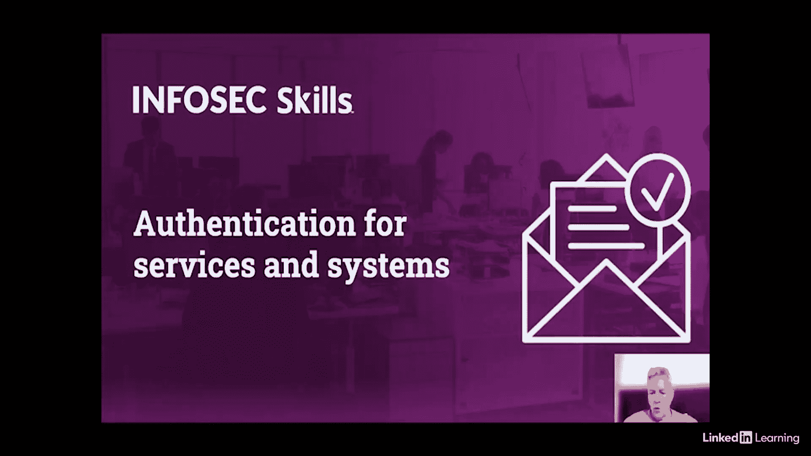
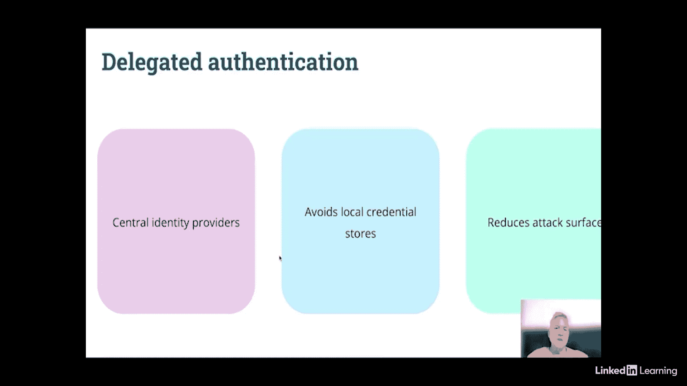

ISC2信息系统安全架构专业认证：07：服务与系统身份认证 🔐


在本节课中，我们将学习服务和系统的身份认证。当今的IT环境与五年前或十年前已经截然不同，现在访问各种资源的非人类身份比以往任何时候都多，因此安全的身份认证显得愈发重要。系统、服务和工作负载都需要完成身份认证，而它们可以使用多种不同的方式来实现这一目标。本节内容将围绕非人类身份、常见认证方式、基于证书的认证、服务间认证、云端身份架构、临时凭证、条件访问以及委托认证等核心主题展开，帮助初学者建立完整的认知体系。


非人类身份与工作负载

上一节我们概述了服务和系统身份认证的背景，本节中我们来看看什么是非人类身份。在讨论具体的认证技术之前，我们需要先搞清楚什么是非人类身份。过去身份认证大多针对人类用户，但现在越来越多的程序和系统也需要证明自己的身份。这些非人类身份通常就是我们所说的工作负载，它们在后台运行并主动请求各种服务。

以下是非人类身份的典型表现：

- 应用程序
- 服务
- 虚拟机
- 容器
- 任何请求服务的实体

简单来说，工作负载是指任何在后台运行并主动请求服务的程序或实体。在现代架构中，这类非人类身份的数量往往远远超过人类用户，因此我们需要专门的认证机制来保护它们访问资源的行为。


常见身份认证方式

上一节我们介绍了非人类身份与工作负载，本节中我们来看看常见的身份认证方式。了解了非人类身份之后，接下来我们来看看系统和服务常用的身份认证方式。不同的方案适用于不同的场景，每种方式都有自己的优点和局限性。

以下是几种常见的身份认证方式：



- API密钥
- HMAC消息认证码
- OAuth令牌
- 互信TLS（mTLS）

API密钥是一种比较简单的共享密钥方式。它的核心概念可以用下面的公式表示：

`API Key = Shared Secret between Application and Entity`

API密钥的实现很简单，应用程序和被调用的实体之间只需要共享一个密钥即可。但这种方式也有明显的弱点，因为我们必须考虑密钥如何共享、如何存储，并且要确保密钥没有被硬编码在代码中，同时还需要定期轮换密钥。为此，必须建立完善的密钥管理机制，否则密钥一旦泄露，整个认证体系就会面临风险。

HMAC是另一种基于共享密钥的认证方式，它在API密钥的基础上增加了完整性检查。我们可以用这个公式来理解：

`HMAC = Message + Shared Secret → Integrity Check`

如果你熟悉消息认证码，就会知道它们同样依赖共享密钥。也就是说，只要使用了共享密钥，就必须配套建立密钥管理流程。没有密钥管理，基于共享密钥的认证就无法安全运行。

OAuth令牌提供的不仅是身份认证，还包含基于作用域的访问控制。这意味着我们可以使用OAuth令牌实现更细粒度的授权。其核心思想可以概括为：

`OAuth Token = Authentication + Scope-based Access`

除了上述方式，互信TLS也是一种很好的解决方案。它要求组织已经部署公钥基础设施，而许多企业已经具备此环境。互信TLS允许客户端和服务器使用证书相互认证，实现强大的机器对机器身份识别。其关系可以简化为：

`mTLS = Client Certificate + Server Certificate + PKI`

通过互信TLS，客户端和服务器在建立连接时都会出示各自的证书，从而确保通信双方的身份都是可信的。


基于证书的身份认证

上一节我们学习了API密钥、HMAC、OAuth和互信TLS等认证方式，本节中我们来看看基于证书的身份认证。当我们使用基于证书的身份认证时，目标是让整个过程尽可能透明，避免给运维人员带来过重负担。为了实现这一目标，需要建立几个关键的自动化流程。

以下是基于证书认证需要建立的关键流程：

- 自动注册流程
- 证书续期流程
- 证书吊销流程

自动注册意味着工作负载可以自动申请证书，而不需要人工干预。续期流程确保证书在过期前自动更新，防止服务中断。吊销流程则用于在证书被泄露或不再使用时及时作废。只有这三个流程都完善，基于证书的身份认证才能在现代架构中稳定运行。


服务间身份认证与令牌交换

上一节我们讨论了基于证书的身份认证，本节中我们来看看服务间身份认证与令牌交换。在微服务架构中，服务之间经常需要相互调用。互信TLS可以为服务间通信提供基于证书的强身份认证，而令牌交换则解决了身份在调用链中传递的问题。这两者结合，可以让服务间的通信更加安全和可审计。

以下是服务间认证的关键机制：

- 互信TLS提供基于证书的强身份认证
- 令牌交换允许中间服务以自身名义申请新令牌
- 原始用户身份贯穿整个调用链

假设我向一个服务发送请求，接着我又请求订单服务，而订单服务需要请求后端数据库。在这种情况下，订单服务不会简单地转发我的原始令牌，而是会以自身名义申请一个新令牌。同时，我的原始身份会被传递通过整个调用链。这种机制可以用下面的伪代码表示：

```
Order Service → Request New Token (on its own behalf)
Original User Identity → Propagated through the entire chain
```

令牌交换的好处在于可追溯性和问责制。即使中间服务使用了自己的令牌去请求下游资源，原始调用者的身份信息仍然会保留在审计日志中，方便我们追踪每一个请求的来源。


云端身份认证架构

上一节我们介绍了服务间身份认证与令牌交换，本节中我们来看看云端身份认证架构。在云端身份认证架构中，组织通常会部署一个中央身份管理服务器，也就是身份提供商。常见的例子包括Okta、OneLogin、Ping等供应商。这些身份提供商承担中央信任、身份认证，以及在很多情况下的授权角色，成为整个体系中的信任锚点。

以下是云端身份认证的核心角色：

- 中央身份管理服务器
- 身份提供商（IdP）
- 信任锚点
- 授权决策点

通过集中式身份提供商，应用程序不需要自行维护复杂的认证逻辑，而是可以依赖一个统一的信任中心。这种架构简化了分布式系统中的身份管理，也便于统一审计和策略执行。


临时凭证与特权访问

上一节我们学习了云端身份认证架构，本节中我们来看看临时凭证与特权访问。接下来我们来谈谈临时凭证，尤其是针对特权账户的情况。如果用户需要执行特权功能，不应该长期持有高权限凭证，而是应该采取“借用-使用-归还”的模式，从而降低凭证泄露带来的风险。

以下是临时凭证的使用流程：

- 用户申请临时凭证
- 使用该凭证执行特定功能
- 任务完成后归还凭证

我们不希望长期凭证存在，尤其是在特权操作场景中。一旦长期凭证被泄露，攻击者就可以获得持久的高权限访问权。通过使用临时凭证，即使凭证被盗，攻击者能利用的时间窗口也非常有限，从而最大程度降低潜在损失。


条件访问与零信任

上一节我们讨论了临时凭证与特权访问，本节中我们来看看条件访问与零信任。条件访问控制与零信任架构密切相关，两者通常需要结合使用。在零信任模式下，身份认证不是一次性的，而是需要持续进行。系统会不断要求用户证明“我就是我”，但这还不够，还需要评估用户当前是否具备执行操作的条件。

访问决策可以用下面的公式来表示：

`Access Decision = Identity + Context + Device Posture + Risk Level`

除了确认用户身份，系统还需要评估用户当前的操作上下文，以及所使用设备的安全状态。例如，请求是否来自一台安装了反恶意软件、已打安全补丁、并且保持更新的健康系统？如果设备姿态不合格，即使身份认证通过，系统也可能拒绝访问或限制权限。


步进认证与委托认证

上一节我们介绍了条件访问与零信任，本节中我们来看看步进认证与委托认证。当用户执行高风险操作时，普通的身份认证可能不够，这时就需要步进认证，也称为即时认证。其核心思想是根据风险等级动态要求额外的认证因素，只有风险可控时才允许操作继续。

以下是常见的额外认证因素：

- 生物识别，如视网膜扫描或指纹
- U盾密钥
- 验证器应用生成的一次性代码

简单来说，如果某个操作的风险评分较高，系统就会要求用户提供第二个甚至第三个认证因素。这样可以确保在风险较高时，只有经过多重验证的用户才能完成敏感操作。

此外，我们还可以将身份认证委托给身份提供商。这意味着应用程序可以信任身份提供商，而不需要自行管理用户密码。

以下是委托认证的具体做法：

- 不允许应用程序维护本地凭证存储
- 将凭证集中存储在核心身份提供商处
- 使用令牌为用户、服务或机器进行背书

这种方式大大减少了攻击面，因为凭证数据库只存在于单个受保护的系统中，而不是分散在互联网上的各个应用程序里。


课程总结

上一节我们学习了步进认证与委托认证，本节中我们来对整节内容进行总结。在本节课中，我们一起学习了服务和系统的身份认证。我们探讨了非人类身份和工作负载的概念，介绍了API密钥、HMAC、OAuth令牌和互信TLS等认证方式，讨论了基于证书的身份认证及其自动化流程，学习了服务间身份认证和令牌交换，了解了云端身份认证架构和临时凭证的使用，还掌握了条件访问、步进认证以及委托认证的相关知识。



虽然针对非人类账户的认证策略在具体实现上可能有所不同，但身份认证的基本原则始终保持不变。无论是人类用户还是系统服务，安全的身份认证都是构建可信环境的基础。

