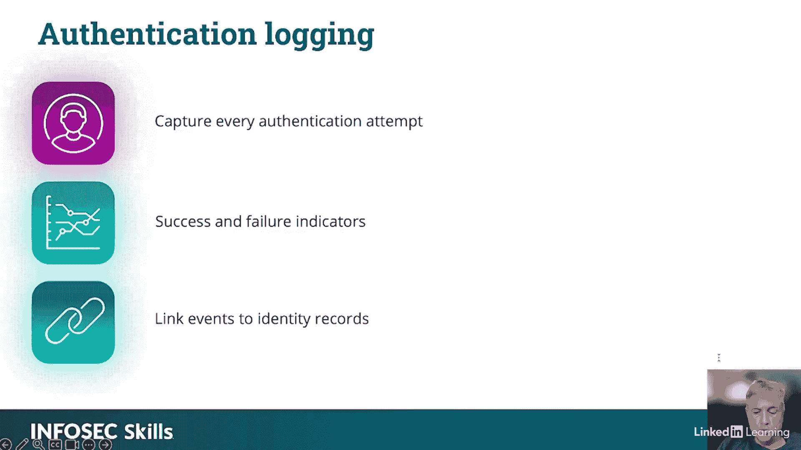
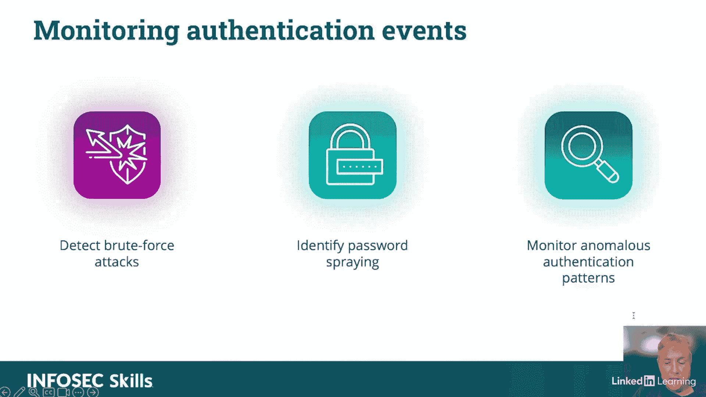
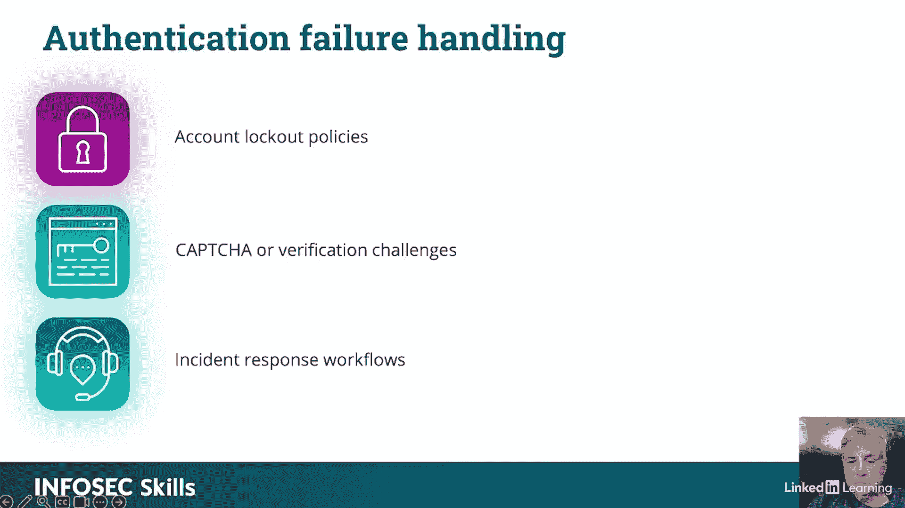

# 🔐 ISSAP认证教程：08：监控身份认证

在本节课中，我们将学习身份认证监控的基础知识。身份认证监控是一个篇幅较短但非常重要的章节，因为这里我们要讨论如何监控用户的身份认证行为，防止错误用户或攻击者在通过认证之后成功进入系统。如果攻击者能够认证并成功访问系统，他们就有可能在系统内部造成严重破坏。在前面的内容中，我们已经讨论过强身份认证及其重要性，现在我们需要进一步确保，必须对认证行为进行持续监控。

接下来，我们先来看看为什么身份认证监控如此重要。

如果错误的用户或者攻击者能够通过身份认证，并成功进入系统，那么他们就可以在系统内部进行各种恶意操作，造成严重的安全损失。这就是为什么在讲完强身份认证之后，我们还必须建立监控机制，确保每一次认证都在可控范围内。

那么，具体来说，我们到底应该监控哪些认证尝试呢？以下是监控对象的说明：

- 我们要监控每一次身份认证尝试，无论结果是成功还是失败。
- 监控每一次认证尝试会产生大量数据。
- 这些认证事件是所有安全事件中最重要的事件之一。
- 监控每一次认证尝试，并不意味着我们要记录每一次登录行为。
- 监控每一次认证尝试，并不意味着每次有人登录时都要发出警报。
- 监控每一次认证尝试，也不意味着我们要保留每一次登录尝试的海量数据。
- 监控每一次认证尝试的真正含义是，当我们需要时，相关信息已经存在并可供使用。

监控对象的核心逻辑可以表示为：

```text
监控对象 = 所有身份认证尝试 = 成功认证 + 失败认证
```

这个公式的意思是，无论登录是否成功，我们都需要把相关认证事件收集起来，以便后续分析使用。

在了解了要监控什么之后，我们还需要知道，监控的目的是为了发现哪些具体的攻击行为。以下是监控重点：

- 暴力破解攻击，攻击者尝试大量可能的密码，希望撞中正确密码。
- 字典攻击，攻击者使用预先准备好的常见密码列表进行尝试。
- 密码喷洒攻击，攻击者尝试同一个非常常见的密码，比如123，在多个系统上反复尝试，最终希望能进入其中一个系统。

这里给大家一个小提示，如果你的密码是123这样的简单组合，请立即修改。我会等你修改完成。

密码喷洒攻击比较难以发现，因为攻击者在多个系统上分散尝试。如果我们只监控系统1，可能不会注意到某个账号在系统1上登录失败，同样，如果我们只监控系统2、系统3和系统4，也可能分别忽略这些失败记录。因此，我们需要拥有整个网络的宏观视图，才能有效开展监控。

除了识别攻击类型，我们还需要关注登录的成功与失败情况，并据此设置合理的阈值。以下是需要了解的内容：

- 登录成功或登录失败，本身不一定意味着发生了恶意行为。
- 正常用户每天都会成功登录，也有可能因为输入错误密码而导致登录失败。
- 我们需要设置失败事件的阈值，例如连续失败三次或五次。
- 当失败次数达到设定的阈值时，系统应发出通知。
- 收到通知后，我们需要做出响应，例如将该账户锁定，防止多次错误登录后继续尝试。

失败阈值的判断逻辑可以用简单代码表示：

```text
如果 连续失败登录次数 >= 阈值（如3次或5次）:
    触发安全通知
    锁定相关账户
```

这个机制的目的是在发现异常登录尝试时，及时阻止潜在的攻击行为。



仅仅知道登录成功或失败还不够，我们必须能够把每一次认证行为追溯到具体的人。以下是关联的必要性：

- 我们必须知道是谁发生了认证失败，比如失败了15次或者其他次数。
- 必须将认证事件与身份记录以及身份属性关联起来。
- 只有建立这种关联，才能获得真正的问责能力，明确每一次异常认证背后的具体责任人。

身份关联的核心关系可以表示为：

```text
认证事件 ↔ 身份记录 ↔ 身份属性 = 真正的问责制
```

这意味着，每一次认证尝试都要能追溯到具体的用户身份及其相关属性信息。

有了身份关联之后，下一步就是学习如何从大量的登录记录中，识别出真正可疑的异常行为。以下是典型的可疑情形：

- 出现暴力破解攻击的迹象。
- 出现字典攻击的迹象。
- 出现密码喷洒攻击的迹象。
- 不可能旅行情形，例如你在一秒钟前还在纽约，下一秒却在旧金山登录，这显然不合理。
- 在凌晨4点登录，或者从从未使用过的地点登录，这种情况也需要引起重视。

检测不可能旅行的判断逻辑可以简化为：

```text
如果 同一用户在短时间内从地理位置遥远的两个地点登录:
    标记为不可能旅行，视为可疑行为
```



检测这些异常行为需要借助安全信息和事件管理系统，以及用户行为分析系统。这些工具能够帮助我们发现偏离正常模式的登录行为。通过这种方式，我们可以更好地发现不符合常规的登录活动。

发现可疑登录之后，不能只是记录下来，还需要立即采取相应的应对措施。以下是具体的响应方式：

- 对可疑的账户进行锁定，阻止进一步的登录尝试。
- 制定相关策略，例如规定连续三次错误登录后，账户自动锁定。
- 使用验证码验证挑战。有些验证码很简单，只需要点击复选框即可，有些则非常复杂，比如输入扭曲的字母，或者点击所有包含自行车的图片，哪怕图片里只有一小块车把手，也很难判断是否应该点击。

验证码机制的目的在于，随着自动化攻击程序变得更加智能，我们也必须采取更严格的控制措施，防止攻击者利用脚本自动尝试登录。攻击者变得越来越复杂，我们的防御也必须变得越来越严格。

最后，我们还需要把对可疑登录的处置固定成标准流程，以便在发生安全事件时能够快速反应。以下是流程的关键要素：

- 当发生不当登录尝试或发现可疑情况时，必须有明确的处理流程。
- 流程中应规定发生了什么之后该做什么。
- 越是能够自动化这个流程，效果就越好。

自动化的事件响应流程可以用简单的步骤表示：

```text
检测到可疑登录 -> 触发告警 -> 锁定账户 -> 通知安全团队 -> 调查并处置
```

这样可以确保安全事件得到及时、统一的处理，减少人工干预带来的延迟。



在本节课中，我们一起学习了身份认证监控的核心内容。我们讨论了为什么要监控身份认证，需要监控每一次认证尝试，如何识别暴力破解、字典攻击和密码喷洒等攻击行为，如何设置失败阈值并锁定账户，如何将身份信息与认证记录关联以实现问责，如何检测不可能旅行等可疑登录行为，如何使用验证码和账户锁定来响应威胁，最后也了解了事件响应流程的重要性以及自动化带来的好处。希望这些内容能帮助你更好地理解身份认证监控在信息系统安全架构中的作用。

