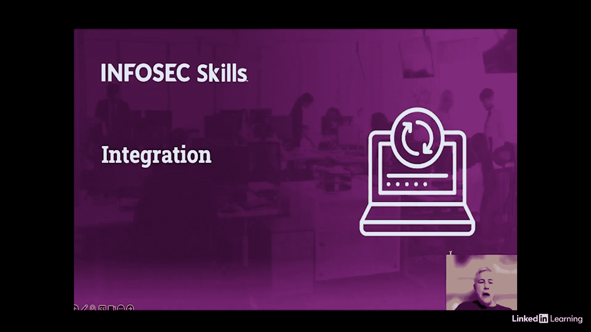
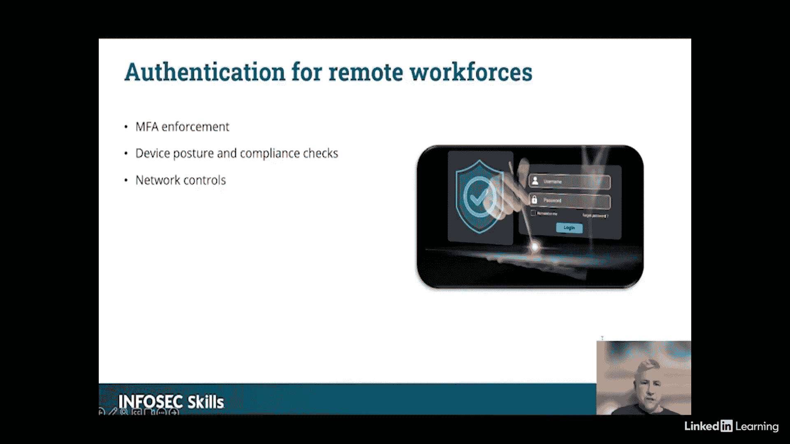

ISSAP信息系统安全架构专业人员：09：集成🔗


在本节课中，我们将要学习如何把身份、认证、授权，以及监控和问责这些零散的安全零件串联在一起，形成一个完整的安全架构。集成是保证安全体系正常运转的关键，没有集成，单独的安全措施就像散落的零件，无法发挥应有的作用。我们会从最基础的身份证明开始，逐步讲解如何把各个环节连接起来，让整个安全系统像一个整体一样协同工作。



既然要讨论集成，我们自然需要从最基础的环节着手，也就是确定用户到底是谁。

以下是强身份证明流程的主要步骤：

- 由人力资源部门负责新员工入职时的身份证明工作
- 收集驾照、护照、社会安全号码或社会保险号等身份证明文件
- 通过上述验证手段，确保被预配账户的身份与提供了强身份证明的合法用户绑定

确认了用户身份之后，接下来要把凭据和正确的用户绑定起来，并选择合适的认证方式。

以下是关于凭据绑定和认证方式选择的几点说明：

- 根据实际风险情况，可以要求多因素认证，也可以选择基于密码的单因素认证
- 业务需求始终决定采用什么样的技术，而不是技术决定业务
- 无论使用哪种认证方式，都要防止欺骗和冒充行为
- 如果采用单因素密码，需要实施策略来防止密码喷洒和彩虹表攻击
- 多因素认证在防止冒充方面效果明显更好

选定认证方式后，还要确保凭据本身的颁发过程是安全的，否则前面的努力都可能白费。

以下是凭据颁发过程中需要注意的事项：

- 不要通过未加密的电子邮件发送默认密码，然后让用户自己修改，这种做法不够安全
- 数字证书的获取通常需要经过注册流程，而不是随意发放
- 无论采用什么注册流程，都必须保证流程本身安全，并且每次都严格执行
- 很多注册流程和安全要求会由治理机制驱动，治理的内容我们稍后会详细介绍

在单一机构内部搞定身份和认证之后，还要考虑更复杂的分布式环境和全球化业务场景。

以下是分布式系统中认证集成的关键点：

- 如今的网络高度分布式，企业跨地区运营，需要访问全球资源
- 必须在不同地区建立中央位置和中央策略，以便统一验证用户身份
- 联合身份机制允许我们与可信的身份提供者建立信任关系
- 与服务提供者创建联邦信任，实现认证的集中管理
- 集中式认证还能保证策略执行的一致性

核心概念公式：

```text
身份集成链 = 身份证明 → 凭据绑定 → 认证 → 授权 → 监控与问责
联邦信任模型 = 可信身份提供者 ↔ 服务提供者（建立联邦信任）
```

除了办公室内的用户和分布式系统，远程员工也是集成策略中不可忽视的一部分。

以下是保障远程访问安全的常见措施：

- 远程用户不在办公大楼内部直接接入系统和网络，这会引入新的风险
- 需要实施多因素认证来加强身份验证
- 进行设备姿态检查和合规性检查，确保终端满足安全基线
- 使用网络控制手段，例如部署RADIUS服务器，并通过RADIUS要求多因素认证
- 可以部署安全的VPN访问，为远程员工提供加密的通信通道
- 无论采取什么具体实施方式，都必须把远程员工队伍纳入安全考虑范围



本节课中，我们一起学习了如何将身份、认证、授权，以及监控和问责这些安全组件集成在一起。我们先从强身份证明流程开始，确保用户身份合法；接着讨论凭据绑定和认证方式的选择，重点防止欺骗和冒充；然后说明安全颁发凭据的重要性，避免通过不安全渠道发送默认密码；随后介绍分布式系统中的中央策略和联合身份机制，实现跨区域的统一认证；最后，我们探讨了远程员工的访问风险，并列出了多因素认证、设备合规检查、RADIUS和VPN等控制措施。通过这些内容，你可以了解如何把碎片化的安全控制点串联成一个协调一致的安全架构。
