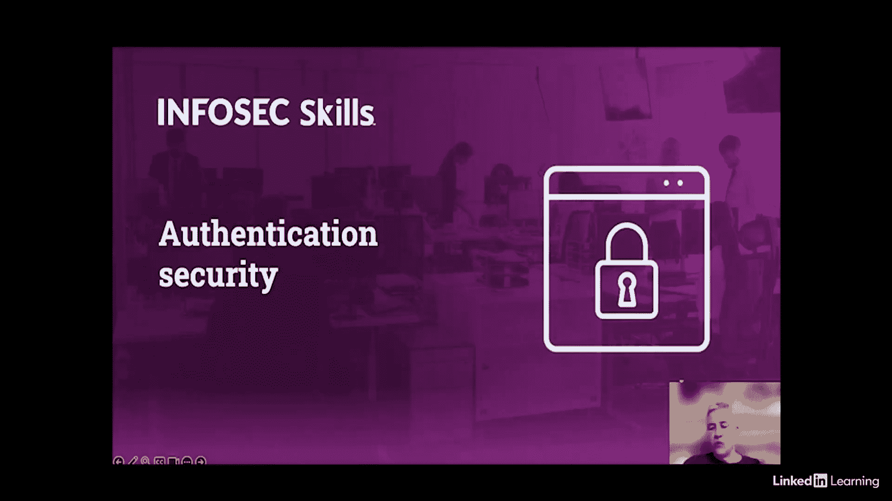
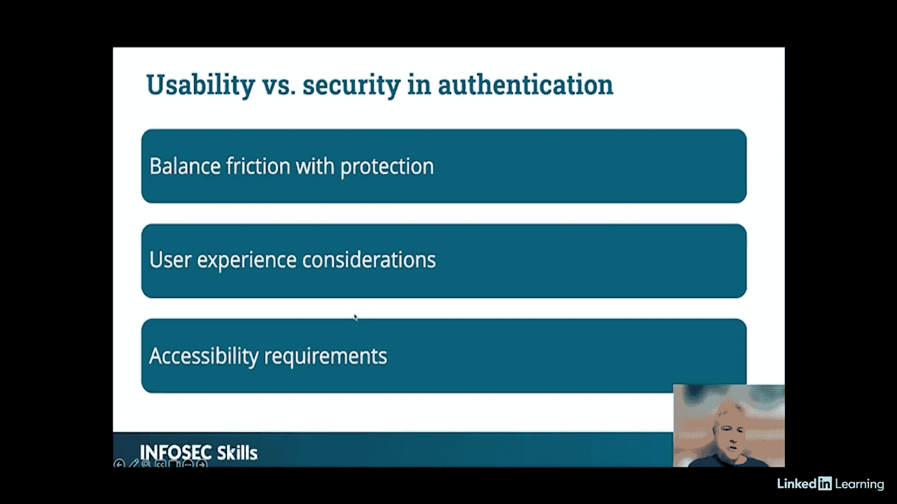

# ISSAP信息系统安全架构专业认证：10：认证安全 🔐


在本节课中我们将要学习认证安全的核心知识，重点包括身份证明的优先地位、高安全环境下的认证控制、多因素认证与硬件密钥的应用，以及特权账户的管理方式。这些内容是构建安全系统架构的重要基础，希望大家认真对待每一个知识点，不要漏掉任何细节。

上一节我们介绍了身份集成的基本概念，本节中我们来看看认证安全具体要怎么做。

认证安全是整个安全体系中非常关键的一环，我们需要多次强调它的重要性，不能掉以轻心。在实际工作中，认证决定了谁能进入系统，谁不能进入，所以必须把它放在首位来考虑，不能有任何松懈。

身份证明是整个流程的第一步，我们之前通过系统集成的方式讨论过它的重要性，现在再把它捡起来仔细说一遍。只有先把用户是谁搞清楚，才能谈后续的认证授权问题，这一点绝对不能忽视，必须放在认证流程的最前面处理。

在高安全环境中，认证必须非常谨慎地控制，不能随便放过任何一个账户。你可以想一想军事系统或者金融系统，这些地方对安全要求极高，认证漏洞可能导致严重的后果。除了普通用户之外，管理员账户和root账户的认证控制尤其重要，因为这些账户拥有最高权限，一旦被攻破，整个系统都会面临巨大风险。

以下是关于高安全环境认证控制的核心要点：



- 身份证明必须放在认证流程的最前面，优先处理。
- 高安全场景下的认证控制要非常严格，不能有松懈。
- 军事和金融系统是典型的高安全环境，值得重点参考。
- 管理员账户和root账户需要特别严格的认证管控。

接下来我们再看看多因素认证和专用硬件密钥，这部分也是认证安全的重点内容。

多因素认证是提升账户安全性的常用方法，专用硬件密钥也是重要的认证手段。通常情况下，基于硬件的认证被认为比软件密钥或软件机制更强大，更难以伪造和欺骗。软件可能被恶意程序复制或截获，但硬件密钥通常需要物理持有才能使用，攻击成本更高，安全性更可靠。

核心概念可以用下面这个简单的公式来理解：

```
多因素认证 = 你知道的信息（如密码） + 你拥有的物品（如硬件密钥） + 你自身的特征（如指纹）
```

在实际部署时，我们需要限制注册流程，不能让任何人随便注册认证设备。会有很多策略来控制这个过程，比如要求人们亲自到场进行身份证明，而不是通过网络远程完成。这种面对面的方式可以大大降低冒充身份的风险，让认证更可信。

以下是身份证明过程中的常见策略：

- 限制注册流程，不允许随意远程注册。
- 要求申请人亲自到场进行身份核实。
- 出示政府签发的身份证件，验证真实身份。
- 进行背景调查，确认申请人的可信度。

以上这些步骤都是身份证明过程的一部分，完成身份证明后才能进入正式的认证阶段，两者是紧密相连的，缺一不可。

本节我们继续讨论特权用户的认证问题，这部分内容非常实际，适合结合工作中的账户管理来理解。

对于特权用户，比如root账户和管理员账户，我们需要确保实行职责分离，这是一个基本的安全原则。这里要说明的是，职责分离虽然不在当前的幻灯片内容里，但在实际工作中非常重要。我们不应该让一个管理员账户拥有所有权限，那样太危险了，一旦这个账户出问题，整个系统就没有防御能力了。

正确的做法是创建具有特权能力的账户，但这些账户不应该是全能的。也就是说，一个账户可以管理网络，另一个账户可以管理数据库，权限要拆分开，不要集中在一个人或一个账户手里，降低单点失效的风险。

以下是特权账户管理的核心要求：

- 特权用户包括root账户和管理员账户，需要最强的认证保护。
- 必须实行职责分离，避免权限过于集中。
- 不应该存在全能的超级管理员账户。
- 账户应当拥有特定的特权能力，而不是无所不能。

这些特权账户的管理人员，就是我们之前讨论过的特权账户管理对象，他们也是需要最强认证措施的人员群体，必须重点保护。



本节课中我们一起学习了认证安全的多个方面，包括身份证明的优先位置、高安全环境下的认证控制方法、多因素认证与硬件密钥的优势、身份证明的具体注册策略，以及特权账户的职责分离和管理要求。希望这些内容能帮助大家更好地理解认证在系统安全架构中的作用，并在实际工作中正确应用这些原则。
