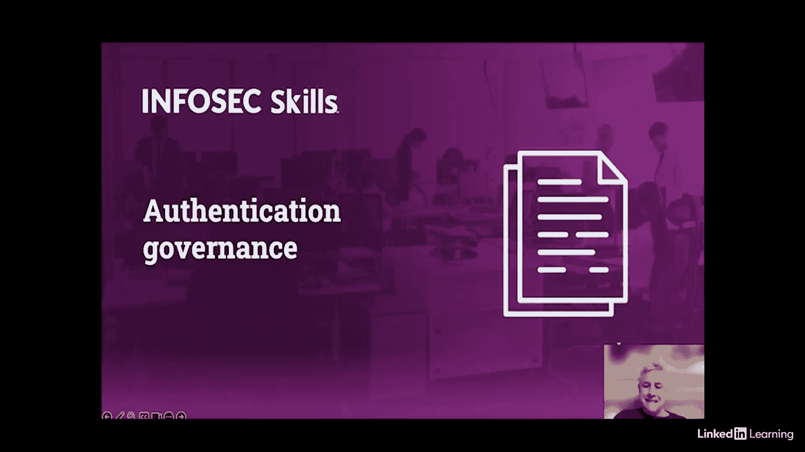
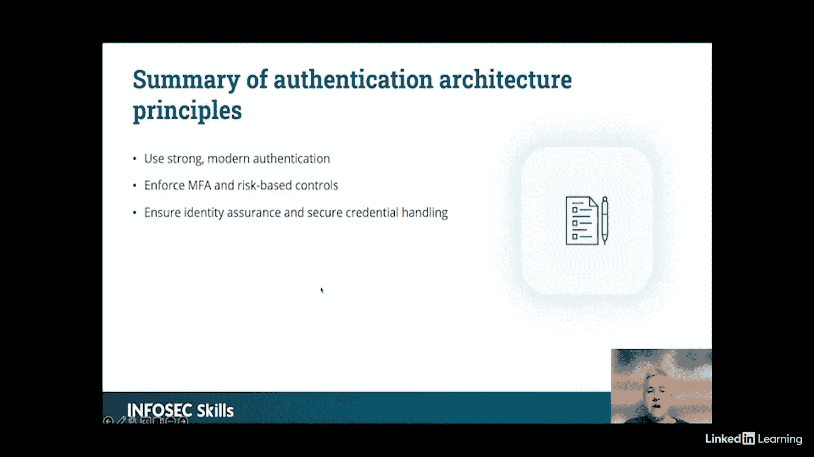

# ISC2 ISSAP 认证教程：11：认证治理 🔐


在本节课中我们将要学习认证治理的核心内容。认证治理听起来可能比较抽象，但实际上它就是企业如何管理和控制用户身份认证的一整套规则和流程。作为安全架构师，我们不仅要设计技术方案，还要负责制定政策、监控执行情况，并确保各项控制措施持续有效。下面我们就从架构师的职责开始，逐步拆解认证治理的关键环节。




首先我们要明确，在认证治理这件事上，架构师扮演着至关重要的角色。作为架构师，我们必须面对的一个关键因素是，我们要对认证治理负责，是我们来实施治理。我们指定架构，我们监控系统。我们确保有流程来防护认证。换句话说，架构师不仅是认证方案的设计者，也是治理体系的执行者和监督者。


以下是架构师在认证治理方面的主要职责：

- 制定认证架构
- 监控认证系统运行状况
- 确保存在防护认证的流程
- 实施治理机制


有了这些职责之后，治理工作的第一件事就是定义保证级别。上一节我们介绍了架构师在认证治理中的基本职责，本节中我们来看看保证级别这个核心概念。保证级别是一个非常直观的概念，它衡量的是我们对用户或主体真实就是其声称身份的信心程度。在安全需求较高的组织中，我们将需要更高的安全性和更高的保证。保证越高，冒充用户就越困难。


以下是不同风险等级下常见的认证方式：

- 低保证系统：仅使用密码
- 高风险系统：要求多因素认证
- 关键系统：防钓鱼、基于硬件的认证，比如 FIDO2 和 U2F 密钥


核心概念可以用下面这个公式来理解：

保证级别 = 对用户或主体身份真实性的信心程度

定义了保证级别之后，我们还需要考虑零信任架构和合规性。关键系统需要防钓鱼、基于硬件的认证，比如我们之前提到过的 FIDO2 和 U2F 密钥。我们当然会实施零信任架构，并强制执行合规性。这是治理的重要部分。政策和实施只有在强制执行时才有效，所以我们必须弄清楚这个架构将如何实施和强制执行。和往常一样，我们必须考虑监管要求，这将规定我们的保证级别，无论我们是否符合 PCI DSS、HIPAA 或其他监管要求。


在受监管环境中，尤其是受到严格监管的环境中，我们将需要远高于标准的保证级别。不同的合规标准对认证的要求不一样，下面是一个简单的合规映射示例：

```text
PCI DSS → 强制多因素认证
HIPAA → 严格访问控制与审计
ISO 27001 → 定期风险评估与控制审查
NIST → 身份保证等级定义
```


除了制定政策，架构师还要负责持续监控。我们也要对监控负责。我们必须持续测量，而不仅仅是实施。所以作为架构师，我们必须跟踪这些重要的关键绩效指标。监控不是一次性的工作，而是需要持续关注的过程，只有这样才能发现潜在的问题并及时修复。


以下是架构师应当跟踪的关键指标：

- 多因素认证注册率
- 认证成功率
- 失败登录次数


这两个指标可以用下面的公式来计算：

MFA注册率 = 已注册多因素认证的用户数 / 总用户数 × 100%

认证成功率 = 成功认证次数 / 总认证尝试次数 × 100%

MFA注册率越高，使用多因素认证的用户和主体就越多，被攻破的风险就越小。认证成功率如果很高，通常说明用户可以无摩擦地顺利认证。而如果比率较低，通常是可用性问题，用户可能很难记住复杂的密码，或者凭据处理不当，比如证书处理有问题。当然，我们还会关注失败登录，失败登录可能是密码喷洒或暴力破解攻击的直接迹象。


有了监控指标，我们需要把治理落实到具体的政策和标准中。继续思考治理时，我们从政策和标准开始。我们需要企业级的认证要求。我们批准哪些认证方法？同样，这取决于所需的保证级别。然后我们定期审查周期。无论风险要求什么，我们都要回去确保我们实施的内容仍然有效。新威胁总会出现，控制措施会随时间失效。也许我们收到过事件报告，显示我们薄弱的地方，或者一次失败的审计。甚至不一定是失败的审计，而是审计中出现的问题。我们需要确保自己保持最新。当然，还要映射到合规要求。不管是什么合规要求，我们都要确保控制措施有映射，并有证据向审计师证明我们符合法律、法规和行业要求。


企业级认证策略可以用下面这样的代码结构来表示：

```yaml
authentication_policy:
  approved_methods:
    - password: low_assurance
    - mfa: high_assurance
    - fido2_hardware_key: critical_assurance
  review_cycle: quarterly
  compliance_mapping:
    - PCI_DSS
    - HIPAA
    - ISO_27001
```


在执行过程中，架构师需要避免一些常见的治理错误。我们要意识到，如果你看看幻灯片上列出的错误，这些不是技术问题，尽管可能有技术方面的因素。这些是治理问题，是治理失败。我们必须确保定义正确的政策、程序、标准、指南和审查，防止这些问题发生，并确保它们不会重复或在整个企业中扩散。


以下是认证治理中常见的错误和安全陷阱：

- 会话不过期或空闲时间过长
- 会话未在适当时候重新认证
- Cookie 与会话生成、存储管理不当
- 令牌缺乏数字签名或受保护存储
- 使用 NTLM、PAP、CHAP 或旧版 Kerberos 等过时协议


具体来说，糟糕的会话处理包括会话不过期，允许用户长时间空闲，或者会话没有在适当时候重新认证。Cookie 是如何管理的，会话是如何生成和存储的，这些都属于会话处理范畴。不安全的令牌存储也是大问题，我们认证工作的大部分都基于令牌，令牌可以被存储和重复使用。所以我们需要确保令牌有数字签名，并且令牌存储受到保护，最好是基于硬件的保护。绝对不能使用遗留协议或安全机制，比如 NTLM，那是非常古老的，会导致很多问题，比如传递哈希攻击。我们要避免使用以明文传输凭据的认证协议，比如 PAP。即使是 CHAP，按今天的标准也不算真正安全。旧版 Kerberos 也是。我们需要保持最新和更新。


治理将要求我们拥有强大的多因素认证、安全的会话管理、整个生命周期中安全的令牌存储，并根据需要让过时协议被淘汰和退役，让我们保持最新。


为了总结一下，当我们回顾认证架构原则时，我们需要关注强大、现代的认证。MFA 和基于风险的控制。确保我们有持续认证和基于设备的感知，并且我们使用身份保证和凭证，根据身份所需的保证级别采取基于风险的响应。




本节课中我们一起学习了认证治理的完整流程。我们了解了架构师在治理中的职责，学习了如何定义保证级别，掌握了监控与关键绩效指标的使用方法，探讨了政策、标准与合规映射，分析了常见的治理错误，最后回顾了认证架构的基本原则。希望这些内容能帮助你在实际工作中构建更安全的认证体系。
