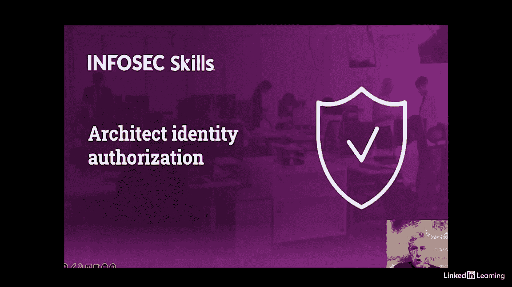
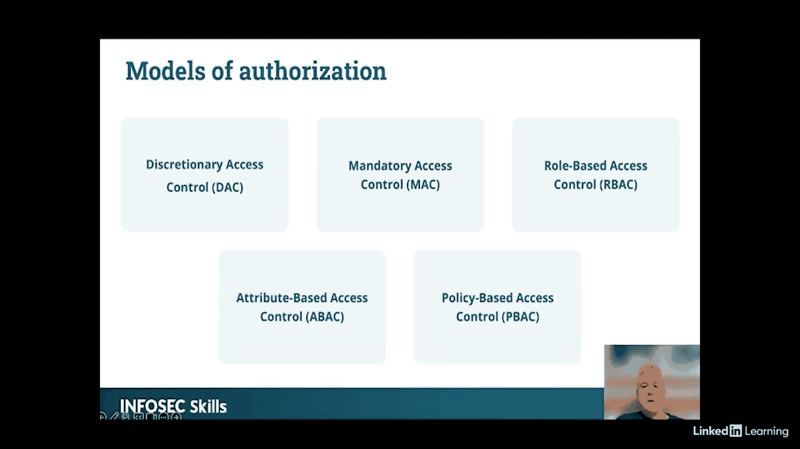

# ISC2 ISSAP：01：架构身份授权 🔐

在本节课中，我们将学习身份认证完成之后的下一步，即授权。你将了解什么是授权，它和认证有什么区别，以及如何通过最小权限、职责分离等原则来控制用户能做什么。我们还会介绍几种常见的访问控制模型，帮助你在实际工作中设计合理的权限体系。

从认证到授权：认证完成后，系统知道你是谁，但还不知道你能做什么。这就是授权要解决的问题。假设你已经证明自己是 Kelly Henderhand，接下来系统会问：你可以登录本地系统吗？可以访问哪些文件？可以恢复密钥吗？这些问题的答案，就是授权的内容。授权完全建立在身份识别和认证的基础之上，没有认证就谈不上授权。

授权遵循的核心原则：设计授权体系时，需要遵循一些安全原则，确保用户获得的权限恰到好处，既能完成工作，又不会带来额外风险。下面是几条最常用的原则。

以下是授权的主要安全原则：

- **最小权限原则**：用户只能获得完成本职工作所需的最小权限，不能多也不能少。公式表示为：`用户权限 = 完成工作所需的最小权限集合`。
- **需要了解原则**：用户只能访问与其职责相关的资源。例如，如果你不属于销售团队，就不应该打开销售文件夹。
- **职责分离原则**：一项关键操作不能由一个人独自完成，必须需要多个人配合。公式表示为：`关键操作 = 多人协作才能完成`。这会迫使潜在的欺诈行为串通发生，提高作案难度。
- **审计与策略对齐**：所有授权决定都要留下记录，并且必须能够证明与组织安全策略保持一致。

需要了解和最小权限的区别：这两个概念经常被混淆，但它们关注的点不同。最小权限关注的是你能访问哪些数据，而需要了解关注的是你能执行哪些活动。举个例子，不允许你进入销售文件夹，因为你不属于销售团队，这是需要了解原则；不允许你修改服务器的日期和时间，这是最小权限原则。这两个原则通常需要和职责分离一起使用，并且要通过策略来强制执行。

职责分离与防欺诈：职责分离的核心思想是，不要让任何一个人拥有过大的权力。这里有一个要记住的说法：职责分离迫使串通。串通通常是贬义词，指多方合谋实施欺诈。但如果系统设计得当，单个用户无法独立完成欺诈，必须拉上其他人一起配合，这样欺诈的难度就会大大增加。例如，打印支票的人和签署支票的人不能是同一个人，否则就容易发生舞弊。

即时访问与足够访问：在日常工作中，用户以普通身份运行，只有在真正需要管理功能时，才临时提升权限。临时凭证可能有时效限制，安全团队会定期审查这些凭证，确保用户获得的访问权限既不多也不少，正好满足需求。这再次回到了最小权限原则。

常见的访问控制模型：为了在实际系统中落实授权原则，我们需要选择合适的访问控制模型。常见的模型包括以下几种。

以下是几种主要的访问控制模型：

- **自主访问控制（DAC）**：资源所有者可以自行决定谁可以访问自己的资源。
- **强制访问控制（MAC）**：访问决策由系统策略统一决定，普通用户无法随意修改。
- **基于角色的访问控制（RBAC）**：根据用户在组织中的角色分配权限，目的是防止权限随着时间推移不断累积，也就是所谓的权限蔓延。
- **基于属性的访问控制（ABAC）**：根据用户属性，例如是否为终身教授、所在部门等，动态决定访问权限。
- **基于策略的访问控制（PBAC）**：由安全策略直接驱动访问决策，策略规定在什么环境下用户可以访问什么资源。

模型选择与应用：DAC 和 MAC 是较早期的概念，源自政府用于系统评估的橙皮书。从名称上就可以看出，强制访问控制通常比自主访问控制更安全。接下来的章节中，我们会更详细地探讨这些模型，并讨论如何在具体场景中选择合适的模型。

总结：本节课中，我们一起学习了身份认证之后的授权环节。我们解释了授权的基本含义，即认证后用户可以访问什么资源、可以执行什么操作。我们详细介绍了最小权限、需要了解、职责分离等核心原则，并说明了如何通过即时访问和足够访问来控制权限。最后，我们概述了 DAC、MAC、RBAC、ABAC 和 PBAC 等常见访问控制模型，为后续深入学习打下基础。

