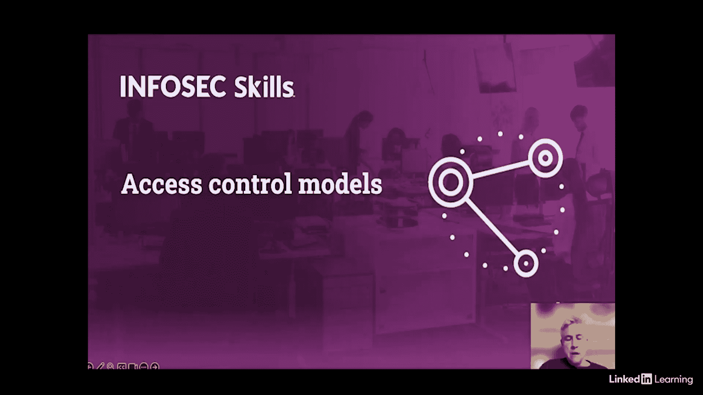
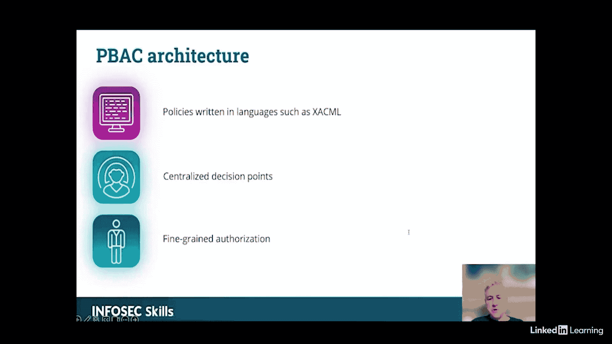

信息系统安全架构专业认证：02：访问控制模型 🔐




在本节课中我们将要学习访问控制模型。上一节我们探讨了如何限制授权，而答案就在于我们构建系统架构时所依据的访问控制模型。本节我们将逐一拆解几种常见的访问控制模型，并用大白话解释它们的工作原理、适用场景以及优缺点，帮助初学者快速建立概念。无论你是刚接触安全架构的新手，还是希望复习基础知识的学习者，这些内容都会以最直白的方式呈现，避免不必要的专业术语堆砌，让每一个知识点都容易理解和记住。


## 自主访问控制（DAC）📁

自主访问控制是我们日常中最常遇到的模型之一。Windows 系统以及绝大多数普通办公系统都采用这种架构。之所以称它为“自主”，是因为对象的安全性完全取决于对象所有者的个人决定。举例来说，假设我创建了一个文件夹并命名为 Kelly 的文件夹，既然是我建立的，我就是所有者，自然也就由我来决定谁可以进入这个文件夹。在 DAC 架构中，我们通过访问控制列表，也就是 ACL，来管理对资源的访问权限。简单来说，谁能看、谁能改，都是文件夹所有者说了算。

以下是 DAC 的几个关键特点：
- 资源所有者拥有完全的分配权限
- 使用 ACL 来授予或拒绝访问
- 设计目标是方便共享，而非最高安全级别
- 使用灵活，但用户掌控力较大，安全性相对较低

不过 DAC 并非最安全的选择。只要安全性取决于用户的个人酌情决定，就意味着它不是为了提供最强防护而设计的，它的首要目标是易用性。这种模式给予用户大量控制权，在一般办公环境中很实用，但在对安全性要求更高的场景下，我们通常会寻找其他替代方案。如果你需要的是一种好用又方便的共享机制，DAC 是不错的选择；如果你需要的是严格保密，则需要考虑更严格的模型。


## 强制访问控制（MAC）🏛️

当我们进入更安全的环境，例如军队或受到严格监管的行业时，自主访问控制可能不再足够，这时候强制访问控制就派上用场了。强制访问控制的核心思想是使用标签来做决定。这些标签通常与安全许可等级和信息分类等级相关联。换句话说，访问权限不再由资源所有者随意决定，而是由系统根据预设的标签强制执行。

以下是 MAC 的基本运作方式：
- 每个主体（比如用户账户）会被贴上一个标签，例如“秘密级许可”
- 每个客体（比如文件或资源）也会被贴上一个标签，例如“绝密级”
- 当主体尝试访问客体时，操作系统会对比两者的标签
- 如果主体的标签等级不足以访问该客体，访问请求会被直接拒绝

用公式表达如下：

```
访问决策 = 比较(主体标签, 客体标签)
```

在 MAC 中，是操作系统而非用户自己做出访问决定，这就是强制访问控制的全部含义。这种模式牺牲了一些灵活性，换取了更强的安全强制执行能力，非常适合对机密性要求极高的场合。虽然日常办公中不常见，但在国防、情报等领域却是标准配置。


## 基于角色的访问控制（RBAC）👥

接下来我们来看基于角色的访问控制，通常简称为 RBAC。在大型企业中，这是最受青睐的授权模型之一。与 DAC 不同，RBAC 中用户的访问权限由其所担任的角色决定，而非由其个人身份直接决定。这样一来，管理员不需要为每个员工单独设置权限，只需要分配合适的角色即可。

以下是 RBAC 的核心逻辑：
- 每个角色绑定一组固定的权利、权限和资格
- 用户获得角色，继而获得该角色对应的权限
- 无需为每个用户单独更新权限，从而避免权限蔓延
- 角色与业务职能对齐，落实最小权限原则和职责分离原则
- 通过身份和访问管理计划以及身份治理控制来实施

用公式简单表示：

```
用户访问权限 = 分配给用户的角色所拥有的权限集合
```

RBAC 之所以受到大型企业青睐，主要在于其一致性、可扩展性以及易于管理的访问控制。角色一旦预配完成，日常维护工作会大幅减少，新员工入职或旧员工调岗时，只需更换角色，权限就会自动跟随变化。

当然，RBAC 也存在一些陷阱。以下是需要注意的常见问题：
- 角色爆炸：创建过多过于细分、过于狭窄的角色，导致管理困难
- 角色定义过时：随着业务流程变化，角色权限没有及时更新，可能导致权限过多或过少
- 硬编码映射：将角色赋值直接写死在应用程序中，一旦角色或权限变更，就必须修改应用程序，而不是从中央身份服务器统一管理，这会增加变更时的运维工作量

要避免这些问题，我们应当设计更宽泛、可复用的业务角色，而不是充满琐碎细节的受限角色，同时确保角色定义随业务变化保持最新。只有做到角色清晰、数量适中，RBAC 才能发挥出最大的管理效率。


## 基于属性的访问控制（ABAC）🏷️

在 RBAC 之后，我们引入基于属性的访问控制，即 ABAC。如果说 RBAC 关注的是“用户拥有什么角色”，那么 ABAC 会问一个更宽泛的问题：基于我们对用户、资源、当前动作以及环境等所有已知信息，是否应该允许这次访问？这种模型把注意力从单一的角色身份，转移到多个属性的综合判断上。

以下是 ABAC 的决策依据：
- 用户属性：例如身份、部门、雇佣状态
- 资源属性：例如数据分类、所属项目
- 环境属性：例如访问时间、地理位置、网络状态
- 动作属性：例如读取、写入、删除

用公式表示：

```
是否允许访问 = 函数(用户属性, 资源属性, 环境属性, 动作属性)
```

ABAC 提供了非常灵活、细粒度且高度详细的决策能力，非常符合零信任架构中上下文感知式强制执行的理念。不过，要实施 ABAC，必须建立强大的治理机制。例如，当人力资源系统将一名员工从承包商变更为正式员工时，该用户的访问权限应当自动调整，而不是依赖人工干预。如果没有治理，我们就会遇到属性过时和访问决策错误的问题。

因此，我们需要可靠的属性来源，例如人力资源系统、Active Directory 或 Entra ID、移动设备管理策略，以及端点检测与响应系统所报告的合规性和健康状况。数据分类体系也可以为 ABAC 提供输入。总而言之，治理是我们对这些授权系统的责任，而强大的治理要求可靠且一致的决策制定。没有良好的数据源和流程，ABAC 就无法发挥其应有的价值。


## 基于策略的访问控制（PBAC）📜

最后我们来看基于策略的访问控制，即 PBAC。PBAC 的核心在于集中式访问控制。我们使用集中管理的策略服务器来存放访问策略，而策略执行点则分布在各个接入点上，例如无线接入点、VPN 服务器和远程访问服务器。换句话说，策略在一个地方制定，在多个地方执行。

以下是 PBAC 的架构组成：
- 策略决策点：集中式服务器，如 RADIUS 或其他集中化服务器，负责评估策略
- 策略执行点：分布式接入设备，在执行访问控制前先向决策点核对
- 策略语言：通常使用 XACML 等语言编写，方便修改和维护

策略可以包含多个条件，从而做出非常精确且细粒度的授权决定。例如，我们可以规定：只有财务部员工、在工作时间内、使用受管理的设备、通过公司 VPN 连接、访问被标记为内部数据、且动作仅为读取时，才允许查看某些信息。我们还可以要求在访问敏感数据之前先进行多因素认证。所有这些规则都可以集中定义，然后由分布的执行点统一检查。

用伪代码描述一下 PBAC 的检查流程：

```
如果 策略决策点 批准访问:
    策略执行点 放行请求
否则:
    策略执行点 拒绝请求
```

相比于其他模型，PBAC 让策略易于修改，能够快速响应业务需求的变化，同时提供极其细致的授权控制能力。无论是临时调整访问规则，还是应对合规性要求，集中式策略管理都能让工作变得更加高效。




本节课中我们一起学习了自主访问控制、强制访问控制、基于角色的访问控制、基于属性的访问控制以及基于策略的访问控制这五种常见模型。我们了解了每种模型的基本原理、适用场景以及优缺点，并掌握了如何在不同环境中选择合适的访问控制方式。希望这些内容能帮助你更好地理解授权架构的设计思路，为后续学习更复杂的安全体系打下坚实基础。
