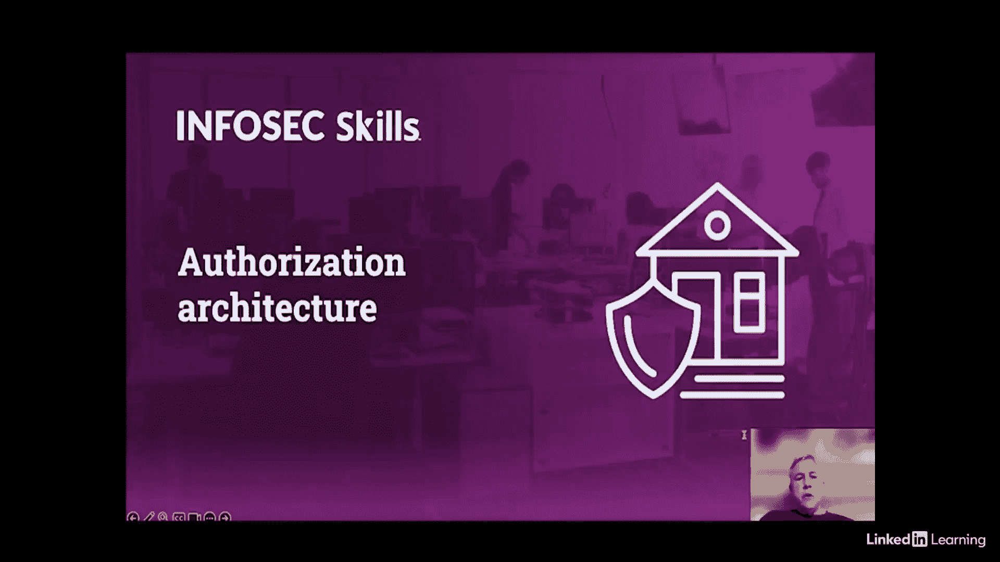
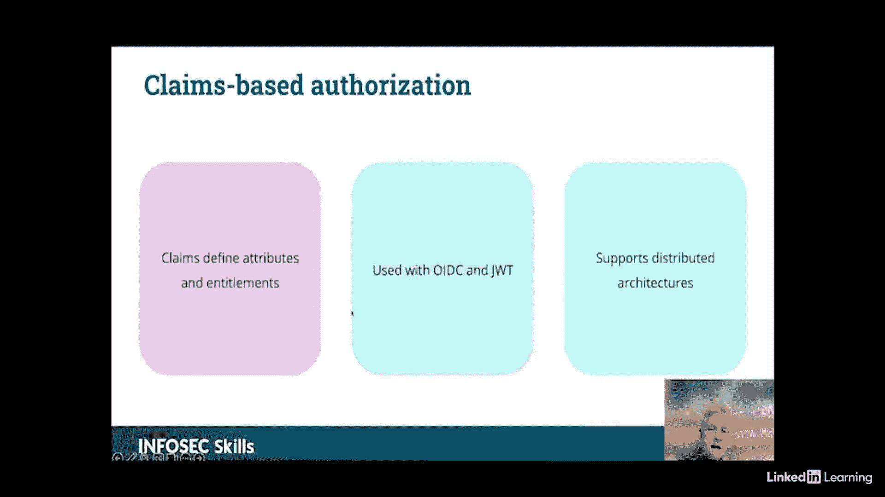

🔐 ISC2 ISSAP：03：授权架构


在本节课中，我们将要学习授权架构的核心内容。授权的作用是在确认用户身份之后，决定该用户能够访问哪些资源、执行哪些操作。我们会先整体看看搭建授权架构需要什么，然后重点介绍一种基于策略的标准语言，也就是 XACML。接下来，我们会逐一拆解策略决策点、策略执行点和策略管理点，看看这几个组件是如何分工协作的。这些知识点是理解企业级访问控制的基础，希望大家能够重点掌握。


## 授权架构的整体思路


首先，我们来看看搭建授权架构需要考虑什么。当我们谈论授权架构时，本质上是在探讨如何让系统判断某个请求是否应该被允许。一个完整的授权架构不仅要知道用户是谁，还要判断用户是否有权限访问特定资源。这其中涉及很多细节，比如策略存放在哪里、谁来做出决定、谁来强制执行决定。下面我们就从一个具体的标准语言开始说起。




## 基于 XML 的策略语言 XACML


上一节我们聊了授权架构的整体思路，本节中我们来看看常用的策略描述标准。我们先来聊聊 XACML，它的全称是可扩展访问控制标记语言。这里有个规律，几乎所有名字里带有 ML 后缀的技术，大多数都是基于 XML 构建的。XML 的特点是描述能力很强，但代价就是开销比较大，文件可能会比较冗长。虽然现在可能有更现代、更精简的替代方案，但为了打好基础，我们还是先从 XACML 开始。

XACML 是一个存在了相当长时间的标准，核心思想是基于策略的访问控制。简单来说，就是把访问规则写成策略文件，系统根据这些策略来决定放行还是拒绝。在实际部署中，我们通常希望策略能够集中管理，而不是分散在各个应用程序里。这样可以通过以下公式来理解：

[
\text{访问决策} = f(\text{用户属性}, \text{资源属性}, \text{环境属性}, \text{策略集})
]

核心组件之间的关系也可以用简单的伪代码表示：

```text
if 策略匹配(请求, 策略集):
    返回 允许访问
else:
    返回 拒绝访问
```

XACML 的主要特点如下：
- 基于 XML 编写，扩展性强
- 适合集中式策略管理
- 开销较大，适合对实时性要求不高的场景


## 策略决策点（PDP）


介绍完 XACML 标准之后，本节中我们来看看策略是如何被存储和决策的。在讨论 XACML 的过程中，绕不开几个重要概念，其中第一个就是策略决策点，也就是 PDP。PDP 简单来说就是策略存放的地方，它是整个授权流程中的决策大脑。当系统收到一个访问请求时，PDP 会根据存储的策略来评估这个请求是否符合规则。

策略决策点的核心职责可以总结如下：
- 存储访问控制策略
- 接收来自执行点的评估请求
- 根据策略计算出允许或拒绝的决定


## 策略执行点（PEP）


有了决策点之后，还需要一个地方来真正执行决定，本节中我们来看看策略执行点。策略执行点，也就是 PEP，是实际负责放行或拦截的设备或组件。它的工作方式是这样的：PEP 先从策略决策点获取策略信息，然后根据决策点的结果，决定是允许访问还是禁止访问。如果没有 PEP，PDP 做出的决定就没有地方落地。

策略执行点的常见表现形式如下：
- 防火墙
- 网关
- 应用程序中的权限拦截器
- 操作系统的访问控制模块


## 策略管理点（PAP）


除了决策和执行，策略本身也需要有人来创建和维护，本节中我们来看看策略管理点。策略管理点，也就是 PAP，通常和策略决策点部署在同一台系统上，但它们承担的功能是分开的。PAP 的工作是创建策略、修改策略，以及管理策略的生命周期。你可以把它理解为策略的后台编辑器，而 PDP 则是策略的运行引擎。

策略管理点的常见功能包括：
- 编写访问控制策略
- 修改已有策略规则
- 发布或撤销策略
- 管理策略版本


## 总结




本节课中我们一起学习了授权架构的基础知识。首先介绍了基于 XML 的 XACML 标准，说明了它用于基于策略的集中式访问控制。接着拆解了三个核心组件：策略决策点（PDP）负责存储策略并做出判断，策略执行点（PEP）负责强制执行允许或拒绝的决定，策略管理点（PAP）负责创建和管理策略。掌握这些概念，有助于你理解企业级系统如何实现统一的授权控制。
