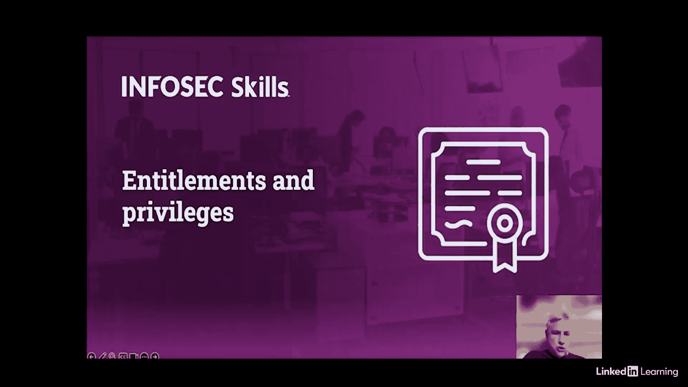
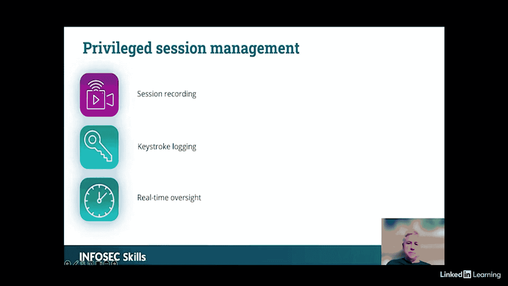

信息系统安全架构专家：04：权利与特权 🔐


在本节课中，我们将要学习权利与特权这两个核心概念。这两个词听起来可能比较抽象，但实际上它们关系到每个系统中最基本的安全问题：一个用户到底能做什么，又能访问什么。作为安全架构师，如果你不清楚这些规则，就很容易在设计系统时留下漏洞。这节课我们会用大白话把这些知识讲清楚，不需要你有很深的技术背景，初学者也能看懂。我们会先从权利和特权的定义说起，然后聊聊集中化管理为什么更安全，接着讨论特权账户该如何管理，最后介绍即时提权和会话监控等实用方法。我们现在正式开始。


## 什么是权利与特权 📋

上一节我们介绍了访问控制的基本思想，本节中我们来看看权利和特权是如何在实际系统中落地的。归根结底，安全架构最终要回答的问题非常简单，那就是我被允许做什么，以及我被允许访问什么。在设计我们的系统架构时，我们必须搞清楚哪些操作是被允许的，比如读取文件、写入数据、执行程序，以及各种其他操作。然后，我们需要把这些权限——更准确地说，是权利——映射到特定策略中的特定角色。这里请大家一定要记住，因为这是整个访问控制体系的基础。

权利不仅仅是权限，它还关联着相应的权益。我们可以用一个简单的公式来描述这个关系：

**权利 = 权限 + 权益**

也就是说，当你拥有一个权利时，不仅意味着你可以执行某个操作，还意味着你拥有与这个操作相关联的某些权益。比如，读取文件的权限可能还关联着查看文件元数据的权益。理解这个区别，能帮助我们在设计策略时更加精确，避免授予过多或者过少的访问权限。

以下是权利映射的典型流程：



1. 确定系统中允许执行的所有操作，例如读取、写入、执行、删除等。
2. 将这些操作封装为具体的权限对象。
3. 把权限对象分配给特定的角色，比如管理员、审计员或普通用户。
4. 将角色绑定到相应的安全策略，从而生效。


## 集中化管理与分布式管理 🏢

在了解了权利的基本概念之后，我们需要讨论如何高效地管理这些权利。当我们能够集中管理，而不是在分布式环境中分散管理时，我们就能获得更强的控制力、更高的安全性，并减少错误和配置失误的可能性。你可以这样想，如果每台服务器都有自己独立的权限列表，管理员就需要一台一台地登录去修改，这不仅非常浪费时间，还很容易漏掉某台机器，或者在某台机器上配置出错。相比之下，集中化管理让我们从单一位置完成所有配置，审计工作也会变得更加方便。

以下是集中化管理主要带来的好处：

1. 控制力更强，安全管理员可以全局查看和调整权限。
2. 安全性更高，减少因人工操作遗漏而导致的安全缺口。
3. 错误概率更低，避免在不同系统中出现不一致的配置。
4. 配置失误更少，因为所有变更都在同一个管理控制台中进行。


## 特权账户管理 🔑

说完普通权限，我们现在来聊聊更敏感的特权账户。当然，我们需要考虑特权账户。我们之前已经讨论过特权账户，这些是拥有管理员权限或访问权的人员，例如 Linux 或 Unix 的 root 用户。这类账户在系统中拥有极高的控制力，一旦被滥用或者泄露，后果可能非常严重。因此，我们要确保这些用户同时拥有普通账户，并且在必要时拥有提升权限的方式。

例如在 Windows 中，你见过“以管理员身份运行”功能，我可以以管理员身份运行程序。这正是我们要讨论的机制之一：日常工作使用普通账户，只有在确实需要执行管理任务时才临时提权。

我们可以用一段伪代码来描述这个过程：

```
如果用户以普通身份登录:
    执行日常操作
否则如果需要管理权限:
    请求提权审批
    获得批准后临时获得管理员权限
    完成特定任务后自动恢复普通身份
```

我们必须确保授予此类访问权限有适当的审批流程。审批链条是什么，这又与治理密切相关。也就是说，不能让任何人随便提权，必须有一个清晰的审批路径，并且这个路径需要符合组织的安全治理要求。


## 即时架构与时限性特权 ⏱️

紧接着特权账户管理，我们需要了解即时架构这个重要思想。Just in time architecture，这就是“以管理员身份运行”功能所体现的核心思想：根据需要授予你权限，或者提升你的控制力和访问权，并且仅在需要的时间内有效。除了提供提权方式之外，它还确保权限不会永久保留。我们通常将其与时限性特权关联，意味着你拥有管理员访问权，但是这个访问权只能维持很短的一段时间。

我们可以用一个公式来表示时限性特权：

**有效特权 = 管理员权限 × 时间限制（例如 10 分钟或 1 小时）**

或者我们可以将其绑定到特定操作，因此你可以以管理员身份运行某个特定应用程序。但是，一旦那个操作完成，你就会恢复到普通用户账户身份。这种设计非常有意义，因为即使某个账户不幸被攻破，攻击者也无法长期保持高权限访问。

以下是即时提权的典型应用场景：

1. 管理员需要修改系统配置，此时申请临时提权。
2. 审批通过后，系统在 10 分钟内赋予管理员权限。
3. 管理员完成配置修改后，权限自动过期。
4. 账户恢复为普通用户权限，无法继续执行敏感操作。


## 密码凭据保管库与会话监控 🛡️

这再次与特权账户管理相关联，接下来我们看看如何保护密码和监控会话。密码和凭据的保管库管理可以防止用户把密码写下来，也不会使用弱密码。当所有的特权凭据都存放在受保护的保管库中，并且只有经过授权的会话才能调用时，系统的安全性会大大提高。

我们会监控会话，确保没有空闲会话，也没有无限期持续的会话。我们会隔离管理会话，因为它们非常强大，一旦被攻击者控制，可能对整个系统造成毁灭性打击。必要时记录会话，这就是监控。我们需要知道我的特权账户是什么，它们在做什么，正在行使什么样的权利，正在使用什么样的权利和权限。因此我们会记录会话，甚至可能会记录按键。我们将提供实时监督，因为我们要严密监控特权账户能够做什么。

以下是特权会话监控的核心措施：

1. 使用凭据保管库存储特权账户密码，避免明文记录或弱密码。
2. 监控所有特权会话，及时发现并终止空闲会话。
3. 隔离管理会话，防止与普通用户会话混合。
4. 记录会话内容和按键日志，支持事后审计与取证。
5. 提供实时监督视图，让安全团队随时了解特权账户的当前行为。


## 本节总结 📚



本节课中，我们一起学习了权利与特权的基本概念，包括权限与权益的区别、集中化管理的优势、特权账户的管理方式，以及即时架构和时限性特权的应用。我们还探讨了密码凭据保管库和特权会话监控，了解了如何通过审批、隔离和记录来加强对高权限账户的控制。希望这些内容能帮助你在构建安全架构时，更清晰地规划谁可以做什么、能访问什么，以及如何安全地管理特权访问。

