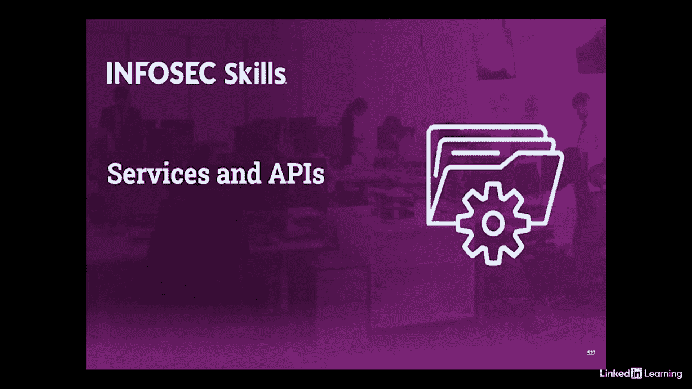
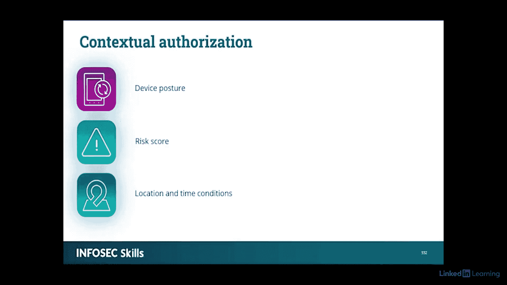

# ISC2 Information Systems Security Architecture Professional (ISSAP)：05：Services and APIs 🔐


在本节课中，我们将学习服务与 API 之间如何进行安全授权。现代应用程序通常由大量服务和 API 组成，它们之间需要频繁通信。如果保护不到位，攻击者可能会利用薄弱环节获取敏感数据。我们会讲解如何验证请求发送方的身份，如何使用 OAuth 权限范围和 JWT 声明来控制操作，如何为每个服务分配唯一身份，以及如何通过相互 TLS、令牌交换、边车代理和策略即代码等技术，落实零信任和最小权限原则。无论你是刚接触安全架构，还是希望巩固知识，这节课都会用大白话把核心概念讲清楚。

我们先来看看 API 是如何决定允许哪些请求通过的。



在现代系统中，大部分通信发生在服务与服务之间，或者应用与应用之间。这意味着 API 不仅要面对人类用户，还要面对其他程序。为了保护这些接口，API 必须先弄清楚是谁在发起请求，以及该请求方被允许做什么。

以下是 API 授权中常用的三个核心要素：

- 身份验证：API 会检查请求来自哪个应用程序或服务，确保请求方不是伪装者。
- OAuth 权限范围：使用 OAuth 时，会定义允许执行的操作，例如只读、写入、修改等。每个权限范围代表一组具体的操作许可。
- JWT 声明：JWT 中的声明包含用户是谁，以及该用户拥有什么属性。这些信息帮助 API 判断请求方是否具备访问资格。

核心概念可以用下面的公式来理解：

```
细粒度授权 = 身份验证 + OAuth 权限范围 + JWT 声明
```

这三者通常会一起使用，共同构成现代 API 架构中的精细访问控制机制。

上一节我们介绍了 API 授权的基本要素，本节中我们来看看服务本身如何获得身份和权限。

在讨论服务授权时，我们不能只把重点放在人类用户身上。现代云环境中，服务、系统和各种基于机器的身份（也就是所谓的非人类身份或工作负载）数量远远多于人类账号。每个服务都应该拥有自己独立的身份，而不是和其他服务共享同一个账号。

这种做法的目的是贯彻最小权限原则。假设系统中有支付服务和报告服务，支付服务可能被允许访问账单 API，而报告服务则没有这个权限。如果所有服务共用一个身份，一旦其中一个服务被攻破，攻击者就可能借用共享身份访问不该触及的资源。给每个服务分配独立身份，就可以实现细粒度的访问控制。

下面是一个简单的代码示例，说明不同服务对应的访问权限：

```yaml
支付服务:
  身份: payment-svc-001
  允许访问: 账单 API
报告服务:
  身份: reporting-svc-002
  允许访问: 数据查询 API
  禁止访问: 账单 API
```

有了独立身份之后，服务之间还需要在通信过程中互相证明对方可信，这时就要用到相互 TLS。

普通的 TLS 只能让客户端验证服务器的身份，而相互 TLS（mTLS）要求客户端和服务器互相出示证书，双方都要完成身份认证。比如库存服务连接订单服务时，两边各自出示自己的证书，验证通过后，系统才确认双方都是受信任的组件，从而授权这次连接建立。

mTLS 的核心公式可以表示为：

```
可信连接 = 客户端证书 + 服务器证书 + 双向验证
```

通过 mTLS，服务之间的通信通道会更安全，避免中间人攻击或未经授权的服务接入。

除了证书验证，服务之间还可以通过交换受信令牌来访问资源，这比使用密码安全得多。

传统做法中，服务之间有时会硬编码密码来互相认证，这既不安全又难以管理。现代做法是使用令牌交换协议，服务之间交换临时的、受信任的令牌，而不是长期有效的密码。每个服务只获得它完成任务所需的最小权限。

举个具体的例子：前端应用收到用户请求访问某个资源，此时持有用户令牌。前端应用不会直接把用户令牌一直传下去，而是将其交换为一个专门给支付服务使用的令牌。支付服务再拿着这个令牌去调用账单 API，账单 API 根据支付服务的令牌和权限来决定是否批准请求。

可以用下面的伪代码描述这个过程：

```
用户令牌 -> 前端应用 -> 交换为 -> 支付服务令牌 -> 调用账单 API -> 授权决策
```

这样做的好处是缩小了攻击面。用户令牌本身拥有较广的权限，如果让它一直贯穿整个调用链，一旦泄露风险很大。通过在每个环节使用专属的、权限受限的令牌，即使某个令牌被盗，攻击者也只能做非常有限的事情。

在微服务架构中，每个服务在和其他服务通信前都需要经过认证和授权，这就带来了大量重复的安全工作。边车代理正是为了解决这个问题而出现的。

边车代理可以把它想象成每个微服务旁边的一个小型安全卫士。这个代理进程负责处理身份认证、mTLS 和授权等安全功能，而主服务则专注于自己的业务逻辑。这样一来，业务代码就不需要自己写安全校验逻辑，所有的网络和安全操作都由边车代理统一代办。

边车代理的作用关系可以表示为：

```
微服务 = 业务逻辑 + 边车代理（负责安全与网络）
```

边车代理还可以被多个进程和服务复用，避免为每个服务重复编写相同的安全代码，节省开发和维护成本。主服务只需要把请求交给边车，边车负责验证对方身份和权限，确认没问题后再把请求转发过去，主服务则安心处理业务即可。

当服务数量变得非常多时，我们还需要一种方法来统一定义每个服务可以执行哪些操作，这时服务网格中的角色定义就派上用场了。

在包含大量微服务的系统里，如果每个服务的权限都单独配置，管理起来会非常混乱。服务网格允许我们为不同的工作负载定义明确的角色，并规定每个角色可以执行什么操作。这和我们熟悉的基于角色的访问控制（RBAC）很相似，但这里的对象是服务和工作负载，而不是人类用户。

下面是一个基于服务网格角色的示例配置：

```rego
# 服务网格角色策略示例
角色: 账单读取者
允许操作: 读取账单数据
拒绝操作: 修改账单、删除账单

角色: 支付处理者
允许操作: 发起支付、查询支付状态
拒绝操作: 访问用户个人档案
```

通过角色定义，我们可以非常精确地控制每个服务能做什么，避免权限过大或过小的情况。

零信任是现代安全架构的核心理念，我们之前多次提到它，本节将重点介绍如何把授权策略写成代码。

零信任授权要求我们对每一次访问都进行持续评估，不能仅凭一次登录就永远信任。除了身份、设备和环境上下文之外，还有一个我们之前没有详细展开的概念，就是策略即代码（Policy as Code）。

所谓策略即代码，是指把授权策略用代码语言编写下来，而不是把它们硬编码在应用程序里。常见的语言包括 XACL，或者更常见的 RegO（Open Policy Agent 使用的语言）。把策略当作代码管理，可以集中控制、保持一致性，并且在变更时容易通过变更控制流程进行更新，还能对策略进行版本管理。

策略即代码的基本关系可以表示为：

```
授权决策 = 策略代码（如 RegO / XACL） + 请求上下文
```

这意味着安全团队可以在代码仓库中维护授权规则，应用程序只需要在运行时调用这些策略来做出允许或拒绝的决定。

最后，我们来回顾一下贯穿整节课的一个关键概念，即上下文授权。

上下文授权是零信任架构中不可或缺的一部分。我们在这节课中讨论过的所有要素——身份验证、权限范围、JWT 声明、mTLS、令牌交换、边车代理、服务网格角色和策略即代码——都是零信任架构的关键组成部分。如果你对其中某些概念记不太清楚，可以回头查看之前关于零信任的章节，因为这些元素共同构成了完整的上下文感知授权体系。

简单来说，上下文授权不仅看“谁”在访问，还看“从哪里访问”“用什么设备访问”“访问的时间和环境如何”，综合这些上下文信息后再决定是否允许请求通过。



在本节课中，我们一起学习了服务与 API 的授权机制。我们介绍了 API 如何验证请求方身份，如何结合 OAuth 权限范围和 JWT 声明实现细粒度控制；解释了为何每个服务都需要独立的工作负载身份，以及最小权限原则的重要性；讨论了相互 TLS 如何让服务双向认证；说明了令牌交换协议如何用临时令牌代替密码来缩小攻击面；介绍了边车代理如何把安全功能从业务逻辑中分离出来；探讨了服务网格角色定义和基于角色的访问控制；最后讲解了策略即代码和上下文授权在零信任架构中的作用。希望这些内容能帮助你更好地理解现代系统中服务间安全通信的原理。
