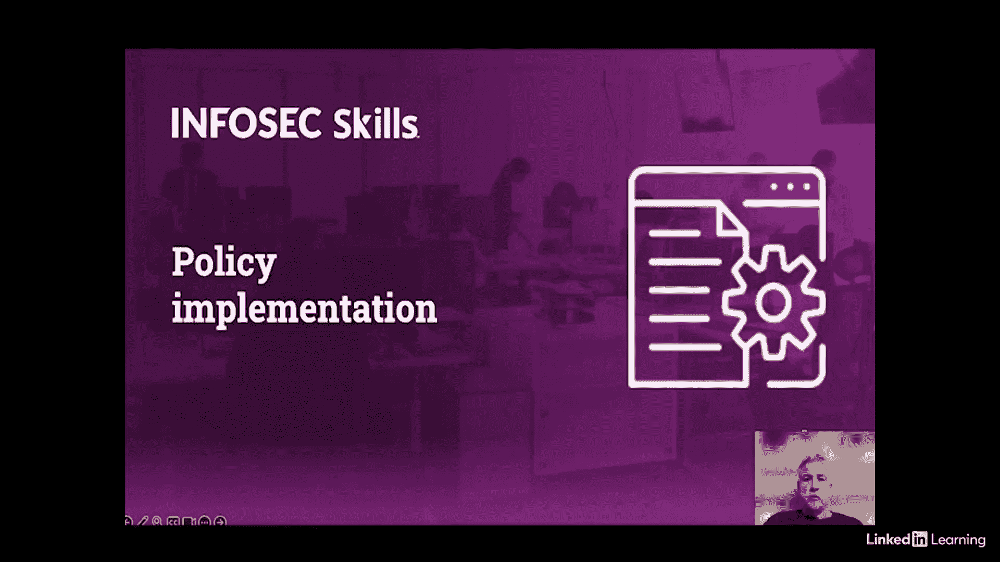
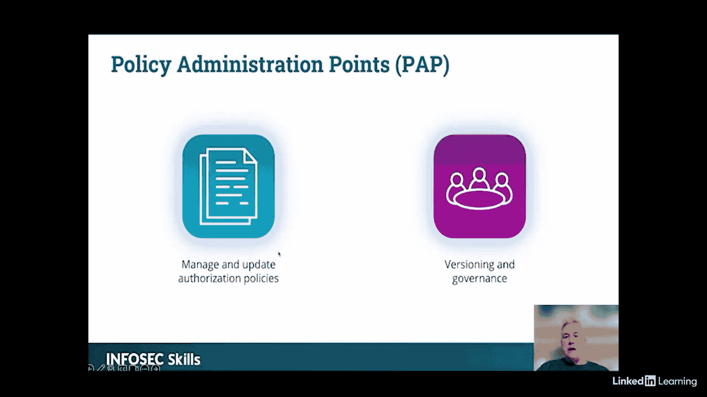

# ISC2信息系统安全架构专业认证(ISSAP)：第06节：策略实施 🔒


## 本节概述

在本节课中我们将要学习策略实施的核心内容。这部分知识主要围绕四个逻辑服务点展开，分别是策略决策点、策略执行点、策略信息点和策略管理点。我们会用大白话把每个概念讲清楚，帮助初学者理解这些组件是如何协同工作的，以及在实际的企业环境中它们分别承担什么职责。通过本节的学习，你将掌握访问控制决策是如何从策略制定到最终执行的完整过程。

---

## 策略实施的四个核心逻辑点

刚才我们对策略实施做了一次快速回顾，再次强调策略决策点这个概念。在讨论完整的策略实施体系时，我们需要同时关注策略执行点、策略信息点和策略管理点这四个部分。重要的是要理解，很多服务会以某种形式提供所有这些功能，或者至少提供其中多个能力。但这些服务在逻辑上是截然不同的，不能把它们混为一谈。当我们谈论策略决策点时，我们指的是一个独立的逻辑角色。

以下是策略实施中涉及的四个核心逻辑服务点：



- 策略决策点（Policy Decision Point，PDP）
- 策略执行点（Policy Enforcement Point，PEP）
- 策略信息点（Policy Information Point，PIP）
- 策略管理点（Policy Administration Point，PAP）

这四个点合起来构成了完整的访问控制决策与执行流程，缺一不可。每个点都有明确的职责边界，只有它们配合工作，才能实现安全且可管理的访问控制。

---

## 策略决策点（PDP）

在上一节中我们初步介绍了策略决策点的概念，本节中我们来看看它的具体职责和技术要求。策略决策点的工作就是评估访问请求，把请求和现有的授权策略进行对比，然后决定是否允许访问。这个过程需要具备可扩展性，并且要保证高可用性。这一点非常关键，因为在大型环境中可能会有几十万个服务和工作负载都需要授权，如果决策点不能横向扩展或容易宕机，整个系统都会受到影响，业务无法正常运行。

以使用Azure和Entra ID为例，它们提供了非常可扩展的方案，可以在请求访问时评估策略。PDP不应该凭空做出决定，它必须依据明确的策略规则，并且要在高并发场景下依然能快速响应。

策略决策点的核心逻辑可以用下面这个简单的公式来表示：

```
访问请求 + 授权策略 = 访问决策（允许或拒绝）
```

或者用伪代码描述：

```python
def evaluate_access(request, policies):
    for policy in policies:
        if policy.matches(request):
            return policy.decision  # 允许或拒绝
    return 拒绝
```

---

## 策略执行点（PEP）

介绍完策略决策点之后，我们自然要聊聊策略执行点。执行点的作用是根据决策点的指令，实际地阻止或允许对资源的访问。它不需要理解策略的细节，只需要收到PDP的指令，然后执行即可。执行点本质上就是资源的边界设备，它严格遵循PDP做出的决定，不擅自做出修改。

以下是常见的策略执行点形式：

- Web应用程序（如SharePoint、Office 365）
- 反向代理服务器
- API网关
- 管理交换机
- 无线接入点

策略执行通常通过应用程序、代理服务器、网关来实现，但也可以通过管理交换机、无线接入点等设备完成。无论使用什么设备，核心原则都是一样的：边界设备必须严格按照策略决策点的决定来行事，不能自行判断。

---

## 策略信息点（PIP）

决策不应该在真空中做出，这一点我们在前面已经提到过。策略决策点的判断应该受到策略信息点的影响，这样才能做出更明智、实时的决策。如果没有额外的上下文信息，决策就会变得死板，无法适应复杂的真实场景。

策略信息点的作用是提供上下文信息，比如风险评分、用户属性、设备状态等。例如，我们可以查看安全信息和事件管理系统或者Microsoft Defender，了解当前的风险评分是多少。基于这些属性信息，PDP就能结合实时上下文来做出更准确的允许或拒绝决策，而不是仅依赖静态规则。

策略信息点提供的数据类型通常包括：

- 用户属性（部门、职位、权限等级）
- 设备属性（操作系统、补丁状态、是否加密）
- 环境属性（访问时间、地理位置、网络类型）
- 风险评分（来自安全产品的实时威胁评估）

有了这些信息，决策就不再是简单的规则匹配，而是能够根据实际情况动态调整的智能判断，从而提高整体安全性。

---

## 策略管理点（PAP）

说完了如何做决策和如何执行决策，我们现在来看策略是怎么产生的。这就是策略管理点要承担的角色。策略管理点通常就是策略决策点所在的设备或系统，但它的功能侧重于创建和管理策略。它不负责评估访问控制是否符合策略，那是PDP的工作。管理点专门负责策略的编写、版本控制和生命周期管理。

从逻辑上讲，整个流程的起点就是策略管理点。管理员通过策略管理点来制定策略，然后这些策略会被分发给策略决策点，供PDP在评估访问请求时参考。同时，管理点还需要跟踪策略的版本变更，做好治理工作，确保策略始终符合组织的合规要求，避免策略混乱导致安全漏洞。

策略管理点的主要职责包括：

- 创建访问控制策略
- 修改和更新已有策略
- 管理策略版本
- 策略的发布与撤销
- 策略治理与合规审计

只有策略被正确定义和管理，后面的决策和执行环节才能有据可依，整个访问控制体系才能正常运转。

---

## 完整流程串联

现在我们把前面讲的四个点串起来看。一个管理员首先使用策略管理点来创建策略，接着策略决策点根据这些策略评估传入的访问请求，决策结果会发送给策略执行点，由执行点决定允许还是阻止访问。在整个过程中，策略信息点会提供实时的监控数据和风险评分，帮助决策点做出更好的判断。这是一个典型的策略实施闭环，每个组件都有明确的分工，彼此配合才能保证访问控制既安全又灵活。

这个完整的协作流程可以用下面的伪代码来概括：

```python
# 1. 管理员通过PAP创建策略
policies = PAP.create_policy("只有财务部门可访问报表系统")

# 2. PDP收到访问请求，结合PIP提供的上下文信息进行评估
decision = PDP.evaluate(request, policies, context_from_PIP)

# 3. PEP根据PDP的决策执行允许或阻止
if decision == "允许":
    PEP.grant_access(request)
else:
    PEP.block_access(request)
```

---

## 本节总结



在本节课中我们一起学习了策略实施的四个核心逻辑点，分别是策略决策点、策略执行点、策略信息点和策略管理点。我们了解到PDP负责评估访问请求并做出允许或拒绝的决定，PEP负责在资源边界执行这个决定，PIP提供风险评分和属性等上下文信息以辅助决策，而PAP则负责策略的创建、管理和版本控制。这四个部分共同构成了完整的策略实施体系，是理解访问控制架构的重要基础。掌握这些概念后，你将能够更好地设计和评估企业级的访问控制方案。
