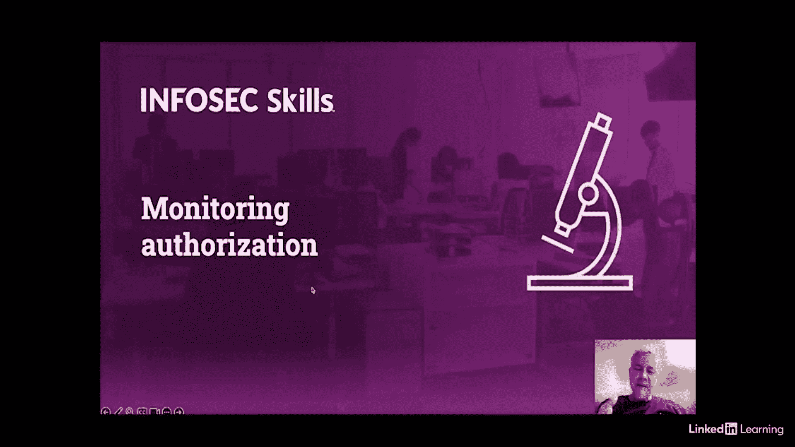
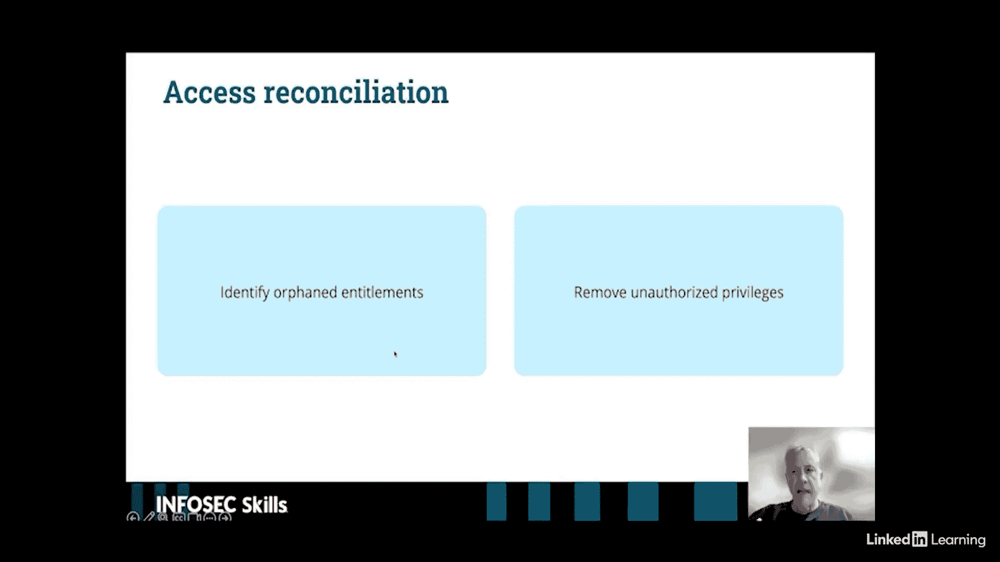

ISSAP信息系统安全架构专家：07：授权监控 🛡️


在本节课中，我们将学习如何监控系统中的授权行为。授权决定了谁能访问什么资源，而监控则负责确保这些决定始终正确、可追踪，并且符合安全策略。我们会讲解日志记录、权限漂移、动态授权更新、职责分离以及高风险访问控制等核心内容。学完本节，你将了解如何设计一套持续验证授权、防止权限滥用并支持审计合规的安全架构。



### 授权监控的基本目标 🎯

首先，我们要搞清楚授权监控到底是干什么的。授权监控的核心思想很简单，就是记录每一次允许或拒绝访问的决定，并把这些记录保存下来，以便以后查账、调查和合规检查。如果没有监控，我们就不知道谁在什么时候访问了什么，也无法在出问题时找到责任人。监控不仅是为了满足法律法规或内部政策的要求，更是为了让每一次访问决策都留下痕迹，做到有迹可循、有人负责、可审计。

```
访问决策日志 = {用户, 资源, 动作, 结果(允许/拒绝), 时间戳, 策略版本}
问责性 = 日志完整性 ∧ 可追溯性 ∧ 可审计性
```

以下是授权日志需要记录的关键要素：
- 每一次授权决策，无论是允许还是拒绝
- 生成该决策所依据的策略版本
- 支持调查、审计和整体问责的完整记录

有了日志记录，接下来我们看看具体要监控哪些异常行为。

### 监控的重点：过度特权与特权蔓延 ⚠️

在监控过程中，我们主要关注几种高风险情况。第一种是过度使用特权，也就是用户拥有的权限超过了工作需要，或者频繁使用不必要的高权限。第二种是权限偏离正常范围，比如某个账号突然访问了从未碰过的敏感系统。第三种是特权蔓延，这是指用户随着时间的推移，慢慢累积了越来越多的权限，却没有人发现也没有人清理。这些问题如果不加以控制，就会为内部威胁和外部攻击留下漏洞。

```
特权蔓延 = 当前拥有权限 - 初始分配权限 > 0
过度特权使用 = 实际使用权限 > 业务所需最小权限
```

以下是需要持续监控的异常行为：
- 过度使用特权
- 任何偏离正常行为的访问
- 特权蔓延现象

为了防止这些问题，我们需要建立持续的检查机制和定期的审查流程。

### 持续权利监控与访问认证 🔄

持续监控意味着系统要不停地检查用户的权利和权限，确保它们始终符合策略要求。访问认证则是定期对用户拥有的权限进行复核，确认这些权限是否仍然需要。如果发现任何未经授权的权限变更，系统应该立即发出警报。此外，在合适的情况下，我们还应该能够自动撤销或回滚过多的权限，而不是完全依赖人工操作。所有这些流程都要有详细的文档记录，并配合日志和审计，这样才能建立一个持续验证授权决策、保持权限准确并遵循最小权限原则的系统。

```
持续合规检查 = 定期扫描(用户权限, 策略规则)
未经授权变更 → 触发警报 → 自动回滚或人工审批
```

以下是持续监控体系应当包含的组成部分：
- 连续监控权利和权限
- 定期的访问认证和复核
- 未经授权的权限变更触发警报
- 自动回滚或删除过多权限的流程

除了静态的权限检查，现代系统还需要支持根据用户状态动态调整授权。

### 动态授权更新与跨系统同步 🔄

动态授权更新的意思是，当用户的属性、设备状态或风险条件发生变化时，授权决策会自动调整，而不需要人工干预。比如，员工升职、调岗或离职后，系统应该能立即根据新的身份和上下文更新访问权限，而不是依赖静态的固定权限。同时，我们还需要在不同的应用程序之间同步授权信息，可以使用OIDC、SAML等联合服务，或者利用AWS、Azure等云平台提供的身份和访问管理治理工具。我们的目标是让授权始终反映用户当前的身份、当前的上下文和当前的业务角色，从而支持最小权限和零信任架构。

```
动态授权决策 = f(用户属性, 设备状态, 风险条件, 实时事件)
访问权限 = f(当前身份, 当前上下文, 当前业务角色)
零信任 = 永不信任, 始终验证 ∧ 动态调整
```

以下是动态授权更新的典型触发场景：
- 用户角色变更
- 晋升或调岗
- 设备状态或风险条件变化
- 离职或账号禁用

在动态调整权限的同时，定期的人工复核同样不可或缺。

### 定期重新认证与职责分离 👥

定期重新认证就是定期回去重新评估和验证，用户是否还需要他们分配的角色、权利和特权访问权限。这个过程不能只靠安全团队，还需要经理和应用所有者参与，因为他们最了解业务需求，最清楚哪些人应该保留访问权限，哪些人应该被撤销。而在设计权限时，职责分离是一个极其重要的概念，考试中也经常考到。职责分离的目的是防止任何一个人拥有过大的权力，避免一个人既能创建用户又能分配权限，或者既能创建供应商又能审批付款。我们需要梳理所有职责和责任，找出可能产生冲突的权限组合，确保没有一个人持有互相冲突的特权。

```
职责分离 = ∀用户, ¬(角色A ∧ 角色B), 其中角色A与角色B互斥
有毒组合示例 = 创建用户 ∧ 分配权限 = 禁止
```

以下是常见的危险权限组合，也就是所谓的有毒组合：
- 创建用户的同一人同时分配权限
- 创建供应商的同一人同时审批或支付款项
- 开发人员既能编写代码又能直接部署到生产环境

识别出冲突之后，我们需要通过系统工作流来强制执行职责分离。

### 通过工作流强制执行职责分离与异常处理 ⚙️

在架构设计层面，我们应该把职责分离直接写入工作流，让系统在授予访问权限之前就拦截违规行为。例如，如果员工申请应付账款审批人角色，系统会先检查该员工现有的权限。如果不存在冲突且凭证正确，请求就会获批；但如果会造成职责分离违规，请求就会被拒绝，或者至少进入例外处理流程。即使某人 somehow 获得了冲突角色，应用程序层面也应该阻止误用，比如禁止同一个人既创建又审批发票，或者要求不同的用户审批超过特定金额的电汇。有时候业务确实需要允许某种高风险组合，这时我们需要有一套例外处理流程，要求提供业务理由、获得经理批准、限制访问时长、增加额外监控，甚至采用双重批准或多重签离，并且要定期复查，确保例外权限不会无限期延长。

```
访问请求结果 = 允许, 若 无职责分离冲突 ∧ 凭证正确
访问请求结果 = 拒绝或例外流程, 若 存在职责分离冲突
例外访问 = 业务理由 ∧ 经理批准 ∧ 限时访问 ∧ 额外监控 ∧ 定期复查
```

以下是系统层面强制职责分离的常见做法：
- 检查现有权利，发现冲突则拒绝请求
- 要求不同用户分别创建和审批发票
- 对高金额电汇要求不同用户审批
- 对例外访问实施双重控制或多人签离

除了工作流控制，对最高风险的访问还需要额外的强身份验证措施。

### 高风险访问控制与M of N机制 🔐

对于那些保护最关键系统的高风险访问控制，我们需要更严格的验证手段。多因素认证、分级认证、限时访问以及双重控制都是常用手段。双重控制有时也叫四眼原则，意思是没有任何一个人应该能够单独拥有某项关键权限。另一种相关概念是分割知识，即多个人分别知道一个密钥的不同部分，比如一个20字符的密码，我知道前10个字符，你懂后10个字符。还有M of N控制机制，这里的M和N都是变量，意思是总共N个人里，至少要有M个人在场才能完成操作。比如有10个管理员，要求任何3个人到场才能操作；或者7个人里需要2个人；数字本身不重要，关键是要多个人共同参与，避免单点风险。高风险访问应该受到严格控制并紧密监控。

```
双重控制/四眼原则 = 任意单人不可独立完成关键操作
分割知识 = 密钥 = 部分A + 部分B, 由不同人员持有
M of N控制 = 从总人数N中, 至少需要M人在场才能授权, 其中 M ≤ N
```

以下是高风险访问控制的典型措施：
- 多因素认证
- 分级认证
- 限时访问
- 双重控制或四眼原则
- 分割知识
- M of N控制

控制和监控之外，还需要定期清理系统中不再使用的账号和权限。

### 定期对账与清理孤儿账户 🧹

定期对账是指定期检查系统，确保没有孤儿账户的存在。孤儿账户是指那些基于已终止用户或已删除身份而仍然保留的账号和权利，也就是本该被清理却还留在系统里的账号。我们需要确保访问权限只保留给真正的活跃用户，对于不再使用的旧账号，要有清理流程把它们删除。同时，对账的重点还包括发现未经授权的特权并将其移除。整个对账过程应该集中化管理，能够持续验证并清理这些遗留问题，并且要保留完整的审计痕迹，为合规检查提供证据。

```
孤儿账户 = 账号属于已终止用户 ∨ 账号属于已删除身份 ∧ 仍保留权限
对账目标 = 移除孤儿账户 ∧ 移除未经授权特权 ∧ 保留审计痕迹
```

以下是定期对账需要处理的典型问题：
- 基于终止用户仍保留的账号
- 基于删除身份仍保留的权利
- 长期未使用的旧账号
- 未经授权的特权

至此，我们已经把授权监控的主要内容都梳理了一遍。

## 总结



本节课中我们一起学习了授权监控的完整体系。我们讨论了如何通过日志记录实现访问决策的可追溯性、问责性和可审计性，如何监控过度特权和特权蔓延，如何建立持续监控和动态授权更新机制，如何通过定期重新认证和职责分离降低内部威胁，如何对高风险访问实施多因素认证和双重控制，以及如何通过定期对账清理孤儿账户和未经授权的特权。这些知识能够帮助你设计出既安全又合规的授权架构，确保每一次访问都有据可查、受控可审。
