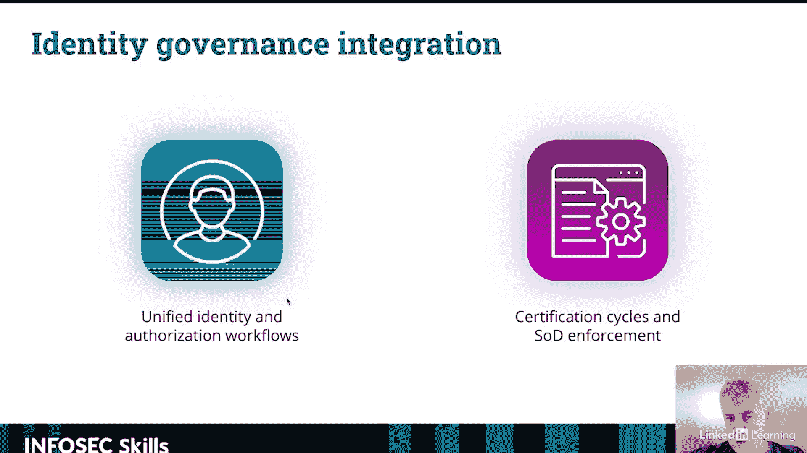
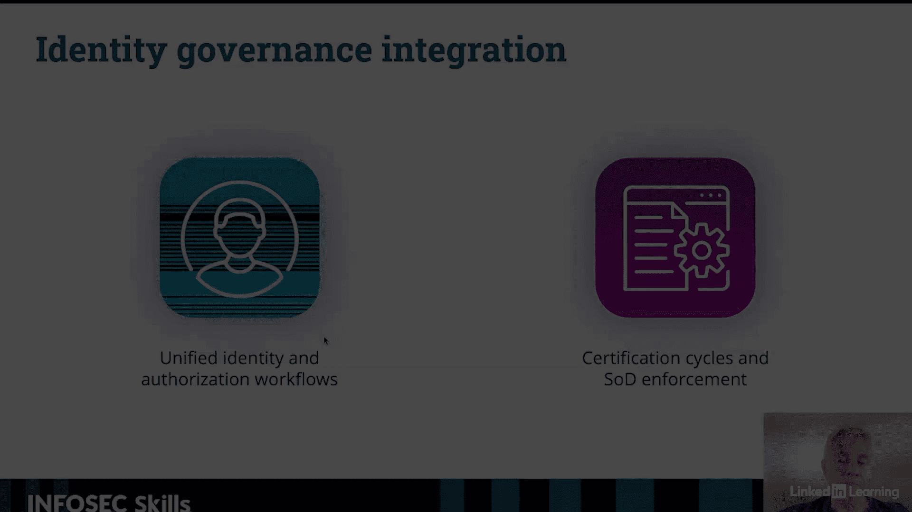

ISC2 ISSAP 信息系统安全架构专家: 08: 机器授权 🤖


在本节课中我们将学习机器授权的核心概念。我们会详细讨论机器身份如何运作，为什么机器和人类用户一样需要遵循零信任原则，以及如何基于工作负载给予权限。内容还包括身份传播、范围强制执行、云资源授权、数据库和数据湖授权，最后会讲到身份治理的集成。这些知识点是理解现代安全架构中机器访问控制的基础。


## 1. 机器身份与零信任授权原则 🔐

上一节我们介绍了人类用户的授权基础，本节中我们来看看机器身份是如何纳入同样的安全体系中的。

从架构师的角度来看，我们需要认真思考这些机器身份。机器身份可以是我们的应用程序，也可以是虚拟机、容器、API，或者任何其他类型的计算实体。当然，所有这些机器都需要使用与人类用户相同的零信任原则来进行授权。也就是说，不能因为某个请求来自内部系统就默认信任它，每一次访问都必须经过验证和授权。

对于每一台机器，我们都要考虑最小权限原则，只授予绝对必要的权限。这个决定主要基于工作负载，而不是系统所在的物理位置。我们需要关注的是系统的身份是什么，以及它需要处理什么样的工作负载。因此，对于我们的工作负载，例如微服务、支付服务、EMS、函数等，它们都会获得独立的身份，权限是根据工作负载的目的来授予的，同时也要依据其信任级别。每个工作负载的访问权限仅限于实际所需的内容。

我们还会使用属性来确定这些细节，也就是我们之前提到的APAP，即服务身份名称。需要考虑的属性包括：你处于部署环境还是开发环境？你的账户关联了哪些标签？风险等级是多少？例如，如果我们具体来看这个场景，假设有一个支付服务可以读取客户账单信息。然后还有一个推荐服务，可以根据你的购买记录或浏览历史进行推荐，而推荐服务可能只能读取产品目录。

你可能会让这些服务各自在独立的容器和Kubernetes中运行。在每一个节点上，都有不同的隔离边界。因此我们希望实现隔离，希望实现分离，并且希望将访问权限与工作负载绑定。这样一来，即使某个容器出现问题，也不会影响到其他工作负载。


以下是机器身份常见的几类示例：

- 应用程序
- 虚拟机
- 容器
- API
- 无服务器函数

核心概念可以用下面的公式来描述：

```text
机器访问决策 = 工作负载身份 × 信任级别属性 × 最小权限范围
```


## 2. 身份传播与令牌机制 🔄

在了解了机器身份之后，本节中我们来看看身份传播是如何在服务之间工作的。

当一个服务调用另一个服务时，下游服务需要了解请求的发起位置，以便据此做出访问决策。例如，假设有用户访问Web应用，请求会经过网关，到达订单服务，然后到达库存服务，中间经过了很多跳转。虽然最终是订单服务实际调用库存服务，但我们需要能够追溯到最初的用户，因为问责是安全体系中的主要要素之一。因此我们希望确保库存服务可以执行策略，不仅针对调用的应用程序，还要针对最终用户。

为了实现这一点，我们可以使用各种令牌技术，例如OAuth令牌和JWT（JSON Web Tokens）等。我们需要利用现有可用的技术来传播身份信息，确保下游服务知道请求背后的真实来源。

下面是JWT令牌的简单结构示例：

```json
{
  "iss": "order-service",
  "sub": "user-12345",
  "aud": "inventory-service",
  "scope": "read:inventory",
  "exp": 1735689600
}
```


## 3. 范围强制执行 🎯

在讨论完身份传播后，本节中我们来看看范围强制执行如何限制机器的权限。

范围定义了机器可以执行什么操作，以防机器获得过多权限。例如读取订单数据库、写入库存或删除日志，这些都需要通过范围分配权限。请求令牌的服务只会获得其所需的范围。例如，一个报表服务可能可以读取销售报告或读取库存，但没有修改这些元素的权限，它只有读取访问权限。这样，如果攻击者攻陷了该服务，只会损失读取能力，而不会导致整个系统泄露。

我们正在使用许多与用户和人类账户相同的原则，只是现在应用到机器上。基于范围的访问控制中，API将使用OAuth范围，每个范围都将是一个特定的隔离边界。在整个考试和实际工作中，最小权限原则始终是正确答案，请始终遵循这一原则。

核心授权逻辑可以用下面的代码片段来理解：

```python
if token.scope in required_scopes and request.identity.trusted:
    grant_access()
else:
    deny_access()
```

常见的范围示例如下：

- read:orders
- write:inventory
- delete:logs
- read:sales-report
```


## 4. 云资源授权 ☁️

在掌握了范围强制执行之后，本节中我们来看看云资源授权是如何应用这些原则的。

云资源的授权原则相同，但环境不同。我们可能会有虚拟机、存储桶、K8s集群、函数即服务等多种云资源。我们的目标是确保每个访问请求都遵循零信任原则。例如，云管理员可能被允许启动和停止虚拟机，但不能修改身份和访问管理策略，也不能访问财务信息。

因此，我们将使用策略作为治理的一部分来控制访问。我们还将使用基于资源的权限。对于云资源，有些资源除了身份和访问管理策略外，可能还有自己的授权策略。如果我们有基于资源的权限，它将定义谁可以访问哪个资源，而不考虑用户的权限。例如，S3存储桶可能允许某个应用程序读取访问，但可以拒绝所有其他用户，即使他们在其他地方具有通用存储权限。我们可以对这些权限进行非常细粒度的控制。

条件访问也是重要的一环，我们需要确保风险得分、位置以及访问或请求实体的身份符合我们的规则。接下来我们将分别查看AWS、Azure和Google的具体实现。


### AWS授权架构

从AWS开始，我们有身份和访问管理架构。AWS架构师将结合身份和访问管理角色，考虑策略、安全配置策略等一切内容。我们想确保是谁在提出请求，每个资源都在我们指定的条件下被访问。

如果具体看AWS架构，无论提供商是谁，都有相同的一般原则。但在AWS中，我们会获得角色。角色和策略、服务控制策略是AWS的关键元素，角色将为我们提供临时身份。请记住临时身份的最小权限原则，限制攻击范围，限制攻击者能做什么。我们的策略规定了谁可以在哪个系统或哪个环境中做什么。我们的SCP（服务控制策略）将通过AWS组织应用这些策略，确保我们有边界，防止账户超出安全限制。这就是我们指定最大允许操作的地方。

AWS中的关键元素包括：

- IAM角色：提供临时身份
- IAM策略：定义谁可以对哪个系统做什么
- SCP：服务控制策略，通过AWS组织应用安全边界
- 条件键：添加上下文，例如仅允许从特定IP或AWS区域访问，要求多因素身份验证

条件键的示例配置如下：

```json
{
  "Condition": {
    "IpAddress": {"aws:SourceIp": "203.0.113.0/24"},
    "Bool": {"aws:MultiFactorAuthPresent": "true"}
  }
}
```


### Azure授权架构

在完成AWS的介绍后，本节中我们来看看Azure的授权架构。

我们将基于角色访问控制拥有角色，并在角色中内置权限，但内置角色可能过多或不足，因此我们还将创建自定义角色。我们将把权限分配给角色，而不是分配给单个身份。关于特权身份管理，我们有Microsoft Entra的特权身份管理工具。我们将获得恰时特权访问，并确保对于拥有更高权限的人员，我们限制被攻陷时的风险范围。如果内置角色不足，我们可以添加自定义角色，始终根据我们环境的结构和框架进行定制。


### Google Cloud授权架构

在介绍完Azure之后，本节中我们来看看Google Cloud的授权架构。

Google的平台采用相同的理念，身份和访问管理，这就是我们授权的地方。创建查找结果和查找结果声明，将主体（用户、组、服务等）应用于特定资源。然后你的查找结果也可以应用于组织、文件夹或任何单个资源级别。这样我们就可以拥有继承权限。这是一个集中的管理位置，始终有益，以便我们能更有效地强制执行这些策略。

关于服务账户，它们是应用程序的身份。我们将为这些服务账户授予最小权限。我们也讨论过GCP中的条件IM策略。云平台将允许你创建IAM条件，就像我们期望的基于上下文的访问控制一样。在这里，我们将查找结果与角色关联，将原则分配给角色。这将允许我们在层次结构中创建多个级别，以确保我们能够非常详细地遵循最小权限原则。


## 5. 数据库与数据湖授权 🗄️

在了解了云资源授权之后，本节中我们来看看数据库和数据湖的授权方式。

我们也需要数据库授权。当我们讨论FEA级权限时，如果我们在FEA级别分配权限，我们将控制对相关数据库对象组的访问，例如表、视图、存储过程。而不是授予单个对象的访问权限，我们将授予一整套的访问权限，这通常只针对数据库所有者或开发者，并确保将其绑定到角色。

现在关于角色，你也可以为行和列添加特定的安全性。行级安全性将帮助过滤你使用的计算因素，当然，列级安全性通常基于属性。最后一点是，与其授予用户访问权限，不如允许应用程序通过存储过程访问数据。用户有权限访问存储过程，而存储过程访问数据库。

对于那些记得CISSP考试的人，你可能学习过一种名为Clark-Wilson的安全模型。Clark-Wilson的核心是将不可信实体远离后端服务，即用户不直接访问数据库，用户访问接口，接口访问数据库，这就是Clark-Wilson模型的实际应用。有时将CISSP中的这些理念带回现实世界看看其实现情况是件好事。

Clark-Wilson模型的访问路径可以表示为：

```text
用户 -> 接口 -> 存储过程 -> 数据库
```

这里的关键是，你需要在多个层级实施数据库安全性。例如，用于管理的架构权限，用于保护特定数据的列级安全性，当然，在讨论存储过程安全性时，允许通过接口进行访问。

数据湖也是同样的理念。当我们讨论数据湖时，我们拥有包含大量数据的集中式存储库，可能是原始数据、结构化数据、非结构化数据或半结构化数据，但我们仍然需要访问它并检索必要的信息。

同样，我们需要授权，例如基于区域的访问控制。数据被划分为区域，每个区域都会有不同的安全要求，并根据属性标签授予访问权限。属性标签被分类并标记，例如机密、绝密、保密级别或合规部门，如HIA或PCI DSS。这样就可以基于标签做出决策，这非常类似于强制访问控制环境中的标签思考。在这里，我们称它们为标签或使用基于属性的标记，但实际上我们是在创建标签，这些标签将决定系统如何处理访问。

基于区域的访问控制逻辑如下：

```text
访问决策 = 数据标签 × 用户清关级别 × 区域安全策略
```


## 6. 令牌化与数据掩码 🎭

在讨论完数据库和数据湖之后，本节中我们来看看令牌化与数据掩码技术。

我们不希望敏感信息轻易被访问。因此我们使用令牌化，我们可以访问一个指针，指针指向后端数据库中的有价值或敏感信息。所以令牌不是数据，它只是指向数据的引用。当我们谈论掩码视图时，我们掩盖敏感信息，我们都见过数据掩码，例如输入密码时被星号替换。

使用该策略，例如，对于信用卡号，掩盖前几个字符并显示最后四位数字，这就是掩码。允许用户获取所需信息而无需将其完全暴露，这不仅适用于数据湖，对数据库也很重要，你会在整个安全领域看到这些理念。

令牌化的基本流程如下：

```text
敏感数据 -> 令牌化系统 -> 令牌（指针） -> 后端安全数据库
```


## 7. 身份治理集成 🤝

在介绍完令牌化和数据掩码之后，本节中我们来看看身份治理集成的重要性。

当然，我们必须再次提醒身份治理集成。我们希望拥有统一的身份和授权功能，集中管理，以便我们可以有共同的视角和共同的控制。这里的最大挑战是将我们的治理与云授权集成。因为当一切都在本地时，事情简单得多。我们的资源在云中，而且通常不止一个云服务提供商，而是很多，因此我们可能在云服务之间存在访问不一致的问题。

通过治理平台统一的身份和授权工作流程可以解决这个问题。请记住，所有云服务提供商都会为我们提供管理工具。集中化是关键。

认证周期和职责分离强制执行将回头进行审查，我们确保没有用户拥有超过其所需的权限，没有系统、没有身份，如果事物过期，我们有能力回头审查新的认证以及访问权限。






本节课中我们一起学习了机器授权的完整体系。我们探讨了机器身份、零信任原则、工作负载权限、身份传播、范围强制执行，以及AWS、Azure和Google Cloud中的云资源授权。同时，我们也了解了数据库、数据湖的授权方法，令牌化与数据掩码技术，最后学习了身份治理集成和认证周期管理。这些内容构成了机器访问控制的核心知识框架。
