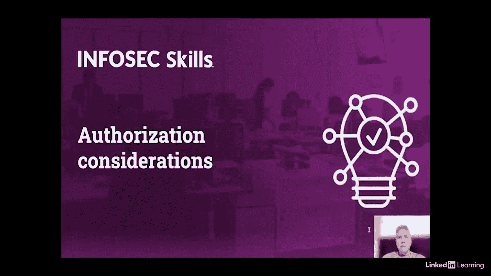
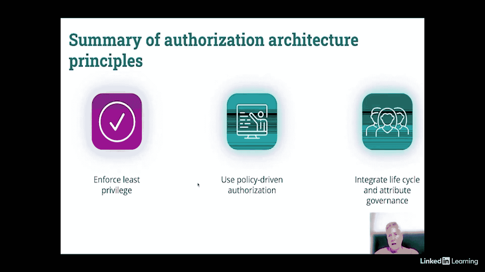

ISSAP 信息系统安全架构专业师：09：授权考虑因素 🔐

在本节课中，我们将一起学习授权方面的关键考虑因素。我们会探讨如何把授权策略定义为代码，如何把授权控制纳入持续集成和持续部署流水线，如何测试访问控制是否正确实现，以及如何通过监控和关键指标来发现过度权限、权限蔓延等常见问题。最后，我们会回顾为什么最小权限原则始终是授权设计的核心。

授权规划的整体考量 📋

上一节我们介绍了访问控制的基础概念，本节中我们先来看看制定授权计划时需要考虑哪些方面。

在制定授权计划的时候，我们一定要确保方案足够全面。在实际工作中，总有一些需要我们特别注意的考量因素，尤其是当我们处理策略的时候。过去几年里，我们处理基础设施的方式发生了巨大变化，DevOps 现在比以往任何时候都更处于核心位置，而 DevSecOps 才是我们真正应该思考的方向。不过因为原文主要围绕 DevOps 展开，我们就聚焦在这里，重点讨论策略即代码这个话题。

策略即代码（Policy as Code）💻

刚才我们聊到了 DevOps 和基础设施的变化，本节中我们来看看什么是策略即代码，以及它为什么重要。

传统的做法是人工手动配置授权和安全策略，而现在的更好方式是把授权策略和安全策略直接定义为代码。

以下是策略即代码的核心含义：

- 把策略写成代码，而不是手工点击配置。
- 策略可以纳入版本控制，方便追踪每一次变更。
- 策略会自动通过 CI/CD 流水线，在基础设施和应用程序中自动执行。
- 这样能保证实施的一致性，确保策略强制执行最小权限原则。

最小权限原则可以用简单的公式表示：

`用户或系统权限 = 完成业务所需的最小必要权限`

把授权策略作为软件开发生命周期的一部分来管理，意味着在任何内容到达生产环境之前，我们都要提供适当的测试和版本控制。持续的策略审查也是必不可少的，我们要始终留意过度权限、策略违规、配置错误等问题，在代码到达生产环境之前完成评估。通过把这些工作整合到 CI/CD 流水线中，我们能获得更大的控制力。

将授权纳入 CI/CD 流水线 🔄

在了解了策略即代码之后，本节中我们来看看如何把授权控制真正集成到 CI/CD 流水线里。

当我们把授权策略作为代码管理，并且把它放入持续集成和持续部署流水线时，就会自动获得自动化和集成带来的好处。我们需要有一种方法来追踪任何策略变更，这时候基础设施即代码的思想就派上用场了。我们还要确保自己具备回滚的能力，万一需要回退到之前的版本，可以快速恢复。这就强制要求我们保留良好的文档和配置记录。

测试授权控制 🧪

上一节我们介绍了把授权放入 CI/CD 流水线的方法，本节中我们来看看如何测试授权控制是否正确。

测试授权的核心目标，是确保访问控制策略被正确实现，并且始终遵循最小权限原则。我们需要验证“需要知道”原则，对于特权账户访问，还要要求额外的分步认证。以下是测试授权时需要关注的几个方面：

- 验证策略行为是否符合预期。
- 确认 RBAC（基于角色的访问控制）配置正确，只允许授权操作，明确拒绝未授权操作。
- 确保用户、系统、API 以及非人类账号只能访问最基本的必要内容。
- 测试权限提升场景，确保有适当的控制措施来降低这类风险。
- 确保访问控制策略能够抵御绕过强授权的尝试。

RBAC 的简单表达方式可以写成：

`RBAC = 用户 → 角色 → 权限`

通过在 CI/CD 流水线中完成这些测试，我们就能自动化地验证授权策略，确保最小权限得到强制执行。

监控与关键绩效指标 📊

测试授权控制之后，本节中我们来看看如何通过监控和关键指标来持续评估授权效果。

部署之后，我们需要持续监控，观察系统是否按预期运行，是否存在过度权限使用或过度权限率过高的情况。提升权限的用户数量应该非常有限，能够访问更高级别权限的服务也应该尽可能少。拿不准的时候，权限越低越好，不过最终仍然要根据业务需求来决定。

除了以上考量，我们还可以关注以下关键绩效指标：

- 访问审查完成率：访问认证和权利审查完成得有多快、多彻底。
- 审查及时性：确保能够及时完成审查，避免出现未审查的账号，或流程中的性能缺口。
- 授权决策延迟：从授权系统做出允许或拒绝决定所需的时间。如果延迟过高，系统性能就会受到影响。

我们要监控、测量，确保系统运行符合既定的目标和宗旨。

常见授权问题与挑战 ⚠️

在了解了监控和指标之后，本节中我们来看看授权管理中容易遇到的几个常见问题。

在实际运营中，我们需要警惕角色泛滥问题。当存在太多重叠的角色时，就会导致分配的权限过多，变得难以管理，环境也变得比必要时更加复杂。另外，我们还要确保权利不会过期，不会在用户不再需要之后仍然留在账号上。这就是所谓的权限蔓延，可以用简单的公式表示：

`权限蔓延 = 用户在组织中停留时间越长，累积的未回收权限越多`

当用户在一个组织待得越久，账号往往会关联越来越多额外的权限和权限凭证。如果我们没有建立合适的流程，这些权限和凭证可能不会被撤销。因此，始终要确保审查流程能够捕捉到这类情况。

最后，关于硬编码策略，我们要保持成长型思维，确保策略具有灵活性，可以根据需要进行修改和更新，同时也要便于审计，并能在整个访问控制中保持一致性。

总结与核心要点 📘

前面几节我们详细讨论了授权策略即代码、CI/CD 集成、测试方法、监控指标以及常见问题，本节中我们来总结本节课的核心内容。

本节课中我们一起学习了以下几个要点：

- 授权计划必须全面，并考虑策略和基础设施的变化。
- 授权和安全策略应该定义为代码，而不是手动配置。
- 策略即代码能带来版本控制、CI/CD 流水线集成和自动强制执行。
- 最小权限原则是授权设计的核心，在考试中几乎总是正确的答案。
- 授权应由策略驱动，策略即代码让策略的版本控制、测试、评估、审批和生命周期管理变得更加容易。
- 我们需要在整个架构生命周期中实施生命周期管理和治理，以确保有监督和支持。

希望通过本节课的学习，你能对授权考虑因素有一个清晰的认识，并能在实际的架构设计和安全审计中灵活运用这些概念。
