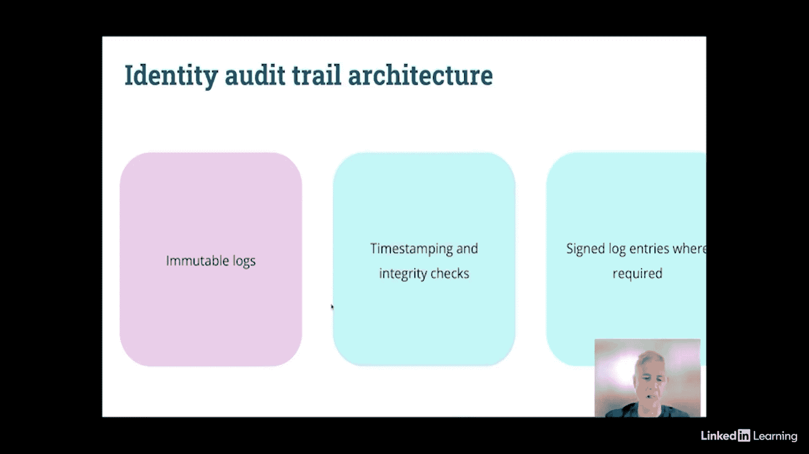

# ISSAP信息系统安全架构专业：01：架构身份会计 🔐

在本节课中我们将要学习身份会计与审计的基本概念。身份会计是安全架构中非常重要的一环，它决定了我们如何记录用户的身份活动，以及如何确保这些记录可以被审计和追溯。在开始之前，我们已经讨论过身份验证和授权，也就是确认用户是谁，以及用户能做什么。接下来的内容将重点放在记录用户做了什么，以及这些记录如何保持安全和可信。这一节适合初学者，我们会用大白话把每个概念讲清楚，确保大家能够看懂。

## 为什么需要身份会计和审计

上一节我们介绍了身份验证和授权，本节中我们来看看为什么身份会计和审计同样重要。

在安全架构中，身份验证和授权解决了“谁”和“能做什么”的问题，而身份会计和审计解决了“做了什么”和“什么时候做”的问题。如果没有账务记录，我们就无法知道系统中发生了哪些身份相关的事件，也无法在出现问题时追溯责任。这不仅是技术需求，也是很多行业的合规要求。

以下是开展身份会计和审计的主要原因。

- 实现问责制，让每个身份事件都有据可查。
- 满足受监管行业的合规要求，符合相关标准或框架。
- 在发生刑事活动时，支持证据的取证收集。
- 为组织提供运营保证，证明安全流程正常运行。
- 将账务记录与审计联系起来，虽然两者不完全相同，但审计能够提供问责依据。

## 身份会计要记录的核心内容

上一节我们介绍了为什么需要身份会计和审计，本节中我们来看看具体要记录哪些内容。

身份会计的核心目标是记录与身份相关的所有关键活动。这包括身份验证、授权以及账户配置等过程。架构师需要确保这些活动都被完整地记录下来，尤其是权限变更，因为权限变更往往涉及较高的安全风险，必须被优先跟踪。

以下是身份会计中需要重点记录的内容。

- 身份验证事件，记录用户是谁以及何时进行验证。
- 授权决策，记录用户被允许或拒绝执行什么操作。
- 账户配置与取消配置，记录账户的创建和删除。
- 权限变更，记录任何角色或特权的调整。
- 其他与身份相关的活动，包括权限使用情况和访问行为。

身份会计记录 = 身份验证日志 + 授权决策日志 + 账户配置日志 + 权限变更日志 + 其他身份相关活动日志

## 身份生命周期事件的跟踪

上一节我们介绍了身份会计要记录的核心内容，本节中我们来看看如何跟踪账户的整个生命周期。

身份生命周期是指一个账户从创建到注销的完整过程。在这个过程中，账户可能会被创建、修改、分配新角色，最后被取消配置。架构师需要确保每一个生命周期事件不仅被监控，还被详细跟踪，这样才能在审计时还原账户的历史状态。

以下是需要跟踪的身份生命周期事件。

- 账户创建。
- 账户修改，包括属性和角色的变更。
- 权限或角色的调整，例如某人获得晋升或被移动到不同的组。
- 账户取消配置，即账户被禁用或删除。
- 所有访问请求，特别是获批的请求，需要记录谁请求了访问、谁批准了访问、何时批准、批准原因，或者请求是否被拒绝。

## 认证与授权决策的审计细节

上一节我们介绍了身份生命周期事件的跟踪，本节中我们来看看认证和授权决策需要记录哪些细节。

对于身份验证，我们并不需要在每次用户成功登录时都发送通知，那样会产生太多无关信息。相反，我们可以设置截断级别，只在特定情况下收到提醒。例如，当用户连续三次输入错误密码时，系统才发出通知。对于授权决策，则需要记录谁做出了决策、决定了什么、策略是否有版本、决策背后的理由和逻辑，以及是否存在支持该决策的审计痕迹。

以下是认证和授权决策审计的关键要点。

- 成功与失败的身份验证事件，但不需要通知每次成功登录。
- 使用截断级别过滤日常噪声，例如连续三次密码错误时才通知管理员。
- 授权决策的执行人和决策内容。
- 策略的版本控制信息，记录是否进行了重新版本化。
- 决策的理由和逻辑，以及对应的审计痕迹。

## 审计日志的完整性与不可篡改性

上一节我们介绍了认证与授权决策的审计细节，本节中我们来看看如何保护审计日志不被篡改。

审计日志如果本身可以被修改，那它就失去了审计的意义。因此，架构师需要确保日志的完整性和真实性。具体来说，除了负责写入的服务，没有人应该有权修改日志，审计员和管理员都不应该直接写入日志。日志应当以防篡改格式存储，例如一次写入介质，并配合哈希处理、时间戳、完整性检查和数字签名等技术手段。

数字签名日志 = 日志内容 + 哈希值 + 时间戳 + 数字签名

不可否认性 = 完整性 + 真实性

以下是保护审计日志完整性的具体措施。

- 仅允许负责写入的服务修改日志，审计员和管理员无写入权限。
- 使用一次写入介质等防篡改存储格式。
- 对日志文档进行哈希处理，生成唯一摘要。
- 添加时间戳，证明记录产生的时间。
- 进行完整性检查，确保日志未被篡改。
- 使用数字签名对日志记录签名，获得完整性和真实性，从而实现不可否认性。

## 审计痕迹的设计原则

上一节我们介绍了审计日志的完整性与不可篡改性，本节中我们来看看架构师在设计审计痕迹时应遵循的原则。

作为架构师，我们是审计痕迹的设计者。审计痕迹不仅要防篡改，还要有篡改证据，意味着一旦有人试图修改，系统能够立即发现。同时，审计痕迹必须是可信且可靠的，这样才能支持合规要求，并帮助组织在必要时开展取证工作。

审计痕迹质量 = 防篡改性 + 篡改证据性 + 可信性 + 可靠性

以下是审计痕迹的设计原则。

- 审计痕迹应当防篡改，防止未经授权的修改。
- 审计痕迹应当具有篡改证据性，能够发现篡改行为。
- 审计痕迹应当可信，确保记录内容真实可靠。
- 审计痕迹应当可靠，支持身份事件的完整追踪和合规维护。

本节课中我们一起学习了身份会计与审计的基本概念。我们了解了为什么需要身份会计和审计，包括问责制、合规要求和取证需求等原因。我们学习了身份会计需要记录的核心内容，包括身份验证、授权、账户配置和权限变更等。我们探讨了身份生命周期事件的跟踪方法，以及认证和授权决策的审计细节，比如截断级别和决策日志。我们还介绍了保护审计日志完整性的技术手段，如哈希、时间戳和数字签名，并讨论了审计痕迹的设计原则。希望通过本节课，大家能够掌握架构身份会计的基础知识，为后续学习打下坚实的基础。

