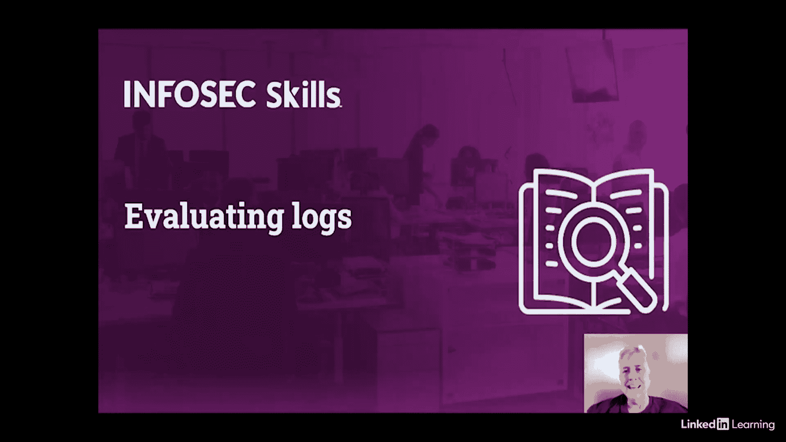
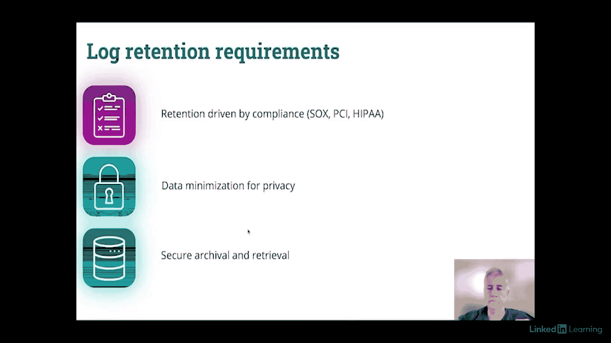

# 🔐 ISSAP信息系统安全架构专业认证：02：评估日志


在本节课中，我们将一起学习身份日志的评估方法。我们会先看看怎么把散落在各处的日志汇聚到一起，再聊聊身份日志具体要关注哪些信息，接着讨论日志应该保留多久，最后了解如何安全地归档和取回这些日志。希望这些内容能帮助你更好地理解日志管理。




现在我们已经搭好了身份日志的整体结构和架构，接下来得看看日志本身该怎么处理。


首先要解决的问题是，如何把日志汇集到一起，怎么把这些信息聚合起来。因为在我们的环境里，日志来源分布很散，可能有几百个甚至更多的设备和系统会产生日志。当我们需要查看日志时，不能一台一台去找，必须有一个集中的方式，把安全日志都带到一个中心仓库里。一旦有了这个中心仓库，我们就能对这些日志进行管理和分析。


以下是日志聚合的核心公式：

```
日志聚合 = Σ(环境中所有分散的日志源)
```

SIEM系统就是专门干这件事的。SIEM的全称是安全信息与事件管理系统，它的作用是从不同来源拉取信息，把它们汇集在一起。它不仅提供汇总，还能帮我们分析，关联网络中各种事件，并生成报告，让我们只看到真正需要的信息。


中心化日志架构的目的是实现事件的汇总和关联。有了汇总和关联，我们就能做趋势分析和预测。代码示例如下：

```
中心化日志架构 = 日志汇总 + 事件关联 + 趋势分析 + 预测
```


接下来我们来看看身份日志具体要关注什么。如果我们讨论的是身份日志，我希望能够专门看到来自分身份提供者的信息。具体来说，我想看到来自Active Directory的日志，也想看到任何能反映身份管理情况的应用程序日志。这些输入能让我们了解身份管理在实际运行中是怎么进行的，并提供所需的洞察。


以下是身份日志的关键来源：

- 身份提供者（Identity Provider）日志
- Active Directory日志
- 其他参与身份管理的应用程序日志


听到“汇总”这个词，我们通常会想到SIEM系统。它们的工作就是把所有这些不同来源的信息拉过来，汇集在一起。不仅如此，SIEM还能帮助我们分析，在整个网络中关联事件，并提供理想的报告，只展示我们需要的信息。


日志汇总之后，还得决定保留多久。这就涉及日志保留期限的问题了。说实话，这个问题没有一个标准答案，因为日志保留要求通常取决于法规、行业标准，或者组织自身的需求。过去我们不太谈论存储数据几十年甚至更久，但现在基于不同的法规和需求，情况已经不同了。


以下是确定日志保留期限的依据：

- 法规要求
- 行业标准
- 组织业务需求

我们需要搞清楚保留要求是什么，查看相关法规，跟数据所有者和业务负责人沟通，然后确定数据保留的时间长度。


不过要注意，如果不存储数据，就不需要保护数据，所以我们不希望超过保留期限。同时，我们只想存储绝对必要的数据，数据最小化是隐私保护的关键原则。存得越少，需要保护的就越少。公式如下：

```
需要保护的数据量 = 存储的数据量
```

最后当然还要做安全归档和取回。记录信息并保留下来，但如果取不回，就没有意义。所以在保留期间，我们要通过加密和访问控制来保护日志，但也要权衡，确保在必要时能快速恢复。


以下是日志归档需要平衡的几点：

- 合规性要求
- 隐私保护要求
- 安全保护措施
- 快速恢复能力

我们得确定日志保留策略应该是什么，在合规与隐私之间找到平衡，考虑安全问题，并且确保日志保留的时间刚好好：足够满足业务和法规要求，但不会比绝对需要的时间更长。




总结一下，在本节课中我们一起学习了身份日志的评估方法。我们了解了如何通过中心化仓库和SIEM系统聚合散落各处的日志，明确了身份日志需要关注的关键来源，探讨了基于法规和业务需求确定日志保留期限，并学习了如何在安全归档与快速取回之间取得平衡。
