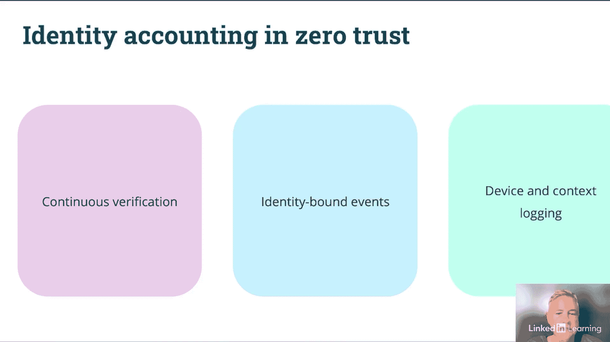
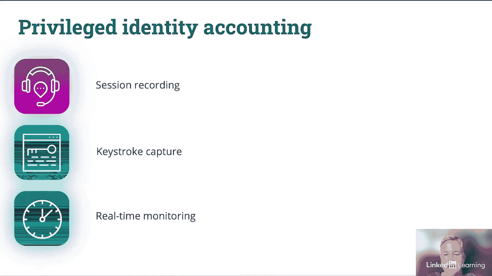
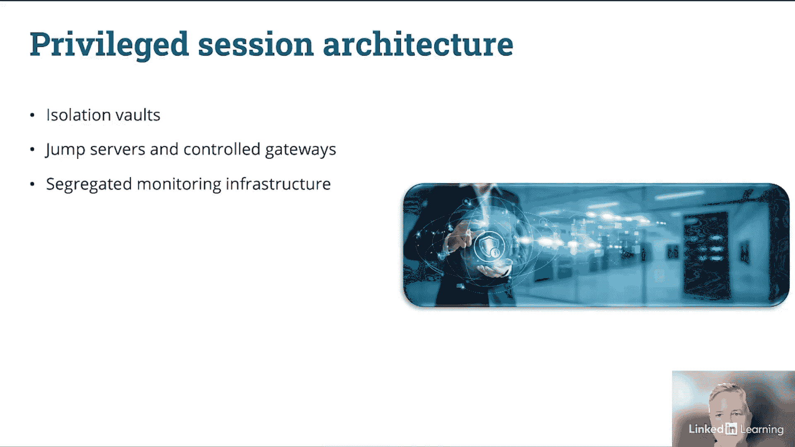
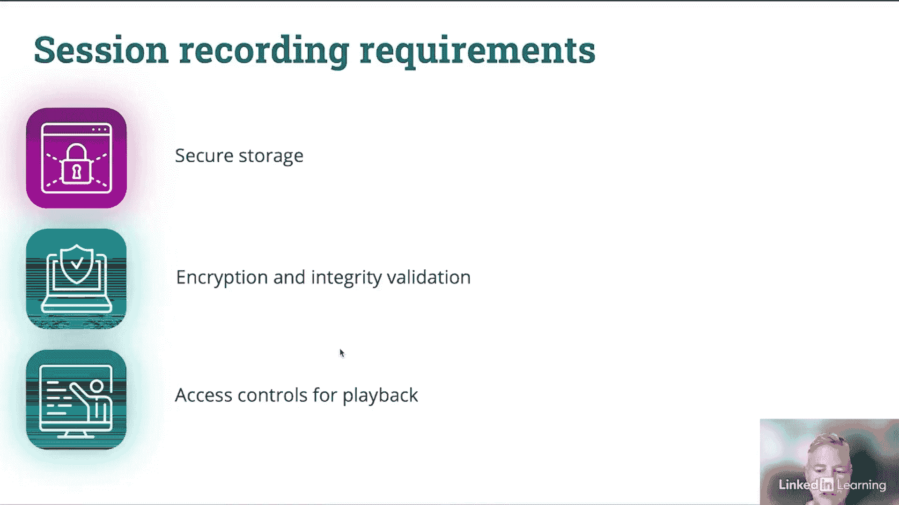
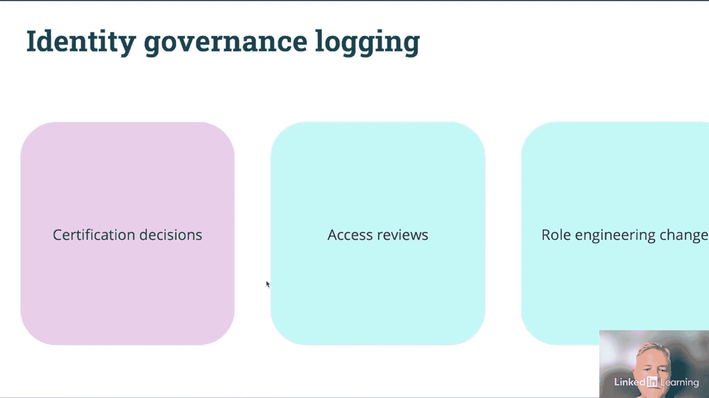
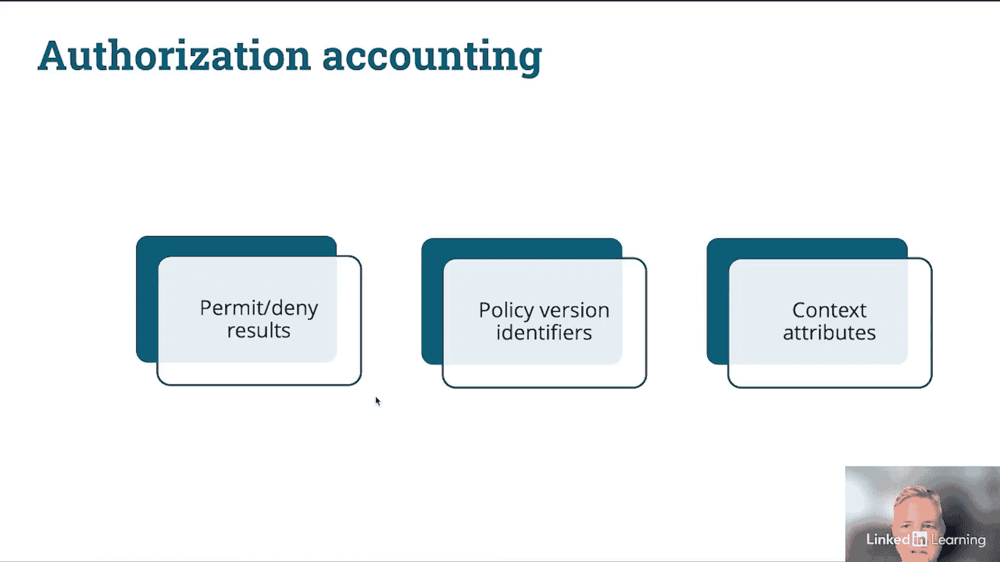
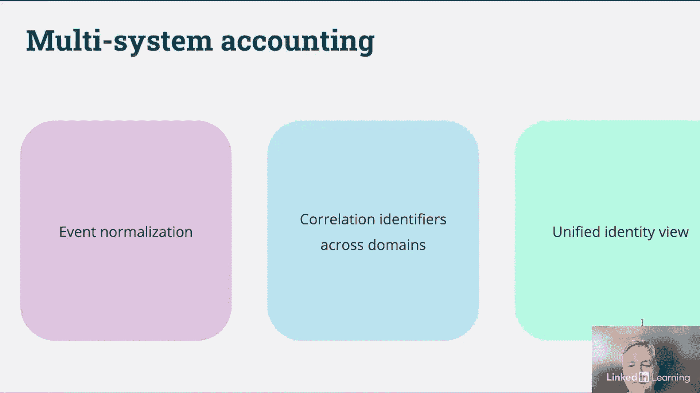

linkedin - ISC2 Information Systems Security Architecture Professional (ISSAP)：03：身份核算 🔐


本节课中我们将学习身份核算的核心概念。我们会先了解身份管理的整个生命周期，然后重点讨论特权身份如何进行核算与审计，接着介绍跳板机、会话录制、身份治理日志、授权核算以及多系统核算等内容。最后我们会看到，在零信任架构下，如何把所有活动追溯到一个具体的身份。

上一节我们介绍了身份管理的基本思想，本节中我们来看看身份核算在实际系统中是如何落地的。

身份管理的生命周期包含几个阶段。首先是身份证明，也就是确认申请人是谁。然后是配置，即给用户创建账号和权限。接下来是管理，在账号使用期间维护其状态。最后是解配，即在用户离职或不再需要时回收权限。在这整个生命周期中，我们需要持续验证访问者的身份。

持续验证意味着每次访问都要回答几个关键问题。谁在发起访问？这个人还可信吗？访问来自什么设备？连接的上下文是什么？因为我们现在基于身份边界，而不是基于网络边界，所以零信任架构要求持续验证，并根据身份来决定访问权限。

访问决策可以简化为如下公式：



```
访问决策 = f(身份，设备上下文，连接上下文，持续验证结果)
```

只要身份可信且上下文正常，才允许访问。否则应当拒绝。

特权身份核算是指对高权限账号进行详细记录和跟踪。特权账号非常强大，一旦被滥用会造成严重破坏，因此必须有良好的可追溯性和可审计性。



我们需要好的软件来管理特权账号，通常称为特权访问管理系统，即 PAM 系统。PAM 系统要确保每一项特权活动都能归属到某个具体身份。

以下是 PAM 系统需要记录的内容：

- 特权会话录制，包括远程桌面协议、安全外壳连接以及任何管理会话。
- 按键捕获，记录管理员输入的每一个按键。
- 命令捕获，记录执行的每一条管理命令。
- 实时记录，管理员可以在活动发生时观察。

所有这些记录的目的只有一个，就是确保每一次特权操作都能找到对应的身份，不留死角。

特权会话架构中，我们引入了隔离保险库的概念。特权凭证不再由管理员直接持有，而是存储在 PAM 保险库中。

当管理员需要使用密码时，需要从保险库中签出。密码可以被注入到会话中，并且应该自动轮换，同时受到防盗窃保护。

这种设计的好处是，管理员在不需要密码时无法直接获取密码，减少了凭证被泄露的风险。

跳板机是一个受控设备，用于访问敏感服务器。我们把特权访问强制通过一个控制点，也就是跳板机，而不是让管理员直接连接目标系统。

管理员先连接到跳板机，跳板机作为网关，可以强制执行多因素身份验证、日期时间限制以及其他访问控制。



以下是跳板机的典型作用：

- 作为特权访问的唯一入口点。
- 对连接进行加固，防止直接攻击目标系统。
- 强制执行多因素身份验证。
- 设置访问时间窗口和其他限制。

为了防止恶意管理员篡改证据，特权会话日志和录制内容必须与被监控的系统分开存储。

这就是职责分离和隔离的原则。监控基础设施独立于目标系统，确保即使某个管理员拥有目标系统权限，也无法进入日志存储区域删除记录。

最终的访问链路如下：

```
管理员 -> PAM 系统 -> 多因素身份验证 -> 跳板机 -> 网关 -> 特权系统
```

整个链路中，每一步都实施职责分离，确保没有单个人可以独立完成所有敏感操作。



会话录制是特权访问管理的重要组成部分。我们已经讨论过录制 SSH 连接和远程桌面协议连接。

录制本身如果不安全，那么记录的价值就没有了。因为录制内容可能被修改，从而失去证据效力。

以下是会话录制的安全要求：

- 安全存储位置，建立集中式仓库。
- 提前制定保留策略和控制措施。
- 管理员不得对存储区域拥有访问权限，无法删除或修改录制内容。
- 传输中和静止状态下都要对录制内容加密。
- 使用哈希值确保完整性，以便判断是否被篡改。
- 考虑使用一次写入介质或其他不可变形式的存储。
- 播放访问遵循最小权限原则，采用基于角色的访问控制，仅允许审计员、安全人员或调查人员访问。

我们需要把会话录制与 PAM 系统结合，因为 PAM 系统会持续录制某些活动类型，而这些录制内容必须安全存储。

身份治理日志要求我们对所有活动提供核算和问责。不仅要知道谁做了什么，还要知道谁请求了访问、谁批准了访问、出于什么原因批准、何时授权、谁重新认证了权限，以及权限是什么时候被变更或撤销的。

审计员不应该仅仅看到某个用户拥有数据库管理员权限。审计员应该能够完整还原整个决策过程。



以下是身份治理日志需要记录的要素：

- 访问请求的发起人。
- 审批人及其职位。
- 批准或拒绝的决定。
- 批准的即时需求和理由。
- 权限被授予的时间。
- 赋予权限的角色。
- 权限被变更或撤销的时间。
- 负责重新认证的人员。

访问审查应当及时、一致且按计划进行。对角色、权限或群组的任何变更，都必须记录下来。

授权核算与身份治理日志类似，重点在于记录访问决定的结果。



我们需要文档化每一次访问尝试，包括谁被允许访问、谁被拒绝访问，以及策略版本标识符。

例如，当策略发生修改时，审计员应该能够回溯并重建为什么在某个特定时间点允许了访问。

授权决策通常基于用户角色、群组、设备合规状态等上下文属性。所有这些信息都需要被捕获和保存。

多系统核算更具挑战性，因为活动可能分布在本地系统、云环境、软件即服务应用程序以及不同安全域中的其他应用程序上。

从审计和问责角度来看，多系统核算要确保活动可以追溯到一个身份，而不仅仅是单一系统上的身份。

事件归一化是解决这个问题的关键。不同系统记录信息的方式不同，一个系统可能称用户账号为 user ID，另一个系统可能称其为 user account，或者使用不同的缩写。

如果没有归一化，这些记录就无法被识别为同一个实体。我们需要把数据归一化，以便安全信息和事件管理系统能够识别这些记录指向同一用户。

数据归一化可以表示为：

```
规范化身份 = 归一化(系统 A 的 user ID, 系统 B 的 user account, ...)
```

相关性分析则进一步整合这些数据，构建端到端的交易视图。我们希望实现单一视图，即统一的身份视图，能够看到用户可能拥有多个账号和多个身份，但它们最终追溯到一个权威的真实来源身份。

这一点至关重要，因为用户可能同时拥有活动目录账号、云账号以及软件即服务账号，将这些身份追溯到同一个人可能非常复杂。

时间同步也是多系统核算中不可忽视的部分。我们需要跨所有不同系统保持一致且可信的时间来源，例如使用网络时间协议。

假设用户访问一个云应用，流程如下：

1. 用户向身份提供商进行身份验证，例如通过 Okta。
2. 身份提供商发送令牌。
3. 令牌通过 API 网关，网关验证令牌有效性。
4. 用户访问的应用程序调用数据库。
5. 数据库执行事务。

链路上的每个组件都应该生成自己的日志。多系统核算要确保我们能够关联这些事件，证明用户完成了身份验证、获得了令牌、发起了 API 请求、访问了应用程序、执行了数据库事务，并且始终能够将这些活动追溯到同一个用户身份。



本节课中我们一起学习了身份核算的完整流程。我们了解了身份管理生命周期中的持续验证，掌握了特权身份核算与 PAM 系统的作用，学习了隔离保险库、跳板机和隔离监控基础设施如何保护特权会话，了解了会话录制的安全存储与完整性要求，掌握了身份治理日志和授权核算的记录要点，最后学习了多系统核算中事件归一化、时间同步与端到端可追溯性的方法。这些知识共同构成了零信任架构下身份核算与问责的基础。
