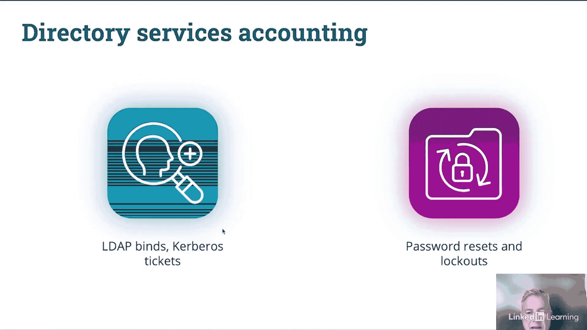

🔐 ISSAP 信息系统安全架构专家：04：服务与机器的责任核算


本节课我们将学习服务与机器的责任核算。除了人类账户之外，系统账户和机器身份同样需要被追踪和审计。我们会从为什么机器也需要责任核算、证书与凭证的生命周期管理、API 元数据与令牌管理、Active Directory 中的 LDAP 绑定审计，以及 Kerberos 票据监控等方面展开。内容会用大白话解释，让初学者也能看懂非人类身份如何在整个生命周期中保持可追溯性。


## 一、为什么不仅是人，机器身份也需要责任核算

上一节我们介绍了账户责任核算的基本概念，本节中我们来看看为什么不仅是人类账户，连基于系统的账户和工作负载也需要被审计。

我们继续讨论责任核算这个话题。这里不需要花太多时间，但必须确保不仅仅是基于人类的账户需要责任核算，也要包括基于系统的账户，并且要将这些账户与具体的工作负载绑定。我们不想只记录某个服务访问了数据库，我们想知道具体是什么工作负载，它们使用了什么证书，如何进行身份验证，如何获得授权，然后我想看到访问数据库的 API，以及执行了什么事务。所以人类不是唯一需要责任核算的身份。机器身份、凭证、身份验证、授权、工作负载动作，全部要记入审计轨迹，在整个生命周期中保持可追溯性。从 ISSAP 的审计与责任核算角度来看，机器身份核算确保这些非人身份，无论是服务器还是 API 或其他任何东西，它们都同样可追溯。接下来我们将看看如何管理这些身份的生命周期。

核心公式如下：

```
责任核算 = 身份 + 凭证 + 身份验证 + 授权 + 操作 + 审计轨迹
```


## 二、机器身份与证书生命周期管理

上一节我们介绍了机器身份需要像人类身份一样被追踪，本节中我们来看看如何管理证书和凭证的生命周期，确保每个非人类元素都有明确的归属。

所以证书的签发和过期，要确保有审计轨迹，知道哪个系统获得了哪个证书、为什么获得、是谁授权的。然后要确保为了保留这些信息，为了很好地收集和保留这些信息，我们需要自动化，我们将利用提供给我们的工具，因此机器对机器的活动会被记录，即使没有人直接参与，比如哪个工作负载调用了哪个服务，使用了什么证书等等。现在要实现这一点，每个系统、每个非人类元素也需要凭证，因此需要唯一的机器身份，确保没有共享的服务账户或凭证，唯一性是让我们拥有清晰审计轨迹的关键。每个工作负载都获得一个独立的身份，这样可以确保审计人员能够追踪应用程序、虚拟机、容器，具体到执行的操作，然后我们控制生命周期，包括证书生命周期和凭证生命周期，我们要确保有所属关系，因此每台机器最终都应该有一个特定的可识别业务所有者或系统所有者，审计人员必须能够确定责任和问责对象。有了唯一身份和生命周期管理后，我们需要记录这些身份之间的调用细节。

以下是机器身份唯一性的核心要点：

- 每个系统都需要独立的凭证
- 禁止使用共享服务账户
- 每个工作负载分配唯一标识
- 审计人员可将操作追溯至具体的应用、虚拟机或容器


## 三、API 调用与令牌管理

上一节我们介绍了证书和凭证的生命周期管理，本节中我们来看看 API 调用该如何记录元数据，以及令牌如何签发与撤销。

正确记录带有元数据的 API 调用，不仅要记录调用了哪个 API，还要记录工作负载身份，请求了什么，执行了什么操作，时间戳，所有这些我们想要追踪的元数据，因为这能让数据变得有意义。我们将记录哪个服务收到了令牌，该令牌在哪里签发，该令牌关联的范围和权限是什么。还需要确保我们有撤销令牌的手段，以防凭证被泄露或失效，我们还需要一份关于此事的记录，包括原因、是谁撤销了凭证、撤销的原因、谁授权了撤销，等等。除了应用层面的 API 调用，目录服务中的身份验证同样需要审计。

API 元数据包含如下字段：

```text
API 元数据 = {调用的 API, 工作负载身份, 请求内容, 操作类型, 时间戳}
```

以下是令牌管理需要记录的信息：

- 令牌接收的服务
- 令牌签发位置
- 关联的范围和权限
- 撤销原因与授权人


## 四、Active Directory 与 LDAP 绑定审计

上一节我们介绍了 API 元数据和令牌管理，本节中我们来看看目录服务中的身份验证如何留痕，特别是 LDAP 绑定的审计。

我们必须在 Active Directory 中进行核算，因为目录服务提供了非常强大的访问权限，你知道，从特权账户到普通账户，都要通过我们的目录服务进行身份验证，所以再次强调，是谁进行了身份验证，如何进行的身份验证，然后其账户或凭证发生了什么，你知道，要定期回顾审查，所以进行 LDAP 查找。当我们谈论 LDAP 查找时，我们将记录任何成功和失败的目录身份验证尝试，记录身份、来源、时间、结果。失败的绑定可能表明存在暴力破解攻击，密码猜测，甚至密码喷洒，或者可能是过期凭证，可能是配置问题，各种问题。目录服务之外，Kerberos 票据也是我们需要重点监控的身份凭证。

以下是 LDAP 绑定审计需要记录的信息：

- 身份标识
- 请求来源
- 发生时间
- 验证结果


## 五、Kerberos 票据与主体交互监控

上一节我们介绍了 LDAP 绑定审计，本节中我们来看看 Kerberos 票据如何反映身份与访问行为，以及如何发现密码攻击。

然后是与 Kerberos，你知道，就像我们之前说的，Kerberos 与 Active Directory 配合工作，所以我们将基于票据进行跟踪，我们将跟踪那个票据授予票据，我们将跟踪服务票据，以显示哪个身份进行了身份验证，然后随后请求访问这些服务，我们将监控 Kerberos 中主体之间的交互，任何形式的密码重置，账户锁定将向我们提供潜在的暴力破解攻击迹象，密码喷洒、凭证填充，任何这些迹象都表明有人试图破解我们的密码。

Kerberos 追踪包含以下要素：

```text
Kerberos 追踪 = 票据授予票据 + 服务票据 + 主体交互 + 账户锁定记录
```




本节课中我们一起学习了服务与机器的责任核算。我们了解到不仅人类账户，系统账户和机器身份同样需要审计与追踪。我们讨论了证书生命周期、唯一机器身份、API 元数据记录、令牌撤销机制、Active Directory 中的 LDAP 绑定审计，以及 Kerberos 票据与主体交互监控。这些机制共同确保非人类身份在整个生命周期中可追溯，审计人员能够明确责任与归属。

