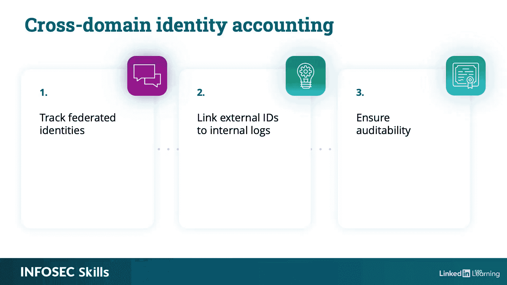

# ISSAP 信息系统安全架构专家：05：联邦会计 🔐


在本节课中，我们将学习联邦会计的核心思想，重点看看当用户跨组织访问资源时，安全架构该如何保证每一个操作都能追溯到最初的身份。我们会从联邦账户的基本概念说起，接着聊聊令牌是怎么签发和验证的，再探讨跨域问责该怎么做，最后结合云环境中的实际案例，看看审计痕迹到底该留些什么。这部分内容对 ISSAP 考试非常重要，因为考试常考如何保证审计痕迹完整、全面，避免外部身份访问资源时留下盲区。

## 什么是联邦账户与联邦信任

上一节我们做了整体概述，本节我们先来看看什么是联邦账户，以及联邦信任在其中扮演什么角色。

联邦账户简单来说，就是一个用户在一个组织里完成身份认证，然后拿着认证结果去另一个组织使用资源的机制。这里面涉及两个关键角色，一个是身份提供商，另一个是服务提供商。身份提供商负责验证用户是谁，服务提供商负责决定用户能做什么。两者之间建立信任关系之后，用户就不需要在每个系统里单独注册账号了。

联邦信任的核心在于，资源方不再自己验证用户密码，而是信任另一个组织出具的证明。这就好比你在 A 公司出示身份证，B 公司认可 A 公司的身份证明，就让你进门。整个过程的关键在于，我们必须能够把最终的访问行为，一直追溯回最开始认证用户的那个身份提供商。

以下是联邦账户的基本流程：

1. 用户向身份提供商进行身份认证。
2. 身份提供商签发一个经过数字签名的令牌。
3. 用户将令牌发送给服务提供商。
4. 服务提供商验证令牌是否来自受信机构。
5. 验证通过后，用户获准访问应用。

这个流程看起来简单，但背后隐藏着一个重要前提：架构必须支持把整条链路重建出来，否则一旦出了问题，我们根本不知道是哪个环节出了漏洞。

## 令牌的签发与数字签名验证

了解了联邦账户的大致流程后，本节我们深入看看令牌到底长什么样，以及服务提供商如何确保令牌可信。

在联邦环境中，令牌就是用来证明身份的“通行证”。最常见的有 SAML 令牌，还有 OIDC 里的 ID 令牌。不管是哪种，令牌都必须由身份提供商进行数字签名。数字签名的作用是保证令牌在传输过程中没有被篡改，并且确实是由我们信任的身份提供商签发的。

服务提供商收到令牌之后，会先检查数字签名是否有效，然后确认签发方是不是受信机构或联邦机构。只有这两项都通过了，服务提供商才会允许用户进入应用。如果跳过这一步，任何人伪造一个令牌都能进来，那联邦体系也就失去意义了。

以下是令牌验证的关键要点：

- 令牌必须由受信身份提供商数字签名。
- 令牌中需要包含有效的身份声明。
- 服务提供商必须能够追溯到签发该令牌的身份提供商。
- 需要记录哪个经过认证的身份获得了该令牌。

从 OIDC 的角度来看，思路是一样的。我们需要确保 ID 令牌的签发过程和验证过程都能追踪，清楚地知道是谁签发了令牌，以及最终哪个经过认证的身份持有了这个令牌。这不仅是技术要求，更是问责制的基础。

## 跨域问责与完整链条保留

令牌验证解决了“谁来了”的问题，但还不够。本节我们来讨论更深层次的跨域问责，以及架构该如何保留完整的活动链条。

联邦服务最大的挑战之一，就是问责制不能停留在本域边界。用户离开本组织进入另一个组织之后，我们仍然需要知道，最终访问资源的人到底是谁。这就是跨域问责的核心目标：允许跨域的身份识别和认证，并且让每一步操作都有迹可循。

在实际操作中，应用程序本身可能并不直接对用户进行认证，而是信任另一个组织的身份提供商。这意味着应用程序看到的用户身份，实际上是由外部机构提供的。如果架构没有设计好，一旦发生安全事件，我们可能只知道某个角色访问了数据库，却不知道背后的原始用户是谁。

为此，系统需要保留完整的活动链条，包括令牌是怎么签发的、哪些断言是有效的、谁是受信机构、哪个身份获得了令牌。只有把这些信息都记录下来，我们才能在事后验证整个活动链是否合法，是否存在未经授权的跨域访问。

跨域问责可以用下面这个公式来概括：

跨域问责 = 令牌签发追踪 + 身份声明验证 + 原始身份还原

## 云环境中的身份追溯与 STS

聊完理论上的联邦问责，本节我们转向云环境，看看在实际的云平台中，临时权限和 API 调用该如何留痕。

在云环境中，情况会更复杂一些，因为我们经常要走出组织边界，调用其他服务或账户里的资源。这时候，任何临时权限、API 调用或者策略决策，都必须能够追溯到真正负责的身份。否则，审计人员看到的只是一个角色在操作，根本找不到背后的真实用户。

云平台通常通过安全令牌服务来解决这个问题。安全令牌服务会记录用户或工作负载何时获得了某个角色，以及随之获取的临时凭证。记录的内容需要包括请求该角色的实体身份、被假设的角色是什么、请求发生的时间和日期，还有临时凭证的有效时长。

以下是安全令牌服务需要记录的核心信息：

```
请求实体身份：<身份>
被假设角色：<角色名>
请求时间：<日期和时间>
凭证有效时长：<持续时间>
```

之所以要这么详细地记录，是因为后续的活动看起来是由角色发起的，而不是由原始用户发起的。如果没有这些记录，我们就无法把数据库里的一次删除操作，追溯回最开始申请角色的那个人。

## API 调用审计与资源策略

除了临时凭证，云环境中还有大量的服务间调用。本节我们看看 API 调用和资源策略该如何审计。

云管理基本上都是 API 驱动的。一个服务会通过 API 调用另一个服务，一个应用会通过 API 调用另一个应用。在这种情况下，审计的重点就变成了：到底是哪个服务发起了 API 调用？执行了什么操作？调用成功了还是失败了？

以 AWS 为例，CloudTrail 这类服务会提供审计功能，记录对资源的访问请求。资源策略评估的时候，系统需要保留足够的信息，以便确定究竟是哪个 IAM 资源导致访问被允许，涉及的是什么策略。这样一旦出现异常访问，我们就能从日志里反推出问题出在哪里。

以下是 API 审计需要关注的关键字段：

- 发起 API 调用的服务或应用。
- 执行的具体操作名称。
- 操作结果是成功还是失败。
- 涉及的资源和策略。

除了记录正常的访问行为，我们还要警惕权限提升的风险，并确保跨账户安全配置得当。如果这些没有设置好，追溯性就会变得很差，我们可能只知道某个服务请求了某个资源，却永远找不到背后的原始身份。

## 实际案例：跨组织访问数据库的完整追溯

前面介绍了很多概念和机制，本节我们用一个具体的例子，串联起整个联邦追溯的过程。

假设 Kelly 在 A 组织工作，她通过本组织的身份提供商登录。身份提供商签发一个 SAML 令牌，跨越联邦信任发送到 B 公司。Kelly 在 B 公司获得了内部管理员角色，并访问了一台数据库。

如果只记录“管理员访问了数据库”，那显然不够。我们需要更进一步，清楚地知道：Kelly 是在自己的组织里由身份提供商认证的，她联邦到 B 公司，跨越了联邦信任边界，在 B 公司获得了管理员角色，然后才访问数据库。换句话说，审计痕迹必须一直延伸到最初的身份，而不是在中间某个环节就断掉。

以下是完整追溯链条的关键节点：

1. Kelly 在 A 组织的身份提供商完成认证。
2. 身份提供商向 B 公司发出 SAML 令牌。
3. Kelly 跨越联邦信任进入 B 公司。
4. Kelly 获得内部管理员角色。
5. Kelly 使用该角色访问数据库。

每一步都必须有记录，否则审计就不完整。这也是 ISSAP 考试中反复强调的重点：任何访问我们资源的外部身份，都必须被追踪，并且必须能够被识别出来。不能只记录一个通用的联邦信任角色，而必须使用唯一的识别信息，把每一次访问都关联到具体的个人。

## 考试重点与课程总结

前面的案例把理论落到了实处，本节我们回到考试角度，总结本节课的核心内容。

在 ISSAP 考试中，联邦会计和跨域问责是高频考点。考试不仅考你知道联邦是什么，更考你明白审计痕迹必须完整、全面。这意味着，无论外部身份来自哪个组织，无论使用了什么联邦机制，所有访问我们资源的行为都要有据可查，并且能够识别出背后的真实用户。



本节课我们一起学习了联邦账户的基本流程、令牌的签发与数字签名验证、跨域问责的重要性、云环境中安全令牌服务的作用、API 调用与资源策略的审计方法，以及如何通过一个实际案例把原始身份追溯到底。希望这些内容能帮你建立起对联邦会计的整体认识，并在实际架构设计中避免留下追溯盲区。
