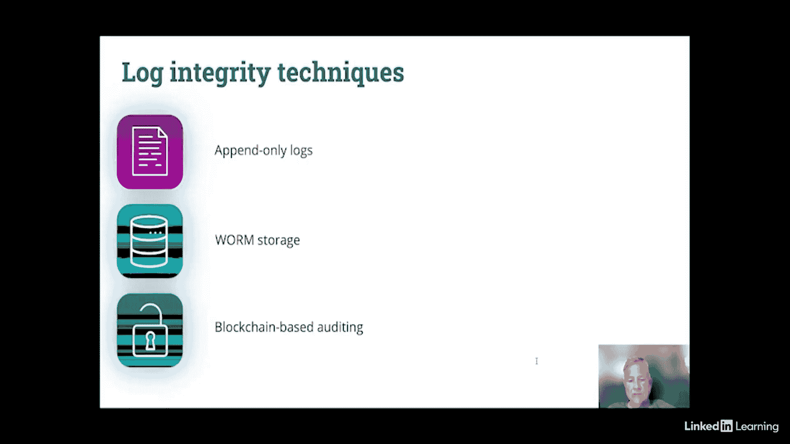

LinkedIn ISSAP：06：完整性 🔒


在本节课中，我们将学习关于完整性的核心知识。完整性在审计和问责中扮演着至关重要的角色。如果没有可证明的日志完整性，审计师无法信任证据，组织也无法对身份变更进行可靠追溯。我们会逐步讲解属性变更记录、身份关联、身份蔓延与漂移，以及如何通过哈希、保管链和不可变存储来保护日志不被篡改。

## 属性变更会计（Attribute Change Accounting）


上一节我们介绍了完整性的基本概念，本节中我们来看看属性变更会计的具体要求。属性变更会计是指，当身份属性发生任何变动时，系统都必须记录下来。比如你更改了某个用户的角色、调整了权利，或者修改了安全许可级别，又或者把某人加入了某个群组、又把某人移出了某个群组，这些行为都需要被跟踪。当然，记录的内容不能太简单，需要包含完整的变更上下文。

以下是每条变更记录中应该包含的关键信息：

- 变更者：谁做了这个变更
- 时间：什么时候做的
- 旧值：变更之前的值是什么
- 新值：变更之后的值是什么
- 授权方式：这个变更是如何被批准的

记录了变更信息之后，还需要处理身份关联的更新，我们接下来看看这部分内容。

## 身份关联更新（Identity Correlation Updates）

在跟踪了属性变更之后，我们需要确保各种账户都能正确关联到同一个人或同一台机器，这就是身份关联更新的内容。身份关联更新关注的是，系统中的不同账户究竟是如何链接到正确的身份身上的。这里的身份可以是真实的人，也可以是一台机器。我们在实际工作中可能会使用用户名、账户名称、云账户、人力资源记录等多种标识。理想情况下，我们要把这些记录整合在一起，确认它们指向同一个人，这样才能进行有效的跟踪。比如，我们可能拥有一个身份账户、一个云账户，以及一个人力资源记录，这三者都表示同一个人。如果关联关系发生了变化，系统需要记录哪些关联被建立，哪些关联被解除。

以下是常见的身份标识示例：

- 用户名
- 账户名称
- 云账户
- 人力资源记录

那么，为什么这些都属于完整性问题呢？我们继续往下看。

## 为什么这是完整性问题（Why Integrity Matters）

刚才我们讲了属性变更和身份关联，现在我们来讨论，为什么这些场景本质上都是完整性问题。当我们谈论完整性时，核心目标就是防止未授权的修改。这意味着，不仅要保护身份数据本身，还要保护记录变更的日志证据，防止它们被未授权地修改。为了实现这个目标，通常会采取集中式日志记录，并严格限制管理员访问权限，甚至只允许只读访问。此外，哈希和数字签名等完整性机制也会派上用场，我们稍后会详细讲解。总之，如果身份属性发生了变更，我们就需要拥有可信的证据，能够证明这些证据具有完整性，从而为变更提供文档记录和可追溯性。

```text
完整性目标 = 防止身份数据被未授权修改 + 防止变更日志被未授权修改
```

掌握了完整性的基本目标后，我们需要思考如何持续发现未授权的变更，接下来进入持续监控部分。

## 持续监控与基线比对（Continuous Monitoring & Baseline Comparison）

除了记录变更，我们还需要持续寻找未授权变更的迹象，这本质上是对前面讨论内容的延伸。持续监控的核心思路是，不断把当前的身份配置与基线或批准状态进行对比。如果发现当前状态和基线不一致，就可能是滥用的信号。常见的滥用指标包括意外的角色变更、意外的属性变更，或者无法把某个特定账户追溯到对应的身份。另外，如果权限是在正常的身份与访问管理流程之外被更改的，这也是需要重点跟踪的信息。对于所有这些情况，我们都希望能够进行追踪。

以下是常见的滥用指标示例：

- 意外的角色变更
- 意外的属性变更
- 无法追溯到身份的特定账户
- 正常身份与访问管理流程之外的权限变更

在讨论完如何发现异常之后，我们需要了解一种特别常见的问题，即身份蔓延和权限蔓延。

## 身份蔓延与权限蔓延（Identity Creep & Privilege Creep）

前面提到的监控工作中，一个非常典型的大问题就是身份蔓延，而权限蔓延是其中的一种常见类型。身份蔓延简单来说，就是用户在组织中待的时间越久，拥有的权限和权利就越多，最终可能超出实际需要。尤其是在基于身份的访问控制模型下，权限是绑定到个人身份而不是绑定到角色的。随着员工在公司中不断更换岗位、承担不同职责，他们会累积不同属性和不同权利的各种权限。在这种情况下，权限蔓延就是指用户积累了超过其所需的权利和权限，这正是我们需要警惕的现象。

以下是导致权限蔓延的常见原因：

- 员工长期待在同一组织中
- 基于身份而非基于角色的访问控制
- 岗位变更后旧权限未及时回收
- 不同职责累积的多种权利和属性

知道了权限蔓延是什么，接下来我们看看如何通过持续对账来发现它。

## 如何检测权限蔓延（Detection of Privilege Creep）

检测权限蔓延不能靠偶尔检查，而需要建立持续的对账机制。我们要建立一个权威的真理来源，比如人力资源数据库，或者身份与访问管理服务提供商。在这个来源中记录的是预期应该有的访问权限。然后，系统会持续监控实际的访问情况，把预期访问和实际访问进行对比。如果发现两者之间存在差异，就需要发出告警，以便我们及时修复这些不一致的情况。通过这种方式，我们可以持续修正差异，防止权限悄悄蔓延。

除了权限蔓延，还有一个范围更大的概念叫身份漂移，我们接下来看看它的具体含义。

## 身份漂移（Identity Drift）

身份漂移的范围比权限蔓延更大，虽然权限蔓延是一种身份漂移，但身份漂移包含更多情形。身份漂移是指，身份或访问状态不再匹配批准状态的时候。这种不匹配可能通过权限蔓延发生，也可能是故意的修改，或者是意外的访问，甚至是意外地从一个群组变更到了另一个群组。无论具体原因是什么，结论是一样的：我们需要跟踪所有超出正常预期的变化，确保身份状态始终符合批准的配置。

在明确了身份漂移之后，我们需要确保记录这些变化的日志文件本身具有完整性，接下来进入日志完整性校验部分。

## 日志完整性校验（Log Integrity Verification）

前面我们讨论了很多关于身份变更的跟踪，现在必须保证记录这些变更的日志文件本身没有被篡改。为了确保日志文件的完整性，我们可以使用校验和和哈希值来验证文件是否被修改过。具体做法是，在日志文件创建时生成一个哈希值或指纹。如果对文件做了任何修改，生成的哈希值就会发生变化。这样，我们就可以校验记录、文件、配置文件、导出数据、同步数据等是否被修改过。

```text
验证逻辑：如果 Hash(日志文件创建时) == Hash(当前日志文件)，则文件完整；否则文件已被篡改。
```

除了校验和与哈希，我们还需要建立保管链，来证明数据在整个生命周期中是谁在处理。

## 保管链（Chain of Custody）

除了验证数据是否被修改，我们还需要知道数据在整个生命周期中是谁持有、谁访问过，这就是保管链的作用。保管链的目标略有不同，它主要想要掌握谁拥有、谁访问、谁转移或修改了身份数据。简单来说，就是回答谁、什么、何时、为什么这几个问题。谁处理了数据？处理了什么数据？什么时候处理的？为什么要访问、转移或以某种方式修改数据？这些问题的答案构成了保管链的核心证据。

以下是保管链需要记录的关键要素：

- 谁处理了数据
- 处理了什么数据
- 什么时候处理的
- 为什么要访问、转移或修改数据

回到整体来看，校验和与保管链分别承担两个不同的目标，我们来总结一下这两者的关系。

## 校验和与保管链的两个目标（Two Goals: Checksums and Chain of Custody）

在本节幻灯片中，我们实际上有两个明确的目标，分别对应两种保护机制。第一个目标是使用校验和和哈希值，来验证数据是否被更改。第二个目标是通过保管链，提供数据持有的证据。针对我们的日志，确保日志不能被修改是首要任务。我们之前已经讨论过哈希和保管链，除此之外，还有一些其他的想法可以进一步加强保护。

接下来我们介绍几种具体的防篡改存储机制。

## 防篡改存储机制（Tamper-Evident Storage Mechanisms）

为了让日志更难以被篡改，我们可以采用仅追加日志、写入一次存储和区块链审计等多种技术。首先是仅追加日志，这意味着不能修改已有的条目，只能向日志中追加新内容。这样可以确保任何历史事件都被保留，管理员也无法覆盖或重写日志。当然，仅追加日志最好结合哈希使用，这样我们就能知道是否发生了修改。其次是写入一次介质，也就是写一次读多次（WORM）存储。一旦数据写入，就无法再被修改，这属于不可变存储的一种。最后是基于区块链的审计。区块链是一项相对较新的技术，但它的主要目的和优势就在于完整性。我们会把记录以加密方式链接在一起，任何篡改行为都会打破这条链，从而提供强有力的证据证明数据没有被修改，日志也没有以未授权的方式更改。

以下是几种常见的防篡改存储方式及其作用：

- 仅追加日志：防止常规篡改，保留历史事件
- WORM 存储：在存储层级本身强制执行不可变性
- 区块链审计：通过加密链接使篡改显而易见且易于检测

总结一下，这些机制共同构成了完整性保护的完整体系。



本节课中我们一起学习了完整性的核心知识。我们介绍了属性变更会计，要求记录谁、何时、旧值、新值和授权方式；讲解了身份关联更新，确保不同账户能正确关联到同一个人或机器；讨论了为什么保护身份数据和变更日志属于完整性问题；学习了如何通过持续对账检测权限蔓延，以及身份漂移的概念；最后，我们掌握了使用校验和、哈希、保管链、仅追加日志、WORM 存储和区块链审计等方法，确保日志文件不可被未授权修改，具备可靠的审计证据。
