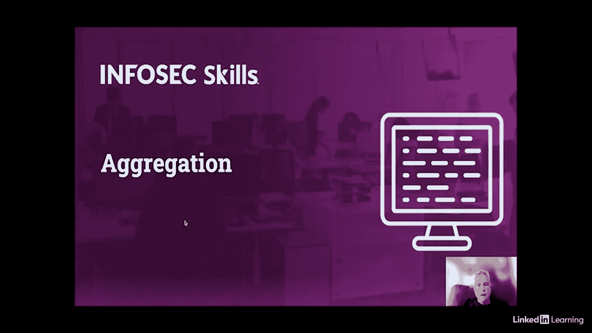
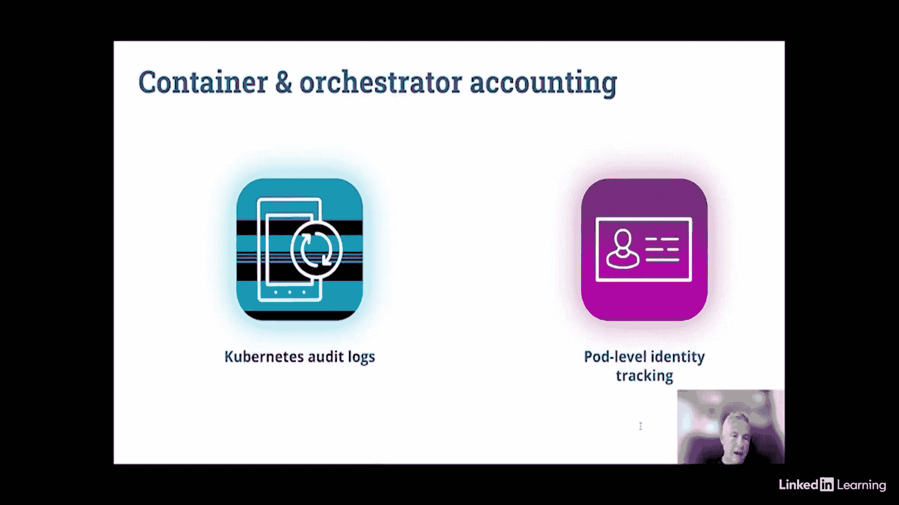

# ISSAP 信息系统安全架构专业：07：聚合与安全日志分析 📊


在本节课中，我们将学习聚合的核心概念，重点了解 SEAM 系统如何充当集中式关联与检测层，以及 UEBA、威胁狩猎、API 审计、微服务身份问责和容器审计等技术如何共同支撑安全架构。你将了解如何把分散在不同系统中的日志汇集到同一个视图中，如何识别看似正常但实际危险的行为，以及如何在容器和微服务等动态环境中保留完整的身份问责链。


📚 课程概述


本节课的主要目标是让你理解聚合在安全架构中的位置，掌握 SEAM 系统的基本作用，并认识到在复杂环境中保持可见性和可追溯性的重要性。无论是传统系统、API 接口、微服务还是容器工作负载，身份信息和操作记录都需要被集中、关联并分析，以便安全团队能够及时发现威胁并进行调查。




🔍 SEAM 系统：安全信息与事件管理


在了解了聚合的总体目标之后，我们来看看 SEAM 系统如何发挥核心作用。SEAM 是安全信息与事件管理系统的缩写。从架构师的角度来看，它是我们环境中的集中式关联与检测层。SEAM 的核心作用是将分散在不同系统中的所有活动汇集到同一个可视化视图中，通常被称为“单玻璃窗”视图。这样我们就能观察整个网络，并发现那些如果只查看单个系统时不容易立即注意到的异常。


举个例子，假设出现不当的跨系统移动，也就是所谓的“不可能旅行”。或者出现某种异常的特权访问，以及某个用户在 10 个不同系统中反复失败身份验证的情况。如果我们只查看每个系统，这些行为可能看起来并不严重。但当我们通过 SEAM 系统将它们放在一起观察时，就能发现其中的问题。这时你可能意识到，攻击者很可能正在进行密码喷洒攻击，或者尝试用其他方法猜测密码来获取系统访问权限。这就是 SEAM 系统的作用：它会在网络范围内关联身份行为，帮助我们聚焦于跨多个系统的异常与威胁。


SEAM 系统完全支持零信任架构，因为它们具备遥测能力。这意味着我们的环境中存在持续监控和持续风险评估。从架构角度思考时，我们需要确保系统发送有用的信息，而不是用所有数据淹没 SEAM 系统。相反，系统应当向 SEAM 发送有用的、经过归一化的、时间同步的日志。还要确保这些系统之间的身份信息可以相互关联。SEAM 系统侧重于审计与问责制，并且集中管理日志。这样可以为调查人员提供痕迹，用于合规性要求，也可以证明我们的安全控制措施正常运行。


以下是 SEAM 系统的关键架构要点：

- 系统应当发送有用的、归一化的、时间同步的日志，而不是无差别地上传所有数据
- 不同系统之间的身份信息需要能够相互关联
- 日志集中化有助于调查、合规性验证和安全控制有效性证明


🧠 UEBA：用户与实体行为分析


SEAM 系统汇集了日志，但光有日志还不够，我们还需要判断哪些行为是异常的。这时 UEBA 系统就派上用场了。UEBA 是用户与实体行为分析系统，它的任务是判断某个身份的行为是否正常，或者是否偏离常规。要了解什么是偏离常规，系统必须先知道常规是什么。这就是基线的作用。这些系统可以获取用户基线，并学习用户、服务账户、机器账户、设备、工作负载等的正常行为模式。这样一来，我们就能检测出异常登录时间，或者平时不应被访问的系统被访问的情况。UEBA 帮助我们发现滥用行为。


当然，这也包括内部威胁，即合法授权用户的异常行为。这些人员拥有内部网络访问权限，或者是环境中权限最大的人员。即使他们没有特权访问权，只要获得授权，就能造成很大损害。因此，SEAM 系统也会关注异常或不寻常的用户行为。它们还能帮助我们检测被攻破的攻击，因为一个实体登录并不意味着它就是可信的，因此我们需要持续监控不一致的情况。UEBA 通常与 SEAM 系统配合使用。SEAM 系统负责汇总和关联信息，UEBA 系统则关注正常行为，一旦出现偏差就会发出警报。当两者协同工作时，我们能够更深入地了解环境中的行为。


UEBA 的核心可以用以下公式描述：

```
基线模型：正常行为 = 用户、服务账户、设备、工作负载的历史行为模式
异常判定：当前行为偏离基线超过预设阈值 → 触发告警
```


🎯 威胁狩猎：主动寻找潜在威胁


除了被动分析日志，安全团队还可以更主动地出击，这就是威胁狩猎的内容。还可以采取的另一步是主动寻找威胁，而不是等待发生泄露才做出反应。我们可以开展威胁狩猎。威胁狩猎的理念是假设网络已经被攻破，然后寻找能够验证这一假设并找出问题所在的线索。即使没有明确证据表明网络已被攻破，我们也会做出这个假设，并主动进行调查。我们会进行模式分析，观察网络上的正常模式并寻找偏差，同时跟踪攻击链。如果你了解攻击链，它描述了攻击者会经历的各个过程，例如侦察、武器化账户以及后续步骤。攻击链越早终止，造成的损害就越小。


攻击链的典型阶段可以用以下代码块表示：

```
侦察 → 武器化 → 传递 → 利用 → 安装 → 命令与控制 → 目标达成
```


🔌 API 审计与可追溯性


在传统系统之外，API 也是攻击者常用的入口，因此需要专门的审计机制。接下来是 API。API 是不同系统之间的通信通道。我们需要审计轨迹来记录是哪台机器发起请求，并能够追溯到用户通过 API 能够执行的操作。我们要确保记录用户，实现从发起连接的用户一直到调用 API 的完整可追溯性。我们会记录作用域、使用的令牌，以及被允许执行的操作，例如读取、写入或拥有管理员权限等。当然，我们还会记录声明，并监控实际活动，寻找异常。这些信息都会输入到 SEAM 系统和 UEBA 系统中进行分析。环境中的每个实体都有身份，我们需要监控并确保这些身份的行为符合预期。


API 审计记录的关键字段可以用以下代码块表示：

```
API 审计记录：{用户, 作用域, 令牌, 权限(读/写/管理员), 声明, 实际活动, 是否异常}
```


🧩 微服务中的身份问责


当应用拆分成微服务后，单个用户请求会穿过多个组件，身份问责变得更加复杂。接下来要考虑微服务。微服务会让问责制变得更加困难，因为用户请求可能会经过许多不同的服务。作为架构师，我们必须在整个链路中保留身份和问责制。我们之前提到过边车代理。如果在每个微服务旁边部署边车代理，该代理可以自动记录哪个身份调用了哪个服务，从而获得更好的可追溯性，并且实现微服务间日志的一致性。我们还需要中央策略代理，包括策略组件和授权代理，策略决策点会记录允许访问的原因。集中式策略服务器有助于分析允许访问的策略。然后是分布式追踪。一个唯一的追踪 ID 或关联 ID 会跟踪事务在多个微服务中的完整流程。例如，用户访问服务 A，服务 A 访问服务 B，服务 B 访问服务 C 并连接到数据库。我们希望在整个过程中都具备可追溯性。


微服务追踪链路可以用以下代码块表示：

```
用户 → 服务 A → 服务 B → 服务 C → 数据库
trace_id = 唯一关联标识符（贯穿整个请求链路）
```


📦 容器与编排审计（Kubernetes）


容器环境比微服务更加动态，传统的日志方式可能不再适用，因此需要针对 Kubernetes 进行专门设计。然后要考虑容器和编排的问责制。我们在这里同样需要问责制。容器中的工作负载是动态的，会被创建和销毁，生命周期非常短。传统的服务器日志可能不足以满足需求。架构师必须设计环境，即使容器或 Pod 消失后，仍能保留问责制。在 Kubernetes 中，审计日志会记录针对 Kubernetes API 的活动，包括谁发起了请求、尝试了什么操作、哪个资源受到影响，以及是否成功。这些是跨环境追踪和监控的重要信息。


然后是 Pod 级别的身份跟踪，我们会跟踪每个 Pod 关联的工作负载身份。这通常通过 Kubernetes 服务账户或工作负载身份机制来实现。无论如何，我们的目标是确定哪个工作负载被哪个服务访问。我们希望日志是集中化的，并且拥有关联层，实现从身份到动作，再到 Pod 或工作负载访问资源的追踪，正如我们之前讨论的。例如，管理员部署了一个 Pod，该 Pod 随后访问了一个敏感数据库。这就形成了从管理员身份到 Kubernetes API，再到创建 Pod 的服务账户工作负载，最后到数据库访问的完整追溯链。这就是从起点到终点的可追溯性。


Kubernetes 审计日志的关键字段如下：

```
K8s 审计日志：{请求发起者, 尝试的操作, 受影响资源, 操作是否成功}
Pod 身份追踪链：管理员身份 → K8s API → 服务账户/工作负载 → 数据库访问
```

特别是在容器架构中，围绕人类管理活动和机器及工作负载身份设计日志非常重要。Kubernetes 审计日志会告诉我们是谁在什么时间更改了环境。这样我们就能判断这些活动是否合理。


📝 课程总结




本节课中我们一起学习了聚合的核心概念，重点掌握了 SEAM 系统作为集中式关联与检测层的作用，理解了如何通过归一化和时间同步的日志实现身份关联与审计问责。我们还学习了 UEBA 如何通过基线模型检测异常行为和内部威胁，如何通过威胁狩猎主动发现潜在入侵，以及如何在 API、微服务和 Kubernetes 容器环境中保留完整的身份追溯链。这些知识将帮助你在设计安全架构时，构建从人类管理活动到机器工作负载的全方位可见性与问责机制。

